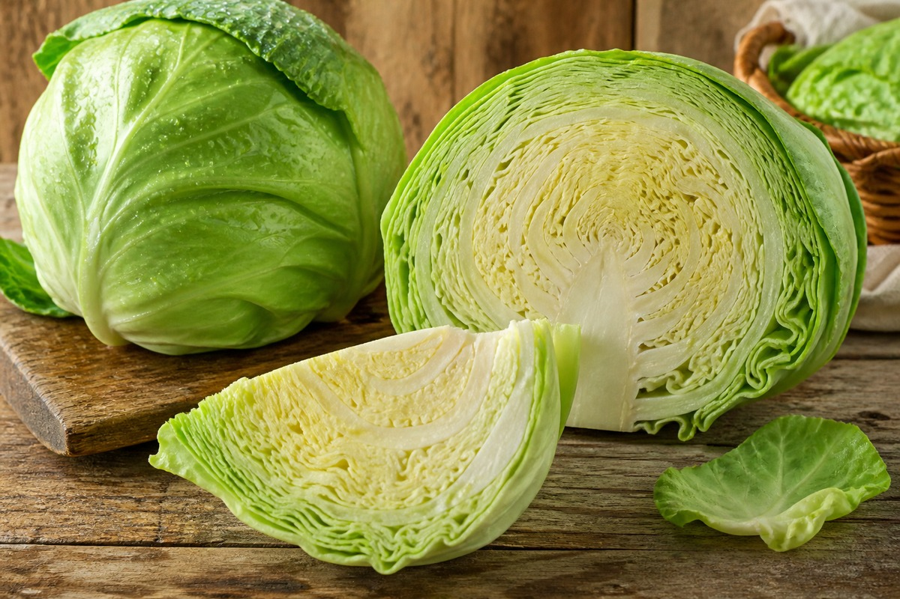

*▲ 로마 시대부터 위에 좋은 채소로 알려진 양배추(Cabbage)는 S-메틸메티오닌(비타민 U로 불리는 성분)과 글루코시놀레이트 유래 설포라판을 함유한 십자화과 채소입니다. 영양 수치는 USDA FoodData Central FDC 169975(생것) 기준입니다.*

한 줄 결론 <strong>생양배추 100g은 25kcal, 비타민C 36.6mg, 비타민K 76mcg입니다.</strong> 비타민 U로 불리는 S-메틸메티오닌과 설포라판 생성 효소는 열에 약하다는 보고가 있어, 생으로 먹거나 짧게 데치면 이 성분 손실이 적습니다. 다만 위염·궤양을 치료하는 식품은 아닙니다.

**양배추(Cabbage, Brassica oleracea var. capitata)**는 비타민 C·K와 식이섬유가 많은 십자화과 채소입니다. 위에 부담이 적어 위가 불편할 때 찾는 사람이 많지만, 위 질환을 치료하는 식품으로 승인된 것은 아닙니다.

1950년대 스탠퍼드 대학의 가넷 체니(Garnett Cheney)가 양배추즙과 궤양 회복을 다룬 소규모 연구를 발표하면서 **비타민 U(S-메틸메티오닌)**라는 이름이 널리 알려졌습니다. 이후 위약 대조를 갖춘 대규모 임상시험으로 재현되지 않았고, 현재 소화성 궤양 치료는 약물(PPI, 헬리코박터 제균)이 표준입니다. 양배추즙은 보조 식품으로 볼 수 있지만 치료제가 아닙니다.

양배추의 세포벽이 파쇄될 때 글루코라파닌이 미로시나아제와 반응해 **설포라판(Sulforaphane)**이 만들어집니다. 시험관 실험에서는 헬리코박터 균에 대한 항균 작용과 Nrf2 경로를 통한 2상 해독 효소 유도가 보고됐지만, 양배추를 먹어서 위염·위암이 예방된다는 사람 대상 결과는 없습니다. **비타민 K1(필로퀴논)**은 100g당 76mcg(성인 기준치의 약 63%)으로, 혈액 응고 인자 합성에 필요합니다.

미국 농무부(USDA FoodData Central) FDC 169975를 기준으로 양배추의 영양 성분, 실제로 확인된 범위의 건강 효과, 영양 손실을 줄이는 조리법과 주의사항을 정리합니다.

---

## 1. 양배추 칼로리와 영양성분은? (비타민C 36.6mg·비타민K 76mcg)

양배추는 100g당 25kcal라는 극히 낮은 칼로리 속에 수분, 복합 식이섬유, 비타민 C, 비타민 K, 그리고 항궤양 유황 아미노산 유도체를 응축하고 있습니다.

| 영양 성분 (Nutrient) | 함량 (100g당) | 1일 권장 섭취량 비율 (한국인 성인 기준) |
| :--- | :--- | :--- |
| **열량 (Energy)** | 25 kcal | 1.3% |
| **수분 (Water)** | 92.18 g | 별도 표기¹ |
| **단백질 (Protein)** | 1.28 g | 2.3% |
| **지방 (Total Fat)** | 0.10 g | 0.2% |
| - 포화지방산 (Saturated Fat) | 0.034 g | 0.2% |
| - 단일불포화지방산 (MUFA) | 0.017 g | 기준치 없음 |
| - 다가불포화지방산 (PUFA) | 0.017 g | 기준치 없음 |
| - 콜레스테롤 (Cholesterol) | 0.00 mg | 0.0% |
| **탄수화물 (Carbohydrates)** | 5.80 g | 1.8% |
| - 당류 (Total Sugars) | 3.20 g | 3.2% |
| - 식이섬유 (Dietary Fiber) | 2.50 g | 10.0% |
| **비타민 C (Ascorbic Acid)** | 36.60 mg | 36.6% |
| **비타민 K1 (Phylloquinone)** | 76.00 mcg | 63.3% |
| **엽산 (Vitamin B9, Folate)** | 43.00 mcg | 10.8% |
| **칼륨 (Potassium, K)** | 170.00 mg | 4.9% |
| **칼슘 (Calcium, Ca)** | 40.00 mg | 5.7% |
| **마그네슘 (Magnesium, Mg)** | 12.00 mg | 3.8% |
| **인 (Phosphorus, P)** | 26.00 mg | 3.7% |
| **철분 (Iron, Fe)** | 0.47 mg | 3.9% |

*※ 출처: [USDA FoodData Central FDC 169975](https://fdc.nal.usda.gov/food-details/169975/nutrients) — Cabbage, raw (SR Legacy). 비타민 U(총 S-메틸메티오닌)와 글루코시놀레이트는 USDA·국내 성분표에 표준 분석값이 없어 표에서 제외했습니다.*  

*¹ 수분은 점막 조직 상피의 탄력성과 소화액 분비를 지지하는 생체 용매입니다.*  
*※ '기준치 없음' 표기는 기능성 유황 화합물 및 파이토케미컬로 DRI상 일일 권장 백분율(%DV)이 법적으로 규정되지 않은 항목입니다.*

### 1회 섭취량 환산: 양배추 한 잎·채 썬 한 컵은 몇 kcal인가?

양배추는 잎과 채 썬 양으로 먹습니다. USDA 1회 섭취량 자료의 무게로 환산했습니다.

| 섭취 단위 | 가식부 무게 | 열량 | 단백질 |
| :--- | :--- | :--- | :--- |
| 중간 잎 1장 | 23 g | 5.8 kcal | 0.29 g |
| 큰 잎 1장 | 33 g | 8.2 kcal | 0.42 g |
| 채 썬 한 컵 | 70 g | 17.5 kcal | 0.90 g |
| 다진 것 한 컵 | 89 g | 22.2 kcal | 1.14 g |

*※ 잎 5장을 먹어도 30kcal 안팎입니다. 양배추 요리의 열량은 채소가 아니라 마요네즈·기름·설탕에서 올라갑니다.*

---

## 2. 양배추 효능은 무엇일까? 과학으로 입증된 4대 효과

### ① 비타민 U(S-메틸메티오닌) — 오래된 연구, 제한된 근거
1950년대 소규모 연구에서 양배추즙이 궤양 증상을 완화했다는 보고가 있었습니다. 이후 위약 대조 연구로 충분히 재현되지 않았고, 기전 연구도 주로 세포 수준에 머물러 있습니다. 위염·궤양이 의심되면 양배추에 기대지 말고 진료를 받아야 하며, 제균 치료와 위산 억제제가 표준 치료입니다.

### ② 설포라판 — 시험관·동물 실험 단계
**설포라판(Sulforaphane)**은 시험관 실험에서 헬리코박터의 우레아제 활성을 억제하고, 세포와 동물 모델에서 **Nrf2** 경로를 통해 글루타티온 S-전이효소 같은 2상 효소를 유도하는 것으로 보고됐습니다. 사람이 양배추를 먹었을 때 위 속 헬리코박터가 줄어드는지, '해독'이 얼마나 되는지는 임상 연구로 확인되지 않았습니다.

### ③ 비타민 K1 — 혈액 응고와 뼈 단백질 활성화에 필요
양배추 100g에는 **비타민 K1**이 76mcg(성인 기준치의 약 63%) 들어 있습니다. 비타민 K는 프로트롬빈 등 응고 인자 합성에 필요하고, 뼈 단백질인 오스테오칼신의 활성화에도 관여합니다. 결핍을 막는 것은 중요하지만, 충분히 먹는 사람이 더 먹는다고 골다공증이 예방된다는 근거는 없습니다. 와파린 등 항응고제를 복용한다면 비타민 K 섭취량을 갑자기 크게 바꾸지 말고 주치의와 상의하십시오.

### ④ 식이섬유와 장내 미생물
양배추 100g에는 식이섬유가 2.5g 들어 있습니다. 장내 미생물이 이 섬유를 발효해 단쇄지방산(아세트산, 부티르산)을 만들고, 이는 대장 상피세포의 에너지원으로 쓰입니다. 식이섬유 섭취가 장 건강에 도움이 된다는 것은 일반적으로 받아들여지지만, 양배추만으로 장 투과성이나 전신 염증이 교정된다고 단정할 수는 없습니다.

---

## 3. 양배추는 생즙이 좋을까, 데쳐야 할까? 비타민 U 보존법

### 열에 약한 비타민 U와 미로시나아제를 보존하는 저온 조리
비타민 U로 불리는 S-메틸메티오닌과 설포라판 생성 효소인 미로시나아제는 열에 약합니다. 오래 끓이면 미로시나아제 활성이 크게 떨어져 설포라판 생성이 줄어든다는 연구가 있습니다. 생으로 얇게 채 썰어 먹거나 3분 이내로 가볍게 데치면 이 성분 손실을 줄일 수 있습니다.

### 지용성 비타민 K 흡수를 위한 불포화 식물성 오일 결합
비타민 K1과 카로티노이드는 지용성이라 식사에 지방이 함께 있어야 흡수가 잘 됩니다. 생양배추 샐러드에 올리브유나 들기름 1작은술을 더하면 비타민 K 흡수에 도움이 됩니다. 흡수 증가 폭은 식사 구성과 개인에 따라 달라 특정 배수로 단정하지 않습니다.

---

## 4. 양배추 부작용과 갑상선 주의점은?

### 과민성대장증후군(IBS) 환자의 가스 팽만감
양배추는 라피노오스(Raffinose)와 프룩탄 등 소화 효소로 분해되지 않는 고FODMAP 당류를 함유하고 있습니다. 대장 내 세균에 의해 급격히 발효되면서 수소와 메탄가스를 다량 발생시킬 수 있으므로, 복부 팽만이나 과민성대장증후군을 앓는 분은 한 번에 100g 이내로 나누어 가볍게 익혀 드시는 것이 좋습니다.

### 갑상선 질환자의 고이트로겐(Goitrogen) 영향
십자화과 채소에는 갑상선 호르몬 합성에 필요한 요오드의 흡수를 일부 방해할 수 있는 고이트로겐 성분이 미량 함유되어 있습니다. 갑상선 기능 저하증 환자가 매일 생양배추를 대량(수 kg) 섭취하는 것은 피해야 하며, 가볍게 데치거나 쪄서 섭취하면 고이트로겐 활성이 불활성화되어 안전하게 영양을 누릴 수 있습니다.

---

## 5. 양배추 하루 얼마나 먹을까? 핵심 요약

1. **비타민 U(S-메틸메티오닌):** 위에 좋다는 연구는 1950년대 소규모 연구에 기반하며, 현대 임상 근거는 제한적입니다.
2. **설포라판:** 시험관·동물 실험에서 항균·항산화 작용이 보고된 단계입니다.
3. **가벼운 스팀과 식물성 오일 조합:** 3분 이내 저온 조리와 올리브유 드레싱으로 유효 성분을 온전히 흡수하십시오.

---

## 6. 양배추와 함께 먹으면 좋은 음식은?

- **[사과 (Apple)]({{ site.baseurl }}/posts/apple-nutrition-benefits/)**: 사과의 수용성 펙틴과 유기산이 양배추의 비타민 U와 결합하여 손상된 소화기 점막을 이중으로 코팅 치유하고 특유의 풋내를 상큼하게 잡아줍니다.
- **[두부 (Tofu)]({{ site.baseurl }}/posts/tofu-nutrition-benefits/)**: 소화가 편한 식물성 고단백 두부와 위벽을 보호하는 양배추의 비타민 K가 결합하여 궤양 회복기 환자의 완벽한 저자극 회복 식단을 완성합니다.
- **[마늘 (Garlic)]({{ site.baseurl }}/posts/garlic-nutrition-benefits/)**: 마늘의 유황 화합물 알리신과 양배추의 설포라판이 만나 간의 글루타티온 해독 시스템을 극대화하고 강력한 항염 면역 시너지를 발휘합니다.

---

## 7. 자주 묻는 질문 (FAQ)

### Q1. 양배추즙(주스)으로 마시는 것과 생양배추를 직접 씹어 먹는 것은 어떤 차이가 있나요?
**A:** 생양배추를 씹거나 갈면 세포벽이 부서지면서 미로시나아제가 설포라판을 만듭니다. 시판 가열 양배추즙은 살균 과정에서 이 효소와 비타민 U가 줄어들 수 있습니다. 다만 양배추즙이 위 질환을 치료한다는 근거는 충분하지 않으니, 증상이 있으면 진료를 우선하십시오.

### Q2. 양배추의 단단한 심지 부분도 영양가가 있나요, 아니면 버려야 하나요?
**A:** 심지에도 비타민 C와 식이섬유가 들어 있으니 버릴 이유는 없습니다. 다만 ‘잎보다 1.5~2배 많다’는 식의 수치는 공인 분석값으로 확인되지 않았습니다. 질겨서 씹기 어렵다면 사과나 바나나와 함께 갈아 스무디로 먹으면 됩니다.

### Q3. 역류성 식도염 환자가 양배추를 매일 먹어도 안전한가요?
**A:** 대부분의 사람이 매일 먹어도 문제가 되지 않습니다. 다만 양배추가 역류성 식도염을 치료한다는 근거는 없으므로, 증상이 지속되면 진료를 받아야 합니다. 공복에 생양배추를 많이 먹으면 가스가 찰 수 있으니 가볍게 쪄서 천천히 먹는 편이 편합니다.

  
📌 관련 순위 가이드

  <ul>
    <li><a href="/posts/low-calorie-high-satiety-foods/">저칼로리 포만감 다이어트 음식 TOP 10: 100g 비교</a></li>
    <li><a href="/posts/low-gi-foods-blood-sugar-guide/">혈당 낮추는 음식 TOP 10: 저혈당 지수(GI) 순위표</a></li>
  </ul>

