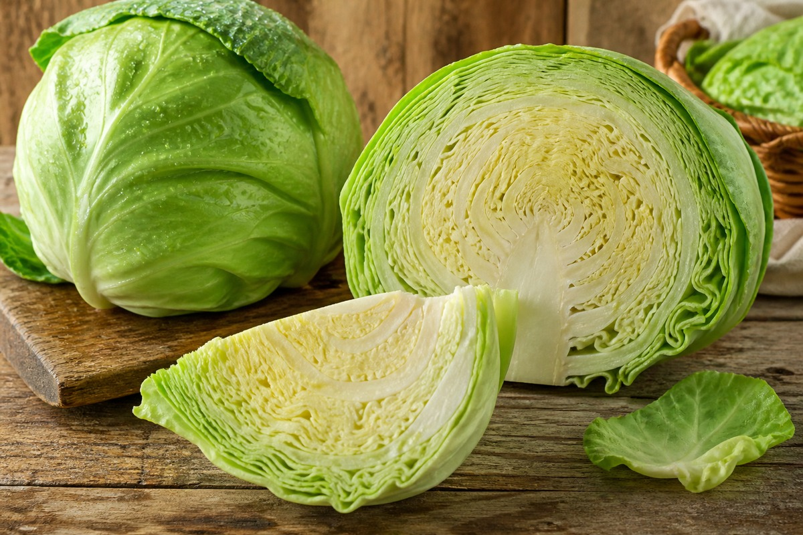

*▲ Long treated as a soothing vegetable for the stomach, cabbage (Brassica oleracea var. capitata) contains S-methylmethionine (called vitamin U) and glucosinolate-derived sulforaphane. Nutrient figures use USDA FoodData Central FDC 169975 (raw).*

Quick answer <strong>Raw cabbage provides 25 calories, 36.6 mg vitamin C and 76 mcg vitamin K per 100 g.</strong> The compound called vitamin U and the enzyme that makes sulforaphane are heat sensitive, so raw or briefly steamed cabbage retains more of them. Cabbage is not a treatment for gastritis or ulcers.

**Cabbage (Brassica oleracea var. capitata)** is a cruciferous vegetable rich in vitamin C, vitamin K and fibre. It is easy on the stomach for many people, but no regulator has approved it as a treatment for gastric disease.

Small studies by Garnett Cheney at Stanford in the 1950s reported faster ulcer healing with cabbage juice, and the name **vitamin U (S-methylmethionine)** comes from that work. Later placebo-controlled trials did not replicate the effect, and ulcers are now treated with acid suppression and H. pylori eradication. Cabbage juice should be seen as a food, not a therapy.

Breaking cabbage tissue lets plant **myrosinase** convert glucoraphanin into **sulforaphane**. In vitro studies report antibacterial activity against **Helicobacter pylori** and activation of the **Nrf2** pathway with induction of phase II enzymes; no human trial shows that eating cabbage prevents gastritis or stomach cancer. Cabbage also supplies 76 mcg of **vitamin K1 (phylloquinone)** per 100 g, about 63% of the adult reference intake, which is needed for clotting factor synthesis.

Using USDA FoodData Central entry 169975, this guide sets out the nutrient profile, the effects that human evidence supports, and how cooking and storage change the vegetable.

---

## 1. Raw Juice or Steamed Cabbage? Preserving Vitamin U

Raw green cabbage exhibits an exceptionally low energetic footprint (25 kcal/100g) while harboring dense concentrations of phylloquinone, ascorbic acid, and organosulfur glucosinolates.

| Nutrient | Amount (per 100g) | Daily Value (% DV) |
| :--- | :--- | :--- |
| **Energy** | 25 kcal | 1.3% |
| **Water** | 92.18 g | Special classification¹ |
| **Protein** | 1.28 g | 2.6% |
| **Total Fat** | 0.10 g | 0.1% |
| - Saturated Fat | 0.034 g | 0.2% |
| - Monounsaturated Fat (MUFA) | 0.017 g | Daily value not established |
| - Polyunsaturated Fat (PUFA) | 0.017 g | Daily value not established |
| - Cholesterol | 0.00 mg | 0.0% |
| **Carbohydrates** | 5.80 g | 2.1% |
| - Total Sugars | 3.20 g | 6.4% |
| - Dietary Fiber | 2.50 g | 8.9% |
| **Vitamin C (Ascorbic acid)** | 36.60 mg | 40.7% |
| **Vitamin K1 (Phylloquinone)** | 76.00 mcg | 63.3% |
| **Folate (Vitamin B9)** | 43.00 mcg | 10.8% |
| **Potassium (K)** | 170.00 mg | 3.6% |
| **Calcium (Ca)** | 40.00 mg | 3.1% |
| **Magnesium (Mg)** | 12.00 mg | 2.9% |
| **Phosphorus (P)** | 26.00 mg | 2.1% |
| **Iron (Fe)** | 0.47 mg | 2.6% |

*※ Source: [USDA FoodData Central FDC 169975](https://fdc.nal.usda.gov/food-details/169975/nutrients) — cabbage, raw (SR Legacy). Vitamin U (total S-methylmethionine) and glucosinolate totals have no standard analysed value in USDA or Korean composition tables, so those rows are omitted.*  

*¹ Water serves as the physical hydration matrix sustaining gastric mucosal secretion.*  
*※ 'Daily value not established' denotes functional organosulfur conjugates and glucosinolate precursors devoid of formal percentage DRI thresholds.*

---

## 2. What Are the Benefits of Cabbage? Four Evidence-Backed Effects

### ① Vitamin U (S-methylmethionine): old research, limited evidence
The claim that cabbage speeds ulcer healing rests on small 1950s studies that were not reproduced in later placebo-controlled trials. Laboratory work suggests S-methylmethionine can affect methylation reactions in cells, but it has not been shown to heal ulcers in people. Suspected gastritis or ulcers need medical assessment and standard treatment.

### ② Sulforaphane: laboratory and animal evidence
In laboratory studies **sulforaphane** inhibits H. pylori urease and, in cells and animals, activates **Nrf2** with induction of enzymes such as HO-1 and glutathione S-transferase. Whether eating cabbage clears H. pylori in people, or how much "detoxification" that produces, has not been established clinically.

### ③ Vitamin K1: clotting factors and bone protein activation
Cabbage provides 76 mcg of **vitamin K1** per 100 g, about 63% of the adult reference intake. Vitamin K is required for gamma-glutamyl carboxylation of clotting factors II, VII, IX and X, and for activating **osteocalcin** in bone. Getting enough matters, but extra vitamin K in people who already have enough has not been shown to prevent osteoporosis. Anyone taking warfarin should keep vitamin K intake steady rather than swinging up and down, and discuss changes with their clinician.

### ④ Fibre and the gut microbiome
Cabbage supplies 2.5 g of fibre per 100 g. Gut bacteria ferment fibre into short-chain fatty acids, mainly butyrate, which colon cells use as fuel. Higher fibre intake is broadly associated with better gut health, but cabbage alone cannot be said to correct gut permeability or systemic inflammation.

---

## 3. Storing and Portioning Cabbage

### Preserving Thermolabile Sulfonium and Myrosinase via Minimal Heat
S-methylmethionine and plant myrosinase are heat labile. Long boiling substantially reduces myrosinase activity, so less sulforaphane forms. Shredding cabbage raw or steaming it for under three minutes limits that loss.

### Dietary Lipid Emulsification for Lipophilic Phylloquinone Absorption
Vitamin K1 is fat soluble, so it is absorbed better when the meal contains some fat. Dressing raw cabbage with olive oil or perilla oil supports absorption. The size of the increase varies with the meal and the person, so no multiple is claimed.

---

## 4. Who Should Avoid Cabbage? Side Effects and Cautions

### Colonic Gas Distension in High-FODMAP and Irritable Bowel Cohorts
Cabbage contains indigestible oligosaccharides (raffinose and fructans) that bypass upper gastrointestinal hydrolysis. Rapid bacterial fermentation in the cecum produces carbon dioxide and hydrogen, precipitating meteorism and visceral distension in irritable bowel syndrome (IBS) patients. Symptomatic individuals should limit single-meal portions to 80g and prefer light steam cooking.

### Goitrogenic Thiocyanate Interference in Thyroid Hypofunction
Cruciferous plants synthesize indole glucosinolates that hydrolyze into thiocyanate ions, which can competitively inhibit the thyroidal sodium-iodide symporter (NIS). While clinically inconsequential under balanced dietary iodine conditions, patients with active untreated hypothyroidism should avoid raw juicing in multi-kilogram volumes and favor brief hydrothermal blanching.

---

## 5. Cabbage per Day: How Much Do You Need?

1. **Vitamin U (S-methylmethionine):** the stomach-soothing reputation rests on small 1950s studies; modern clinical evidence is limited.
2. **Sulforaphane:** antibacterial and antioxidant activity shown mainly in laboratory and animal work.
3. **Vitamin K1:** 76 mcg per 100 g covers about 63% of the adult reference intake and is needed for clotting factor synthesis.

---

## 6. What Foods Pair Best with Cabbage?

- **[Apple (Apple)]({{ site.baseurl }}/en/posts/apple-nutrition-benefits/)**: Soluble pectin and organic malic acids in apples complement cabbage Vitamin U, forming a dual-action soothing protective gel across irritated gastric linings.
- **[Tofu (Tofu)]({{ site.baseurl }}/en/posts/tofu-nutrition-benefits/)**: Hypoallergenic, easily digestible plant protein from firm tofu combines with cabbage Vitamin K to supply optimal substrates for tissue recovery post-gastritis.
- **[Garlic (Garlic)]({{ site.baseurl }}/en/posts/garlic-nutrition-benefits/)**: Organosulfur allicin from garlic operates synergistically with cabbage sulforaphane to maximize hepatic glutathione transferase synthesis and systemic antimicrobial defense.

---

## 7. Frequently Asked Questions (FAQ)

### Q1. How does commercial pasteurized cabbage juice compare to fresh raw cabbage?
**A:** Heat treatment reduces heat-sensitive S-methylmethionine (vitamin U) and inactivates myrosinase, so freshly shredded raw cabbage forms more sulforaphane than a pasteurised juice. That is a difference in enzyme activity, not proof that either form heals the stomach lining.

### Q2. Does the fibrous inner core of cabbage contain therapeutic nutritional value?
**A:** The core contains vitamin C and fibre, so there is no reason to discard it. The often-quoted “1.5 to 2 times more than the leaves” figure is not backed by a standard analysed value. If it is too tough to chew, blend it into a smoothie with apple or banana.

### Q3. Is daily cabbage intake clinically advisable for patients presenting acid reflux (GERD)?
**A:** Most people can eat cabbage daily without problems. There is no evidence that cabbage treats acid reflux, so persistent symptoms need medical assessment. If raw cabbage on an empty stomach causes gas, steam it lightly first.

  
📌 Related ranking guide

  <ul>
    <li><a href="/en/posts/low-calorie-high-satiety-foods/">Top 10 Low-Calorie High-Satiety Foods: 100g Calories</a></li>
    <li><a href="/en/posts/low-gi-foods-blood-sugar-guide/">Top 10 Low-GI Foods to Lower Blood Sugar: GI and GL Chart</a></li>
  </ul>

