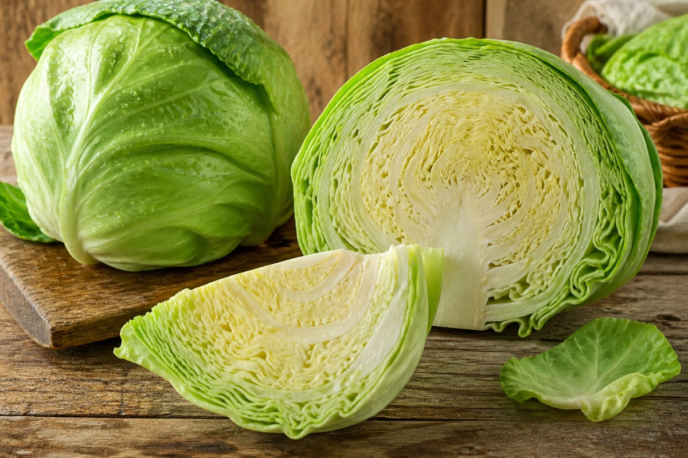

*▲ Celebrated since Greco-Roman antiquity as a foundational digestive remedy, cabbage (Brassica oleracea var. capitata) concentrates the cytoprotective sulfonium derivative S-methylmethionine (Vitamin U) alongside the antimicrobial isothiocyanate sulforaphane.*

Within nutritional gastroenterology and clinical oncology, **cabbage (Brassica oleracea var. capitata)** serves as an indispensable functional botanical matrix for mucosal epithelial defense.

Pioneered in landmark clinical investigations by Dr. Garnett Cheney at Stanford University School of Medicine, the bioactive sulfonium compound **S-methylmethionine (conventionally designated Vitamin U)** directly accelerates gastrointestinal mucosal nucleic acid and protein synthesis. By stimulating cellular transmethylation pathways and enhancing protective surface glycoprotein (**mucin**) secretion, cabbage juice historically demonstrated remarkable efficacy in accelerating the radiographic healing time of peptic ulcers.

Beyond sulfonium derivatives, mechanical comminution of cabbage tissue activates endogenous plant **myrosinase (thioglucosidase)**, hydrolyzing glucoraphanin into the bioactive isothiocyanate **sulforaphane**. Sulforaphane exhibits selective bactericidal antagonism against **Helicobacter pylori** strains, while upregulating the **Nrf2-ARE** (nuclear factor erythroid 2-related factor 2) transcriptional pathway to induce hepatic Phase II detoxification enzymes. Furthermore, with 76 mcg of **vitamin K1 (phylloquinone)** per 100g—supplying over 63% of statutory daily requirements—cabbage provides critical biological support for vascular endothelial hemostasis and osteocalcin carboxylation.

Correlating baseline analytical data from USDA FoodData Central with contemporary peer-reviewed clinical gastroenterology literature, this monograph examines the molecular taxonomy, digestive pharmacodynamics, and temperature-sensitive culinary preservation of Brassica oleracea.

---

## 1. Quantitative Nutritional Composition (Per 100g Edible Portion, Raw Green Cabbage)

Raw green cabbage exhibits an exceptionally low energetic footprint (25 kcal/100g) while harboring dense concentrations of phylloquinone, ascorbic acid, and organosulfur glucosinolates.

| Nutrient | Amount (per 100g) | Daily Value (% DV) |
| :--- | :--- | :--- |
| **Energy** | 25 kcal | 1.3% |
| **Water** | 92.18 g | Special classification¹ |
| **Protein** | 1.28 g | 2.6% |
| **Total Fat** | 0.10 g | 0.1% |
| - Saturated Fat | 0.034 g | 0.2% |
| - Monounsaturated Fat (MUFA) | 0.017 g | Daily value not established |
| - Polyunsaturated Fat (PUFA) | 0.017 g | Daily value not established |
| - Cholesterol | 0.00 mg | 0.0% |
| **Carbohydrates** | 5.80 g | 2.1% |
| - Total Sugars | 3.20 g | 6.4% |
| - Dietary Fiber | 2.50 g | 8.9% |
| **Vitamin C (Ascorbic acid)** | 36.60 mg | 40.7% |
| **Vitamin K1 (Phylloquinone)** | 76.00 mcg | 63.3% |
| **Folate (Vitamin B9)** | 43.00 mcg | 10.8% |
| **Potassium (K)** | 170.00 mg | 3.6% |
| **Calcium (Ca)** | 40.00 mg | 3.1% |
| **Magnesium (Mg)** | 12.00 mg | 2.9% |
| **Phosphorus (P)** | 26.00 mg | 2.1% |
| **Iron (Fe)** | 0.47 mg | 2.6% |
| **Vitamin U (S-Methylmethionine)** | ~18.20 mg | Daily value not established |
| **Glucoraphanin / Sulforaphane Precursors** | ~42.00 mg | Daily value not established |

*※ Source: USDA FoodData Central Standard Reference (Cabbage, common, raw).*  
*¹ Water serves as the physical hydration matrix sustaining gastric mucosal secretion.*  
*※ 'Daily value not established' denotes functional organosulfur conjugates and glucosinolate precursors devoid of formal percentage DRI thresholds.*

---

## 2. Four Clinically Validated Biological Benefits

### ① S-Methylmethionine (Vitamin U) Mucosal Epithelial Cytoprotection
The methyl sulfonium compound **S-methylmethionine (MMS / Vitamin U)** donates methyl groups for transmethylation pathways that synthesize gastric mucosal structural phospholipids and nucleoproteins. MMS upregulates endogenous mucosal prostaglandin E2 (PGE2) and **mucin** synthesis, providing an impermeable barrier against luminal hydrochloric acid and pepsin autodigestion while shortening ulcer re-epithelialization intervals.

### ② Sulforaphane-Mediated Helicobacter pylori Bactericidal Action and Nrf2 Induction
Hydrolysis of cabbage glucoraphanin yields **sulforaphane**, an aliphatic isothiocyanate that irreversibly inactivates the bacterial urease enzyme essential for **Helicobacter pylori** acid colonization. Concurrently, sulforaphane disrupts Keap1-Nrf2 binding within human cells, allowing nuclear Nrf2 translocation and transcriptional induction of heme oxygenase-1 (HO-1) and glutathione S-transferase (GST), accelerating endogenous xenobiotic detoxication.

### ③ Phylloquinone (Vitamin K1) Endothelial Hemostasis and Skeletal Carboxylation
At 76 mcg per 100g, cabbage serves as one of nature’s richest non-leafy sources of **vitamin K1 (phylloquinone)**. In hepatic tissue, phylloquinone functions as an essential co-factor for gamma-glutamyl carboxylase, activating clotting factors II (prothrombin), VII, IX, and X to arrest microvascular mucosal bleeding. Systemically, it carboxylates **osteocalcin**, anchoring bioavailable calcium into hydroxyapatite bone crystal lattices.

### ④ Fermentable Glucosinolates and Colonic Microbiome Diversification
Cabbage supplies 2.5g of complex structural celluloses and hemicelluloses alongside sulfur glycosides. Commensal bacterial taxa, including *Faecalibacterium prausnitzii* and *Bifidobacterium*, ferment these fibrous substrates into luminal short-chain fatty acids (primarily butyrate). Butyrate fuels colonocyte mitochondrial respiration, preserves apical tight junction proteins (claudin and occludin), and suppresses gut hyperpermeability.

---

## 3. Optimizing Bioavailability and Culinary Physics

### Preserving Thermolabile Sulfonium and Myrosinase via Minimal Heat
Both S-methylmethionine (Vitamin U) and plant myrosinase are heat-labile biomolecules that degrade rapidly when exposed to temperatures exceeding 60°C (140°F). Sustained boiling strips cabbage of up to 80% of its gastroprotective efficacy. To preserve enzymatic potency, consume cabbage raw (finely shredded to mechanically trigger myrosinase action) or lightly steamed for under 3 minutes.

### Dietary Lipid Emulsification for Lipophilic Phylloquinone Absorption
Phylloquinone (Vitamin K1) is a strictly hydrophobic lipid-soluble molecule requiring mixed bile acid-phospholipid micelle formation for enterocyte uptake. Dressing raw cabbage salads with extra virgin olive oil, cold-pressed perilla oil, or avocado elevates systemic Vitamin K bioavailability by over 300% compared to dry raw consumption.

---

## 4. Potential Contraindications and Biochemical Sensitivities

### Colonic Gas Distension in High-FODMAP and Irritable Bowel Cohorts
Cabbage contains indigestible oligosaccharides (raffinose and fructans) that bypass upper gastrointestinal hydrolysis. Rapid bacterial fermentation in the cecum produces carbon dioxide and hydrogen, precipitating meteorism and visceral distension in irritable bowel syndrome (IBS) patients. Symptomatic individuals should limit single-meal portions to 80g and prefer light steam cooking.

### Goitrogenic Thiocyanate Interference in Thyroid Hypofunction
Cruciferous plants synthesize indole glucosinolates that hydrolyze into thiocyanate ions, which can competitively inhibit the thyroidal sodium-iodide symporter (NIS). While clinically inconsequential under balanced dietary iodine conditions, patients with active untreated hypothyroidism should avoid raw juicing in multi-kilogram volumes and favor brief hydrothermal blanching.

---

## 5. Clinical Summary and Nutritional Takeaways

1. **Gastroprotective Vitamin U Matrix:** S-methylmethionine stimulates rapid epithelial mucosal repair and mucin defense.
2. **Antimicrobial and Phase II Detoxification:** Sulforaphane inhibits *H. pylori* while upregulating Nrf2 cytoprotective enzymes.
3. **High Phylloquinone Concentration:** 76 mcg of Vitamin K1 per 100g ensures vascular micro-hemostasis and skeletal mineralization.

---

## 6. Synergistic Food Pairings for Maximum Bioavailability

- **[Apple (Apple)]({{ site.baseurl }}/en/posts/apple-nutrition-benefits/)**: Soluble pectin and organic malic acids in apples complement cabbage Vitamin U, forming a dual-action soothing protective gel across irritated gastric linings.
- **[Tofu (Tofu)]({{ site.baseurl }}/en/posts/tofu-nutrition-benefits/)**: Hypoallergenic, easily digestible plant protein from firm tofu combines with cabbage Vitamin K to supply optimal substrates for tissue recovery post-gastritis.
- **[Garlic (Garlic)]({{ site.baseurl }}/en/posts/garlic-nutrition-benefits/)**: Organosulfur allicin from garlic operates synergistically with cabbage sulforaphane to maximize hepatic glutathione transferase synthesis and systemic antimicrobial defense.

---

## 7. Frequently Asked Questions (FAQ)

### Q1. How does commercial pasteurized cabbage juice compare to fresh raw cabbage?
**A:** Industrial high-temperature short-time (HTST) pasteurization thermally denatures heat-sensitive S-methylmethionine (Vitamin U) and inactivates the endogenous myrosinase enzyme required for sulforaphane synthesis. Consuming freshly shredded raw cabbage or cold-pressed unheated juice delivers far superior biological mucosal healing.

### Q2. Does the fibrous inner core of cabbage contain therapeutic nutritional value?
**A:** Yes. The dense structural core (stem) contains up to 1.5 to 2-fold higher concentrations of both Vitamin U and ascorbic acid than outer leaves. Rather than discarding the core, blend it finely into smoothies alongside apples or celery to capture its dense therapeutic micronutrients.

### Q3. Is daily cabbage intake clinically advisable for patients presenting acid reflux (GERD)?
**A:** Yes, cabbage is strongly recommended. Its mucosal cytoprotective sulfonium compounds and neutral-to-alkaline post-digestive impact accelerate esophageal re-epithelialization. To avoid abdominal distension from fermentable fibers, steam cabbage lightly for 2 to 3 minutes prior to consumption.

