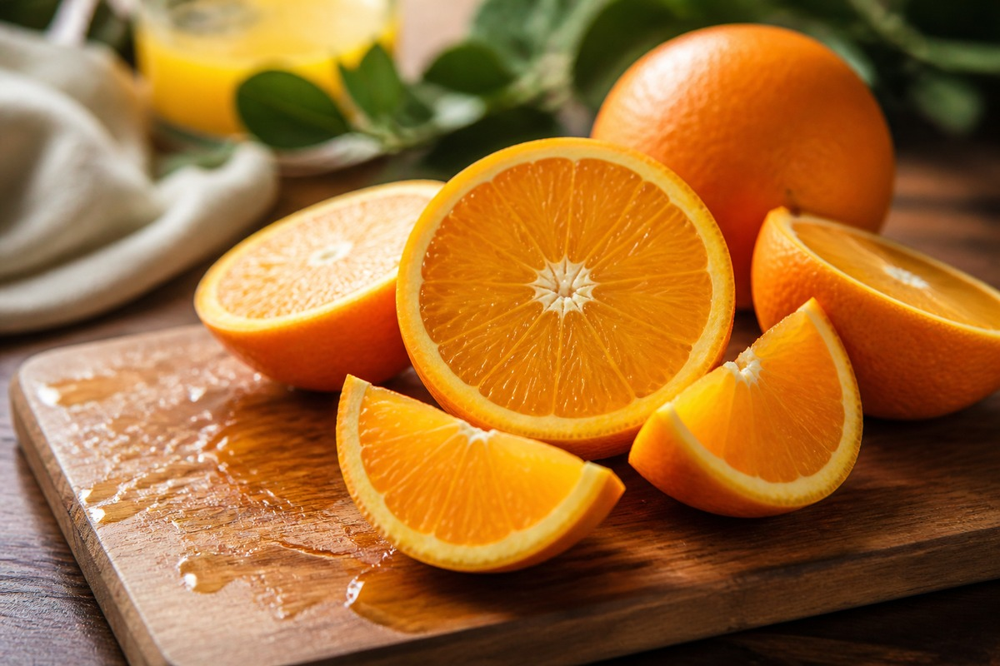

*▲ Sun-ripened oranges (Citrus sinensis) deliver therapeutic densities of bioactive L-ascorbic acid and the citrus flavanone hesperidin, mediating microvascular elasticity and systemic cellular antioxidant defense.*

Within clinical cardiology and nutritional biochemistry, the **sweet orange (Citrus sinensis)** represents far more than an emblematic citrus fruit; it functions as one of nature’s most sophisticated delivery systems for water-soluble antioxidants and microvascular-modulating flavanones.

A 100-gram edible portion of raw navel orange yields 53.2 mg of natural L-ascorbic acid—supplying over 59% of the daily statutory reference requirement. Crucially, the biological efficacy of citrus extends beyond ascorbic acid through synergistic co-factors concentrated within its fibrous endocarp and white albedo layer: notably the flavanone glycoside **hesperidin** and polymethoxylated flavones.

Upon ingestion, hesperidin is deglycosylated by colonic microbiota into its active aglycone **hesperetin**, crossing the gut-blood barrier to phosphorylate endothelial nitric oxide synthase (**eNOS**). This biochemical cascade elevates cyclic guanosine monophosphate (cGMP) synthesis, inducing vascular smooth muscle relaxation and attenuating peripheral arterial resistance. Furthermore, native **citric acid** drives cellular ATP generation through the Krebs tricarboxylic acid cycle while chelating dietary non-heme iron to augment systemic enterocyte uptake.

Synthesizing empirical reference data from USDA FoodData Central and contemporary randomized controlled trials, this monograph elucidates the quantitative nutrient density, vascular pharmacodynamics, and bio-optimizing culinary practices for Citrus sinensis.

---

## 1. Quantitative Nutritional Composition (Per 100g Edible Portion, Raw Navel Orange)

Oranges exhibit high nutrient density with minimal energetic burden (47 kcal/100g), low sodium, elevated potassium, and functional dietary fiber.

| Nutrient | Amount (per 100g) | Daily Value (% DV) |
| :--- | :--- | :--- |
| **Energy** | 47 kcal | 2.4% |
| **Water** | 86.75 g | Special classification¹ |
| **Protein** | 0.94 g | 1.9% |
| **Total Fat** | 0.12 g | 0.2% |
| - Saturated Fat | 0.015 g | 0.1% |
| - Monounsaturated Fat (MUFA) | 0.023 g | Daily value not established |
| - Polyunsaturated Fat (PUFA) | 0.025 g | Daily value not established |
| - Cholesterol | 0.00 mg | 0.0% |
| **Carbohydrates** | 11.75 g | 4.3% |
| - Total Sugars | 9.35 g | 18.7% |
| - Dietary Fiber | 2.40 g | 8.6% |
| **Vitamin C (Ascorbic acid)** | 53.20 mg | 59.1% |
| **Folate (Vitamin B9)** | 30.00 mcg | 7.5% |
| **Thiamin (Vitamin B1)** | 0.087 mg | 7.3% |
| **Potassium (K)** | 181.00 mg | 3.9% |
| **Calcium (Ca)** | 40.00 mg | 3.1% |
| **Magnesium (Mg)** | 10.00 mg | 2.4% |
| **Phosphorus (P)** | 14.00 mg | 1.1% |
| **Citrus Hesperidin** | ~28.50 mg | Daily value not established |
| **Beta-Cryptoxanthin** | 116.00 mcg | Daily value not established |
| **Organic Citric Acid** | ~1,020.00 mg | Daily value not established |

*※ Source: USDA FoodData Central Standard Reference (Navel Orange, raw, edible portion).*  
*¹ Water constitutes the biological transport solvent essential for electrolyte equilibrium.*  
*※ 'Daily value not established' designates functional secondary metabolites, bioflavonoids, and carotenoids devoid of statutory percentage reference thresholds.*

---

## 2. Four Clinically Validated Biological Benefits

### ① Endothelial eNOS Upregulation and Microvascular Hemodynamics
The primary citrus flavanone **hesperidin** stimulates endothelial nitric oxide synthase (**eNOS**) phosphorylation at Ser1177 via Akt signaling pathways. Elevated endothelial nitric oxide (NO) diffuses into vascular smooth muscle cells, activating soluble guanylyl cyclase (sGC) to upregulate cGMP and promote arterial vasodilation. Human randomized clinical crossover trials confirm that oral citrus flavanone supplementation significantly enhances flow-mediated dilation (FMD) of the brachial artery and reduces systolic blood pressure in pre-hypertensive cohorts.

### ② Leukocyte Phagocytic Priming and Innate Immunocompetence
Ascorbic acid concentrates inside neutrophils and macrophages at levels up to 80-fold higher than extracellular plasma concentrations via sodium-dependent vitamin C transporters (SVCT2). In immune challenge scenarios, intracellular ascorbate acts as a crucial electron donor, quenching peroxynitrite and hypochlorous acid generated during respiratory bursts. This protects host leukocyte integrity, optimizes chemotaxis, and enhances pathogen clearance without collateral tissue necrosis.

### ③ Fibroblast Collagen Biosynthesis and Dermal Matrix Integrity
In dermal connective architecture, L-ascorbic acid operates as an obligatory reducing co-factor for **prolyl 4-hydroxylase** and **lysyl hydroxylase** enzymes. These enzymes catalyze the post-translational hydroxylation of proline and lysine residues, securing the spatial triple-helix conformation of Type I and Type III procollagen. Concurrently, the citrus carotenoid **beta-cryptoxanthin** downregulates ultraviolet-induced matrix metalloproteinase-1 (MMP-1), protecting structural elastin from photodegradation.

### ④ Pectin-Mediated Bile Acid Sequestration and Hypocholesterolemic Action
The inner white mesocarp (albedo) of oranges contains dense concentrations of water-soluble **pectin**. Within the duodenal lumen, viscous pectin networks entrap dietary cholesterol micelles and inhibit reabsorption of conjugated bile acids. Forced hepatic bile acid resynthesis depletes systemic low-density lipoprotein (LDL) pools, lowering atherogenic serum apolipoprotein B concentrations while gut microbiota ferment pectin into anti-inflammatory short-chain fatty acids (SCFAs).

---

## 3. Optimizing Bioavailability and Culinary Physics

### Consuming the Sub-Epidermal Albedo Mesh
A frequent culinary error involves over-stripping the white fibrous albedo mesh adhering to orange segments. Quantitative chromatography reveals that over 70% of total hesperidin and naringenin glycosides reside within this inner peel layer. Consuming segments intact rather than drinking strained clear juice ensures maximum bioflavonoid ingestion and optimizes glycemic response.

### Synergistic Chelation of Plant-Based Non-Heme Iron
Non-heme iron (ferric Fe³⁺) from leafy crucifers and legumes displays exceptionally low baseline human enterocyte bioavailability (<5%). Concomitant intake of raw orange segments reduces ferric ions to bioavailable ferrous ions (Fe²⁺) while citric acid forms soluble monodentate chelates that prevent insoluble hydroxide precipitation in alkaline intestinal fluid, amplifying systemic iron absorption up to fivefold.

---

## 4. Potential Contraindications and Biochemical Sensitivities

### Lower Esophageal Sphincter Irritation in Gastroesophageal Reflux (GERD)
With a titratable acidity producing an intrinsic pH between 3.3 and 4.0, concentrated citrus ingestion can transiently decrease lower esophageal sphincter (LES) pressure and stimulate gastric parietal cell hypersecretion. Patients presenting active erosive reflux or peptic ulcers should avoid consuming citrus on an empty stomach.

### Acid-Induced Dermal Enamel Demineralization
Organic fruit acids can temporarily soften dental hydroxyapatite enamel prisms. Ingesting citrus and immediately performing mechanical toothbrushing promotes enamel abrasion. Dental clinical guidelines recommend rinsing the oral cavity with neutral tap water post-consumption and delaying abrasive brushing by at least 30 minutes.

---

## 5. Clinical Summary and Nutritional Takeaways

1. **Microvascular Endothelial Protection:** Citrus hesperidin drives eNOS nitric oxide generation and microvascular dilation.
2. **Dense Immunological Support:** Supplying 53.2 mg of natural vitamin C per 100g to prime leukocyte chemotaxis.
3. **Whole Fruit with Albedo Outperforms Juicing:** Intact fiber and white inner peel retain 70% of cardioprotective bioflavonoids.

---

## 6. Synergistic Food Pairings for Maximum Bioavailability

- **[Spinach (Spinach)]({{ site.baseurl }}/en/posts/spinach-nutrition-benefits/)**: Ascorbic acid and citric acid in oranges reduce non-heme ferric iron in spinach into bioavailable ferrous chelates, amplifying intestinal absorption fivefold.
- **[Avocado (Avocado)]({{ site.baseurl }}/en/posts/avocado-nutrition-benefits/)**: Monounsaturated triacylglycerols in avocado dissolve lipophilic beta-cryptoxanthin from oranges, while citrus ascorbate shields avocado fatty acids from lipid peroxidation.
- **[Chicken Breast (Chicken Breast)]({{ site.baseurl }}/en/posts/chicken-breast-nutrition-benefits/)**: Complete essential amino acids from lean poultry combine with citrus ascorbic acid to accelerate post-exercise fibroblast prolyl hydroxylation and muscular collagen repair.

---

## 7. Frequently Asked Questions (FAQ)

### Q1. How does commercial 100% orange juice compare nutritionally to raw, whole oranges?
**A:** Commercial juice lacks the structural dietary fiber and albedo mesh that contain over 70% of native hesperidin bioflavonoids. Straining and pasteurization deplete volatile terpenes and elevate the glycemic index (GI), triggering rapid postprandial glucose excursions. Whole raw oranges preserve functional pectin and steady glycemic uptake.

### Q2. Is daily orange consumption safe for individuals managing type 2 diabetes?
**A:** Yes, when consumed as whole raw fruit. Oranges have a low glycemic index (~40–43) and a low glycemic load (~5 per serving) because viscous pectin fiber delays intestinal carbohydrate hydrolysis. Diabetic individuals should limit intake to one medium whole fruit per day and avoid liquid citrus juices.

### Q3. What is the scientifically validated protocol for removing surface wax and pesticide residues from citrus peel?
**A:** Immerse citrus in lukewarm water containing 1% sodium bicarbonate (baking soda) for 3 to 5 minutes, scrub with a firm vegetable brush, and rinse under running water followed by a brief dilute acetic acid (vinegar) rinse to degrade lipophilic post-harvest coatings effectively.

