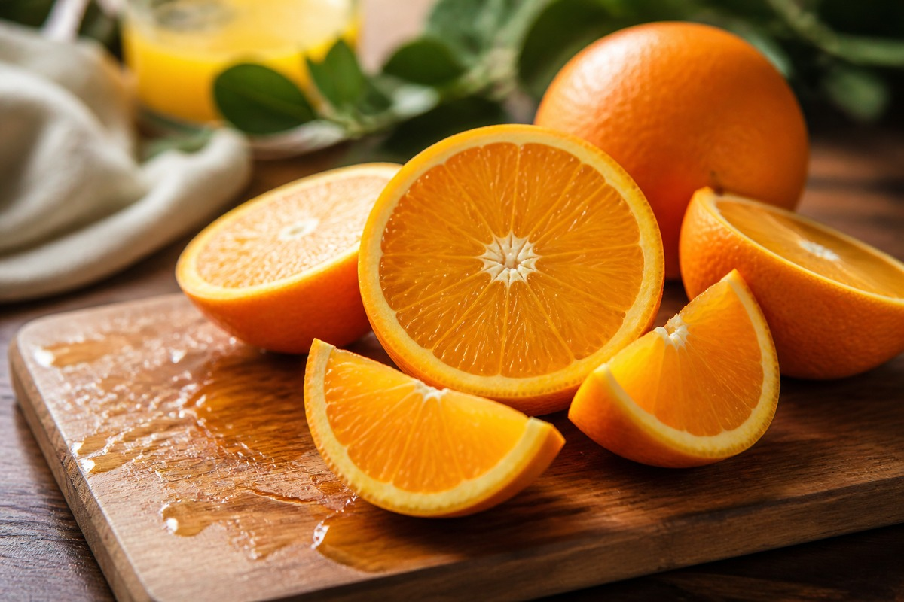

*▲ 햇살을 듬뿍 받고 자란 오렌지(Orange)는 비타민 C와 감귤류 고유의 플라바논 헤스페리딘을 함께 먹을 수 있는 대표적인 과일입니다.*

한 줄 결론 <strong>네이블오렌지 100g은 47kcal, 비타민C 53.2mg, 엽산 30mcg입니다.</strong> 비타민C 하루 권장량의 절반 이상을 한 개로 채우고, 과육째 먹으면 주스보다 식이섬유 2.4g을 더 얻습니다.

상큼하고 달콤한 과즙으로 전 세계인의 사랑을 받는 **오렌지(Orange, Citrus sinensis)**는 비타민 C와 플라보노이드 공급원으로 연구되는 과일입니다.

오렌지 100g에는 성인 1일 권장량의 절반을 넘는 비타민 C(53.2mg)가 들어 있습니다. 과육과 하얀 속껍질(알베도 층)에는 플라바논 배당체인 **헤스페리딘(Hesperidin)**이 들어 있고, 이 성분은 혈관 내피 기능과 관련해 연구되어 왔습니다. 다만 사람을 대상으로 한 연구는 규모가 작고 결과가 엇갈려, 오렌지 섭취가 혈관 질환을 치료하거나 예방한다고 단정할 수는 없습니다.

또한 오렌지의 유기산인 **구연산(Citric acid)**은 식사 안의 비헴철과 함께 있을 때 철 흡수를 돕는 것으로 알려져 있습니다. 수용성 식이섬유인 **펙틴(Pectin)**은 담즙산과 결합해 배설을 늘리는 방향으로 작용하며, 이는 콜레스테롤 관리에 도움이 되는 식이섬유의 일반적인 작용입니다.

미국 농무부(USDA FoodData Central) 표준 분석 데이터를 바탕으로 오렌지의 영양 성분과 영양학적으로 의미 있는 4가지 포인트, 섭취 시 주의사항을 정리합니다.

---

## 1. 오렌지 칼로리와 영양성분은? (비타민C 53.2mg·엽산 30mcg)

오렌지는 100g당 47kcal의 가벼운 열량 대비 풍부한 수분과 식이섬유, 필수 비타민과 칼륨을 고농도로 공급하는 고수분·저밀도 과일입니다.

| 영양 성분 (Nutrient) | 함량 (100g당) | 1일 권장 섭취량 비율 (한국인 성인 기준) |
| :--- | :--- | :--- |
| **열량 (Energy)** | 47 kcal | 2.4% |
| **수분 (Water)** | 86.75 g | 별도 표기¹ |
| **단백질 (Protein)** | 0.94 g | 1.7% |
| **지방 (Total Fat)** | 0.12 g | 0.2% |
| - 포화지방산 (Saturated Fat) | 0.015 g | 0.1% |
| - 단일불포화지방산 (MUFA) | 0.023 g | 기준치 없음 |
| - 다가불포화지방산 (PUFA) | 0.025 g | 기준치 없음 |
| - 콜레스테롤 (Cholesterol) | 0.00 mg | 0.0% |
| **탄수화물 (Carbohydrates)** | 11.75 g | 3.6% |
| - 당류 (Total Sugars) | 9.35 g | 9.4% |
| - 식이섬유 (Dietary Fiber) | 2.40 g | 9.6% |
| **비타민 C (Ascorbic Acid)** | 53.20 mg | 53.2% |
| **엽산 (Vitamin B9, Folate)** | 30.00 mcg | 7.5% |
| **티아민 (Vitamin B1)** | 0.087 mg | 7.3% |
| **칼륨 (Potassium, K)** | 181.00 mg | 5.2% |
| **칼슘 (Calcium, Ca)** | 40.00 mg | 5.7% |
| **마그네슘 (Magnesium, Mg)** | 10.00 mg | 3.2% |
| **인 (Phosphorus, P)** | 14.00 mg | 2.0% |
| **감귤류 헤스페리딘 (Hesperidin)** | 약 28.50 mg | 기준치 없음 |
| **베타-크립토잔틴 (β-Cryptoxanthin)** | 116.00 mcg | 기준치 없음 |
| **천연 구연산 (Citric Acid)** | 약 1,020.00 mg | 기준치 없음 |

*※ 출처: 미국 농무부(USDA FoodData Central) 표준 분석 데이터 (Navel Orange, raw 기준).*  
*¹ 수분은 인체 세포 항상성 유지와 수용성 비타민 전달을 위한 천연 매개 용매입니다.*  
*※ '기준치 없음' 표기는 기능성 플라보노이드 및 카로티노이드 성분으로 DRI상 일일 권장 백분율(%DV)이 법적으로 규정되지 않은 항목입니다.*

---

## 2. 오렌지의 영양학적 포인트 4가지

### ① 헤스페리딘과 혈관 내피 기능
오렌지의 대표 플라바논인 **헤스페리딘(Hesperidin)**은 혈관 내피세포의 산화질소(NO) 생성 경로에 관여하는 것으로 실험실 연구에서 보고됐습니다. 사람을 대상으로 한 소규모 시험에서는 헤스페리딘 섭취 후 혈류매개성 혈관확장(FMD)이 개선됐다는 결과가 있지만, 연구마다 용량·기간·대상이 달라 일관된 결론은 아닙니다. 혈압약을 대신할 수 있는 방법은 아닙니다.

### ② 비타민 C와 면역 기능
비타민 C는 호중구·대식세포 같은 면역세포에 능동 수송으로 들어가 세포 안에 높은 농도로 유지됩니다. 면역세포가 활성산소로부터 자신을 보호하고 정상적으로 기능하는 데 필요합니다. 다만 평소 비타민 C를 충분히 먹고 있는 사람이 더 많이 먹는다고 감기나 바이러스 감염을 막을 수 있다는 근거는 일관되지 않습니다.

### ③ 비타민 C와 콜라겐 합성
비타민 C는 콜라겐 합성 과정에서 프롤린·라이신 잔기의 수산화에 필요한 보조인자입니다. 비타민 C가 부족하면 콜라겐 합성이 제대로 되지 않습니다. 다만 오렌기를 먹는 양으로 피부 주름이 줄거나 광노화가 막힌다는 근거는 부족합니다.

### ④ 펙틴과 구연산염
오렌지 과육과 속껍질의 수용성 식이섬유 **펙틴**은 담즙산과 결합해 배설을 늘리는 작용이 있습니다. 간은 담즙산을 다시 만들기 위해 콜레스테롤을 쓰기 때문에, 식이섬유 섭취가 늘면 LDL 콜레스테롤이 다소 낮아질 수 있습니다. 오렌지의 **구연산염(Citrate)**은 소변 pH를 조절해 요산·시스틴 결석 예방에는 쓰이지만, 옥살산칼슘 결석에 대한 효과는 오렌지 섭취량 수준에서 확인되지 않았습니다.

---

## 3. 오렌지는 생과와 주스 중 뭐가 좋을까? 식이섬유 차이

### 하얀 속껍질(알베도 층)까지 함께 통째로 섭취
오렌지를 손질할 때 과육 겉면의 하얀 속껍질(Albedo)을 벗겨내는 경우가 많습니다. 헤스페리딘과 루틴 같은 플라보노이드는 과육보다 이 알베도 층에 더 많이 들어 있습니다. 다만 '70% 이상', '3배 이상' 같은 수치는 품종과 부위에 따라 달라 확인된 값이 아니므로, 속껍질을 함께 먹으면 플라보노이드와 식이섬유를 조금 더 섭취하는 정도로 이해하면 됩니다.

### 식물성 철분이 풍부한 채소·단백질 식단과의 병용
시금치, 케일, 콩류 등 식물성 식품에 들어있는 비헴철은 흡수율이 대체로 낮고 식사 구성에 따라 수 %대에 머뭅니다. 같은 끼니에 비타민 C가 많은 식품을 곁들이면 흡수량이 늘어난다는 연구가 있지만, 증가 폭은 식사 구성·철 상태·개인차에 따라 크게 달라 '4~6배' 같은 고정 배수로 말할 수 없습니다. 비타민 C가 철 흡수를 돕는 것은 확인된 작용이지만, 빈혈 치료는 병원 진단과 처방이 우선입니다.

---

## 4. 오렌지 주의점과 약물 상호작용은?

### 위식도 역류 질환(GERD) 환자의 공복 섭취 주의
오렌지는 구연산·사과산 같은 유기산이 많아, 공복에 많이 먹으면 속쓰림이나 역류 증상이 심해질 수 있습니다. 역류성 식도염이 있다면 한 번에 먹는 양을 줄이고 식후에 먹어 보는 편이 편합니다. '누구에게나 안전한 섭취 시점'이 정해져 있는 것은 아닙니다.

### 치아 에나멜질 산 부식 방지 습관
감귤류 과일의 산성 성분은 치아 표면의 에나멜질을 일시적으로 연화시킵니다. 오렌지를 섭취한 직후 곧바로 칫솔질을 하면 치아 마모가 가속화될 수 있으므로, 섭취 후 물로 입안을 가볍게 헹구고 약 30분 뒤에 양치질을 하는 것이 구강 건강에 바람직합니다.

---

## 5. 오렌지 하루 얼마나 먹을까? 핵심 요약

1. **헤스페리딘 28.5mg:** 혈관 내피 기능과 관련해 연구되는 플라보노이드이며, 하루 100g 한 개로 약 28mg을 얻습니다.
2. **비타민 C 53.2mg:** 하루 권장량의 절반을 조금 넘는 양입니다.
3. **생과 통섭취:** 속껍질째 먹으면 플라보노이드와 식이섬유를 조금 더 섭취하고, 주스보다 달지 않고 씹는 양이 많아 과섭취를 막기 쉽습니다.

---

## 6. 오렌지와 함께 먹으면 좋은 음식은?

- **[시금치 (Spinach)]({{ site.baseurl }}/posts/spinach-nutrition-benefits/)**: 시금치의 비헴철과 오렌지의 비타민 C를 같은 끼니에 먹으면 철 흡수에 도움이 됩니다. 다만 철 결핍성 빈혈은 진단과 치료가 먼저입니다.
- **[아보카도 (Avocado)]({{ site.baseurl }}/posts/avocado-nutrition-benefits/)**: 아보카도의 지방은 오렌지의 지용성 카로티노이드(베타-크립토잔틴) 흡수를 돕습니다.
- **[닭가슴살 (Chicken Breast)]({{ site.baseurl }}/posts/chicken-breast-nutrition-benefits/)**: 닭가슴살의 단백질과 오렌지의 비타민 C를 함께 먹으면 한 끼 영양 균형을 맞추기 좋습니다.
- **[귤 (Tangerine)](/posts/tangerine-nutrition-benefits/):** 겨울에는 오렌지 대신 귤 2~3개로 비타민C와 헤스페리딘을 이어서 챙길 수 있습니다.

---

## 7. 자주 묻는 질문 (FAQ)

### Q1. 시판 100% 오렌지 주스와 생오렌지는 영양학적으로 어떤 차이가 있나요?
**A:** 차이가 있습니다. 시판 주스는 살균·농축 과정에서 비타민 C가 일부 줄고, 섬유질이 걸러져 당 흡수가 빨라집니다. 오렌지 자체의 혈당지수는 낮은 편이지만 주스로 마시면 같은 양의 당이 더 빠르게 흡수되므로, 당뇨가 있다면 한 번에 마시는 양을 줄이는 편이 좋습니다. 헤스페리딘은 과육과 속껍질에 함께 들어 있습니다.

### Q2. 당뇨 환자가 오렌지를 먹어도 혈당에 무리가 없나요?
**A:** 생오렌지의 혈당지수(GI)는 자료에 따라 40~43 정도로 보고되어 낮은 편에 속하고, 반 개~1개(약 100~150g)의 혈당부하지수(GL)는 5 안팎으로 계산됩니다. 이는 일반적인 참고치이며 개인의 혈당 반응은 다를 수 있습니다. 당뇨가 있다면 1회 양을 정해 먹고, 주스 대신 생과로 먹으며, 혈당 측정으로 본인 반응을 확인하는 것이 안전합니다. 식사·복약 계획은 주치의·영양사와 상의하세요.

### Q3. 오렌지 껍질의 잔류 농약이 걱정되는데 어떻게 세척해야 안전한가요?
**A:** 수입 오렌지 표면의 왁스와 잔류 농약은 물로만 헹구면 덜 지워집니다. 베이킹소다를 푼 미온수에 3~5분 담갔다가 부드러운 솔로 문지르고 흐르는 물에 헹구면 표면 잔류물이 줄어듭니다. 제거율은 농약 종류와 세척 방법에 따라 달라 ‘99% 이상’처럼 단정할 수 없고, 식초물은 세균을 완전히 죽이지 못합니다.

  
📌 관련 순위 가이드

  <ul>
    <li><a href="/posts/antioxidant-anti-aging-foods-guide/">항산화·노화 방지 음식 TOP 10: 폴리페놀·카로티노이드 순위</a></li>
    <li><a href="/posts/heart-blood-pressure-cholesterol-foods/">혈압·혈관 건강 음식 TOP 10: 콜레스테롤·중성지방 관리</a></li>
  </ul>

