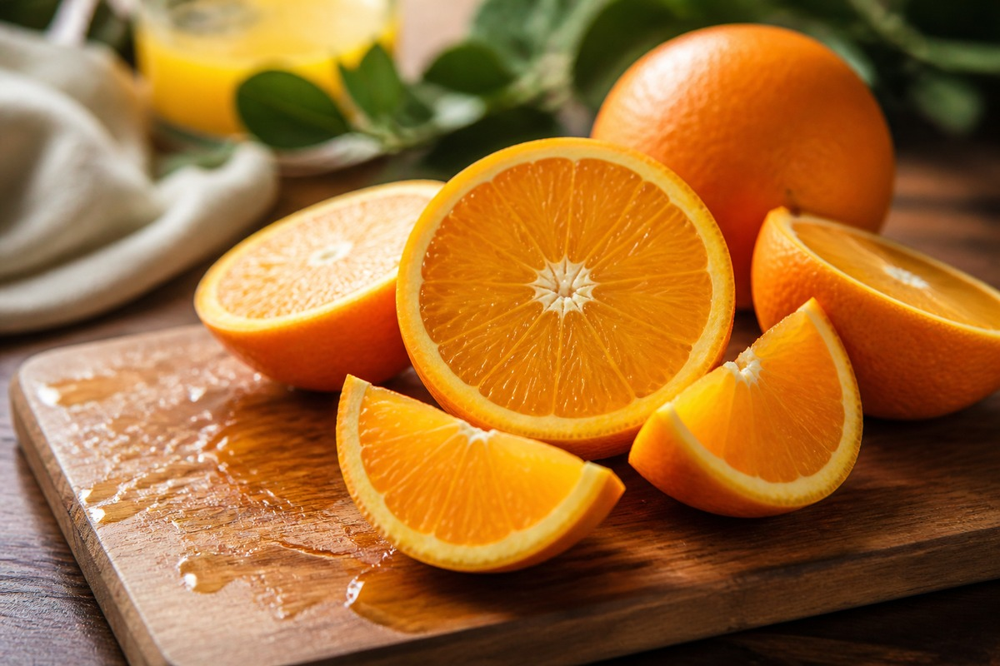

*▲ 햇살을 듬뿍 받고 자란 오렌지(Orange)는 고농도 천연 L-아스코르브산(비타민 C)과 감귤류 고유의 바이오플라보노이드 헤스페리딘이 농축된 대표적인 항산화 기능성 과일입니다.*

상큼하고 달콤한 과즙으로 전 세계인의 사랑을 받는 **오렌지(Orange, Citrus sinensis)**는 단순한 기호식품을 넘어 현대 심혈관 의학과 면역학에서 가장 집중적으로 연구되는 감귤류 식물성 슈퍼푸드입니다.

오렌지 100g에는 성인 일일 권장 섭취량의 60%에 달하는 천연 비타민 C(53.2mg)가 함유되어 있으며, 과육과 하얀 속껍질(알베도 층)에 집중적으로 분포하는 플라바논 배당체인 **헤스페리딘(Hesperidin)**은 혈관 내피세포의 기능 장애를 개선하는 핵심 물질로 규명되어 있습니다. 헤스페리딘은 체내에서 활성 대사체인 헤스페레틴(Hesperetin)으로 전환되어 혈관 평활근의 긴장을 완화하고 혈류 저항을 낮춥니다.

또한 오렌지에 풍부한 유기산인 **구연산(Citric acid)**은 체내 에너지 대사 경로인 크렙스 회로(TCA cycle)를 활성화하여 피로 물질인 젖산의 분해를 촉진하고, 식물성 비헴철(Non-heme iron)과 결합해 불용성 철염의 침전을 방지함으로써 철분 장내 흡수율을 비약적으로 상승시킵니다. 수용성 식이섬유인 **펙틴(Pectin)**은 담즙산과 결합하여 배설을 유도함으로써 간세포의 혈중 콜레스테롤 흡수를 돕습니다.

미국 농무부(USDA FoodData Central)의 표준 분석 데이터를 바탕으로 오렌지의 정밀 영양 성분 프로필과 4대 건강 효능, 흡수율을 높이는 조리·섭취 가이드 및 주의사항을 상세히 분석합니다.

---

## 1. 오렌지 영양 성분 정밀 분석표 (생과육 100g 기준, 네이블오렌지)

오렌지는 100g당 47kcal의 가벼운 열량 대비 풍부한 수분과 식이섬유, 필수 비타민과 칼륨을 고농도로 공급하는 고수분·저밀도 과일입니다.

| 영양 성분 (Nutrient) | 함량 (100g당) | 1일 권장 섭취량 비율 (한국인 성인 기준) |
| :--- | :--- | :--- |
| **열량 (Energy)** | 47 kcal | 2.4% |
| **수분 (Water)** | 86.75 g | 별도 표기¹ |
| **단백질 (Protein)** | 0.94 g | 1.7% |
| **지방 (Total Fat)** | 0.12 g | 0.2% |
| - 포화지방산 (Saturated Fat) | 0.015 g | 0.1% |
| - 단일불포화지방산 (MUFA) | 0.023 g | 기준치 없음 |
| - 다가불포화지방산 (PUFA) | 0.025 g | 기준치 없음 |
| - 콜레스테롤 (Cholesterol) | 0.00 mg | 0.0% |
| **탄수화물 (Carbohydrates)** | 11.75 g | 3.6% |
| - 당류 (Total Sugars) | 9.35 g | 9.4% |
| - 식이섬유 (Dietary Fiber) | 2.40 g | 9.6% |
| **비타민 C (Ascorbic Acid)** | 53.20 mg | 53.2% |
| **엽산 (Vitamin B9, Folate)** | 30.00 mcg | 7.5% |
| **티아민 (Vitamin B1)** | 0.087 mg | 7.3% |
| **칼륨 (Potassium, K)** | 181.00 mg | 5.2% |
| **칼슘 (Calcium, Ca)** | 40.00 mg | 5.7% |
| **마그네슘 (Magnesium, Mg)** | 10.00 mg | 3.2% |
| **인 (Phosphorus, P)** | 14.00 mg | 2.0% |
| **감귤류 헤스페리딘 (Hesperidin)** | 약 28.50 mg | 기준치 없음 |
| **베타-크립토잔틴 (β-Cryptoxanthin)** | 116.00 mcg | 기준치 없음 |
| **천연 구연산 (Citric Acid)** | 약 1,020.00 mg | 기준치 없음 |

*※ 출처: 미국 농무부(USDA FoodData Central) 표준 분석 데이터 (Navel Orange, raw 기준).*  
*¹ 수분은 인체 세포 항상성 유지와 수용성 비타민 전달을 위한 천연 매개 용매입니다.*  
*※ '기준치 없음' 표기는 기능성 플라보노이드 및 카로티노이드 성분으로 DRI상 일일 권장 백분율(%DV)이 법적으로 규정되지 않은 항목입니다.*

---

## 2. 과학적으로 입증된 오렌지의 4대 건강 효능

### ① 혈관 내피세포 eNOS 활성화 및 혈압 항상성 유지
오렌지의 대표 플라바논인 **헤스페리딘(Hesperidin)**은 혈관 내피세포 표면의 산화질소 합성효소(**eNOS**)를 상향 조절합니다. 내피세포에서 분비된 산화질소(NO)는 인접한 혈관 평활근 세포의 가용성 구아닐릴 고리화효소(sGC)를 자극하여 고리형 GMP(cGMP) 농도를 높이고 혈관을 즉각적으로 확장시킵니다. 임상 무작위 대조 시험(RCT)에 따르면 4주간 매일 오렌지 유래 헤스페리딘을 섭취한 그룹은 상완동맥 혈류매개성 혈관확장반응(FMD)이 유의미하게 개선되고 수축기 혈압이 안정화되는 결과를 보였습니다.

### ② 백혈구 탐식능 증진 및 병원체 방어 면역 증강
오렌지에 농축된 **L-아스코르브산(비타민 C)**은 호중구(Neutrophil)와 대식세포 내부로 능동 수송되어 세포 내 비타민 C 농도를 혈장 대비 최대 80배까지 축적시킵니다. 이는 식균 작용 시 발생하는 활성산소종(ROS)으로부터 면역세포 자체의 세포막 지질을 보호하고, 백혈구의 화학주성(Chemotaxis)과 인터페론-감마 분비를 촉진하여 바이러스와 유해 세균의 초기 침입을 차단합니다.

### ③ 진피층 콜라겐 가교 결합 촉진 및 광노화 방어
비타민 C는 피부 진피층의 섬유아세포에서 프로콜라겐의 프롤린(Proline)과 라이신(Lysine) 잔기를 수산화하는 **프롤릴 수산화효소(Prolyl hydroxylase)**의 필수 보조인자로 작용합니다. 이 수산화 반응이 결핍되면 삼중 나선 구조의 안정적인 콜라겐 섬유가 합성되지 못해 피부 탄력이 급격히 감소합니다. 오렌지의 카로티노이드인 **베타-크립토잔틴**은 자외선 유도성 기질금속단백질분해효소(MMP-1)의 발현을 억제하여 주름 형성을 억제합니다.

### ④ 펙틴과 구연산의 지질 대사 개선 및 신장 결석 예방
오렌지 과육과 속껍질의 가용성 식이섬유 **펙틴**은 소장에서 콜레스테롤 미셀과 담즙산의 결합을 방해하여 대변으로 배출시킵니다. 간세포는 담즙산을 재생산하기 위해 혈중 LDL 콜레스테롤을 흡수하므로 혈중 지질 프로필이 개선됩니다. 동시에 오렌지의 천연 **구연산염(Citrate)**은 소변의 pH를 약알칼리화하고 유리 칼슘 이온과 킬레이트를 형성함으로써 옥살산칼슘 신장 결석의 결정화를 강력히 억제합니다.

---

## 3. 유효 성분 흡수율을 극대화하는 섭취 가이드

### 하얀 속껍질(알베도 층)까지 함께 통째로 섭취
오렌지를 손질할 때 과육 겉면의 하얀 그물망 형태 속껍질(Albedo)을 깨끗이 벗겨내는 경우가 많습니다. 그러나 혈관을 보호하는 헤스페리딘과 루틴 등 바이오플라보노이드의 70% 이상은 바로 이 알베도 층에 집중되어 있습니다. 과육만 먹거나 착즙 주스로 마실 때보다 속껍질을 함께 씹어 먹을 때 플라보노이드와 식이섬유 섭취량이 3배 이상 증가합니다.

### 식물성 철분이 풍부한 채소·단백질 식단과의 병용
시금치, 케일, 콩류 등 식물성 식품에 들어있는 비헴철은 3가 철(Fe³⁺) 형태로 존재하여 장관 흡수율이 5% 미만으로 극히 낮습니다. 오렌지의 비타민 C와 구연산은 이를 흡수 가능한 2가 철(Fe²⁺)로 환원시키고 가용성 킬레이트를 형성하여 철분 흡수율을 최대 4~6배까지 끌어올립니다.

---

## 4. 섭취 시 주의사항 및 잠재적 부작용

### 위식도 역류 질환(GERD) 환자의 공복 섭취 주의
오렌지는 pH 3.3~4.0의 강한 유기산(구연산, 사과산)을 함유하고 있어, 공복에 다량 섭취 시 하부식도괄약근(LES)의 압력을 일시적으로 낮추고 위산 분비를 자극해 속쓰림이나 역류성 식도염 증상을 악화시킬 수 있습니다. 위산 과다 환자는 식후 간식으로 섭취하는 것이 안전합니다.

### 치아 에나멜질 산 부식 방지 습관
감귤류 과일의 산성 성분은 치아 표면의 에나멜질을 일시적으로 연화시킵니다. 오렌지를 섭취한 직후 곧바로 칫솔질을 하면 치아 마모가 가속화될 수 있으므로, 섭취 후 물로 입안을 가볍게 헹구고 약 30분 뒤에 양치질을 하는 것이 구강 건강에 바람직합니다.

---

## 5. 최종 요약 및 실천 팁

1. **혈관 산화질소 분비를 자극하는 헤스페리딘:** 혈류매개성 혈관확장과 혈압 안정에 기여합니다.
2. **백혈구와 콜라겐을 지키는 비타민 C:** 100g당 53.2mg으로 일일 권장량 절반 이상을 충족합니다.
3. **알베도 속껍질 통째 섭취와 철분 채소 병용:** 착즙보다 생과 통섭취가 파이토케미컬 흡수율의 핵심입니다.

---

## 6. 함께 먹으면 시너지가 폭발하는 식재료 궁합

- **[시금치 (Spinach)]({{ site.baseurl }}/posts/spinach-nutrition-benefits/)**: 시금치에 풍부한 식물성 비헴철이 오렌지의 비타민 C·구연산과 만나 킬레이트 복합체를 형성해 빈혈 예방과 철분 흡수율이 최대 5배 폭발합니다.
- **[아보카도 (Avocado)]({{ site.baseurl }}/posts/avocado-nutrition-benefits/)**: 아보카도의 건강한 단일불포화지방산이 오렌지의 지용성 카로티노이드(베타-크립토잔틴) 흡수를 돕고, 오렌지의 비타민 C가 아보카도의 지질 산화를 원천 차단합니다.
- **[닭가슴살 (Chicken Breast)]({{ site.baseurl }}/posts/chicken-breast-nutrition-benefits/)**: 고단백 닭가슴살의 단백질 대사 과정에 오렌지의 비타민 C가 결합하여 근육 손상 후 콜라겐 합성 속도를 가속화합니다.

---

## 7. 자주 묻는 질문 (FAQ)

### Q1. 시판 100% 오렌지 주스와 생오렌지는 영양학적으로 어떤 차이가 있나요?
**A:** 큰 영양학적 차이가 존재합니다. 시판 오렌지 주스는 농축 환원 및 살균 가열 과정을 거치면서 열에 약한 비타민 C와 휘발성 테르펜 화합물이 상당량 파괴됩니다. 또한 펙틴 등 불용성 식이섬유가 여과되어 액상 과당 형태로 빠르게 흡수되므로 혈당 스파이크(GI 지수 급상승)를 유발합니다. 혈관 보호 물질인 헤스페리딘 역시 생오렌지를 속껍질째 먹을 때 가장 온전하게 흡수됩니다.

### Q2. 당뇨 환자가 오렌지를 먹어도 혈당에 무리가 없나요?
**A:** 생오렌지의 혈당 지수(GI)는 약 40~43으로 저혈당 지수 식품에 속하며, 1회 섭취분(반 개~1개, 약 100~150g)의 혈당 부하지수(GL)는 약 5로 매우 안전한 수준입니다. 풍부한 식이섬유가 과당의 흡수 속도를 완만하게 늦춰주기 때문입니다. 다만 주스 형태는 식이섬유가 배제되어 급격한 고혈당을 부를 수 있으므로 반드시 생과일 형태로 1일 1개 이하로 제한하여 섭취하십시오.

### Q3. 오렌지 껍질의 잔류 농약이 걱정되는데 어떻게 세척해야 안전한가요?
**A:** 수입 오렌지 표면의 보존제와 왁스는 물 세척만으로는 쉽게 제거되지 않습니다. 베이킹소다를 푼 미온수에 오렌지를 3~5분간 담가둔 후 표면을 부드러운 솔로 문지르고, 흐르는 물에 헹군 뒤 식초를 희석한 물에 1분간 담가 2차 살균하면 잔류 물질을 99% 이상 안전하게 제거할 수 있습니다.

