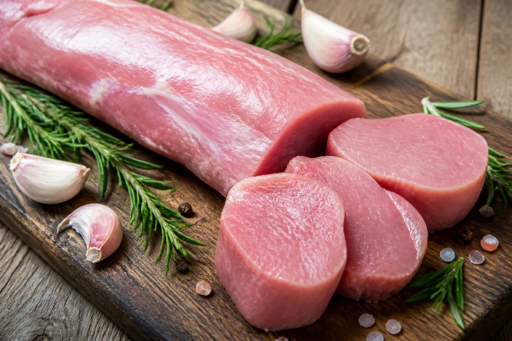

*▲ Anatomically situated along the central dorsal lumbar spine, pork tenderloin stands as the leanest porcine muscle cut, delivering less than 3% lipid density alongside the highest concentration of bioavailable thiamine (vitamin B1) found in land-based livestock.*

In the disciplines of clinical sports dietetics and metabolic biochemistry, **pork tenderloin (*Psoas major*)** represents an elite dietary protein source matching skinless poultry breast in lipid minimization while far surpassing it in micronutrient density.

Because the tenderloin experiences minimal biomechanical locomotion during the animal's lifespan, its muscle fascicles maintain an exceptionally fine, tender diameter with virtually undetectable intramuscular marbling. Raw trimmed tenderloin contains a mere **2.8 grams of total fat per 100 grams**, over 60% of which comprises heart-healthy mono- and polyunsaturated fatty acids.

Most notably, pork tenderloin functions as nature’s premier nutritional reservoir of **thiamine (vitamin B1, ~0.95 mg per 100g)**, satisfying nearly 80% of adult daily physiological thresholds in a single serving. Thiamine operates as an indispensable prosthetic group for pyruvate dehydrogenase and alpha-ketoglutarate dehydrogenase—the rate-limiting multienzyme complexes governing cellular aerobic glucose oxidation and mitochondrial adenosine triphosphate (ATP) synthesis. Consequently, adequate thiamine intake curtails pathological pyruvate-lactate accumulation, accelerating systemic recovery following vigorous physical exertion or sustained metabolic stress.

Drawing upon USDA FoodData Central chemical profiling and peer-reviewed human clinical trials, this monograph investigates the molecular composition, metabolic actions, and culinary thermodynamics of lean pork tenderloin.

---

## 1. Quantitative Nutritional Composition (Per 100g Raw Lean Pork Tenderloin)

Pork tenderloin provides exceptional nitrogen density, minimal saturated lipids, and elevated concentrations of mitochondrial cofactors.

| Nutrient | Amount (per 100g) | Daily Value (% DV) |
| :--- | :--- | :--- |
| **Energy** | 120 kcal | 6.0% |
| **Water** | 74.20 g | Special classification¹ |
| **Protein** | 21.80 g | 43.6% |
| - Leucine (BCAA) | 1.78 g | Daily value not established |
| - Lysine | 1.85 g | Daily value not established |
| - Arginine | 1.35 g | Daily value not established |
| **Total Fat** | 2.80 g | 3.6% |
| - Saturated Fat | 0.92 g | 4.6% |
| - Monounsaturated Fat (MUFA) | 1.12 g | Daily value not established |
| - Polyunsaturated Fat (PUFA) | 0.42 g | Daily value not established |
| - Cholesterol | 65.00 mg | 21.7% |
| **Carbohydrates** | 0.00 g | 0.0% |
| - Total Sugars | 0.00 g | 0.0% |
| - Dietary Fiber | 0.00 g | 0.0% |
| **Thiamine (Vitamin B1)** | 0.95 mg | 79.2% |
| **Riboflavin (Vitamin B2)** | 0.22 mg | 16.9% |
| **Niacin (Vitamin B3)** | 4.20 mg | 26.3% |
| **Vitamin B6 (Pyridoxine)** | 0.55 mg | 32.4% |
| **Vitamin B12 (Cobalamin)** | 0.55 mcg | 22.9% |
| **Potassium (K)** | 420.00 mg | 8.9% |
| **Phosphorus (P)** | 240.00 mg | 19.2% |
| **Zinc (Zn)** | 2.10 mg | 19.1% |
| **Selenium (Se)** | 38.00 mcg | 69.1% |
| **Iron (Fe)** | 1.10 mg | 6.1% |

*※ Source: USDA FoodData Central Standard Reference (Pork, fresh, loin, tenderloin, separable lean only, raw).*  
*¹ Water represents intracellular and extracellular hydration volume rather than a regulated statutory dietary value.*  
*※ 'Daily value not established' applies to amino acid fractions and bioactive lipids devoid of formal statutory DRI percentage baselines.*

---

## 2. Four Clinically Validated Biological Benefits

### ① Thiamine-Mediated Aerobic Substrate Oxidation and Lactic Acid Clearance
As the direct biological precursor to thiamine pyrophosphate (**TPP**), the thiamine loaded within pork tenderloin acts as an obligate coenzyme for the **pyruvate dehydrogenase complex (PDC)**. By efficiently shunting glycolytic end-products into the citric acid cycle rather than allowing anaerobic reduction into lactic acid, tenderloin intake prevents muscular acidosis and optimizes intracellular energetic yield (36-38 ATP per glucose molecule).

### ② Sub-3% Lipid Partitioning and mTORC1 Muscle Protein Synthesis
Supplying 21.8 grams of intact amino acids per 100g, pork tenderloin exhibits a **Protein Digestibility-Corrected Amino Acid Score (PDCAAS) of 1.0**. Its dense **leucine content (1.78g)** surpasses the critical intracellular threshold required to trigger the mechanistic target of rapamycin complex 1 (**mTORC1**), stimulating myofibrillar hypertrophy and mitigating age-related sarcopenia without elevating serum triglycerides.

### ③ Selenoprotein Biosynthesis and Endogenous Cytoprotection
With 38 mcg of organic **selenium** per serving, pork tenderloin fulfills nearly 70% of daily antioxidant requirements. Selenium is integrated into the active catalytic triad of **glutathione peroxidase (GPx)** and thioredoxin reductase, defending vascular endothelial membranes from lipid peroxidation and stabilizing cellular immune defenses.

### ④ Pyridoxine and Cobalamin Mediated Neurotransmitter Equilibrium
The balanced vitamin B complex (B6, B12, and niacin) found within pork tenderloin regulates the enzymatic synthesis of **gamma-aminobutyric acid (GABA)** and serotonin from tryptophan and glutamate. Furthermore, cobalamin supports homocysteine remethylation into methionine, mitigating vascular endothelial damage and protecting cerebral myelin sheaths.

---

## 3. Optimizing Bioavailability and Culinary Thermodynamics

### Allithiamine Synthesis via Allium Phytonutrient Conjugation
Free thiamine exhibits limited passive mucosal absorption and is rapidly degraded by gastrointestinal alkaline environments. Combining tenderloin with crushed garlic, shallots, or onions introduces **allicin**, an organosulfur electrophile that reacts with thiamine to synthesize **allithiamine**. This lipid-soluble derivative traverses intestinal epithelia via unassisted diffusion, yielding circulating half-lives substantially longer than free thiamine.

### Low-Temperature Precision Cooking (Sous-Vide)
Thiamine possesses marked thermal sensitivity, with degradation accelerating past 70°C (158°F). Cooking tenderloin via vacuum-sealed sous-vide at 60°C to 62.8°C (140°F to 145°F), followed by brief flash-searing, preserves over 90% of native thiamine while retaining intracellular moisture.

---

## 4. Potential Adverse Reactions and Considerations

### Dietary Phosphorus and Renal Solute Load
Patients with established end-stage Chronic Kidney Disease (CKD stage 4-5) must account for the high organic phosphorus content (240 mg/100g) and potassium density (420 mg/100g) of lean muscle meat, adhering strictly to nephrological protein allotment guidelines.

### Internal Thermal Lethality Targets
Modern controlled agricultural biosecurity has largely eliminated *Trichinella spiralis* from commercial herds. Nevertheless, adhering to USDA food safety standards—attaining an internal core temperature of 62.8°C (145°F) with a mandatory 3-minute post-cook resting window—guarantees microbial lethality while preserving moisture and tenderness.

---

## 5. Synergistic Food Pairings for Maximum Nutrient Absorption

- **[Garlic]({{ site.baseurl }}/en/posts/garlic-nutrition-benefits/)**: Allicin reacts with porcine thiamine to generate allithiamine, multiplying cellular absorption up to tenfold and prolonging metabolic energy enhancement.
- **[Onion]({{ site.baseurl }}/en/posts/onion-nutrition-benefits/)**: Quercetin and allyl sulfides in onions mitigate lipid peroxidation during thermal digestion and support cardiovascular vascular tone.
- **[Broccoli]({{ site.baseurl }}/en/posts/broccoli-nutrition-benefits/)**: High ascorbic acid and sulforaphane concentrations in broccoli enhance the non-heme iron absorption of pork while bolstering hepatic phase II detoxification.

---

## 6. Frequently Asked Questions (FAQ)

### Q1. How does pork tenderloin compare to skinless chicken breast for weight loss?
**A:** Pork tenderloin contains approximately 2.8g of fat and 120 calories per 100g, statistically indistinguishable from skinless chicken breast (~2.6g fat, 120 kcal). However, tenderloin supplies over five times the thiamine concentration, offering superior metabolic fatigue protection during caloric restriction.

### Q2. Is it microbiologically safe to consume pork tenderloin with a light pink interior?
**A:** Yes. According to USDA Food Safety and Inspection Service guidelines, pork cuts cooked to an internal core temperature of 62.8°C (145°F) followed by a 3-minute resting period achieve complete microbiological lethality. A slight rosy center indicates preserved cellular moisture and optimal tenderness.

### Q3. Why does pork tenderloin become dry and tough when braised or simmered in stews?
**A:** Because tenderloin consists almost entirely of delicate muscle fibers without protective connective collagen or intermuscular fat, prolonged moist heat causes myofibrillar proteins to contract tightly and expel water. Dry-heat roasting, grilling, or sous-vide cooking yields optimal tenderness.

