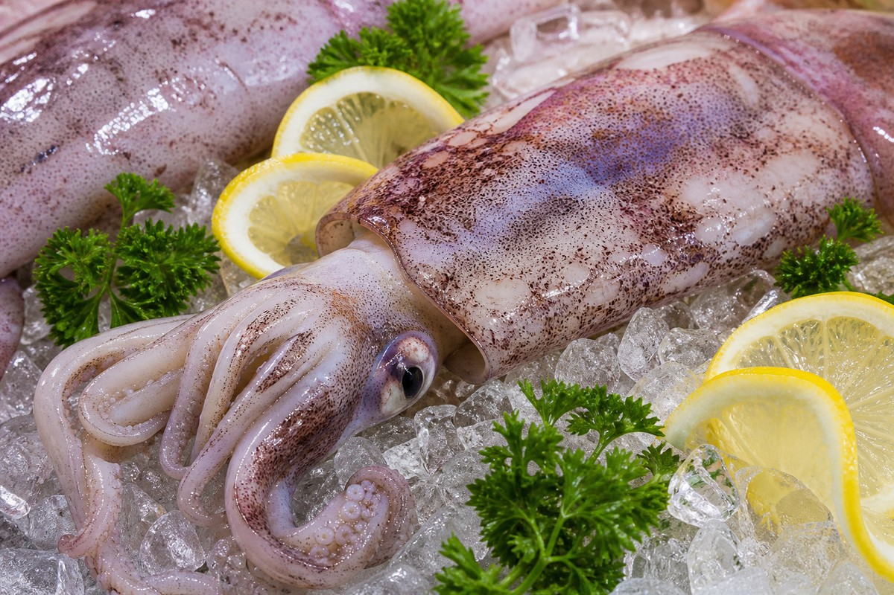

*▲ Representing cephalopod marine mollusks, squid (calamari) functions as nature's premier biological reservoir of free taurine, delivering over 15 grams of bioavailable nitrogenous protein at an energetic footprint of merely 92 calories per 100 grams.*

Within the disciplines of marine bioprospecting and clinical cardiovascular dietetics, **squid (*Teuthida*)** commands exceptional recognition as a nutrient-dense cephalopod delivering profound organ-protective and metabolic benefits.

The defining biochemical feature of squid tissue is its phenomenal concentration of **free intracellular taurine (2-aminoethanesulfonic acid, ~300 to 500 mg per 100g)**. This surpasses terrestrial livestock tissues by tenfold to sixteenfold. In human physiology, taurine acts as an obligatory substrate for hepatic bile acid conjugation, generating taurocholic and taurochenodeoxycholic acids that emulsify and purge endogenous cholesterol while inhibiting enterocytic micellar reabsorption.

Furthermore, squid represents an outstanding dietary protein vector characterized by severe lipid minimization: 100 grams of raw mantle tissue supplies **15.6 grams of complete protein against only 1.4 grams of total lipids** (92 kcal). Over 40% of its fatty acid profile consists of long-chain polyunsaturated **docosahexaenoic acid (DHA) and eicosapentaenoic acid (EPA)**, vital structural cofactors for endothelial nitric oxide production and neurocerebral membrane fluidity. Concurrently, squid supplies over 200% of adult daily thresholds for **copper (1.9 mg)** and over 80% for **selenium (44.8 mcg)**.

Synthesizing analytical baselines from the USDA FoodData Central repository and contemporary human metabolomic evaluations, this monograph details the quantitative nutrient spectrum, hepatoprotective pathways, and culinary thermodynamics of squid.

---

## 1. Quantitative Nutritional Composition (Per 100g Raw Cephalopod Mantle)

Squid exhibits high amino acid density, rich marine trace elements, and low caloric yield.

| Nutrient | Amount (per 100g) | Daily Value (% DV) |
| :--- | :--- | :--- |
| **Energy** | 92 kcal | 4.6% |
| **Water** | 78.50 g | Special classification¹ |
| **Protein** | 15.60 g | 31.2% |
| - Taurine | ~450.00 mg | Daily value not established |
| - Glutamic Acid | 2.18 g | Daily value not established |
| - Arginine | 1.15 g | Daily value not established |
| **Total Fat** | 1.40 g | 1.8% |
| - Saturated Fat | 0.38 g | 1.9% |
| - Monounsaturated Fat (MUFA) | 0.11 g | Daily value not established |
| - Polyunsaturated Fat (PUFA) | 0.52 g | Daily value not established |
| - Omega-3 Fatty Acids (EPA + DHA) | 0.50 g | Daily value not established |
| - Cholesterol | 233.00 mg | 77.7% |
| **Carbohydrates** | 3.10 g | 1.1% |
| - Total Sugars | 0.00 g | 0.0% |
| - Dietary Fiber | 0.00 g | 0.0% |
| **Vitamin B12 (Cobalamin)** | 1.30 mcg | 54.2% |
| **Vitamin B2 (Riboflavin)** | 0.42 mg | 32.3% |
| **Vitamin B3 (Niacin)** | 2.20 mg | 13.8% |
| **Vitamin E (Alpha-Tocopherol)** | 1.20 mg | 8.0% |
| **Copper (Cu)** | 1.90 mg | 211.1% |
| **Selenium (Se)** | 44.80 mcg | 81.5% |
| **Phosphorus (P)** | 221.00 mg | 17.7% |
| **Zinc (Zn)** | 1.50 mg | 13.6% |
| **Potassium (K)** | 246.00 mg | 5.2% |
| **Magnesium (Mg)** | 33.00 mg | 7.9% |

*※ Source: USDA FoodData Central Standard Reference (Mollusks, squid, mixed species, raw).*  
*¹ Water constitutes the biological protoplasmic medium rather than an established dietary reference value.*  
*※ 'Daily value not established' applies to non-proteinogenic amino sulfonic acids (taurine) and marine fatty acids lacking statutory DRI percentage limits.*

---

## 2. Four Clinically Validated Biological Benefits

### ① Hepatic Bile Acid Conjugation and Cholesterol Attenuation
The dense **taurine** reserves in squid accelerate bile acid amidation within hepatocytes, forming bile salts that bind luminal free cholesterol. This mechanism suppresses 7-alpha-hydroxylase degradation while increasing fecal sterol clearance. Clinical lipidology demonstrates that although squid contains native cholesterol (233 mg), its concurrent taurine ballast neutralizes mucosal lipid absorption, maintaining stable or improved systemic **LDL-to-HDL ratios**.

### ② Long-Chain Marine Omega-3 Endothelial Vasodilation
Supplying bioavailable **EPA and DHA**, squid modulates endothelial prostanoid production, shifting the hemostatic balance toward **prostacyclin (PGI2)** over thromboxane A2 (TXA2). This blunts platelet hyper-reactivity, diminishes peripheral vascular resistance, and inhibits coronary atheroma formation.

### ③ Copper-Selenium Synergism and Superoxide Radical Neutralization
Delivering over 200% of daily **copper**, squid fuels **ceruloplasmin** and lysyl oxidase synthesis, governing physiological iron transport and vascular collagen-elastin cross-linking. Combined with **selenium (44.8 mcg)**, which anchors the antioxidant enzyme **glutathione peroxidase**, squid shields cellular membranes against cytotoxic oxidative stress.

### ④ Myofibrillar Osmoregulation and Exercise Performance Recovery
Taurine functions as an essential cellular **osmolyte** within mammalian skeletal and cardiac musculature. It regulates sarcoplasmic reticulum calcium ATPase (**SERCA**) kinetics, attenuating exercise-induced intracellular calcium overload and expediting lactic acid dissipation following strenuous muscular contractions.

---

## 3. Optimizing Bioavailability and Culinary Thermodynamics

### Rapid Hydrothermal Blanching to Minimize Taurine Purging
Taurine is an exceptionally polar, hydrophilic zwitterion that rapidly leaches into boiling water. Prolonged water immersion expels up to 45% of intracellular taurine. Flash-blanching squid mantles for 30 to 50 seconds in boiling water or preparing it within whole-broth soups and bisques ensures 100% dietary capture of extracted taurine and marine peptides.

### Co-Ingestion with Organic Acid Matrices
Cephalopod muscle consists of interlocking helices of structural collagen and dense myofibrils that toughen when exposed to prolonged thermal heat. Dressing flash-cooked calamari with citric acid (fresh lemon) or acetic acid (vinegar) stimulates gastric hydrochloric acid secretion, accelerating peptic degradation and mucosal nutrient absorption.

---

## 4. Potential Adverse Reactions and Considerations

### Purine Density in Hyperuricemia and Gout
Cephalopod tissues contain moderate concentrations of cellular purine nucleosides (110–150 mg/100g). Patients with active acute gouty arthritis or severe hyperuricemia should moderate their intake and avoid pairing squid with purine-dense alcoholic beverages.

### Sodium Concentration in Dehydrated and Processed Varieties
While raw whole squid contains minimal sodium (~44 mg/100g), commercial dried shredded calamari often undergoes heavy salting and monosodium glutamate (MSG) curing, elevating sodium levels past 1,200 mg/100g. Hypertensive individuals should exclusively select fresh, minimally processed raw cuts.

---

## 5. Synergistic Food Pairings for Maximum Nutrient Absorption

- **[Tomato]({{ site.baseurl }}/en/posts/tomato-nutrition-benefits/)**: Natural malic and citric acids in tomatoes facilitate gastric cleavage of dense calamari proteins, while tomato potassium assists with electrolyte equilibrium.
- **[Onion]({{ site.baseurl }}/en/posts/onion-nutrition-benefits/)**: High quercetin concentrations in onions suppress lipid peroxidation of delicate marine omega-3 fatty acids and promote vascular endothelial integrity.
- **[Cabbage]({{ site.baseurl }}/en/posts/cabbage-nutrition-benefits/)**: S-methylmethionine (vitamin U) and sulforaphane in cabbage protect mucosal linings, ensuring smooth gastrointestinal transit of concentrated cephalopod protein.

---

## 6. Frequently Asked Questions (FAQ)

### Q1. Is it safe for hyperlipidemic individuals to consume squid despite its cholesterol content?
**A:** Yes. Clinical research affirms that dietary squid does not unfavorably alter serum LDL-C. Its exceptional taurine content directly inhibits intestinal cholesterol ester micellization and promotes hepatic bile excretion, neutralizing dietary sterol uptake.

### Q2. What is the white crystalline powder that forms on the surface of dried squid?
**A:** The superficial white coating consists of crystallized, high-purity **taurine, betaine, and glutamic acid** that migrate outward with evaporating moisture during dehydration. It is completely non-toxic and indicates functional nutrient preservation.

### Q3. Does retaining the pigmented outer skin of the squid offer nutritional benefits?
**A:** Yes. The external dermal mantle contains elevated concentrations of marine collagen peptides, ommochrome biochromes, and free taurine. Cooking squid with its skin intact maximizes bioactive antioxidant ingestion.

