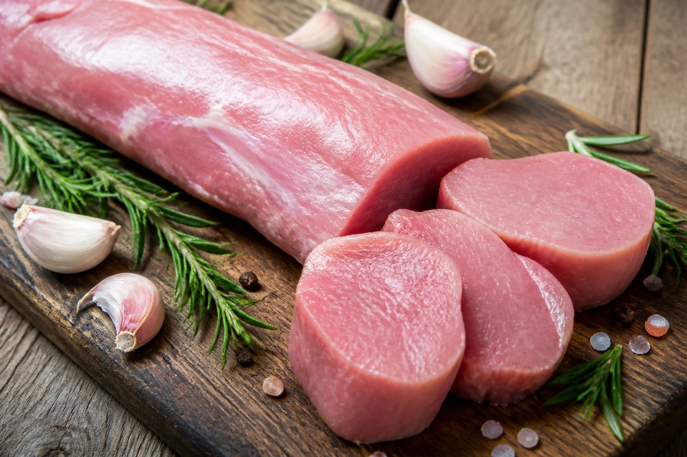

*▲ 돼지고기 부위 중 지방 함량이 3% 미만으로 가장 낮고 순수 단백질 밀도가 가장 높은 안심(Pork Tenderloin)은 소고기나 닭고기의 최대 10배에 달하는 고농도 비타민 B1(티아민)을 공급하는 최고의 에너지 대사 촉진 단백질원입니다.*

현대 스포츠 영양학과 임상 식이요법에서 **돼지고기 안심(Pork Tenderloin)**은 닭가슴살을 완벽히 대체하는 고단백·초저지방의 정점으로 평가받습니다.

돼지의 허리 안쪽에 위치한 안심살은 운동량이 적어 근섬유가 가늘고 부드러우며, 마블링(근내지방)이 거의 형성되지 않아 **지방 함량이 100g당 약 2~3g에 불과**합니다. 이는 껍질을 벗긴 닭가슴살과 대등한 수준의 초저지방 스펙트럼입니다.

더욱 주목할 점은 미세영양소의 압도적인 농도입니다. 돼지고기 안심 100g에는 성인 일일 권장량의 약 80~90%에 달하는 **비타민 B1(티아민, 약 0.95mg)**이 농축되어 있습니다. 티아민은 우리가 섭취한 탄수화물과 포도당을 세포 내 미토콘드리아에서 실질적인 에너지 화폐인 ATP로 전환하는 피루브산 탈수소효소의 핵심 보조효소(TPP)로 작용합니다. 따라서 격렬한 운동이나 과로로 체내에 젖산(Lactic Acid)이 누적되었을 때 이를 신속히 산화 분해하여 피로를 씻어내는 핵심 열쇠가 됩니다.

또한 체내 단백질 합성을 촉진하는 필수아미노산 9종과 BCAA(류신, 이소류신, 발린)가 풍부하며, 강력한 내인성 항산화 효소인 글루타티온 퍼옥시다아제의 핵심 구성 원소인 **셀레늄(38mcg)**이 풍부하게 들어 있습니다.

미국 농무부(USDA FoodData Central)의 표준 영양 분석 데이터를 바탕으로 돼지고기 안심의 정밀 영양 성분 분석표와 4대 건강 효능, 알리신 결합 흡수율 극대화 가이드 및 주의사항을 면밀히 분석합니다.

---

## 1. 돼지고기 안심 영양 성분 정밀 분석표 (가열 조리 전 생육 100g 기준)

돼지고기 안심은 100g당 120kcal의 낮은 열량 속에 21.8g의 고밀도 단백질을 응축하고 있으며, 포화지방은 1g 미만으로 제한된 모범적 다이어트 육류입니다.

| 영양 성분 (Nutrient) | 함량 (100g당) | 1일 권장 섭취량 비율 (한국인 성인 기준) |
| :--- | :--- | :--- |
| **열량 (Energy)** | 120 kcal | 6.0% |
| **수분 (Water)** | 74.20 g | 별도 표기¹ |
| **단백질 (Protein)** | 21.80 g | 39.6% |
| - 류신 (Leucine, BCAA) | 1.78 g | 기준치 없음 |
| - 라이신 (Lysine) | 1.85 g | 기준치 없음 |
| - 아르기닌 (Arginine) | 1.35 g | 기준치 없음 |
| **지방 (Total Fat)** | 2.80 g | 5.2% |
| - 포화지방산 (Saturated Fat) | 0.92 g | 6.1% |
| - 단일불포화지방산 (MUFA) | 1.12 g | 기준치 없음 |
| - 다가불포화지방산 (PUFA) | 0.42 g | 기준치 없음 |
| - 콜레스테롤 (Cholesterol) | 65.00 mg | 21.7% |
| **탄수화물 (Carbohydrates)** | 0.00 g | 0.0% |
| - 당류 (Total Sugars) | 0.00 g | 0.0% |
| - 식이섬유 (Dietary Fiber) | 0.00 g | 0.0% |
| **비타민 B1 (Thiamine)** | 0.95 mg | 79.2% |
| **비타민 B2 (Riboflavin)** | 0.22 mg | 15.7% |
| **비타민 B3 (Niacin)** | 4.20 mg | 28.0% |
| **비타민 B6 (Pyridoxine)** | 0.55 mg | 36.7% |
| **비타민 B12 (Cobalamin)** | 0.55 mcg | 22.9% |
| **칼륨 (Potassium, K)** | 420.00 mg | 12.0% |
| **인 (Phosphorus, P)** | 240.00 mg | 34.3% |
| **아연 (Zinc, Zn)** | 2.10 mg | 24.7% |
| **셀레늄 (Selenium, Se)** | 38.00 mcg | 69.1% |
| **철분 (Iron, Fe)** | 1.10 mg | 9.2% |

*※ 출처: 미국 농무부(USDA FoodData Central) 표준 분석 데이터 (Pork Tenderloin, Fresh, Raw 기준).*  
*¹ 수분은 육조직 내 단백질 수화 및 세포액 유지를 위한 기본 용매로 분류됩니다.*  
*※ '기준치 없음' 표기는 기능성 필수아미노산 및 불포화지방산으로 한국인 영양소 섭취기준(KDRIs)상 일일 권장 백분율(%DV)이 법적으로 규정되지 않은 항목입니다.*

---

## 2. 과학적으로 입증된 돼지고기 안심의 4대 건강 효능

### ① 티아민(비타민 B1) 주도 세포 에너지(ATP) 대사 촉진 및 만성 피로 타파
돼지고기 안심은 지구상에 존재하는 천연 식재료 중 단위 중량당 **비타민 B1(티아민)** 밀도가 가장 높은 식품군입니다. 티아민은 체내에서 티아민 피로인산(TPP)으로 활성화되어 탄수화물 대사의 핵심 단계인 피루브산 탈탄산 반응을 매개합니다. 혈중 당분이 젖산으로 정체되지 않고 크렙스 회로(TCA cycle)로 직행하여 폭발적인 미토콘드리아 ATP 에너지를 생성하도록 유도하므로, 피로 회복과 무기력증 해소에 즉각적인 생리적 효능을 발휘합니다.

### ② 지방 3% 미만의 고순도 아미노산 공급 및 근단백질 합성(MPS) 극대화
단백질 100g 섭취 시 동반되는 포화지방 부담이 거의 없는 돼지고기 안심은 근육 세포의 단백질 합성 스위치인 **mTORC1 경로**를 강하게 자극합니다. 특히 근육 동화에 필수적인 필수 분지쇄아미노산(BCAA) 중 **류신(Leucine, 1.78g)**이 풍부하여, 운동 후 근섬유 미세 손상의 초과 회복과 근감소증(Sarcopenia) 예방에 탁월한 기여를 합니다.

### ③ 고농도 셀레늄과 아연의 강력한 항산화 면역 방어벽 구축
안심 100g에는 일일 필요량의 약 70%에 달하는 **유기 셀레늄(38mcg)**이 농축되어 있습니다. 셀레늄은 세포막 지질의 과산화를 막는 **글루타티온 퍼옥시다아제(GPx)** 효소의 핵심 활성 중심을 구성하여 활성산소로부터 림프구와 면역세포를 보호합니다. 함께 함유된 **아연(2.1mg)**은 T세포 성숙과 DNA 복구 효소 활성을 도와 감염성 질환에 대한 저항력을 배가합니다.

### ④ 비타민 B군 복합체와 콜린의 신경 전달 물질 보존 및 스트레스 완화
안심에 고루 포진한 비타민 B6, B12, 나이아신은 중추신경계의 억제성 신경전달물질인 **가바(GABA)**와 기분 조절 호르몬인 **세로토닌** 합성을 돕습니다. 말초 신경 수초(Myelin Sheath)의 구조적 안정성을 유지하고 뇌 신경 피로를 줄여 집중력 회복과 심리적 안정에 기여합니다.

---

## 3. 유효 성분 흡수율을 극대화하는 조리·섭취 가이드

### 마늘·양파의 알리신과 결합한 '알리티아민' 시너지 생성
비타민 B1은 수용성 비타민으로 체내 저장 한계가 낮고 쉽게 배설되는 특성이 있습니다. 그러나 마늘, 양파, 부추에 풍부한 유황 화합물인 **알리신(Allicin)**과 함께 조리하면 결합체인 **알리티아민(Allithiamine)**으로 전환됩니다. 알리티아민은 장점막 흡수율이 일반 티아민 대비 수배 이상 높고 혈중 체류 시간이 비약적으로 길어져 지속적인 에너지 대사 활성화 효과를 누릴 수 있습니다.

### 저온 조리(수비드) 또는 단시간 시어링을 통한 티아민 보존
티아민은 열에 취약한 열민감성 영양소로 장시간 고온에서 삶거나 태우면 최대 40~50%까지 파괴될 수 있습니다. 안심은 지방이 적어 오래 익히면 수분이 빠져 퍽퍽해지므로, 60~63℃의 저온 수비드 공법으로 조리하거나 팬에서 겉면만 고온으로 빠르게 시어링(Searing)한 뒤 레스팅하여 육즙과 티아민을 90% 이상 보존하는 것이 최상의 조리법입니다.

---

## 4. 섭취 시 주의사항 및 잠재적 부작용

### 만성 신장 질환(CKD) 환자의 단백질·인 섭취 조절
돼지고기 안심은 인(Phosphorus, 240mg)과 칼륨(420mg)이 풍부한 고단백 식품입니다. 사구체 여과율(eGFR)이 저하된 만성 신부전 환자는 체내 인산염 정체로 인한 고인산혈증이나 신성 골이영양증 위험이 있으므로, 전문 임상영양사의 지침에 따라 1회 섭취량을 엄격히 조절해야 합니다.

### 중심부 가열 살균 온도 준수
과거와 달리 현대 사육 돈육의 기생충 위험은 사실상 사라졌으나, 살모넬라나 E. coli 등 세균성 식중독을 완벽히 방어하기 위해 조리 시 고기 중심 온도가 최소 63℃ 이상에 도달하도록 가열한 후 3분간 레스팅하여 안전하게 섭취해야 합니다.

---

## 5. 최종 요약 및 실천 팁

1. **육류 중 비타민 B1 압도적 1위:** 100g만으로 일일 티아민 필요량의 약 80%를 충족하여 젖산 축적을 막고 활력을 되찾아줍니다.
2. **지방 3% 미만의 고단백 식단:** 닭가슴살 수준의 저지방 스펙에 부드러운 육질과 풍부한 필수아미노산을 공급합니다.
3. **마늘·양파와 함께 저온 조리:** 알리신과 결합시켜 알리티아민의 흡수율을 극대화하고 오버쿠킹을 피해 티아민 손실을 방어하십시오.

---

## 6. 함께 먹으면 시너지가 폭발하는 식재료 궁합

- **[마늘 (Garlic)]({{ site.baseurl }}/posts/garlic-nutrition-benefits/)**: 마늘의 알리신 성분이 안심의 비타민 B1과 결합하여 체내 흡수율이 10배 이상 높은 지용성 알리티아민을 형성해 최강의 피로 회복 시너지를 완성합니다.
- **[양파 (Onion)]({{ site.baseurl }}/posts/onion-nutrition-benefits/)**: 양파의 퀘르세틴과 유황 화합물이 안심 단백질의 소화 흡수를 돕고 혈관벽에 콜레스테롤이 산화 축적되는 것을 이중 차단합니다.
- **[브로콜리 (Broccoli)]({{ site.baseurl }}/posts/broccoli-nutrition-benefits/)**: 브로콜리의 풍부한 비타민 C가 안심에 함유된 비헴철의 장내 환원 흡수를 촉진하고, 설포라판이 단백질 대사 부산물의 간 해독을 지원합니다.

---

## 7. 자주 묻는 질문 (FAQ)

### Q1. 돼지고기 안심은 닭가슴살과 비교했을 때 다이어트에 어떤 이점이 있나요?
**A:** 돼지고기 안심은 100g당 지방이 약 2.8g에 불과해 닭가슴살과 영양학적으로 동등한 초저지방 스펙을 지닙니다. 반면 닭가슴살 대비 비타민 B1(티아민) 함량이 5배 이상 높아 다이어트 중 겪기 쉬운 탄수화물 고갈성 무기력증과 피로를 예방하는 데 훨씬 유리하며, 근섬유가 가늘어 훨씬 부드럽게 섭취할 수 있습니다.

### Q2. 돼지고기를 바싹 익히지 않고 미디엄 정도로 살짝 붉은빛이 돌게 먹어도 안전한가요?
**A:** 네, 신선한 냉장 유통육의 경우 안전합니다. 미국 농무부(USDA) 가이드라인에 따르면 돼지고기는 중심 온도 62.8℃(145°F)에 도달한 후 3분간 레스팅하면 유해 세균이 사멸되어 안전성이 입증됩니다. 중심부가 연한 핑크빛을 띨 때 안심 특유의 극상의 연도와 풍부한 육즙을 즐길 수 있습니다.

### Q3. 안심 부위는 장조림이나 카레에 넣으면 왜 퍽퍽해질까요?
**A:** 안심은 결합조직(콜라겐)이나 지방이 거의 없는 순수 근섬유 덩어리이기 때문입니다. 장시간 보글보글 끓이는 습열 조리를 적용하면 근섬유 사이의 수분이 외부로 완전히 빠져나가 조직이 수축하면서 퍽퍽해집니다. 안심은 짧은 시간 동안 굽거나 튀기거나 저온 수비드로 익히는 조리법이 가장 이상적입니다.

