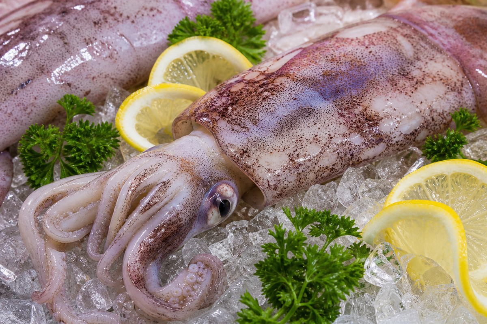

*▲ 연체동물 두족류를 대표하는 오징어(Squid)는 100g당 92kcal의 극저열량 대비 15g 이상의 순수 고품질 단백질과 육류의 수십 배에 달하는 천연 타우린(Taurine)을 공급하는 최고의 해양 보약입니다.*

해양 생화학과 임상 영양학에서 **오징어(Squid)**는 천연 피로 회복 성분의 집약체이자 심혈관 대사 건강을 지키는 기능성 수산물로 독보적인 위상을 차지합니다.

오징어의 가장 큰 생화학적 특성은 바로 **고농도 유리 아미노산인 타우린(Taurine, 100g당 약 300~500mg)**의 보고라는 점입니다. 이는 일반 어류의 2~3배, 소고기나 돼지고기 등 육류의 무려 16배에 달하는 압도적인 수치입니다. 타우린은 간세포 내에서 담즙산과 포합(Conjugation)체를 형성하여 담즙 분비를 촉진하고, 장내에서 음식물 유래 콜레스테롤이 흡수되는 것을 차단하며 간에 축적된 중성지방을 체외로 배출하는 강력한 간 해독 작용을 수행합니다.

또한 오징어는 100g당 열량이 **92kcal**에 불과하며 지방 함량이 1.4g 수준으로 매우 낮아 완벽한 고단백 다이어트 식품으로 기능합니다. 지방 성분의 대부분은 뇌 신경망 형성과 혈전 생성을 억제하는 **DHA와 EPA 오메가3 불포화지방산**으로 채워져 있습니다. 여기에 적혈구 조혈 작용을 돕는 **구리(Copper)**와 강력한 항산화 미네랄인 **셀레늄(Selenium, 44.8mcg)**이 성인 일일 권장량의 80% 이상 농축되어 있습니다.

미국 농무부(USDA FoodData Central)의 표준 분석 데이터를 바탕으로 오징어의 정밀 영양 성분 프로필과 4대 건강 효능, 타우린 손실을 막는 조리 과학 및 주의사항을 면밀히 분석합니다.

---

## 1. 오징어 영양 성분 정밀 분석표 (가열 조리 전 생물 100g 기준)

오징어는 100g당 92kcal의 가벼운 칼로리 속에 15.6g의 양질의 단백질과 고농도 타우린, 풍부한 미량 미네랄을 이상적으로 조화시킨 영양 밀도 1등급 수산물입니다.

| 영양 성분 (Nutrient) | 함량 (100g당) | 1일 권장 섭취량 비율 (한국인 성인 기준) |
| :--- | :--- | :--- |
| **열량 (Energy)** | 92 kcal | 4.6% |
| **수분 (Water)** | 78.50 g | 별도 표기¹ |
| **단백질 (Protein)** | 15.60 g | 28.4% |
| - 타우린 (Taurine) | 약 450.00 mg | 기준치 없음 |
| - 글루탐산 (Glutamic Acid) | 2.18 g | 기준치 없음 |
| - 아르기닌 (Arginine) | 1.15 g | 기준치 없음 |
| **지방 (Total Fat)** | 1.40 g | 2.6% |
| - 포화지방산 (Saturated Fat) | 0.38 g | 2.5% |
| - 단일불포화지방산 (MUFA) | 0.11 g | 기준치 없음 |
| - 다가불포화지방산 (PUFA) | 0.52 g | 기준치 없음 |
| - 오메가3 (DHA + EPA) | 0.50 g | 기준치 없음 |
| - 콜레스테롤 (Cholesterol) | 233.00 mg | 77.7% |
| **탄수화물 (Carbohydrates)** | 3.10 g | 1.0% |
| - 당류 (Total Sugars) | 0.00 g | 0.0% |
| - 식이섬유 (Dietary Fiber) | 0.00 g | 0.0% |
| **비타민 B12 (Cobalamin)** | 1.30 mcg | 54.2% |
| **비타민 B2 (Riboflavin)** | 0.42 mg | 30.0% |
| **비타민 B3 (Niacin)** | 2.20 mg | 14.7% |
| **비타민 E (Alpha-Tocopherol)** | 1.20 mg | 10.0% |
| **구리 (Copper, Cu)** | 1.90 mg | 237.5% |
| **셀레늄 (Selenium, Se)** | 44.80 mcg | 81.5% |
| **인 (Phosphorus, P)** | 221.00 mg | 31.6% |
| **아연 (Zinc, Zn)** | 1.50 mg | 17.6% |
| **칼륨 (Potassium, K)** | 246.00 mg | 7.0% |
| **마그네슘 (Magnesium, Mg)** | 33.00 mg | 10.5% |

*※ 출처: 미국 농무부(USDA FoodData Central) 표준 분석 데이터 (Mollusks, Squid, Raw 기준).*  
*¹ 수분은 연체 해양생물의 세포 원형질 및 체액 유지를 위한 기본 용매로 분류됩니다.*  
*※ '기준치 없음' 표기는 기능성 유리 아미노산(타우린) 및 오메가3 불포화지방산으로 한국인 영양소 섭취기준(KDRIs)상 일일 권장 백분율(%DV)이 법적으로 규정되지 않은 항목입니다.*

---

## 2. 과학적으로 입증된 오징어의 4대 건강 효능

### ① 고농도 타우린 주도 간세포 담즙산 포합 및 혈중 콜레스테롤 배출
오징어의 핵심 생리활성 물질인 **타우린**은 간세포 내 담즙산과 결합하여 **타우로콜산(Taurocholic acid)**을 생성합니다. 이는 체내 콜레스테롤 분해 배설을 촉진하고 소장 내 미셀 흡수를 억제하여 혈중 저밀도 지단백(LDL) 콜레스테롤을 선택적으로 낮춥니다. 비록 오징어 자체에 콜레스테롤이 함유되어 있으나, 풍부한 타우린이 인체 내 콜레스테롤 흡수를 상쇄하고 대사를 가속화하므로 실제 혈중 지질 프로필을 유의미하게 개선합니다.

### ② 해양 오메가3(EPA·DHA)의 혈소판 응집 억제 및 혈관 탄력 보존
오징어의 지질 분획에 풍부한 **EPA(에이코사펜타엔산)**와 **DHA(도코사헥사엔산)**는 혈관 내피세포의 프로스타사이클린(PGI2) 생성을 촉진하여 혈전 형성을 억제합니다. 말초 혈관 저항을 낮추고 동맥경화반 축적을 방지하여 고혈압 및 심근경색 등 허혈성 심혈관계 질환 예방에 기여합니다.

### ③ 유기 셀레늄과 구리의 강력한 항산화 및 조혈 기능 촉진
오징어 100g에는 일일 필요량을 훌쩍 넘어서는 **구리(1.9mg, 237% DV)**와 **셀레늄(44.8mcg, 81% DV)**이 응축되어 있습니다. 구리는 철분을 헤모글로빈으로 전환하는 페록시다아제(세룰로플라스민) 효소의 필수 인자로 작용하여 빈혈을 예방하고 결합조직 합성을 지원합니다. 셀레늄은 백혈구 세포막을 산화적 손상으로부터 보호하여 면역계를 견고히 지킵니다.

### ④ 인슐린 분비 촉진 및 운동 후 골격근 전해질·피로 회복
타우린은 췌장 베타세포의 칼슘 채널 항상성을 조율하여 인슐린 민감성을 향상시킵니다. 또한 골격근 세포 내에서 삼투압 조절 인자로 작용하여 고강도 운동 후 발생하는 근육 세포의 부종과 젖산 누적을 빠르게 정상화하며, 심근 수축력을 강화하여 전신 활력을 배가합니다.

---

## 3. 유효 성분 흡수율을 극대화하는 조리·섭취 가이드

### 단시간 살짝 데치는 조리법을 통한 수용성 타우린 보존
타우린은 물에 쉽게 녹는 수용성 아미노산입니다. 오징어를 끓는 물에 장시간 삶으면 타우린의 40% 이상이 국물로 유출됩니다. 따라서 숙회로 즐길 때는 끓는 물에 30~50초간 살짝 데쳐 건져내거나, 국물 요리(해물탕, 오징어국)로 조리하여 타우린이 녹아든 국물까지 함께 섭취하는 것이 생리학적으로 가장 우수합니다.

### 식초·레몬 등 유기산을 곁들인 단백질 소화 효소 활성화
오징어의 근섬유는 가열 시 나선형으로 강하게 수축하여 자칫 질겨질 수 있습니다. 초고추장의 식초나 신선한 레몬즙의 구연산 등 유기산과 함께 섭취하면 위산 분비를 촉진하여 조밀한 오징어 단백질의 펩신 소화율이 극대화되며, 타우린의 장점막 통과를 돕습니다.

---

## 4. 섭취 시 주의사항 및 잠재적 부작용

### 통풍 및 고요산혈증 환자의 퓨린 섭취 주의
오징어는 연체류 특성상 핵산과 퓨린(Purine) 함량이 다소 높은 식품(100g당 약 110~150mg)에 속합니다. 체내 요산 수치가 높은 고요산혈증 환자나 급성 통풍 발작 위험이 있는 환자는 오징어 과다 섭취를 피하고 알코올과의 동시 섭취를 엄격히 제한해야 합니다.

### 마른 오징어의 나트륨 및 치아 손상 주의
생물 오징어와 달리 건조 오징어는 수분이 증발하면서 중량당 나트륨 함량이 크게 증가하고 식감이 질겨집니다. 고혈압 환자는 염분이 높은 조미 마른 오징어 대신 신선한 생물 오징어를 저염으로 조리해 섭취하는 것이 바람직합니다.

---

## 5. 최종 요약 및 실천 팁

1. **소고기 16배의 천연 타우린:** 간 해독과 담즙산 분비를 촉진해 피로를 풀고 혈관 속 노폐물을 청소합니다.
2. **92kcal의 고단백 저지방 식품:** 풍부한 EPA·DHA와 조혈 미네랄(구리·셀레늄)로 활력을 채웁니다.
3. **살짝 데치거나 국물까지 섭취:** 수용성 타우린 손실을 막기 위해 가열 시간을 1분 내외로 줄이고 유기산과 함께 즐기십시오.

---

## 6. 함께 먹으면 시너지가 폭발하는 식재료 궁합

- **[토마토 (Tomato)]({{ site.baseurl }}/posts/tomato-nutrition-benefits/)**: 토마토의 풍부한 칼륨이 오징어의 나트륨 배출을 돕고, 상큼한 구연산이 오징어 단백질의 소화 분해를 촉진하며 지용성 라이코펜 흡수를 돕습니다.
- **[양파 (Onion)]({{ site.baseurl }}/posts/onion-nutrition-benefits/)**: 양파의 항산화 퀘르세틴이 오징어의 오메가3 불포화지방산 산패를 차단하고 혈관벽의 산화 질소 생성을 자극해 혈압 안정 시너지를 냅니다.
- **[양배추 (Cabbage)]({{ site.baseurl }}/posts/cabbage-nutrition-benefits/)**: 양배추의 비타민 U(S-메틸메티오닌)가 위벽을 보호하여 고단백 오징어가 위장에 부담 없이 부드럽게 소화 흡수되도록 완충해 줍니다.

---

## 7. 자주 묻는 질문 (FAQ)

### Q1. 오징어에 콜레스테롤이 많다는데 고지혈증 환자가 먹어도 괜찮나요?
**A:** 네, 안심하고 드셔도 됩니다. 오징어 100g당 콜레스테롤이 약 230mg 포함되어 있으나, 이를 압도하는 고농도 타우린(약 450mg)이 장내 콜레스테롤 흡수를 강력히 억제하고 간에서 담즙산으로의 전환 배출을 촉진합니다. 실제 임상 연구에서도 오징어 섭취가 혈중 LDL 수치를 올리지 않음이 확인되었습니다.

### Q2. 마른 오징어 표면에 묻어 있는 하얀 가루는 곰팡이인가요?
**A:** 아닙니다. 하얀 가루의 정체는 오징어가 건조되는 과정에서 내부의 수분과 함께 배출되어 결정화된 고순도 **타우린과 베타인** 성분입니다. 천연 피로 회복 유효 성분이 농축된 것이므로 털어내지 않고 그대로 섭취하셔도 안전합니다.

### Q3. 오징어를 껍질째 먹는 것이 영양학적으로 더 좋은가요?
**A:** 그렇습니다. 오징어 껍질에는 천연 펩타이드와 타우린, 항산화 색소인 오모크롬이 고농도로 집적되어 있습니다. 질기지 않다면 껍질을 벗기지 않고 그대로 조리하는 것이 생리활성 성분을 온전히 섭취하는 최고의 방법입니다.

