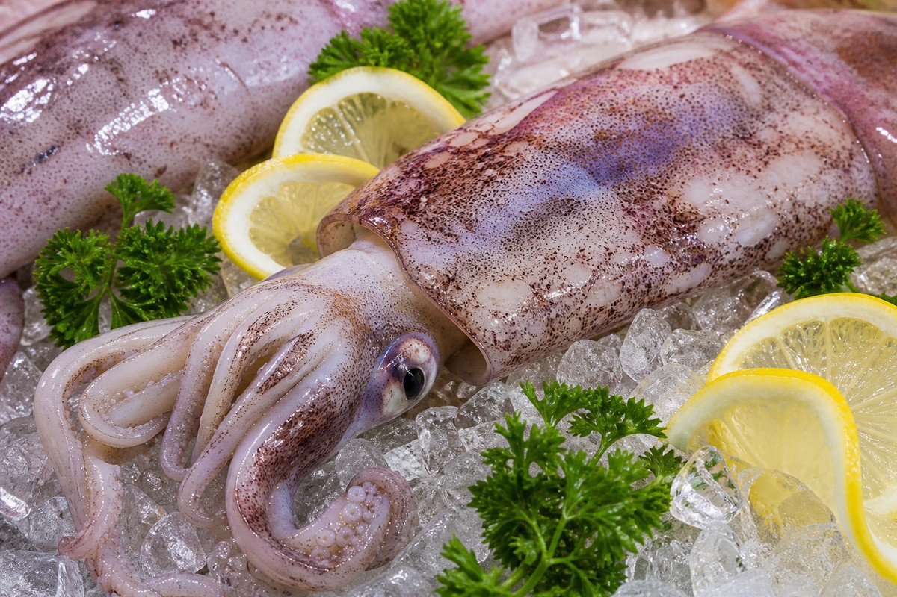

*▲ 생오징어는 단백질과 타우린을 함유한 수산물입니다. 조리와 건조 여부에 따라 100g당 성분은 달라집니다.*

한 줄 결론 <strong>생오징어 100g은 92kcal, 단백질 15.6g, 지방 1.4g입니다.</strong> 타우린은 담즙산 합성에 관여하는 아미노산이고, 저지방 고단백이라 다이어트 중 단백질 공급원으로 쓸 수 있습니다. 다만 콜레스테롤은 100g당 233mg입니다.

**오징어(Squid)**는 단백질과 타우린을 함께 섭취할 수 있는 저지방 수산물입니다.

오징어에는 타우린이 들어 있습니다. 타우린은 담즙산 포합 등 생리 과정에 관여하지만, 오징어 섭취가 간 해독이나 혈중 지질 개선을 보장한다는 임상적 근거는 이 글에서 확인되지 않았습니다.

또한 오징어는 100g당 열량이 **92kcal**이고 지방이 1.4g으로 적어 단백질 공급원으로 쓰기 좋습니다. 지방에는 **DHA·EPA**가 0.5g 들어 있고, 구리(1.9mg)와 셀레늄(44.8mcg)도 함께 섭취할 수 있습니다. 다만 콜레스테롤이 100g당 233mg이라는 점은 같이 기억해야 합니다.

미국 농무부(USDA FoodData Central) 표준 분석 데이터를 기준으로 오징어의 영양 성분, 영양학적으로 의미 있는 4가지 포인트, 조리법과 주의사항을 정리합니다.

---

## 1. 오징어 칼로리와 영양성분은? (단백질 15.6g·아연 1.5mg)

오징어는 100g당 92kcal에 단백질 15.6g, 타우린 약 450mg을 담은 수산물입니다. 다만 콜레스테롤 233mg·나트륨·퓨린도 함께 고려해야 합니다.

| 영양 성분 (Nutrient) | 함량 (100g당) | 1일 권장 섭취량 비율 (한국인 성인 기준) |
| :--- | :--- | :--- |
| **열량 (Energy)** | 92 kcal | 4.6% |
| **수분 (Water)** | 78.50 g | 별도 표기¹ |
| **단백질 (Protein)** | 15.60 g | 28.4% |
| - 타우린 (Taurine) | 약 450.00 mg | 기준치 없음 |
| - 글루탐산 (Glutamic Acid) | 2.18 g | 기준치 없음 |
| - 아르기닌 (Arginine) | 1.15 g | 기준치 없음 |
| **지방 (Total Fat)** | 1.40 g | 2.6% |
| - 포화지방산 (Saturated Fat) | 0.38 g | 2.5% |
| - 단일불포화지방산 (MUFA) | 0.11 g | 기준치 없음 |
| - 다가불포화지방산 (PUFA) | 0.52 g | 기준치 없음 |
| - 오메가3 (DHA + EPA) | 0.50 g | 기준치 없음 |
| - 콜레스테롤 (Cholesterol) | 233.00 mg | 77.7% |
| **탄수화물 (Carbohydrates)** | 3.10 g | 1.0% |
| - 당류 (Total Sugars) | 0.00 g | 0.0% |
| - 식이섬유 (Dietary Fiber) | 0.00 g | 0.0% |
| **비타민 B12 (Cobalamin)** | 1.30 mcg | 54.2% |
| **비타민 B2 (Riboflavin)** | 0.42 mg | 30.0% |
| **비타민 B3 (Niacin)** | 2.20 mg | 14.7% |
| **비타민 E (Alpha-Tocopherol)** | 1.20 mg | 10.0% |
| **구리 (Copper, Cu)** | 1.90 mg | 237.5% |
| **셀레늄 (Selenium, Se)** | 44.80 mcg | 81.5% |
| **인 (Phosphorus, P)** | 221.00 mg | 31.6% |
| **아연 (Zinc, Zn)** | 1.50 mg | 17.6% |
| **칼륨 (Potassium, K)** | 246.00 mg | 7.0% |
| **마그네슘 (Magnesium, Mg)** | 33.00 mg | 10.5% |

*※ 출처: 미국 농무부(USDA FoodData Central) 표준 분석 데이터 (Mollusks, Squid, Raw 기준).*  
*¹ 수분은 연체 해양생물의 세포 원형질 및 체액 유지를 위한 기본 용매로 분류됩니다.*  
*※ '기준치 없음' 표기는 기능성 유리 아미노산(타우린) 및 오메가3 불포화지방산으로 한국인 영양소 섭취기준(KDRIs)상 일일 권장 백분율(%DV)이 법적으로 규정되지 않은 항목입니다.*

---

## 2. 오징어의 영양학적 포인트 4가지

### ① 타우린과 담즙산 대사
오징어에는 **타우린**이 100g당 약 450mg 들어 있습니다. 타우린은 간에서 담즙산과 결합해 타우로콜산을 만드는 데 쓰이는 아미노산입니다. 다만 오징어를 먹는 양으로 혈중 LDL 콜레스테롤이 낮아진다는 근거는 부족합니다. 오징어 100g의 콜레스테롤은 233mg으로 하루 기준치의 상당 부분을 차지하므로, 고지혈증이 있다면 1회 양과 횟수를 조절하고 전체 식단의 포화지방을 함께 봐야 합니다.

### ② 오메가3 지방산(EPA·DHA) 0.5g
오징어 지방에는 **EPA**와 **DHA**가 100g당 0.5g 들어 있습니다. EPA·DHA는 혈소판 응집과 혈관 기능에 관여한다는 연구가 있지만, 이는 하루 1~2g 이상을 꾸준히 섭취했을 때 관찰된 결과이고 오징어 100g의 0.5g으로 같은 효과를 기대하기는 어렵습니다. 오메가3 섭취가 필요하다면 등푸른 생선이나 보충제를 함께 고려하세요.

### ③ 구리와 셀레늄: 미량 영양소 공급원
오징어 100g에는 **구리 1.9mg(일일 기준치 대비 237%)**와 **셀레늄 44.8mcg(81%)**가 들어 있습니다. 구리는 철 대사와 결합조직 합성에 관여하는 효소의 구성 성분이고, 셀레늄은 체내 항산화 효소(글루타치온 과산화효소)의 구성 성분입니다. 둘 다 결핍을 막는 데 필요하지만, 충분히 먹고 있는 사람이 더 먹는다고 빈혈이 낫거나 면역력이 세지는 것은 아닙니다.

### ④ 타우린과 운동·혈당 관련 연구
타우린은 인슐린 분비와 근육의 삼투압 조절에 관여한다는 연구가 있습니다. 다만 이는 주로 보충제나 동물·세포 실험 수준의 결과이고, 오징어를 먹는 양으로 혈당이 개선되거나 운동 후 피로가 빨리 풀린다는 근거는 부족합니다.

---

## 3. 오징어는 오래 삶으면 왜 질겨질까? 타우린과 조리 시간

### 단시간 살짝 데치는 조리법을 통한 수용성 타우린 보존
타우린은 물에 잘 녹는 아미노산입니다. 오징어를 오래 삶으면 타우린이 국물로 빠져나갈 수 있습니다. 숙회로 즐길 때는 끓는 물에 30~50초 정도만 데치거나, 국물 요리라면 국물까지 함께 먹는 편이 합리적입니다. 정확한 유출률은 조리 조건에 따라 달라집니다.

### 식초·레몬 등 유기산을 곁들인 단백질 소화 효소 활성화
오징어의 근섬유는 가열하면 수축해 질겨지기 쉽습니다. 초고추장의 식초나 레몬즙 같은 유기산을 곁들이면 맛이 깔끔해지고 비린 맛을 줄이는 데 도움이 됩니다. 소화율이 극대화된다는 식의 표현은 과장입니다.

---

## 4. 오징어 부작용과 주의할 점은?

### 통풍 및 고요산혈증 환자의 퓨린 섭취 주의
오징어는 연체류 특성상 핵산과 퓨린(Purine) 함량이 다소 높은 식품(100g당 약 110~150mg)에 속합니다. 체내 요산 수치가 높은 고요산혈증 환자나 급성 통풍 발작 위험이 있는 환자는 오징어 과다 섭취를 피하고 알코올과의 동시 섭취를 엄격히 제한해야 합니다.

### 마른 오징어의 나트륨 및 치아 손상 주의
생물 오징어와 달리 건조 오징어는 수분이 증발하면서 중량당 나트륨 함량이 크게 증가하고 식감이 질겨집니다. 고혈압 환자는 염분이 높은 조미 마른 오징어 대신 신선한 생물 오징어를 저염으로 조리해 섭취하는 것이 바람직합니다.

---

## 5. 오징어 하루 얼마나 먹을까? 핵심 요약

1. **타우린:** 담즙산 대사에 관여하는 성분이며, 식품 섭취만으로 특정 치료 효과를 기대할 수는 없습니다.
2. **92kcal의 고단백 저지방 식품:** 단백질 15.6g과 EPA·DHA 0.5g, 구리·셀레늄을 함께 얻습니다.
3. **살짝 데치거나 국물까지:** 오래 삶으면 타우린이 국물로 빠지므로 가열 시간을 줄이는 편이 좋습니다. 콜레스테롤은 100g당 233mg입니다.

---

## 6. 오징어와 함께 먹으면 좋은 음식은?

- **[토마토 (Tomato)]({{ site.baseurl }}/posts/tomato-nutrition-benefits/)**: 토마토의 칼륨은 나트륨 배출에 관여하고, 라이코펜은 기름과 함께 조리할 때 흡수가 좋아집니다.
- **[양파 (Onion)]({{ site.baseurl }}/posts/onion-nutrition-benefits/)**: 양파의 퀘르세틴 같은 플라보노이드를 함께 섭취할 수 있고, 양파의 매운맛이 오징어 요리의 비린 맛을 줄여 줍니다.
- **[양배추 (Cabbage)]({{ site.baseurl }}/posts/cabbage-nutrition-benefits/)**: 양배추는 식이섬유와 비타민 C를 더하는 채소입니다. 위벽을 보호한다는 표현은 과장이고, 부드럽게 데쳐 곁들이면 식감이 잘 맞습니다.

---

## 7. 자주 묻는 질문 (FAQ)

### Q1. 오징어에 콜레스테롤이 많다는데 고지혈증 환자가 먹어도 괜찮나요?
**A:** 오징어 100g에는 콜레스테롤이 약 233mg 들어 있습니다. 타우린이 담즙산 대사에 관여하기는 하지만, 오징어 섭취가 혈중 LDL을 낮춘다는 임상 근거는 확립되어 있지 않습니다. 고지혈증이 있다면 오징어를 '안심하고 많이' 먹기보다 1회 100g 안팎으로 양을 정하고, 튀김·조미 마른오징어처럼 기름과 염분이 많은 형태를 피하며, 전체 식단의 포화지방을 줄이는 것이 우선입니다. 약을 복용 중이라면 주치의와 상의하세요.

### Q2. 마른 오징어 표면에 묻어 있는 하얀 가루는 곰팡이인가요?
**A:** 마른 오징어 표면의 하얀 가루는 건조 과정에서 타우린·베타인 등이 결정화된 것으로 설명되기도 하지만, 제품·보관 상태에 따라 염분이나 변질일 수도 있습니다. 곰팡이 냄새·색 변화·끈적임이 있으면 먹지 말고, 밀봉해 냉장·냉동 보관하세요. 하얀 가루가 있다고 해서 아무 상태나 먹어도 안전한 것은 아닙니다.

### Q3. 오징어를 껍질째 먹는 것이 영양학적으로 더 좋은가요?
**A:** 오징어 껍질에는 오모크롬 같은 색소가 있고 타우린도 일부 들어 있습니다. 다만 껍질째 먹는 것이 영양학적으로 '최고'라고 단정할 근거는 없습니다. 껍질이 질기거나 비린 맛이 신경 쓰이면 벗겨도 영양 차이는 크지 않습니다.

  
📌 관련 순위 가이드

  <ul>
    <li><a href="/posts/high-protein-foods-ranking/">단백질 많은 음식 TOP 10: 100g당 함량과 흡수율 비교</a></li>
    <li><a href="/posts/low-calorie-high-satiety-foods/">저칼로리 포만감 다이어트 음식 TOP 10: 100g 비교</a></li>
  </ul>

**추가 참고:** [타우린과 담즙산 대사에 관한 문헌 리뷰](https://pubmed.ncbi.nlm.nih.gov/35954180/). 이 리뷰는 오징어의 치료 효과를 입증한 시험이 아닙니다.
