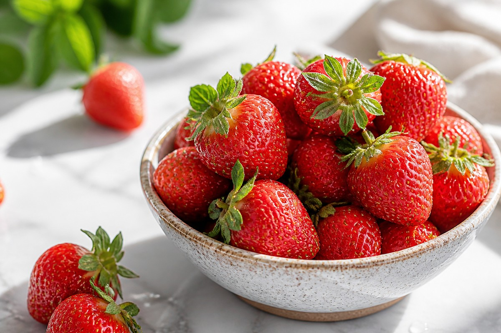

*▲ Delivering just 32 kcal and under 5 grams of sugar per 100 grams, fresh strawberries combine high-density vitamin C with pelargonidin-based anthocyanins and ellagic acid to support endothelial nitric oxide signaling and blunted postprandial glucose excursions.*

Within clinical nutrition and cardiometabolic research, **strawberries (*Fragaria × ananassa*)** occupy a distinct category among sweet fruits: they deliver intense aromatic flavor while imposing minimal glycemic load.

Unlike high-fructose tropical fruits that can provoke sharp postprandial insulin surges, 100 grams of raw strawberries contain only **4.89 grams of total sugars** alongside **2.0 grams of dietary fiber**, yielding a low glycemic index (GI ~40). More importantly, polyphenolic compounds concentrated in the red pericarp and achenes—specifically **anthocyanins (predominantly pelargonidin-3-glucoside)** and **ellagitannins**—competitively inhibit intestinal alpha-glucosidase and pancreatic alpha-amylase activity, attenuating carbohydrate absorption kinetics when consumed alongside starch-rich meals.

Furthermore, strawberries outperform citrus fruits on an equal-weight basis for **ascorbic acid (vitamin C)**, supplying **58.8 mg per 100g** (65% of the U.S. Daily Value) compared to 53.2 mg in navel oranges. Beyond immune competence and collagen hydroxylation, this high ascorbic acid concentration markedly enhances non-heme iron bioavailability in plant-forward diets.

Drawing on USDA FoodData Central analytical profiles and randomized human feeding trials, this monograph details the nutrient matrix, vascular biochemistry, and optimal preparation strategies for fresh strawberries.

---

## 1. Quantitative Nutritional Composition (Per 100g Raw Strawberries)

Strawberries are composed of nearly 91% water, offering exceptional micronutrient-to-calorie efficiency with negligible lipid content.

| Nutrient | Per 100 g | U.S. %DV |
| :--- | :--- | :--- |
| **Energy** | 32 kcal | 1.6% |
| **Water** | 90.95 g | See note¹ |
| **Carbohydrates** | 7.68 g | 2.8% |
| - Total Sugars | 4.89 g | See note¹ |
| - Dietary Fiber | 2.00 g | 7.1% |
| **Protein** | 0.67 g | 1.3% |
| **Total Fat** | 0.30 g | 0.4% |
| - Saturated Fat | 0.02 g | 0.1% |
| - Cholesterol | 0.00 mg | 0.0% |
| **Vitamin C** | 58.80 mg | 65.3% |
| **Folate (DFE)** | 24.00 mcg | 6.0% |
| **Vitamin K** | 2.20 mcg | 1.8% |
| **Manganese** | 0.39 mg | 17.0% |
| **Potassium** | 153.00 mg | 3.3% |
| **Magnesium** | 13.00 mg | 3.1% |
| **Iron** | 0.41 mg | 2.3% |
| **Anthocyanins & Ellagic Acid** | Concentrated | No DV |

*¹ How to read this table: Percent Daily Values (%DV) are calculated against the standard 2,000-kcal U.S. FDA adult reference intake. Items regulated as total intake limits or hydration baselines without an absolute daily requirement (water, total sugars) are marked 'See note¹', while non-essential bioactive phytochemicals carry 'No DV' (Daily Value not established).*

---

## 2. Four Evidence-Based Physiological Benefits

### 1) Endothelial Nitric Oxide Support and LDL Oxidation Defense
Controlled human crossover trials demonstrate that regular strawberry polyphenol intake reduces circulating malondialdehyde (MDA) and oxidized low-density lipoprotein (oxLDL) markers. Anthocyanins activate endothelial nitric oxide synthase (eNOS), promoting vasodilation and maintaining healthy microvascular blood flow.

### 2) Postprandial Glycemic Attenuation and Insulin Sensitivity
When paired with high-glycemic meals, strawberry ellagitannins and anthocyanins slow luminal disaccharide hydrolysis and downregulate sodium-glucose cotransporter 1 (SGLT1) flux. Clinical studies in insulin-resistant adults show measurable reductions in post-meal insulin demand following daily whole-strawberry supplementation.

### 3) High-Density Vitamin C for Collagen Matrix & Immunity
Providing 65% of daily vitamin C requirements per 100g, strawberries supply critical reducing equivalents for prolyl and lysyl hydroxylases—enzymes required to cross-link dermal and vascular collagen fibers—while sustaining neutrophil chemotaxis during immune challenges.

### 4) Ellagic Acid and Fisetin Cellular Stress Modulation
Strawberries are a primary dietary source of ellagic acid and the flavonol fisetin. These polyphenols scavenge reactive oxygen species (ROS) directly and upregulate Nrf2-mediated phase II detoxification enzymes, protecting cellular lipids and nucleic acids from oxidative wear.

---

## 3. Preparation & Bioavailability Guidelines

- **Rinse With Calyx Intact:** Because vitamin C and anthocyanins are water-soluble, soaking hulled strawberries leaches micronutrients into the wash water. Rinse whole berries briefly under cool running water for 20–30 seconds and remove the green stems immediately before eating.
- **Pair With Unsweetened Dairy or Plant Fats:** Combining strawberries with Greek yogurt, kefir, or sliced avocado buffers mild organic acids and facilitates micellar uptake of fat-soluble carotenoids.
- **Portion Benchmarking:** A standard metabolic-friendly serving is **150 g (roughly 7–9 medium berries, ~48 kcal)** consumed whole rather than juiced.

---

## 4. Safety Considerations & Contraindications

- **Moderate Oxalate Content:** Individuals with a history of recurrent calcium oxalate nephrolithiasis should moderate large servings and maintain adequate hydration.
- **Natural Salicylates & Oral Allergy:** Strawberries contain trace natural salicylates and birch-pollen cross-reactive proteins; sensitive individuals may experience mild oral pruritus.
- **FODMAP Tolerance:** Strawberries are low-FODMAP in standard 65–150g portions, though excessive intake (>250g in one sitting) may trigger bloating in irritable bowel syndrome (IBS).

---

## 5. Key Takeaways & Practical Tips

1. **High Nutrient-to-Sugar Ratio:** At 32 kcal and 4.89 g sugar per 100g, strawberries deliver sweet flavor without heavy glycemic impact.
2. **Superior Vitamin C Source:** A single 150g bowl covers nearly 98% of the U.S. Daily Value for vitamin C.
3. **Preserve Whole Matrix:** Wash before hulling and eat berries whole to retain intact fiber and polyphenol synergy.

---

## 6. Synergistic Food Pairings

- **[Spinach]({{ site.baseurl }}/en/posts/spinach-nutrition-benefits/)**: Strawberry ascorbic and citric acids reduce plant-based ferric iron into its absorbable ferrous form, multiplying non-heme iron uptake from leafy greens.
- **[Blueberry]({{ site.baseurl }}/en/posts/blueberry-nutrition-benefits/)**: Pairing strawberry pelargonidin with blueberry malvidin and delphinidin creates a broader polyphenol spectrum for neurovascular and retinal antioxidant defense.
- **[Avocado]({{ site.baseurl }}/en/posts/avocado-nutrition-benefits/)**: Monounsaturated oleic acid in avocado enhances intestinal absorption of fat-soluble micronutrients and slows gastric emptying further.

---

## 7. Frequently Asked Questions (FAQ)

### Q1. Should strawberries be soaked in vinegar or salt water before eating?
**A:** Prolonged soaking is not recommended. Because strawberries have a porous, delicate skin and water-soluble vitamin C and anthocyanins, soaking them for several minutes draws out both flavor and micronutrients. A 20–30 second rinse under cool running water with the green caps still attached is ideal.

### Q2. Are frozen strawberries as nutritious as fresh ones?
**A:** Yes. Commercially flash-frozen strawberries are harvested at peak ripeness and retain nearly identical levels of anthocyanins, ellagic acid, fiber, and minerals. To avoid losing water-soluble vitamin C in thaw drip, blend frozen berries directly into smoothies or fold them into yogurt while still chilled.

### Q3. Can individuals with prediabetes eat strawberries daily?
**A:** In controlled whole-fruit portions (100–150 g per serving), strawberries have a low glycemic index (~40) and minimal glycemic load. Eating them intact after a balanced meal—without added sugar, syrup, or juicing—fits well within blood-glucose management plans.

