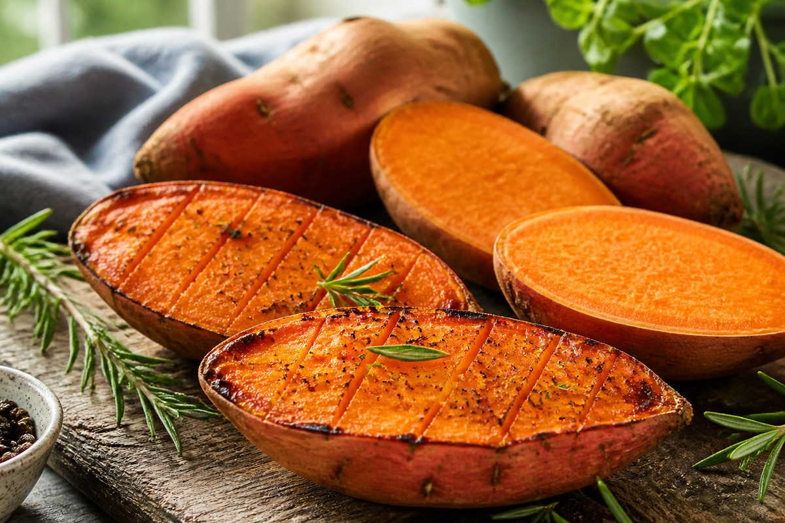

*▲ Delivering over 150% of daily vitamin A needs via beta-carotene alongside complex carbohydrates and potassium, sweet potatoes (Ipomoea batatas) exhibit markedly different glycemic profiles depending on thermal preparation and post-cooking retrogradation.*

Quick answer <strong>Raw sweet potato provides 86 calories, 3.0 g fiber and 337 mg potassium per 100 g.</strong> Cooking then cooling raises resistant starch and lowers the glycemic response, and steaming beats baking for gentler blood sugar.

In metabolic dietetics and athletic nutrition, **orange-fleshed sweet potatoes (*Ipomoea batatas*)** are prized as a nutrient-dense complex carbohydrate alternative to refined grains.

Yet one biochemical principle dictates whether a sweet potato acts as a slow-release energy substrate or triggers a rapid glucose spike: **cooking method and temperature kinetics**. Raw sweet potato provides 86 kcal, 20.12 g of carbohydrate, and 3.0 g of dietary fiber per 100 grams. However, slow dry roasting activates endogenous beta-amylase enzymes between 60°C and 75°C, hydrolyzing starch into maltose and elevating the glycemic index (GI) toward 80–90. By contrast, steaming or boiling rapidly denatures amylase while preserving moisture, keeping the GI in a moderate 46–63 range.

Beyond carbohydrate kinetics, sweet potatoes are one of nature’s richest sources of **beta-carotene (8,509 mcg per 100g)**, supplying 709 mcg RAE of provitamin A without risk of preformed retinol toxicity. Moreover, the milky resinous latex near the peel—rich in **jalapin** and caffeoylquinic acids—supports colonic transit and mucosal antioxidant defense.

Using USDA FoodData Central analytical data and clinical nutrition evidence, this monograph examines the nutrient matrix, resistant starch optimization, and physiological effects of sweet potatoes.

---

## 1. How Many Calories Are in Sweet Potatoes? (3.0 g fiber, 337 mg potassium per 100 g)

Sweet potatoes are virtually fat-free (0.05 g) while delivering concentrated provitamin A, potassium, vitamin B6, and manganese.

| Nutrient | Per 100 g | U.S. %DV |
| :--- | :--- | :--- |
| **Energy** | 86 kcal | 4.3% |
| **Water** | 77.28 g | See note¹ |
| **Carbohydrates** | 20.12 g | 7.3% |
| - Total Sugars | 4.18 g | See note¹ |
| - Dietary Fiber | 3.00 g | 10.7% |
| **Protein** | 1.57 g | 3.1% |
| **Total Fat** | 0.05 g | 0.1% |
| - Saturated Fat | 0.02 g | 0.1% |
| - Cholesterol | 0.00 mg | 0.0% |
| **Vitamin A (RAE)** | 709.00 mcg | 78.8% |
| - Beta-Carotene | 8,509.00 mcg | No DV |
| **Vitamin C** | 2.40 mg | 2.7% |
| **Vitamin B6** | 0.21 mg | 12.4% |
| **Potassium** | 337.00 mg | 7.2% |
| **Manganese** | 0.26 mg | 11.3% |
| **Magnesium** | 25.00 mg | 6.0% |
| **Jalapin & Polyphenols** | Peel-concentrated | No DV |

*¹ How to read this table: Percent Daily Values (%DV) reflect the standard 2,000-kcal U.S. FDA reference diet. Total sugars and water lack a fixed daily requirement and are noted as 'See note¹', while bioactive phytochemicals such as beta-carotene and jalapin carry 'No DV' (Daily Value not established).*

*※ Source: [USDA FoodData Central FDC 168482](https://fdc.nal.usda.gov/food-details/168482/nutrients) — Sweet potato, raw, unprepared (SR Legacy). The 86 kcal and 1.57 g protein per 100 g in the table above are this entry’s values; a different cooking state changes them.*

### What one medium sweet potato and one cup of cubes deliver

Weights below are USDA portion weights for raw sweet potato.

| Portion | Edible weight | Energy | Protein |
| :--- | :--- | :--- | :--- |
| 1 medium (13 cm long) | 130 g | 111.8 kcal | 2.04 g |
| Half, medium | 65 g | 55.9 kcal | 1.02 g |
| 1 cup, cubes | 133 g | 114.4 kcal | 2.09 g |

*Note: one medium sweet potato (130 g) is 112 kcal raw. Baking drives off water, so a baked potato of the same size weighs less but carries nearly the same energy.*

### Why the USDA says 86 kcal and the Korean table 147 kcal

Sweet potato energy per 100 g is quoted as 86 kcal or 147 kcal — nearly double. The difference is **water content, not a misprint.**

| Source | Energy | Water | Carbohydrate | Fiber | Potassium |
| :--- | :--- | :--- | :--- | :--- | :--- |
| USDA FoodData Central, sweet potato, raw, unprepared (FDC 168482) | 86 kcal | 77.28 g | 20.12 g | 3.0 g | 337 mg |
| Korean national food composition table, sweet potato, raw (food code B0060000000a, RDA 2013) | 147 kcal | 62.2 g | 35.52 g | 2.4 g | 375 mg |

The USDA entry is 77.3% water; the Korean entry is 62.2%. The Korean sample therefore carries almost twice the dry matter — mostly starch — in the same 100 g. Korean chestnut and pumpkin sweet potatoes are starchier, drier cultivars, so **147 kcal is the realistic figure for a Korean sweet potato**, while the USDA average describes a different sample.

The Korean table also lists cooked forms: steamed 163 kcal and baked 188 kcal per 100 g. Baking drives off water and develops maltose, raising both energy density and sweetness.

How to read this article, then: the nutrition table uses USDA values so it compares cleanly with the other ingredient guides on this site. **For meal planning with Korean sweet potatoes, use 147 kcal per 100 g raw.**

That changes the usual comparison. Cooked white rice is about 130 kcal per 100 g, so on the Korean figures **raw sweet potato (147) is already slightly above rice, and steamed (163) clearly above it.** Sweet potato earns its diet-food reputation not from low calories but from fiber, potassium and beta-carotene per calorie, plus how cooking and cooling change its glycemic response.

---

## 2. What Are the Benefits of Sweet Potatoes? Four Evidence-Backed Effects

### 1) Safe Provitamin A Delivery for Vision and Mucosal Immunity
Beta-carotene is cleaved into active retinol by intestinal BCMO1 enzymes only according to physiological demand, eliminating hypervitaminosis A risk. Adequate vitamin A sustains retinal rhodopsin regeneration and preserves epithelial tight junctions across the respiratory and gastrointestinal tracts.

### 2) Retrograded Resistant Starch and Microbiome Fermentation
When steamed or boiled sweet potatoes are chilled, amylose and amylopectin chains realign into **type 3 resistant starch (RS3)**. Escaping small-intestinal digestion, RS3 reaches the colon as a prebiotic substrate, fueling butyrate production that nourishes colonocytes and dampens mucosal inflammation.

### 3) Potassium-Mediated Blood Pressure Balance
Supplying 337 mg of potassium per 100g alongside minimal sodium (55 mg), sweet potatoes facilitate renal natriuresis—helping counterbalance high-sodium modern diets and supporting vascular tone.

### 4) Peel-Derived Chlorogenic Acid & Anthocyanin Defense
The outer skin holds several-fold higher concentrations of chlorogenic acids and anthocyanins than the inner flesh, offering targeted scavenging against lipid peroxidation and postprandial oxidative stress.

---

## 3. Boiled or Baked Sweet Potato? GI and Resistant Starch

- **Steam and Chill to Maximize Resistant Starch:** For blood-glucose control, choose steaming over dry baking, then refrigerate cooked sweet potatoes at 4°C for at least 4–6 hours to increase resistant starch formation. Gentle reheating preserves most RS3 gains.
- **Pair With Dietary Lipid for Beta-Carotene Uptake:** Because beta-carotene is strictly lipophilic, consuming sweet potatoes alongside olive oil, avocado, or whole eggs increases carotenoid micellarization and absorption several-fold.
- **Keep the Skin On:** Scrub thoroughly and eat the skin to retain jalapin, insoluble fiber, and concentrated polyphenols.

---

## 4. Who Should Avoid Sweet Potatoes? Side Effects and Cautions

- **Chronic Kidney Disease (Potassium Restriction):** Due to high potassium density (337 mg/100g), patients with impaired renal potassium clearance should consult their clinician or leach cubed potatoes in water before cooking.
- **Gastrointestinal Fermentation:** Raffinose-family oligosaccharides and fermentable fibers can cause mild gas or bloating if large portions (>250 g) are eaten rapidly.
- **Carotenodermia:** Chronic excessive intake of beta-carotene may cause harmless, reversible yellowing of the palms and soles, which resolves upon moderating intake.

---

## 5. Sweet Potatoes per Day: How Much Do You Need?

1. **Method Dictates Glycemic Response:** Steamed sweet potatoes maintain a moderate GI (~46–63), whereas slow-roasted ones climb sharply due to maltose conversion.
2. **Cook, Cool, and Pair With Fat:** Chilling boosts resistant starch, while a drizzle of olive oil or pairing with eggs unlocks beta-carotene absorption.
3. **Standard Portion:** Aim for one medium steamed sweet potato (~130–150 g) per meal as a balanced complex carbohydrate base.

---

## 6. What Foods Pair Best with Sweet Potatoes?

- **[Egg]({{ site.baseurl }}/en/posts/egg-nutrition-benefits/)**: Whole eggs supply complete bioavailable protein missing in sweet potatoes while yolk lipids drive efficient beta-carotene absorption.
- **[Chicken Breast]({{ site.baseurl }}/en/posts/chicken-breast-nutrition-benefits/)**: Combining lean poultry protein with steamed sweet potato carbohydrate supports post-exercise glycogen replenishment and muscle protein synthesis.
- **[Avocado]({{ site.baseurl }}/en/posts/avocado-nutrition-benefits/)**: Monounsaturated fats in avocado further blunt postprandial glucose excursion and maximize provitamin A bioavailability.
- **[Persimmon](/en/posts/persimmon-nutrition-benefits/):** persimmon vitamin C and beta-carotene pair well with sweet potato carotenoids in an autumn snack.

---

## 7. Frequently Asked Questions (FAQ)

### Q1. Why does baked sweet potato raise blood sugar faster than steamed sweet potato?
**A:** Slow oven baking holds the interior in the 60–75°C range long enough for beta-amylase enzymes to convert complex starch into free maltose sugar, driving the glycemic index into the 80–90 range. Steaming heats the tuber faster, limiting maltose formation and keeping the GI around 46–63.

### Q2. Does cooling cooked sweet potatoes really lower calorie absorption?
**A:** Yes. Chilling cooked sweet potatoes at refrigerator temperatures promotes starch retrogradation into resistant starch (RS3), which resists small-intestinal enzymes, reduces net absorbed glucose, and acts as prebiotic fiber in the colon.

### Q3. Are sprouted sweet potatoes toxic like sprouted white potatoes?
**A:** No. Unlike white potatoes (*Solanum tuberosum*), sweet potatoes do not produce solanine alkaloids in their sprouts, so trimming small sprouts is safe. However, discard any sweet potato showing dark black rot spots with a bitter odor, which may contain fungal ipomeamarone toxins.

  
📌 Related ranking guide

  <ul>
    <li><a href="/en/posts/low-gi-foods-blood-sugar-guide/">Top 10 Low-GI Foods to Lower Blood Sugar: GI and GL Chart</a></li>
    <li><a href="/en/posts/low-calorie-high-satiety-foods/">Top 10 Low-Calorie High-Satiety Foods: 100g Calories</a></li>
  </ul>

