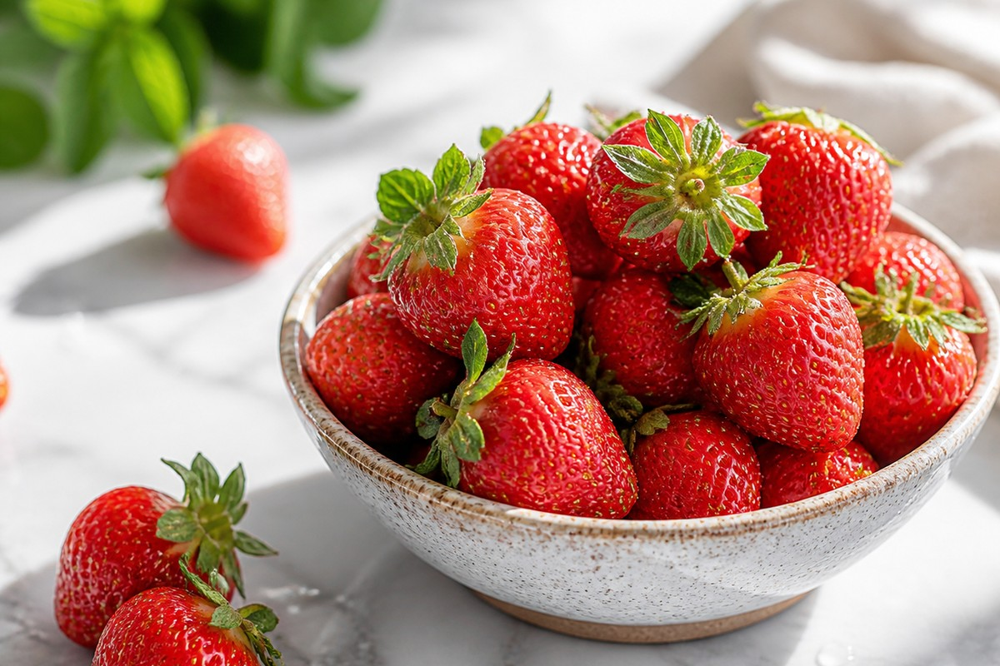

*▲ 100g당 32kcal의 가벼운 열량과 낮은 당부하지수(GL)를 자랑하는 딸기(Strawberry)는 오렌지나 레몬을 능가하는 고농도 비타민 C와 붉은 껍질·과육 속 안토시아닌·엘라그산이 결합된 대표적 항산화 베리류입니다.*

과일 중에서도 달콤한 풍미와 달리 열량과 당분 부담이 극히 적은 **딸기(Strawberry, *Fragaria × ananassa*)**는 대사 건강과 체중 관리를 병행하는 현대인에게 가장 이상적인 저당 과일입니다.

일반적으로 과일은 과당(Fructose) 함량 때문에 혈당 관리 중 섭취를 망설이기 쉽지만, 딸기는 100g당 순수 당류가 약 4.89g에 불과하며 혈당지수(GI) 또한 40 내외로 낮아 인슐린 분비를 급격히 자극하지 않습니다. 오히려 딸기 특유의 붉은 색소인 **안토시아닌(Anthocyanin, 특히 펠라고니딘-3-글루코시드)**과 폴리페놀 **엘라그산(Ellagic Acid)**이 소장 내 탄수화물 분해 효소인 알파-글루코시다아제의 활성을 완만하게 억제해 식후 혈당 상승 곡선을 부드럽게 다듬어 줍니다.

비타민 C 함량 역시 압도적입니다. 생딸기 100g에는 약 58.8mg의 비타민 C가 들어 있어 성인 하루 권장량(100mg)의 약 59%를 단 한 컵 남짓한 분량으로 채울 수 있습니다. 이는 같은 무게의 오렌지(53.2mg)나 귤보다도 높은 수준이며, 피로 해소와 콜라겐 합성, 비헴철(식물성 철분) 흡수 촉진에 핵심적인 조효소 역할을 수행합니다.

미국 농무부(USDA FoodData Central)의 표준 영양 분석 데이터를 기반으로 딸기의 정밀 영양 성분과 4대 핵심 효능, 영양 손실 없는 세척·섭취법 및 주의사항을 정리했습니다.

---

## 1. 딸기 영양 성분 정밀 분석표 (생딸기 100g 기준)

딸기는 약 91%가 수분으로 이루어져 있으며, 32kcal의 낮은 에너지 밀도 속에 비타민 C·엽산·망간·칼륨 등 미세영양소를 조밀하게 응축하고 있습니다.

| 영양 성분 (Nutrient) | 함량 (100g당) | 1일 권장 섭취량 비율 (한국인 성인 기준) |
| :--- | :--- | :--- |
| **열량 (Energy)** | 32 kcal | 1.6% |
| **수분 (Water)** | 90.95 g | 별도 표기¹ |
| **탄수화물 (Carbohydrates)** | 7.68 g | 2.4% |
| - 총 당류 (Total Sugars) | 4.89 g | 별도 표기¹ |
| - 식이섬유 (Dietary Fiber) | 2.00 g | 8.0% |
| **단백질 (Protein)** | 0.67 g | 1.2% |
| **지방 (Total Fat)** | 0.30 g | 0.6% |
| - 포화지방산 (Saturated Fat) | 0.02 g | 0.1% |
| - 콜레스테롤 (Cholesterol) | 0.00 mg | 0.0% |
| **비타민 C (Vitamin C)** | 58.80 mg | 58.8% |
| **엽산 (Folate, DFE)** | 24.00 mcg | 6.0% |
| **비타민 K (Vitamin K)** | 2.20 mcg | 3.1% |
| **망간 (Manganese)** | 0.39 mg | 11.1% |
| **칼륨 (Potassium)** | 153.00 mg | 4.4% |
| **마그네슘 (Magnesium)** | 13.00 mg | 4.1% |
| **철분 (Iron)** | 0.41 mg | 4.1% |
| **안토시아닌·엘라그산** | 고농축 함유 | 기준치 없음 |

*¹ 표 읽는 법: 한국인 영양소 섭취기준(2020) 1일 권장량(열량 2,000kcal, 단백질 55g, 탄수화물 324g, 식이섬유 25g, 비타민 C 100mg 등)을 적용했습니다. 수분과 총 당류처럼 절대 권장량 대신 적정 비율이나 총열량 대비 제한치로 관리되는 항목은 '별도 표기¹', 생리활성 파이토케미컬은 공식 권장 기준이 없어 '기준치 없음'으로 표시했습니다.*

---

## 2. 과학적으로 입증된 딸기의 4대 건강 효능

### 1) 혈관 내피 기능 보호 및 LDL 콜레스테롤 산화 억제
딸기의 붉은빛을 만드는 안토시아닌(펠라고니딘 유도체)은 혈관 내피세포에서 산화질소(NO) 생성을 촉진하여 말초 혈관 이완과 혈압 안정에 기여합니다. 여러 임상 개입 연구에서 동결건조 딸기 분말 또는 생딸기를 꾸준히 섭취한 성인 그룹은 혈중 지질 과산화 지표(MDA)가 유의미하게 감소하고, 동맥경화의 시발점이 되는 산화 LDL 콜레스테롤 수치가 개선되는 경향을 보였습니다.

### 2) 식후 혈당 스파이크 완화 및 인슐린 감수성 개선
고탄수화물 식사와 함께 딸기를 곁들이면 안토시아닌과 엘라기탄닌(Ellagitannin)이 췌장 아밀라아제와 장내 알파-글루코시다아제 효소 작용을 일부 둔화시킵니다. 이로 인해 포도당이 혈류로 한꺼번에 쏟아져 들어오는 현상이 억제되며, 식후 인슐린 요구량을 낮춰 대사증후군 위험을 줄이는 데 긍정적으로 작용합니다.

### 3) 고농도 비타민 C 기반 콜라겐 합성 및 면역 방어
100g당 58.8mg에 달하는 비타민 C는 진피층의 프로콜라겐 수산화 반응에 필수적인 조효소로, 피부 탄력 유지와 모세혈관 벽 강화에 직접 관여합니다. 동시에 선천 면역세포인 호중구와 대식세포의 이동성 및 식균 작용을 지원하여 환절기 상기도 방어력을 높여 줍니다.

### 4) 엘라그산의 세포 DNA 산화 스트레스 차단
딸기 표면의 씨앗과 과육에 포함된 엘라그산 및 피세틴(Fisetin)은 체내 활성산소(ROS)를 직접 소거할 뿐만 아니라 2상 해독 효소(글루타티온 S-전이효소 등)의 발현을 유도합니다. 이를 통해 자외선이나 대사 과정에서 발생하는 세포 내 산화 스트레스를 줄이고 건강한 세포 주기를 유지하는 데 도움을 줍니다.

---

## 3. 영양 손실을 막는 세척 및 흡수율 극대화 섭취 가이드

- **꼭지를 떼지 않고 흐르는 물에 30초 세척:** 딸기의 비타민 C와 안토시아닌은 수용성이어서 물에 오래 담그거나 꼭지를 먼저 딴 뒤 씻으면 단면으로 영양소가 빠르게 빠져나갑니다. 반드시 꼭지가 붙은 상태에서 흐르는 물에 가볍게 헹군 뒤 섭취 직전에 꼭지를 제거하십시오.
- **우유·그릭요거트 등 유제품과의 조합:** 딸기 속 지용성 항산화 성분 일부와 지용성 비타민 흡수를 돕고, 유기산(구연산·사과산)으로 인한 위장 자극을 완충하기 위해 무가당 그릭요거트나 우유와 함께 섭취하면 단백질과 칼슘까지 균형 있게 보충됩니다.
- **하루 적정 섭취량 준수:** 대사 건강과 혈당 안정을 목적으로 할 때 성인 1회 적정량은 중간 크기 기준 **6~10알(약 150g, 48kcal)** 내외입니다.

---

## 4. 섭취 시 주의사항 및 부작용

- **과민성 대장 증후군(IBS) 및 포드맵(FODMAP) 민감군:** 딸기는 비교적 저포드맵 과일에 속하지만, 한 번에 200g 이상 과량 섭취하거나 장이 예민한 경우 소량의 과당과 식이섬유로 인해 복부 팽만감이나 가스가 찰 수 있습니다.
- **신장 결석 병력자의 옥살산 유의:** 딸기에는 미량의 옥살산염(Oxalate)이 함유되어 있어 칼슘옥살산 신장 결석 병력이 있는 분은 수분 섭취를 충분히 병행하며 하루 150g 이내로 조절하는 것이 안전합니다.
- **아스피린·살리실산염 알레르기:** 딸기에는 천연 살리실산염 성분이 소량 들어 있으므로 살리실산염 과민 반응이나 구강 알레르기 증후군(입안 가려움, 붓기) 이력이 있다면 소량 테스트 후 섭취하시기 바랍니다.

---

## 5. 최종 요약 및 실천 팁

1. **가벼운 열량과 높은 포만감:** 100g당 32kcal, 당류 4.89g으로 식단 관리 중에도 부담 없이 즐길 수 있는 저당 과일입니다.
2. **오렌지를 앞서는 비타민 C 밀도:** 150g 한 접시면 성인 하루 비타민 C 권장량의 88% 이상을 자연 상태로 확보할 수 있습니다.
3. **꼭지 붙인 채 빠른 세척:** 영양소 용출을 막으려면 씻기 전에 꼭지를 자르지 말고, 무가당 요거트나 잎채소 샐러드와 조합해 식후 혈당 스파이크를 낮추십시오.

---

## 6. 함께 먹으면 시너지가 폭발하는 식재료 궁합

- **[시금치 (Spinach)]({{ site.baseurl }}/posts/spinach-nutrition-benefits/)**: 시금치에 풍부한 식물성 비헴철(Non-heme Iron)은 단독 흡수율이 낮지만, 딸기의 고농도 비타민 C와 구연산이 장내에서 철분을 환원시켜 체내 흡수율을 수 배 이상 끌어올립니다.
- **[블루베리 (Blueberry)]({{ site.baseurl }}/posts/blueberry-nutrition-benefits/)**: 딸기의 펠라고니딘 계열 안토시아닌과 블루베리의 말비딘·델피니딘 계열 안토시아닌이 결합하면 다중 스펙트럼 항산화 방어망이 구축되어 뇌 신경 및 망막 모세혈관 보호 시너지가 극대화됩니다.
- **[아보카도 (Avocado)]({{ site.baseurl }}/posts/avocado-nutrition-benefits/)**: 아보카도의 단일불포화지방산(올레산)이 딸기 속 카로티노이드·지용성 파이토케미컬의 장내 미셀(Micelle) 형성을 도와 생체이용률을 높여 줍니다.

---

## 7. 자주 묻는 질문 (FAQ)

### Q1. 딸기를 씻을 때 소금물이나 식초물에 오래 담가두는 것이 좋나요?
**A:** 권장하지 않습니다. 딸기는 표피가 얇고 과육이 연하며 수용성인 비타민 C와 안토시아닌 함량이 높습니다. 물에 1분 이상 오래 담가두면 삼투압 현상으로 비타민 C가 물로 빠져나가고 과육이 물러집니다. 꼭지를 떼지 않은 채 흐르는 수돗물에 20~30초 가볍게 흔들어 씻는 것이 가장 위생적이고 영양 손실도 적습니다.

### Q2. 생딸기와 냉동 딸기 중 영양학적으로 어떤 차이가 있나요?
**A:** 수확 직후 급속 냉동한 딸기는 생딸기와 비교해 안토시아닌, 엘라그산, 식이섬유 및 미네랄 함량이 거의 동일하게 보존됩니다. 다만 비타민 C는 장기 보관 시 소폭 감소할 수 있으며, 냉동 딸기는 가열하거나 물에 헹구면 즙과 함께 수용성 영양소가 흘러나올 수 있으므로 해동 없이 스무디나 요거트 토핑으로 바로 활용하는 것이 좋습니다.

### Q3. 당뇨 전단계인데 딸기를 매일 먹어도 혈당에 문제가 없을까요?
**A:** 하루 6~8알(약 100~120g) 정도의 정량을 식후 간식이나 식이섬유·단백질이 포함된 식사 직후에 섭취한다면 혈당 스파이크 위험이 낮습니다. 단, 설탕이나 연유를 곁들이거나 갈아서 주스로 마시면 식이섬유 구조가 파괴되어 흡수 속도가 빨라지므로 반드시 생과육 그대로 씹어 드시는 것이 원칙입니다.

