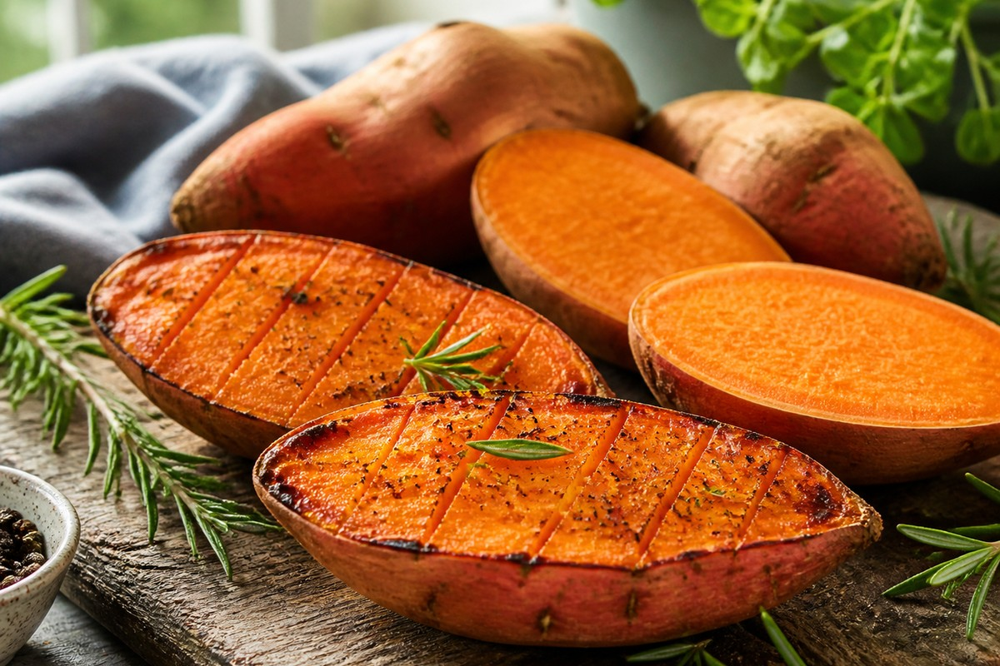

*▲ 복합 탄수화물과 1일 권장량을 훌쩍 뛰어넘는 베타카로틴(비타민 A 전구체), 식이섬유를 고루 품은 고구마(Sweet Potato)는 조리 온도와 냉각 방식에 따라 혈당 반응과 저항성 전분 비율이 극적으로 달라지는 기능성 구황작물입니다.*

피트니스 식단과 혈당 관리 식이요법에서 **고구마(Sweet Potato, *Ipomoea batatas*)**는 백미나 정제 밀가루를 대체하는 대표적인 복합 탄수화물 공급원입니다.

하지만 고구마를 먹으면서도 많은 사람이 간과하는 핵심 생화학 변수가 있습니다. 바로 **조리법에 따른 혈당지수(GI)의 극단적 변화**입니다. 생고구마 100g의 열량은 약 86kcal로 낮고 탄수화물(20.1g)과 식이섬유(3.0g)가 조화롭게 들어 있지만, 고온에서 오랫동안 굽는 '군고구마' 조리 시 고구마 내부의 베타-아밀라아제 효소가 전분을 맥아당(Maltose)으로 대량 분해하면서 GI 지수가 80~90대까지 치솟습니다. 반면 찌거나 삶아 먹으면 수분 보전과 전분 호화 속도가 완만하여 GI 지수를 45~55 수준으로 묶어 둘 수 있습니다.

특히 주황색 과육을 띤 호박고구마 계열에는 **베타카로틴(Beta-Carotene)이 100g당 약 8,509mcg** 이상 농축되어 있어 비타민 A 1일 권장량의 150% 이상을 단번에 충족시킵니다. 또한 고구마를 잘랐을 때 나오는 하얀 유액 성분인 **야라핀(Jalapin)**은 장 점막을 부드럽게 감싸 연동운동을 촉진하는 천연 배변 개선 물질입니다.

미국 농무부(USDA FoodData Central) 데이터를 기반으로 고구마의 정밀 영양 성분표, 4대 건강 효능, 저항성 전분을 극대화하는 냉각 섭취 팁과 주의사항을 정리합니다.

---

## 1. 고구마 영양 성분 정밀 분석표 (생고구마 100g 기준)

고구마는 지방이 거의 없고(0.05g) 칼륨·비타민 A·비타민 B6·망간이 풍부해 나트륨 배출과 에너지 대사 보조에 탁월한 영양 구성을 지닙니다.

| 영양 성분 (Nutrient) | 함량 (100g당) | 1일 권장 섭취량 비율 (한국인 성인 기준) |
| :--- | :--- | :--- |
| **열량 (Energy)** | 86 kcal | 4.3% |
| **수분 (Water)** | 77.28 g | 별도 표기¹ |
| **탄수화물 (Carbohydrates)** | 20.12 g | 6.2% |
| - 총 당류 (Total Sugars) | 4.18 g | 별도 표기¹ |
| - 식이섬유 (Dietary Fiber) | 3.00 g | 12.0% |
| **단백질 (Protein)** | 1.57 g | 2.9% |
| **지방 (Total Fat)** | 0.05 g | 0.1% |
| - 포화지방산 (Saturated Fat) | 0.02 g | 0.1% |
| - 콜레스테롤 (Cholesterol) | 0.00 mg | 0.0% |
| **비타민 A (RAE)** | 709.00 mcg | 88.6% |
| - 베타카로틴 (Beta-Carotene) | 8,509.00 mcg | 기준치 없음 |
| **비타민 C (Vitamin C)** | 2.40 mg | 2.4% |
| **비타민 B6 (Pyridoxine)** | 0.21 mg | 14.0% |
| **칼륨 (Potassium)** | 337.00 mg | 9.6% |
| **망간 (Manganese)** | 0.26 mg | 7.4% |
| **마그네슘 (Magnesium)** | 25.00 mg | 7.9% |
| **야라핀·안토시아닌** | 품종별 함유 | 기준치 없음 |

*¹ 표 읽는 법: 한국인 영양소 섭취기준(2020) 성인 1일 권장량(열량 2,000kcal, 탄수화물 324g, 식이섬유 25g, 비타민 A 800mcg RAE, 칼륨 3,500mg 등) 기준입니다. 수분과 총 당류는 '별도 표기¹', 개별 파이토케미컬(베타카로틴, 야라핀)은 독립 일일 권장량이 설정되지 않아 '기준치 없음'으로 표기했습니다.*

---

## 2. 과학적으로 입증된 고구마의 4대 건강 효능

### 1) 고농도 베타카로틴의 망막·점막 세포 보호 및 면역 강화
고구마 속 베타카로틴은 체내에서 필요량만큼만 레티놀(비타민 A)로 전환되므로 지용성 비타민 과잉 독성 위험 없이 안전하게 비타민 A를 공급합니다. 이는 망막의 로돕신(Rhodopsin) 재합성을 도와 야간 시력을 보호하고, 호흡기·소화기 상피세포의 점막 장벽을 견고하게 유지해 외부 병원균 침입을 1차 차단합니다.

### 2) 저항성 전분과 야라핀의 장내 미생물·배변 시너지
고구마의 풍부한 불용성·수용성 식이섬유와 껍질 부근의 수지 성분인 야라핀은 대장 내 수분을 끌어당겨 변을 부드럽게 하고 장 연동운동을 활성화합니다. 특히 찐 고구마를 식혔을 때 생성되는 **저항성 전분(Resistant Starch)**은 소장에서 소화되지 않고 대장까지 내려가 유익균의 먹이(프리바이오틱스)가 되어 단쇄지방산(부티르산) 생성을 촉진합니다.

### 3) 칼륨(337mg)의 나트륨 배설 및 혈압 조절
100g당 337mg에 달하는 칼륨은 신장에서 나트륨 재흡수를 억제하고 소변으로의 배출을 촉진합니다. 짠 음식을 자주 섭취하는 식습관에서 혈관 내 삼투압 균형을 맞추고 혈압 상승 부담을 덜어주는 데 실질적인 도움을 줍니다.

### 4) 껍질 속 안토시아닌·클로로겐산의 항염 작용
고구마 껍질(특히 자색·붉은 껍질)에는 과육보다 수 배 높은 폴리페놀(클로로겐산)과 안토시아닌이 집중되어 있습니다. 이 성분들은 혈관 내 염증성 사이토카인 발현을 억제하고 활성산소에 의한 지질 과산화를 방어합니다.

---

## 3. 혈당 상승을 막고 흡수율을 높이는 조리·섭취 가이드

- **군고구마 대신 '찌고 식힌 고구마' 선택:** 60~70℃ 구간을 천천히 통과하며 장시간 굽는 군고구마는 전분이 당분으로 빠르게 분해되어 혈당을 크게 올립니다. 다이어트와 혈당 관리가 목적이라면 찜기에서 증기로 찐 뒤 냉장고에서 **4~6시간 이상 식혀 저항성 전분(RS3)을 늘린 상태**로 섭취하는 것이 가장 이상적입니다. (식힌 뒤 전자레인지에 살짝 데워도 저항성 전분의 상당 부분은 유지됩니다.)
- **껍질째 섭취 및 건강한 지방 곁들이기:** 깨끗이 세척해 껍질째 먹으면 야라핀과 안토시아닌, 식이섬유를 온전히 챙길 수 있습니다. 또한 베타카로틴은 지용성이므로 **올리브오일, 아보카도, 달걀 노른자** 등 소량의 지방과 함께 먹으면 체내 흡수율이 수 배 이상 높아집니다.
- **1회 적정 섭취량:** 성인 1끼 탄수화물 대체 기준 **중간 크기 1개(약 130~150g, 찐 상태 약 115~135kcal)**가 적당합니다.

---

## 4. 섭취 시 주의사항 및 부작용

- **만성 신장 질환자의 고칼륨혈증 주의:** 고구마는 칼륨 함량이 높으므로 신장 배설 기능이 저하된 환자는 주치의와 상의하여 섭취량을 제한하거나 물에 담가 칼륨을 일부 용출시킨 뒤 조리해야 합니다.
- **공복 과다 섭취 시 속 쓰림 및 가스 유발:** 고구마의 교질 성분과 아마이드 성분이 위산 분비를 자극할 수 있으며, 라피노스 계열 당류와 식이섬유가 대장에서 발효되며 가스를 생성할 수 있습니다. 위염이 있거나 장이 예민하다면 김치·동치미·요거트 등 발효식품이나 단백질과 함께 식후에 드십시오.
- **베타카로틴 과다 섭취로 인한 카로틴혈증:** 하루 수백 그램 이상 장기간 과식하면 손바닥이나 발바닥이 일시적으로 노랗게 변하는 카로틴혈증이 나타날 수 있으나, 섭취를 줄이면 자연 소실되는 무해한 현상입니다.

---

## 5. 최종 요약 및 실천 팁

1. **조리법이 혈당을 결정한다:** 굽기보다는 찌고, 찐 뒤 한 번 식혀 저항성 전분 비율을 높여 드십시오.
2. **비타민 A의 보고:** 100g만으로 하루 권장량에 육박하는 베타카로틴을 확보할 수 있으며, 소량의 오일·단백질과 곁들일 때 흡수율이 극대화됩니다.
3. **껍질까지 통째로:** 껍질 바로 아래에 집중된 야라핀과 폴리페놀을 놓치지 않도록 깨끗이 씻어 껍질째 섭취하세요.

---

## 6. 함께 먹으면 시너지가 폭발하는 식재료 궁합

- **[달걀 (Egg)]({{ site.baseurl }}/posts/egg-nutrition-benefits/)**: 고구마에 부족한 양질의 단백질(필수아미노산)을 달걀이 완벽히 보완하며, 달걀 노른자의 지질이 고구마 속 지용성 베타카로틴의 장내 흡수를 촉진합니다.
- **[닭가슴살 (Chicken Breast)]({{ site.baseurl }}/posts/chicken-breast-nutrition-benefits/)**: 고구마의 복합 탄수화물과 닭가슴살의 고순도 단백질 조합은 운동 전후 근글리코겐 보충과 근단백질 합성을 동시에 달성하는 피트니스 표준 조합입니다.
- **[아보카도 (Avocado)]({{ site.baseurl }}/posts/avocado-nutrition-benefits/)**: 아보카도의 불포화지방산이 고구마의 혈당 상승 속도를 한층 더 늦추고 베타카로틴 생체이용률을 극대화합니다.

---

## 7. 자주 묻는 질문 (FAQ)

### Q1. 다이어트할 때 찐 고구마와 군고구마의 칼로리와 혈당 차이가 큰가요?
**A:** 수분이 날아간 동일 무게(100g) 기준으로는 수분 손실로 인해 군고구마의 열량 밀도가 약 120~140kcal로 찐 고구마(약 90~100kcal)보다 높습니다. 더 중요한 차이는 혈당지수(GI)로, 구울 때 베타-아밀라아제 효소가 전분을 맥아당으로 전환시켜 군고구마의 GI는 80~90대로 급상승하는 반면 찐 고구마는 45~55 수준을 유지합니다.

### Q2. 고구마를 식혀서 먹으면 실제로 살이 덜 찌나요?
**A:** 네, 원리상 도움이 됩니다. 익힌 고구마를 4℃ 내외의 냉장 온도로 식히면 전분 분자가 재결정화(노화)되면서 소장에서 소화되지 않는 '저항성 전분(Resistant Starch)' 비율이 늘어납니다. 이로 인해 실제 흡수되는 열량이 소폭 줄어들고 식후 혈당 스파이크가 완화되며 대장 내 유익균 증식에 기여합니다.

### Q3. 고구마를 먹을 때 껍질에 묻은 검은 반점이나 싹이 난 부분은 먹어도 되나요?
**A:** 고구마의 싹 자체에는 감자(솔라닌)와 같은 치명적 독소가 없지만, 싹이 트는 과정에서 주변 영양분이 소모되고 식감이 거칠어지므로 도려내고 먹는 것이 좋습니다. 단, 껍질에 검은 반점이 넓게 퍼지고 쓴맛과 곰팡이 냄새가 난다면 '검은무늬병' 곰팡이 독소(이포메아마론)일 가능성이 있으므로 해당 고구마는 통째로 폐기해야 합니다.

