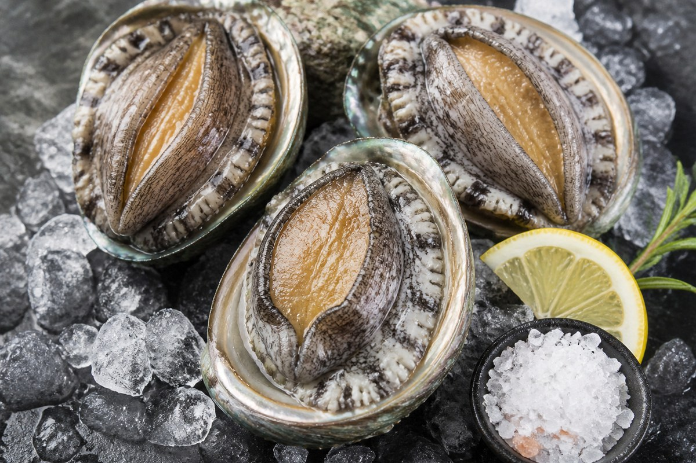

*▲ 100g당 지방은 0.76g에 불과하면서 양질의 단백질 17.10g과 고농도 타우린·글리코겐을 응축한 전복(Abalone)은 예로부터 '바다의 산삼'으로 불리며 수술 후 회복식과 간 피로 해소에 쓰여 온 대표 보양 수산물입니다.*

한 줄 결론 <strong>생전복 100g은 105kcal, 단백질 17.1g, 철분 3.19mg입니다.</strong> 다시마를 먹고 자라 타우린이 풍부하고 글리코겐이 간 에너지원으로 쓰여, 술자리 뒤 기력 회복식으로 쓰여 왔습니다.

다시마와 미역 등 갈조류를 먹고 자라는 고급 복족류 연체동물 **전복(Abalone, *Haliotis discus hannai*)**은 껍질 안쪽의 단단한 근육질 육질 속에 아미노산과 미량 미네랄이 고밀도로 농축된 해양 단백질원입니다.

전복이 예로부터 최고의 기력 회복식으로 손꼽혀 온 가장 큰 생화학적 이유는 유리 아미노산 **타우린(Taurine)**과 즉시 에너지원으로 전환되는 다당류 **글리코겐(Glycogen)**의 결합에 있습니다. 타우린은 간세포 내 담즙산 포합을 촉진하여 알코올·지질 대사 부산물 배출을 돕고, 세포막의 삼투압을 조절해 근육과 심장의 피로 누적을 막아 줍니다. 동시에 전복 속 글리코겐은 소화 흡수 속도가 빨라 체력이 급격히 저하된 상태에서도 위장 부담 없이 빠르게 ATP(세포 에너지)를 보충합니다.

여기에 연체동물 중에서도 손꼽힐 만큼 풍부한 **비타민 E(토코페롤, 100g당 4.00mg)**와 **셀레늄(44.80mcg)**이 합류해 세포막 지질 과산화를 막는 강력한 항산화 방어선을 구축합니다.

미국 농무부(USDA FoodData Central) 표준 영양 분석 데이터를 기반으로 생전복의 정밀 영양 성분과 4대 핵심 효능, 내장(게우) 활용 및 주의사항을 정리했습니다.

---

## 1. 전복 칼로리와 영양성분은? (단백질 17.1g·철분 3.19mg)

생전복 100g은 105kcal의 가벼운 열량과 1% 미만의 낮은 지방 함량에도 불구하고 17.10g의 고순도 단백질과 비타민 E·B군, 셀레늄, 철분을 고루 제공합니다.

| 영양 성분 (Nutrient) | 함량 (100g당) | 1일 권장 섭취량 비율 (한국인 성인 기준) |
| :--- | :--- | :--- |
| **열량 (Energy)** | 105 kcal | 5.3% |
| **수분 (Water)** | 74.56 g | 별도 표기¹ |
| **탄수화물 (Carbohydrates)** | 6.01 g | 1.9% |
| - 총 당류 (Total Sugars) | 0.00 g | 별도 표기¹ |
| - 식이섬유 (Dietary Fiber) | 0.00 g | 0.0% |
| **단백질 (Protein)** | 17.10 g | 31.1% |
| **지방 (Total Fat)** | 0.76 g | 1.4% |
| - 포화지방산 (Saturated Fat) | 0.15 g | 1.0% |
| - 콜레스테롤 (Cholesterol) | 85.00 mg | 28.3% |
| **비타민 E (Vitamin E)** | 4.00 mg | 33.3% |
| **판토텐산 (Vitamin B5)** | 3.00 mg | 60.0% |
| **나이아신 (Vitamin B3)** | 1.50 mg | 10.0% |
| **비타민 B12 (Vitamin B12)** | 0.73 mcg | 30.4% |
| **셀레늄 (Selenium)** | 44.80 mcg | 74.7% |
| **철분 (Iron)** | 3.19 mg | 31.9% |
| **인 (Phosphorus)** | 190.00 mg | 27.1% |
| **마그네슘 (Magnesium)** | 48.00 mg | 15.0% |
| **아연 (Zinc)** | 0.82 mg | 8.2% |
| **칼륨 (Potassium)** | 250.00 mg | 7.1% |
| **타우린·글리코겐** | 고농축 함유 | 기준치 없음 |

*¹ 표 읽는 법: 한국인 영양소 섭취기준(2020) 1일 권장량(열량 2,000kcal, 단백질 55g, 비타민 E 12mg α-TE, 셀레늄 60mcg, 철분 10mg 등)을 적용했습니다. 수분과 총 당류처럼 절대 권장량 대신 적정 비율이나 총열량 대비 제한치로 관리되는 항목은 '별도 표기¹', 생리활성 아미노산 및 다당류는 공식 권장 기준이 없어 '기준치 없음'으로 표시했습니다.*

---

## 2. 전복 효능은 무엇일까? 과학으로 입증된 4대 효과

### 1) 간 해독 효소 활성화 및 피로 해소
전복에 고농축된 **타우린**과 **아르기닌**, **메티오닌**은 간세포 내 알코올 탈수소효소(ADH)와 글루타치온 합성을 지원하여 독성 대사산물의 해독 속도를 높입니다. 또한 담즙산 분비를 촉진해 간 내 중성지방 축적을 완화하므로 잦은 회식이나 만성 피로에 시달리는 직장인의 간 보호 식재료로 탁월합니다.

### 2) 초저지방 고단백 + 글리코겐 기반 신속한 기력 회복
전복은 지방이 100g당 0.76g으로 극히 적으면서 단백질이 17.10g에 달해 소화 효소 부담이 낮습니다. 여기에 근육과 간에 저장된 형태로 존재하는 **글리코겐**과 대사 조효소인 **판토텐산(비타민 B5, 60% DV)**이 함께 들어 있어, 병후 회복기 환자나 운동 직후 체력 보충이 필요한 분들에게 빠르고 안정적인 에너지를 공급합니다.

### 3) 셀레늄·비타민 E의 강력한 세포 항산화 방어
전복 100g에는 1일 권장량의 약 75%에 해당하는 **셀레늄(44.80mcg)**과 33%에 해당하는 **비타민 E(4.00mg)**가 동시에 들어 있습니다. 셀레늄은 체내 항산화 효소인 글루타치온 퍼옥시다아제(GPx)의 핵심 구성 성분이며, 비타민 E와 짝을 이뤄 활성산소에 의한 세포막 손상과 혈관 노화를 이중으로 차단합니다.

### 4) 조혈 작용 지원 및 시신경·혈압 안정
혈액 생성에 필수적인 **철분(3.19mg)**과 **비타민 B12(0.73mcg)**가 함께 들어 있어 어지럼증·빈혈 예방에 도움을 줍니다. 아울러 타우린은 교감신경 과흥분을 억제해 혈압 변동을 완만하게 하고, 망막 광수용체 세포의 삼투압과 칼슘 균형을 유지해 눈의 피로를 덜어 줍니다.

---

## 3. 전복은 어떻게 손질하고 익혀야 좋을까? 타우린 보존법

- **부드러운 전복죽·찜 조리 시 찌는 시간 조절:** 전복 살은 콜라겐과 근섬유가 치밀해 너무 오래 센 불에 끓이면 질겨집니다. 껍질에서 분리한 뒤 이빨(입)을 제거하고 칼집을 내어 3~5분 이내로 짧게 찌거나, 볶은 뒤 푹 끓여 죽으로 만들면 소화가 가장 잘 됩니다.
- **내장(게우)의 현명한 활용:** 전복이 섭취한 미역·다시마의 클로로필과 카로티노이드, 비타민 E가 응축된 내장(게우)은 버리지 말고 참기름에 살짝 볶아 전복죽이나 소스 베이스로 활용하면 지용성 영양소 흡수율이 크게 올라갑니다.
- **타우린 유실 방지:** 타우린은 수용성이므로 물에 삶아 국물을 버리는 것보다, 육수까지 함께 섭취하는 전복죽·전복삼계탕·전복버터구이 방식이 영양 보존에 유리합니다.

---

## 4. 전복 부작용과 주의할 점은?

- **봄철(3~5월) 내장 섭취 주의 (피로페오포르바이드 a):** 산란기나 봄철(3~5월) 전복 내장에는 해조류 엽록소 분해 산물인 '피로페오포르바이드 a'가 축적될 수 있어 섭취 후 직사광선을 쬐면 광과민성 피부염(두드러기·발진)을 일으킬 수 있습니다. 봄철에는 내장을 제거하고 살만 드시는 것이 안전합니다.
- **콜레스테롤 및 요산 관리:** 전복 100g당 콜레스테롤이 약 85mg 들어 있으나 타우린이 담즙 배출을 도와 혈중 콜레스테롤 상승을 일정 부분 상쇄합니다. 다만 고지혈증이나 통풍(퓨린 대사 이상)을 앓고 계신 분은 1회 1~2마리(약 100g 내외)로 섭취량을 조절하고 과식을 피하세요.
- **어패류 알레르기:** 갑각류·연체동물 알레르기가 있는 분은 소량 섭취로도 두드러기나 호흡 불편이 나타날 수 있으므로 주의해야 합니다.

---

## 5. 전복과 함께 먹으면 좋은 음식은?

- **[마늘 (Garlic)]({{ site.baseurl }}/posts/garlic-nutrition-benefits/)**: 전복 버터구이나 전복죽을 조리할 때 마늘을 곁들이면 마늘의 알리신(Allicin) 성분이 전복 속 비타민 B군(판토텐산·B1)과 결합해 피로 회복과 살균 시너지를 한층 끌어올립니다.
- **[달걀 (Egg)]({{ site.baseurl }}/posts/egg-nutrition-benefits/)**: 전복죽 마무리 단계에 달걀을 풀어 넣으면 전복에 부족한 비타민 A·비타민 D와 콜린이 보충되어 완결된 고단백 회복식이 완성됩니다.
- **[시금치 (Spinach)]({{ site.baseurl }}/posts/spinach-nutrition-benefits/)**: 전복의 넉넉한 철분·아연에 시금치의 엽산과 베타카로틴, 비타민 C가 더해지면 조혈 기능과 항산화 방어 효율이 동시에 높아집니다.

---

## 6. 자주 묻는 질문 (FAQ)

### Q1. 전복은 생으로 회로 먹는 것과 익혀 먹는 것 중 어느 쪽이 영양이 더 좋나요?
**A:** 소화 흡수율과 기력 회복 목적이라면 살짝 익혀 드시는 편이 유리합니다. 생전복 회는 수용성 비타민과 식감이 살아 있지만 근섬유가 단단해 위장이 약한 분에게는 소화 부담이 될 수 있습니다. 살짝 찌거나 죽으로 조리하면 결합조직이 부드러워져 단백질과 글리코겐 흡수율이 높아집니다.

### Q2. 전복 내장(게우)의 색깔이 초록빛과 노란빛으로 다른 이유는 무엇인가요?
**A:** 암수 구분 때문입니다. 일반적으로 진한 녹색·흑록색을 띠는 내장이 암컷이며 미역·다시마 성분이 많아 찜이나 죽으로 끓였을 때 깊고 진한 맛을 냅니다. 반면 누렇거나 옅은 황백색 내장은 수컷으로, 생식선 조직이 단단해 회로 즐기기에 좋습니다.

### Q3. 전복을 칫솔로 닦을 때 소금이나 식초를 써도 되나요?
**A:** 굵은소금 소량을 묻혀 흐르는 물에 칫솔로 문지르면 살 표면과 주름 사이의 점액질·이물질을 깔끔하게 제거할 수 있습니다. 다만 식초물에 오래 담가두면 육질이 굳고 수용성 타우린이 빠져나갈 수 있으므로 흐르는 찬물에 빠르게 세척해 바로 조리하세요.

  
📌 관련 순위 가이드

  <ul>
    <li><a href="/posts/liver-immunity-fatigue-recovery-foods/">피로 회복·면역력 음식 TOP 10: 비타민C·아연 함량 순위</a></li>
  </ul>

