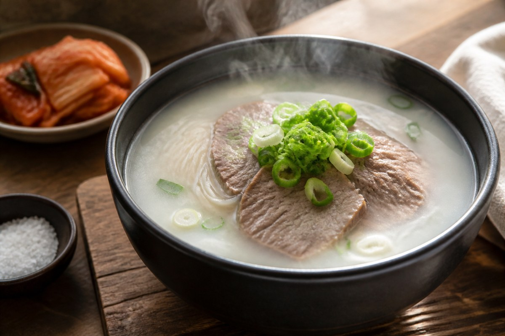

*▲ 사골·도가니 육수 100g은 17kcal에 불과하지만, 12시간 이상 우려내면 콜라겐 유래 펩타이드 약 2g과 글리신·프롤린이 용출됩니다. 다만 '칼슘 덩어리'라는 통념과 달리 실제 칼슘 함량은 100g당 10mg 안팎입니다.*

한 줄 결론 <strong>무염 사골 육수 100g은 17kcal, 단백질 3.3g, 칼슘 10mg입니다.</strong> 끓이는 시간이 길어질수록 콜라겐이 젤라틴으로 풀려 단백질은 늘지만 칼슘은 기대만큼 늘지 않아, 2시간 이상은 맛과 질감 위주로 보는 편이 좋습니다.

겨울이면 가장 먼저 떠오르는 국물이 있습니다. 뼈를 오래 고아 뽀얗게 우러난 **사골·도가니 육수**는 설렁탕과 곰탕의 기본이자, 병후 회복식과 노인 식사 대용으로도 오랫동안 쓰여 왔습니다.

최근 몇 년 사이 이 전통 음식은 미국과 유럽에서 **비프 본 브로스(Beef Bone Broth)** 라는 이름으로 다시 주목받고 있습니다. 2026년 11월 현재 미국 구글 검색량이 전년 대비 38% 증가했고, 장 건강·콜라겐·글리신을 키워드로 한 관련 제품군이 빠르게 늘고 있습니다.

그러나 영양학적으로 사골육수는 **과대평가된 부분과 저평가된 부분이 명확히 갈리는 식품**입니다. 뼈를 오래 끓인다고 칼슘이 우유만큼 녹아나지 않으며, 단백질 농도도 100g당 3~4g 수준으로 높지 않습니다. 반대로 아미노산 조성, 특히 **글리신(Glycine)** 과 **프롤린(Proline)** 비율은 다른 국물 식품에서 찾기 어려운 특징입니다.

이 글에서는 USDA FoodData Central에 등록된 육수 제품군의 실측값을 기준으로 사골·도가니 육수 100g의 정밀 영양 성분, 콜라겐 펩타이드와 글리신이 실제로 무엇을 하는지, 끓이는 시간이 영양에 어떤 차이를 만드는지, 그리고 통풍·신장 질환자가 반드시 확인해야 할 주의사항을 정리했습니다.

---

## 1. 사골·도가니 육수 칼로리와 영양성분은? (단백질 3.3g·칼슘 10mg)

뼈와 물의 비율, 우려낸 시간, 지방 제거 여부에 따라 값의 폭이 큰 식품입니다. 아래 표는 USDA FoodData Central에 등록된 소뼈 육수 제품군의 100g당 실측값 중앙값을 기준으로 했습니다.

| 영양 성분 (Nutrient) | 함량 (100g당) | 1일 권장 섭취량 비율 (한국인 성인 기준) |
| :--- | :--- | :--- |
| **열량 (Energy)** | 17 kcal | 0.9% |
| **수분 (Water)** | 95.00 g | 별도 표기¹ |
| **탄수화물 (Carbohydrates)** | 0.40 g | 0.1% |
| - 총 당류 (Total Sugars) | 0.30 g | 별도 표기¹ |
| - 식이섬유 (Dietary Fiber) | 0.00 g | 0.0% |
| **단백질 (Protein)** | 3.30 g | 6.0% |
| **지방 (Total Fat)** | 0.20 g | 0.4% |
| - 포화지방산 (Saturated Fat) | 0.08 g | 0.5% |
| - 콜레스테롤 (Cholesterol) | 1.00 mg | 0.3% |
| **글리신 (Glycine)** | 약 0.45 g | 기준치 없음 |
| **프롤린·하이드록시프롤린** | 약 0.45 g | 기준치 없음 |
| **콜라겐 유래 펩타이드** | 약 2.00 g | 기준치 없음 |
| **나트륨 (Sodium)** | 122.00 mg | 6.1% |
| **칼륨 (Potassium)** | 45.00 mg | 1.3% |
| **칼슘 (Calcium)** | 10.00 mg | 1.3% |
| **인 (Phosphorus)** | 15.00 mg | 2.1% |
| **마그네슘 (Magnesium)** | 5.00 mg | 1.6% |
| **철분 (Iron)** | 0.10 mg | 1.0% |
| **아연 (Zinc)** | 0.10 mg | 1.0% |

*¹ 표 읽는 법: 한국인 영양소 섭취기준(2020) 1일 권장량(열량 2,000kcal, 단백질 55g, 탄수화물 324g, 지방 54g, 칼슘 800mg, 인 700mg 등)을 적용했습니다. 수분·총 당류는 절대 권장량 대신 적정 비율로 관리되어 '별도 표기¹', 아미노산과 콜라겐 펩타이드는 공식 기준치가 없어 '기준치 없음'으로 표시했습니다. 제품별 편차가 커서 열량은 14~21kcal, 단백질은 2.5~4.3g, 나트륨은 35~180mg 범위로 보고되며, 간을 하지 않고 끓인 가정용 육수는 나트륨이 이보다 낮습니다.*

핵심은 **칼슘의 실제 수치**입니다. 뼈를 12시간 이상 고아도 칼슘은 100g당 10mg 수준으로, 같은 양 우유(약 113mg)의 10분의 1에도 못 미칩니다. 뼈 속 무기질은 물에 거의 녹지 않기 때문입니다. 사골국을 '칼슘 보충식'으로 기대하는 것은 사실에 근거하지 않습니다.

---

## 2. 사골·도가니 육수 효능은 무엇일까? 과학으로 입증된 4대 효과

### 1) 콜라겐 유래 펩타이드와 관절·피부 조직
사골육수의 단백질 상당량은 젤라틴 형태의 콜라겐 펩타이드입니다. 이 펩타이드는 소화 후 프롤린-하이드록시프롤린(PO)·글리신-프롤린 형태로 흡수되어 연골세포와 섬유아세포를 자극하는 것으로 알려져 있습니다.

무작위 배정 시험에서 콜라겐 펩타이드를 하루 8~12g씩 12~24주 섭취한 군은 무릎 통증 점수(VAS)와 관절 기능 지수가 개선되었고, 피부 탄력·보습 관련 지표도 일부 좋아졌습니다. 다만 **육수 1컵(240ml)으로 얻는 콜라겐 펩타이드는 약 2~3g**으로, 임상 용량의 3분의 1 수준입니다. 매일 3컵 이상을 꾸준히 마셔야 근접한다는 계산이 나옵니다.

### 2) 글리신(Glycine)의 수면 질 개선과 콜라겐 합성
글리신은 콜라겐 전체 아미노산의 약 3분의 1을 차지하는 가장 작은 아미노산입니다. 체내에서 글루타티온 합성과 간의 해독 반응(글리신 접합), 신경 억제성 신호 전달에 관여합니다.

취침 전 글리신 3g을 섭취한 무작위 시험에서 수면 잠복기가 짧아지고 서파 수면의 질이 개선되었다는 결과가 보고되었습니다. 육수 2~3컵으로 얻는 글리신은 1g 안팎이므로, 수면 목적이라면 육수를 진하게 우려내거나 취침 1시간 전에 마시는 편이 낫습니다. 신장 기능이 정상인 성인에서 하루 15g 내외의 글리신은 안전한 것으로 평가됩니다.

### 3) 장 점막 장벽과 소화 부담 완화
육수에는 글루타민과 글리신이 소량 들어 있고, 콜라겐 펩타이드는 위산 분비를 과도하게 자극하지 않으면서 수분과 전해질을 공급합니다. 장 상피세포의 주요 연료가 글루타민이라는 사실은 잘 알려져 있으나, **육수 자체가 장 점막을 재생한다는 임상 근거는 아직 부족합니다.** 장 누수(leaky gut) 개선을 표방한 연구는 대부분 세포·동물 실험이거나 표본이 작습니다.

그럼에도 저포드맵 식품으로서 자극이 적고 수분·나트륨·칼륨을 함께 보충할 수 있어, 장이 예민한 회복기나 식사량이 적은 고령자에게 실용적인 선택지가 됩니다.

### 4) 저열량 고포만감과 회복기 단백질·전해질 보충
100g당 17kcal에 불과하면서 단백질 3.3g을 공급하므로, 열량을 크게 늘리지 않고 단백질 섭취를 보완할 수 있습니다. 사골육수에는 콘드로이틴황산과 히알루론산이 미량 포함되어 있고, 칼륨·마그네슘 같은 전해질도 소량 들어 있어 발한 후나 발열 후 수분 보충 음료로 활용할 수 있습니다.

단, 단백질 1일 권장량을 육수만으로 채우려면 1.5L 이상이 필요하다는 점은 분명히 알아야 합니다. 육수는 보조 식품입니다.

---

## 3. 사골은 몇 시간 끓여야 좋을까? 12시간 vs 24시간 비교

- **1~4시간(첫 우림):** 핏물과 불순물, 유리 아미노산과 미량 미네랄이 먼저 나옵니다. 이 국물은 단백질이 적고 잡맛이 강하므로 버리는 것이 원칙입니다. 뼈는 찬물에서 시작해 끓기 직전까지 데친 뒤 흐르는 물에 씻어 사용하세요.

- **6~12시간(본 우림):** 콜라겐이 젤라틴으로 가수분해되는 구간으로, 단백질과 글리신 용출이 이때 대부분 완료됩니다. 온도는 90~95℃의 약불을 유지해야 하며, 100℃에서 계속 끓이면 유화된 지방과 단백질이 거품으로 떠올라 국물이 탁해지고 손실이 커집니다.

- **12~24시간(농축):** 단백질 용출 증가는 완만해지고(대개 10~20% 이내) 수분만 줄어 농축됩니다. 대신 글루탐산이 늘어 감칠맛이 강해지고, 퓨린 화합물도 함께 농축됩니다. 24시간을 넘기면 영양적 이득보다 에너지·안전 부담이 커지므로 권장하지 않습니다.

- **식초를 넣으면 칼슘이 녹는다?** 산을 첨가하면 뼈 무기질 용해가 약간 늘지만 실제 칼슘 증가량은 100g당 수 mg 수준으로, 유의미한 보충 효과를 기대하기 어렵습니다.

- **감칠맛과 나트륨 관리:** 마늘·양파·생강·대추·통후추를 넣으면 글루탐산과 구아닐산 시너지로 감칠맛이 살아나 소금을 줄일 수 있습니다. 간은 먹기 직전에 최소한으로 하고, 완성된 육수는 식힌 뒤 상층의 굳은 기름을 걷어내면 지방과 열량을 30% 이상 줄일 수 있습니다.

---

## 4. 사골·도가니 육수 부작용과 주의할 점은?

- **통풍·고요산혈증:** 장시간 우린 사골육수는 퓨린 농도가 높습니다. 원료와 우린 시간에 따라 편차가 커서 표준 수치가 없지만, 통풍 발작 이력이 있는 사람이 매일 진한 곰탕을 먹는 것은 권장되지 않습니다. 발작기에는 피하고, 평소에는 주 1~2회로 제한하세요.

- **만성 신장 질환:** 나트륨·인·칼륨을 함께 공급하므로 전해질 제한이 필요한 환자는 섭취량을 신장내과 의료진과 상의해야 합니다. 특히 시판 육수는 1컵에 나트륨 230~440mg이 들어 있는 제품도 있습니다.

- **고혈압·심부전:** 간을 세게 한 곰탕은 1끼 나트륨이 하루 목표치(2,000mg)의 절반을 넘기 쉽습니다. 국물은 적게, 건더기 위주로 드시고 소금은 따로 첨가하세요.

- **납 등 중금속 논란:** 2013년 일부 닭뼈 육수에서 납 농도가 상대적으로 높게 측정되었다는 보고가 있었으나, 이후 연구들은 일반적 섭취량에서 안전 범위를 크게 벗어나지 않는다고 평가했습니다. 특정 질환으로 매일 대량 섭취하는 경우에만 의료진과 상의하면 충분합니다.

- **보관과 식중독:** 단백질이 풍부한 국물은 상온에서 *Clostridium perfringens* 등이 증식하기 쉽습니다. 실온에 2시간 이상 두지 말고, 끓인 뒤 60℃ 이상으로 유지하거나 빠르게 식혀 냉장 3일·냉동 1개월 안에 소비하세요.

---

## 5. 사골·도가니 육수와 함께 먹으면 좋은 음식은?

- **[토마토 (Tomato)]({{ site.baseurl }}/posts/tomato-nutrition-benefits/)**: 콜라겐 합성에는 비타민 C가 필수 조효소로 작용합니다. 토마토의 비타민 C와 리코펜을 곰탕에 더하면 콜라겐 펩타이드의 활용도와 항산화 효과를 함께 높일 수 있습니다.

- **[마늘 (Garlic)]({{ site.baseurl }}/posts/garlic-nutrition-benefits/)**: 마늘의 알리신과 유황 화합물은 육수의 감칠맛을 끌어올리면서 혈관 내피 기능과 지질 대사에 긍정적으로 작용해, 기름진 곰탕의 부담을 상쇄합니다.

- **[양파 (Onion)]({{ site.baseurl }}/posts/onion-nutrition-benefits/)**: 양파의 쿼세틴과 유기 황화물은 장내 유익균의 먹이가 되고, 육수 속 글리신·글루타민과 함께 장 점막 환경을 부드럽게 지원하는 조합입니다.

---

## 6. 자주 묻는 질문 (FAQ)

### Q1. 사골육수를 12시간 우려내는 것과 24시간 우려내는 것, 콜라겐 양 차이가 큰가요?
**A:** 크지 않습니다. 콜라겐이 젤라틴으로 가수분해되는 양은 6~12시간 구간에서 대부분 결정되며, 24시간으로 늘려도 단백질 용출량 증가는 대개 10~20% 이내입니다. 오히려 24시간 이상 끓이면 수분이 증발해 농축될 뿐 아니라 퓨린과 나트륨 농도까지 함께 올라갑니다. 90~95℃ 약불에서 8~12시간이 영양과 시간 효율의 균형점입니다.

### Q2. 사골육수의 콜라겐은 관절에 실제로 효과가 있나요?
**A:** 콜라겐 펩타이드 자체의 관절 개선 효과는 하루 8~12g을 12주 이상 섭취한 무작위 시험에서 확인된 바 있습니다. 그러나 육수 1컵에서 얻는 양은 2~3g에 불과해 임상 용량에는 미치지 않습니다. 육수는 관절 건강에 도움이 되는 식사 습관의 일부로 보고, 기대 효과를 높이려면 하루 2~3컵을 꾸준히 마시거나 콜라겐 펩타이드 제품과 병행하는 편이 현실적입니다.

### Q3. 통풍이나 신장 질환이 있으면 사골육수를 피해야 하나요?
**A:** 통풍 환자는 진한 사골·곰탕을 매일 먹지 말고 주 1~2회, 발작기에는 피하는 것이 안전합니다. 만성 신장 질환으로 나트륨·인·칼륨 제한을 받는 경우에는 섭취량을 반드시 신장내과 의료진과 상의해야 하며, 시판 육수를 이용할 때는 라벨의 나트륨 함량을 먼저 확인하세요.

  
📌 관련 순위 가이드

  <ul>
    <li><a href="/posts/liver-immunity-fatigue-recovery-foods/">피로 회복·면역력 음식 TOP 10: 비타민C·아연 함량 순위</a></li>
  </ul>

