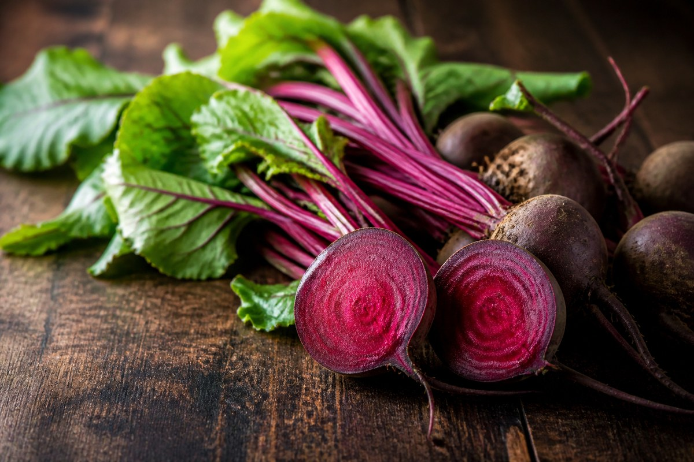

*▲ 생비트 100g은 43kcal에 불과하지만 식이 질산염 150~250mg과 엽산 109mcg, 베타인 128.7mg이 함께 들어 있습니다. 자른 단면의 마젠타색 동심원이 베탈라인 색소의 층입니다.*

한 줄 결론 <strong>생비트 100g은 43kcal, 엽산 109mcg, 칼륨 325mg입니다.</strong> 질산염이 체내에서 산화질소로 전환되면 혈관이 이완되어 수축기 혈압이 몇 mmHg 낮아진다는 임상시험이 있으며, 끓는 물에 익히면 옥살산이 일부 줄어듭니다(감소율은 조리법·품종에 따라 다름).

검붉은 뿌리와 자줏빛 잎줄기를 가진 **비트(Beetroot, *Beta vulgaris*)** 는 오랫동안 '피를 맑게 하는 채소'로 불려왔습니다. 그 경험적 평판이 21세기 들어 **식이 질산염(Nitrate) → 산화질소(Nitric Oxide, NO) 경로**라는 생화학으로 일부 설명되면서, 혈압 관련 연구 대상 식품으로 다시 주목받고 있습니다. 다만 비트 섭취가 혈압약을 대신한다는 뜻은 아닙니다.

비트가 다른 뿌리채소와 결정적으로 다른 지점은 **질산염 농도**입니다. 일반 채소의 질산염 함량이 100g당 수십 mg 수준인 데 반해 비트는 150~250mg으로 높고, 시판 비트 주스 농축 샷은 1회분에 300~500mg을 담고 있습니다. 임상시험에서 혈압·운동 수행력 효과를 확인한 식이 질산염 용량이 200~800mg이었던 이유입니다.

여기에 **베탈라인(Betalains)** 계열 색소와 **베타인(Betaine)** 이 더해집니다. 베타인은 호모시스테인 대사에 관여하는 메틸기 공여체이고, 베탈라인은 수용성 항산화 색소입니다. 항산화 작용은 대부분 세포·시험관 연구 수준입니다. 열량은 100g당 43kcal로 낮고 식이섬유는 2.8g 들어 있습니다.

아래에서는 USDA FoodData Central 표준 데이터를 기준으로 생비트 100g의 영양 성분, 질산염·베탈라인과 관련된 연구, **생비트와 찐 비트 중 무엇을 골라야 하는지**에 대한 옥살산 비교, 그리고 소변이 빨개지는 현상부터 신장결석·저혈압약까지 알아야 할 주의사항을 정리합니다.

---

## 1. 비트 칼로리와 영양성분은? (엽산 109mcg·칼륨 325mg)

비트는 수분이 약 88%로 열량이 매우 낮고, 탄수화물의 대부분이 당류 6.8g과 식이섬유 2.8g으로 구성됩니다. 지방은 0.17g에 불과합니다.

| 영양 성분 (Nutrient) | 함량 (생비트 100g당) | 1일 권장 섭취량 비율 (한국인 성인 기준) |
| :--- | :--- | :--- |
| **열량 (Energy)** | 43 kcal | 2.2% |
| **수분 (Water)** | 87.58 g | 별도 표기¹ |
| **탄수화물 (Carbohydrates)** | 9.56 g | 3.0% |
| - 총 당류 (Total Sugars) | 6.76 g | 별도 표기¹ |
| - 식이섬유 (Dietary Fiber) | 2.80 g | 11.2% |
| **단백질 (Protein)** | 1.61 g | 2.9% |
| **지방 (Total Fat)** | 0.17 g | 0.3% |
| - 포화지방산 (Saturated Fat) | 0.03 g | 0.2% |
| - 콜레스테롤 (Cholesterol) | 0.00 mg | 0.0% |
| **엽산 (Folate, DFE)** | 109.00 mcg | 27.3% |
| **비타민 C (Vitamin C)** | 4.90 mg | 4.9% |
| **비타민 B6 (Vitamin B6)** | 0.07 mg | 5.0% |
| **비타민 A (RAE)** | 2.00 mcg | 0.2% |
| **콜린 (Choline)** | 6.00 mg | 1.1% |
| **칼륨 (Potassium)** | 325.00 mg | 9.3% |
| **마그네슘 (Magnesium)** | 23.00 mg | 6.2% |
| **철분 (Iron)** | 0.80 mg | 8.0% |
| **구리 (Copper)** | 0.08 mg | 8.3% |
| **망간 (Manganese)** | 0.33 mg | 8.2% |
| **칼슘 (Calcium)** | 16.00 mg | 2.3% |
| **나트륨 (Sodium)** | 78.00 mg | 3.9% |
| **아연 (Zinc)** | 0.35 mg | 4.1% |
| **베타인 (Betaine)** | 128.70 mg | 기준치 없음 |
| **식이 질산염 (Dietary Nitrate)** | 150~250 mg | 기준치 없음 |
| **베탈라인 (Betalains, 베타니딘)** | 30~60 mg | 기준치 없음 |
| **옥살산 (Oxalate)** | 50~120 mg | 기준치 없음 |

*¹ 표 읽는 법: 한국인 영양소 섭취기준(2020) 1일 권장량(열량 2,000kcal, 탄수화물 324g, 식이섬유 25g, 단백질 55g, 엽산 400mcg, 칼륨 3,500mg 등)을 적용했습니다. 수분과 총 당류처럼 절대 권장량 대신 적정 비율로 관리되는 항목은 '별도 표기¹', 식물성 생리활성 성분과 옥살산처럼 공식 기준치가 없는 항목은 '기준치 없음'으로 표시했습니다.*

*※ 출처: [USDA FoodData Central FDC 169145](https://fdc.nal.usda.gov/food-details/169145/nutrients) — Beets, raw (SR Legacy). 표의 100g당 열량 43 kcal과 단백질 1.61 g은 이 항목의 값이며, 조리 상태가 다르면 값도 달라집니다.*

같은 비트라도 조리법에 따라 성분이 달라집니다. **삶은 비트 100g은 열량 44kcal로 거의 같지만, 수용성인 베탈라인·엽산·칼륨이 조리수로 10~30% 빠져나갑니다.** 반면 찌거나 통째로 구우면 손실이 5~15%로 줄어듭니다.

---

## 2. 비트 효능은 무엇일까? 근거 수준과 함께 본 4가지 포인트

### 1) 식이 질산염 150~250mg → 산화질소(NO) → 수축기 혈압 강하
비트의 질산염은 입안 세균이 아질산염으로 바꾸고, 위에서 다시 산화질소로 전환됩니다. 산화질소는 혈관 내피세포의 평활근을 이완시켜 **혈관을 넓히고 혈류 저항을 낮춥니다.** 이 경로는 산소가 부족한 조건(저산소·운동 중)에서 특히 효율적으로 작동합니다.

무작위 대조시험을 모은 메타분석들에서는 비트 주스 섭취 후 **수축기 혈압이 평균 3~5mmHg 낮아지는 것**이 보고되었습니다. 효과가 나타나는 시점과 지속 시간은 연구마다 달라 일관되지 않습니다. 효과 크기도 작고 편차가 커서, 혈압약을 대체하는 치료법으로 볼 수 없습니다. 혈압약을 복용 중이라면 식이 변화를 주치의와 상의하세요.

### 2) 베탈라인·베타인 128.7mg — 항산화와 호모시스테인 대사
비트의 붉은 색소 **베타니딘(Betanidin)** 은 수용성 색소로, 세포·시험관 실험에서 지질 과산화를 줄이고 염증 신호(NF-κB, COX-2)를 낮추는 것으로 보고되었습니다. 사람을 대상으로 한 임상 결과는 아직 부족합니다.

**베타인 128.7mg**은 메티오닌 대사에서 메틸기를 전달해 호모시스테인을 메티오닌으로 되돌리는 역할을 합니다. 호모시스테인 수치가 높으면 혈관 건강과 연관된다는 연구가 있지만, 비트 100g의 베타인으로 호모시스테인이 유의하게 낮아지는지는 확인되지 않았습니다.

### 3) 운동 수행력 — 질산염 300~600mg, 운동 2~3시간 전
비트 주스는 질산염 300~600mg을 **운동 2~3시간 전**에 섭취했을 때 지구력 종목의 완주 시간이 다소 개선되었다는 무작위 시험이 여러 편 있습니다. 다만 효과 크기는 작고 훈련 수준·종목에 따라 결과가 엇갈리며, 체력이 좋은 선수보다 비훈련자에서 차이가 컸다는 보고도 있습니다. 20~60초의 짧은 고강도 스프린트나 최대 근력에는 효과가 일관되지 않습니다.

### 4) 엽산 109mcg·식이섬유·저열량(43kcal) — 혈관과 체중 관리
생비트 100g은 엽산 권장량의 27%를 채웁니다. 엽산은 적혈구 생산과 DNA 합성에 필요하고, 임신 전·초기에 충분히 섭취하면 신경관 결손 위험을 낮추는 것으로 알려져 있습니다(임신 준비 중이라면 의사가 권하는 엽산 보충제를 우선하세요). 식이섬유 2.8g은 장내 유익균의 먹이가 됩니다.

열량이 43kcal이고 수분이 88%라 **포만감 대비 열량이 낮습니다.** 다만 단맛이 강해 당류 6.76g이 들어 있으므로, 당뇨 관리자는 1회 100g 안쪽으로 나눠 먹고 혈당 반응을 확인하는 편이 좋습니다.

---

## 3. 비트는 생으로 먹을까, 찔까? 옥살산 줄이는 법

- **찌거나 삶으면 옥살산이 줄어듭니다:** 비트의 옥살산은 100g당 50~120mg 수준으로 채소 중 중간~높은 편입니다. 물에 넣고 끓이면 수용성 옥살산이 조리수로 빠져나가 총 옥살산과 가용성 옥살산이 함께 줄어든다는 연구가 있습니다. 감소율은 조리 시간·물의 양·품종에 따라 크게 달라 '25%'처럼 한 숫자로 말할 수 없습니다. 신장결석 경험이 있다면 생비트보다 **찐 비트, 그것도 조리수를 버리는 방식**이 낫습니다.

- **껍질을 벗기지 말고 통째로 익히기:** 자르거나 껍질을 벗긴 상태로 삶으면 베타닌과 엽산이 조리수로 대량 유출됩니다. 통째로 30~40분 쪄서 식힌 뒤 껍질을 손으로 밀어 벗기면 색과 영양 손실이 가장 적습니다. 오븐 로스팅은 200도에서 40~60분, 포일로 싸면 수분 손실이 줄어듭니다.

- **생비트·주스는 질산염 농도가 가장 높습니다:** 혈압·운동 효과를 노린다면 생비트를 갈아 만든 주스가 유리합니다. 다만 착즙은 식이섬유를 거의 제거하고 옥살산을 그대로 남기므로, **하루 100~250ml 이내**로 제한하고 통째로 먹는 날과 번갈아 가는 것이 현실적입니다.

- **레몬즙·식초로 색을 고정하고 금속 냄비는 피하기:** 베타닌은 산성에서 안정적이고 알칼리에서 갈색으로 변합니다. 조리 시 레몬즙 1작은술이나 식초를 더하면 선명한 색이 유지됩니다. 알루미늄·무쇠 냄비는 색 변화와 금속 맛을 유발할 수 있어 스테인리스·에나멜 용기가 좋습니다.

- **비트 잎도 영양이지만 옥살산은 더 높습니다:** 잎에는 엽산·루테인·질산염이 뿌리보다 많지만 옥살산 농도도 높습니다. 데쳐서 물기를 짜고 조금씩 활용하세요. 보관은 잎을 잘라 뿌리만 밀폐해 냉장 2~3주, 잎은 젖은 키친타월에 싸서 2~3일입니다.

---

## 4. 비트 부작용과 주의할 점은?

- **베투리아(Beeturia) — 소변·대변이 붉어지는 현상:** 비트 색소 베타닌이 대사되지 않고 그대로 배출되면 소변이 분홍빛~붉은색으로 변합니다. 보고에 따라 10~14% 정도에서 나타나며, 위산이 적거나 장 통과 속도가 빠른 사람에게 흔합니다. 대개 1~2회 배뇨 후 사라지고 그 자체로는 건강에 해롭지 않다고 알려져 있습니다. 다만 혈뇨와 혼동될 수 있고 대변 잠혈 검사를 위양성으로 만들 수 있으므로, 검사 전 48시간은 비트를 피하고, 붉은색이 지속되거나 통증이 동반되면 반드시 진료를 받아야 합니다.

- **신장결석(옥살산칼슘) 병력자:** 옥살산 50~120mg/100g은 결석 재발 위험을 높일 수 있습니다. 생비트와 비트 주스는 피하고, 익힌 비트도 옥살산이 완전히 없어지지는 않으므로 양을 줄여 소량씩 먹으며, **칼슘이 풍부한 식품과 함께 먹어** 옥살산이 장에서 칼슘과 결합해 흡수되지 않게 하는 것이 좋습니다. 물을 충분히 마시는 것도 중요합니다.

- **저혈압·혈압약 복용자:** 질산염의 혈관 확장 작용이 약물과 겹치면 어지럼증·기립성 저혈압이 나타날 수 있습니다. 특히 **발기부전 치료제(PDE5 억제제)나 질산염 계열 협심증 약(니트로글리세린)** 과 함께 먹으면 혈압이 과도하게 떨어질 수 있어 병용은 피해야 합니다.

- **위장 장애와 설사:** 베타인과 식이섬유가 장내 삼투압을 높여 과량 섭취 시 묽은 변·복통을 유발합니다. 처음에는 50g부터 시작하세요. 비트는 FODMAP이 낮은 편이라 과민성 대장 증후군 환자도 소량은 대체로 무난합니다.

- **만성 신장 질환자:** 칼륨 325mg/100g으로, 전해질 제한 식단에서는 비트 주스 한 잔(250ml)에 칼륨이 800mg 이상 들어갈 수 있어 주의가 필요합니다.

- **임신 중 다량 섭취:** 엽산 공급원으로는 도움이 되지만 질산염이 많은 채소를 주스 형태로 다량 섭취하는 것은 권장되지 않습니다. 일반적인 식사량의 찐 비트는 대체로 무난하지만, 임신 중 식이 조절은 담당 의사와 상의하세요.

---

## 5. 비트와 함께 먹으면 좋은 음식은?

- **[당근 (Carrot)]({{ site.baseurl }}/posts/carrot-nutrition-benefits/)**: 비트의 수용성 베탈라인과 당근의 지용성 베타카로틴은 서로 다른 상(相)의 항산화제라 함께 먹으면 방어 범위가 넓어집니다. 찐 비트와 당근을 올리브오일에 버무린 루트 샐러드는 지용성 비타민 흡수까지 챙기는 조합입니다.

- **[시금치 (Spinach)]({{ site.baseurl }}/posts/spinach-nutrition-benefits/)**: 비트 엽산과 시금치 엽산·철분이 적혈구 생성을 함께 돕고, 두 채소의 질산염이 산화질소 공급을 늘립니다. 단, 옥살산이 겹치는 조합이므로 결석 병력자는 데쳐서 조리수와 함께 옥살산을 덜어내고 양을 줄이세요.

- **[사과 (Apple)]({{ site.baseurl }}/posts/apple-nutrition-benefits/)**: 사과의 비타민 C와 펙틴을 함께 섭취할 수 있습니다. 생비트·사과·레몬 주스는 '클렌징 주스'로 불리기도 하지만, 디톡스 효과는 입증되지 않았고 당류가 높으니 200ml 이내로 나눠 드세요.

---

## 6. 자주 묻는 질문 (FAQ)

### Q1. 생비트 주스와 삶은(찐) 비트 중 혈압에 더 좋은 쪽은 어느 쪽인가요?
**A:** 혈압 관련 임상시험은 대부분 비트 주스나 질산염 농축 제품을 대상으로 했기 때문에, 질산염 함량이 높은 생비트 주스 쪽이 연구 조건에 가깝습니다. 찌거나 삶으면 질산염과 베탈라인의 일부가 조리수로 빠져나갑니다(비율은 조리법에 따라 다름). 다만 주스는 식이섬유가 거의 없고 옥살산이 그대로 남습니다. 혈압 관리가 목적이라면 하루 비트 주스 100~250ml 또는 찐 비트 100g을 꾸준히 먹는 정도가 현실적이며, 어느 쪽이든 약 복용을 대체하지는 않습니다. 혈압약을 먹고 있다면 주치의와 상의하세요.

### Q2. 비트를 먹고 소변이 붉게 나오는데 병원에 가야 하나요?
**A:** 대부분 **베투리아(Beeturia)** 라는 정상적인 색소 배출 현상입니다. 인구의 약 10~14%에서 나타나며 1~2회 배뇨 후 사라집니다. 하지만 소변색이 하루 이상 지속되거나, 배뇨 통증·발열·옆구리 통증이 동반되면 혈뇨와 구분해야 하므로 즉시 진료가 필요합니다. 대변 잠혈 검사를 앞두고 있다면 48시간 전부터 비트 섭취를 중단하세요. 검사 결과가 위양성으로 나올 수 있습니다.

### Q3. 신장결석이 있는데 비트를 먹어도 되나요?
**A:** 조리법에 따라 다릅니다. 비트는 옥살산이 100g당 50~120mg으로 적지 않아 옥살산칼슘 결석 병력자는 생비트와 비트 주스를 피하는 것이 좋습니다. 익힌 비트도 옥살산이 완전히 없어지지는 않으므로 양을 줄여 소량씩 먹고, 요거트·치즈처럼 칼슘이 많은 음식과 함께 먹어 옥살산이 장에서 흡수되지 않도록 하세요. 물을 충분히 마시는 것도 도움이 됩니다. 결석 병력이 있다면 담당 의사와 식이 계획을 상의하세요.

  
📌 관련 순위 가이드

  <ul>
    <li><a href="/posts/antioxidant-anti-aging-foods-guide/">항산화·노화 방지 음식 TOP 10: 폴리페놀·카로티노이드 순위</a></li>
    <li><a href="/posts/heart-blood-pressure-cholesterol-foods/">혈압·혈관 건강 음식 TOP 10: 콜레스테롤·중성지방 관리</a></li>
  </ul>

