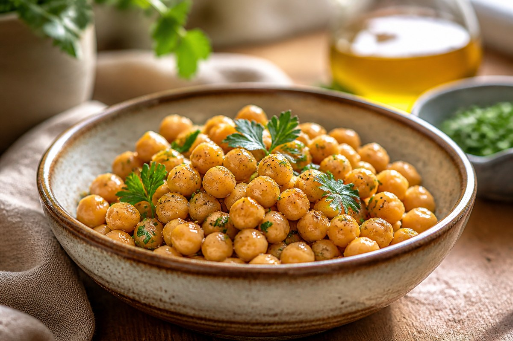

*▲ 100g당 8.86g의 식물성 단백질과 7.60g의 풍부한 식이섬유를 동시에 공급하는 병아리콩(Chickpea)은 낮은 혈당지수(GI 28~37)와 높은 저항성 전분 비율 덕분에 포만감을 오래 유지하고 대사 건강을 지키는 핵심 콩류입니다.*

한 줄 결론 <strong>삶은 병아리콩 100g은 164kcal, 식이섬유 7.6g, 단백질 8.86g입니다.</strong> 식이섬유가 하루 권장량의 30%에 달하고 저항성 전분이 식후 혈당 상승을 완만하게 만들어, 밥의 일부를 대체하기 좋습니다.

중동과 지중해 식단의 근간을 이루며 '이집트콩'으로도 불리는 **병아리콩(Chickpea, *Cicer arietinum*)**은 탄수화물과 단백질, 미네랄의 균형이 가장 뛰어난 식물성 완전식품 중 하나입니다.

일반적인 곡류(백미·밀가루)가 섭취 직후 빠르게 포도당으로 분해되어 인슐린 분비를 급격히 자극하는 반면, 병아리콩은 전체 전분 중 소화 속도가 느린 **아밀로스(Amylose)**와 소장에서 분해되지 않고 대장까지 도달하는 **저항성 전분(Resistant Starch)** 비율이 높습니다. 이 덕분에 삶은 병아리콩의 혈당지수(GI)는 약 28~36 수준으로 매우 낮게 유지되며, 다음 끼니의 혈당 상승까지 완만하게 누그러뜨리는 이른바 '세컨드 밀 효과(Second-meal effect)'를 발휘합니다.

또한 삶은 병아리콩 100g만으로도 성인 하루 엽산(비타민 B9) 권장량의 약 43%를 채울 수 있으며, 철분·마그네슘·망간·아연 등 조혈과 항산화 효소 작동에 필수적인 미량 미네랄이 고밀도로 농축되어 있습니다.

미국 농무부(USDA FoodData Central) 표준 영양 분석 데이터를 바탕으로 삶은 병아리콩의 정밀 영양 성분과 4대 핵심 효능, 소화 부담을 줄이는 조리법 및 주의사항을 정리했습니다.

---

## 1. 병아리콩 칼로리와 영양성분은? (식이섬유 7.6g·단백질 8.86g)

물에 불려 삶은 병아리콩(무염 기준)은 수분 약 60%와 탄수화물·단백질·식이섬유가 조밀하게 결합해 있으며, 콜레스테롤은 전혀 포함하지 않습니다.

| 영양 성분 (Nutrient) | 함량 (100g당) | 1일 권장 섭취량 비율 (한국인 성인 기준) |
| :--- | :--- | :--- |
| **열량 (Energy)** | 164 kcal | 8.2% |
| **수분 (Water)** | 60.21 g | 별도 표기¹ |
| **탄수화물 (Carbohydrates)** | 27.42 g | 8.5% |
| - 총 당류 (Total Sugars) | 4.80 g | 별도 표기¹ |
| - 식이섬유 (Dietary Fiber) | 7.60 g | 30.4% |
| **단백질 (Protein)** | 8.86 g | 16.1% |
| **지방 (Total Fat)** | 2.59 g | 4.8% |
| - 포화지방산 (Saturated Fat) | 0.27 g | 1.8% |
| - 콜레스테롤 (Cholesterol) | 0.00 mg | 0.0% |
| **엽산 (Folate, DFE)** | 172.00 mcg | 43.0% |
| **비타민 B6 (Vitamin B6)** | 0.14 mg | 9.3% |
| **비타민 K (Vitamin K)** | 4.00 mcg | 5.7% |
| **망간 (Manganese)** | 1.03 mg | 29.4% |
| **철분 (Iron)** | 2.89 mg | 28.9% |
| **구리 (Copper)** | 0.35 mg | 43.8% |
| **인 (Phosphorus)** | 168.00 mg | 24.0% |
| **마그네슘 (Magnesium)** | 48.00 mg | 15.0% |
| **아연 (Zinc)** | 1.53 mg | 15.3% |
| **칼륨 (Potassium)** | 291.00 mg | 8.3% |
| **저항성 전분·이소플라본** | 고농축 함유 | 기준치 없음 |

*¹ 표 읽는 법: 한국인 영양소 섭취기준(2020) 1일 권장량(열량 2,000kcal, 단백질 55g, 탄수화물 324g, 식이섬유 25g, 엽산 400mcg 등)을 적용했습니다. 수분과 총 당류처럼 절대 권장량 대신 적정 비율이나 총열량 대비 제한치로 관리되는 항목은 '별도 표기¹', 생리활성 탄수화물 및 파이토케미컬은 공식 기준치가 없어 '기준치 없음'으로 표시했습니다.*

*※ 출처: [USDA FoodData Central FDC 173757](https://fdc.nal.usda.gov/food-details/173757/nutrients) — Chickpeas, mature seeds, cooked, boiled, without salt (SR Legacy). 표의 100g당 열량 164 kcal과 단백질 8.86 g은 이 항목의 값이며, 조리 상태가 다르면 값도 달라집니다.*

---

## 2. 병아리콩 효능은 무엇일까? 과학으로 입증된 4대 효과

### 1) 식후 혈당 스파이크 억제 및 인슐린 저항성 개선
병아리콩의 치밀한 세포벽 구조와 높은 아밀로스·식이섬유 함량은 소화 효소(아밀라아제)의 접근 속도를 물리적으로 지연시킵니다. 임상 영양 연구에서 흰 빵이나 백미 식단의 탄수화물 일부를 병아리콩으로 대체한 그룹은 식후 혈당 곡선 아래 면적(AUC)과 인슐린 분비량이 유의미하게 낮아졌으며, 공복 혈당 유지에도 긍정적인 영향을 보였습니다.

### 2) 장내 미생물 균형 및 부티르산(단쇄지방산) 생성
병아리콩에 풍부한 수용성·불용성 식이섬유와 라피노스 계열 올리고당은 대장에 서식하는 유익균(*Bifidobacterium*, *Faecalibacterium*)의 핵심 먹이(프리바이오틱스)로 쓰입니다. 유익균이 이를 발효하면서 생성하는 **부티르산(Butyrate)**은 대장 상피세포의 주요 에너지원으로 작용해 장 점막 장벽을 튼튼하게 하고 전신 염증 반응을 낮춥니다.

### 3) LDL 콜레스테롤 배출 및 심혈관 위험 감소
수용성 식이섬유와 식물성 스테롤(피토스테롤)은 소장에서 담즙산과 결합해 체외 배출을 촉진합니다. 간이 새로운 담즙산을 합성하기 위해 혈중 콜레스테롤을 끌어다 쓰게 되므로, 결과적으로 저밀도 지단백(LDL) 콜레스테롤 수치가 완만하게 낮아집니다. 또한 풍부한 마그네슘과 칼륨은 혈관 평활근 이완과 혈압 조절을 돕습니다.

### 4) 엽산·철분·단백질 시너지와 포만감 호르몬(GLP-1) 자극
고단백·고식이섬유 조합은 소장 말단 L-세포를 자극해 식욕 억제 호르몬인 **GLP-1**과 **PYY(펩타이드 YY)** 분비를 늘립니다. 체중 감량 중 부족해지기 쉬운 엽산(43% DV)과 철분(29% DV)을 동시에 보충할 수 있어 빈혈 예방과 피로 관리에도 유리합니다.

---

## 3. 병아리콩은 얼마나 불려야 할까? 소화율 높이는 조리법

- **최소 8~12시간 침지(불리기) 후 침지수 버리기:** 병아리콩 껍질과 배아에는 미네랄 흡수를 방해하는 피틴산(Phytic acid)과 가스 유발 물질(라피노스)이 들어 있습니다. 찬물에 8~12시간 충분히 불린 뒤 그 물은 반드시 버리고 새 물로 삶아야 속이 편안해지고 철분·아연 흡수율이 높아집니다.
- **다시마·월계수 잎 또는 소량의 베이킹소다 활용:** 삶는 물에 다시마 한 조각을 넣으면 글루탐산이 감칠맛을 더하고 콩 단백질을 부드럽게 해 주며, 소화력이 약한 분은 완전히 물러질 때까지 40~50분 이상 푹 익히거나 압력솥·후무스(Hummus) 형태로 갈아 드시는 것이 좋습니다.
- **비타민 C 식재료와 병행 섭취:** 병아리콩의 철분은 식물성 비헴철이므로 레몬즙, 파프리카, 오렌지 등 비타민 C가 풍부한 식재료와 함께 먹으면 장내 흡수 효율이 수 배 이상 높아집니다.

---

## 4. 병아리콩 부작용과 주의할 점은?

- **과민성 대장증후군(IBS) 및 복부 팽만감:** 발효성 올리고당(FODMAP) 함량이 높아 평소 장이 예민한 분이 한 번에 많은 양을 먹으면 가스가 차거나 설사를 유발할 수 있습니다. 초기에는 하루 2~3큰술(약 40~50g)부터 시작해 장이 적응하도록 천천히 늘리세요.
- **신장 질환자 칼륨·인 조절:** 삶은 병아리콩 100g당 칼륨 291mg, 인 168mg이 들어 있어 만성 신장 질환으로 전해질 제한이 필요한 경우에는 의료진과 섭취량을 상의해야 합니다.
- **생콩 섭취 금지:** 생병아리콩에는 렉틴(Lectin)과 트립신 저해제 등 항영양소가 포함되어 있으므로 반드시 100℃에서 충분히 가열·조리해 드셔야 합니다.

---

## 5. 병아리콩과 함께 먹으면 좋은 음식은?

- **[오렌지 (Orange)]({{ site.baseurl }}/posts/orange-nutrition-benefits/)**: 병아리콩 샐러드에 오렌지 과육이나 즙을 곁들이면 오렌지의 고농도 비타민 C와 구연산이 병아리콩 속 식물성 비헴철을 환원시켜 철분 흡수율을 극대화합니다.
- **[토마토 (Tomato)]({{ site.baseurl }}/posts/tomato-nutrition-benefits/)**: 병아리콩의 식물성 단백질·아연과 토마토의 리코펜·유기산이 어우러진 스튜나 카레는 항산화 방어와 포만감을 동시에 챙길 수 있는 완벽한 지중해식 조합입니다.
- **[시금치 (Spinach)]({{ site.baseurl }}/posts/spinach-nutrition-benefits/)**: 두 식재료 모두 엽산과 마그네슘이 풍부하며, 병아리콩의 아미노산과 시금치의 질산염·루테인이 결합해 혈관 탄력과 에너지 대사를 든든하게 뒷받침합니다.
- **[낫토 (Natto)](/posts/natto-nutrition-benefits/):** 병아리콩의 식이섬유와 낫토의 프로바이오틱스로 장 건강을 함께 챙길 수 있습니다.

---

## 6. 자주 묻는 질문 (FAQ)

### Q1. 병아리콩과 일반 백미 밥을 섞어 지어도 혈당 관리에 도움이 되나요?
**A:** 네, 매우 효과적입니다. 백미에 불린 병아리콩을 20~30% 비율로 섞어 밥을 지으면 전체 식사의 식이섬유와 단백질 밀도가 올라가고, 병아리콩의 저항성 전분이 위 배출 속도를 늦춰 백미 단독 섭취 시보다 식후 혈당 상승 폭을 뚜렷하게 낮출 수 있습니다.

### Q2. 건조 병아리콩을 직접 삶아 먹는 것과 통조림(캔) 병아리콩 중 어떤 게 더 좋나요?
**A:** 영양 보존과 나트륨 관리 측면에서는 건조 병아리콩을 직접 불려 삶는 것이 가장 좋습니다. 통조림 병아리콩을 사용할 때는 보존액에 나트륨이 다량 녹아 있으므로 반드시 체에 밭쳐 흐르는 찬물에 여러 번 헹구어 물기를 뺀 뒤 조리하세요.

### Q3. 병아리콩의 하루 적정 섭취량은 어느 정도인가요?
**A:** 성인 기준 삶은 병아리콩으로 하루 **100~150g(종이컵 약 2/3~1컵 분량)** 내외가 적당합니다. 단백질과 식이섬유가 풍부해 한 끼 식사의 탄수화물 공급원을 대체하기 좋지만, 과다 섭취 시 총열량과 가스 생성이 늘어날 수 있으므로 정량을 지키는 것이 좋습니다.

  
📌 관련 순위 가이드

  <ul>
    <li><a href="/posts/high-protein-foods-ranking/">단백질 많은 음식 TOP 10: 100g당 함량과 흡수율 비교</a></li>
    <li><a href="/posts/low-gi-foods-blood-sugar-guide/">혈당 낮추는 음식 TOP 10: 저혈당 지수(GI) 순위표</a></li>
  </ul>

