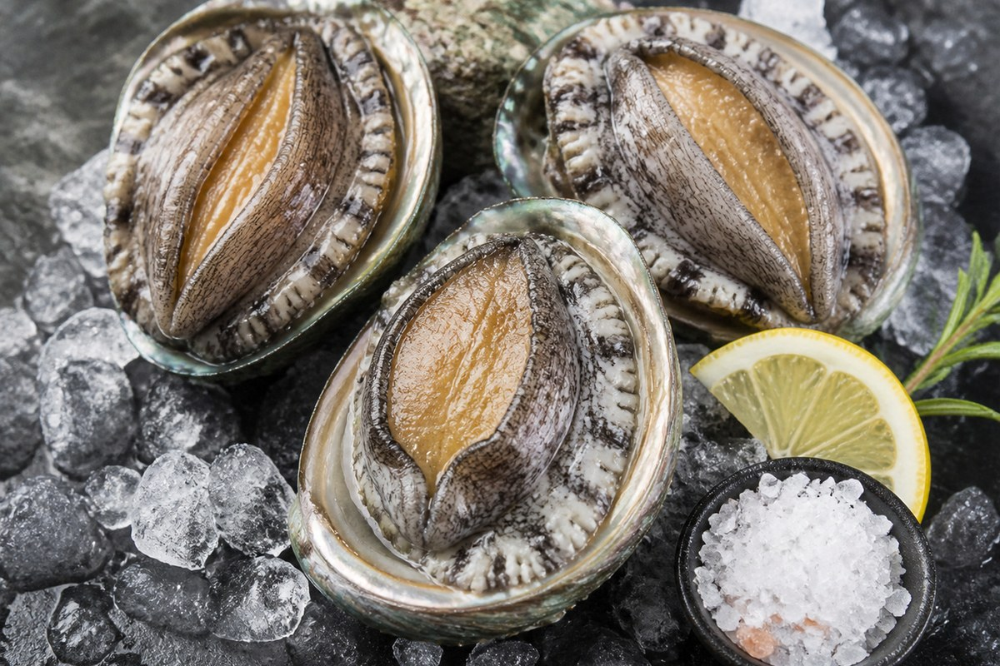

*▲ Supplying 17.10 grams of bioavailable marine protein and under 1 gram of total fat per 100 grams, abalone (*Haliotis spp.*) concentrates free taurine, glycogen, vitamin E, and selenium to support hepatic detoxification and cellular energy recovery.*

Quick answer <strong>Raw abalone provides 105 calories, 17.1 g protein and 3.19 mg iron per 100 g.</strong> Feeding on kelp concentrates taurine, while its glycogen supplies a readily used liver fuel, the basis for its recovery-food reputation.

Revered across East Asian clinical culinary traditions as the "ginseng of the sea," **abalone (*Haliotis discus hannai* and related species)** is a herbivorous marine gastropod mollusk that feeds predominantly on kelp and brown seaweeds. That marine botanical diet shapes an extraordinary biochemical profile inside its muscular foot.

Two compounds anchor abalone's restorative reputation: **taurine**, a sulfur-containing free amino acid, and **glycogen**, a rapidly mobilizable animal polysaccharide. Taurine facilitates hepatic bile acid conjugation, accelerates clearance of lipid and alcohol metabolites, and stabilizes cellular osmoregulation under physical stress. Simultaneously, abalone's native glycogen—paired with **pantothenic acid (vitamin B5, 60% DV)**—supplies immediate metabolic substrate for ATP synthesis during convalescence or post-exercise recovery.

Equally notable is abalone's antioxidant duo: **selenium (44.80 mcg, 81% DV)** and **vitamin E (4.00 mg, 27% DV)** per 100 grams, which act in tandem to protect phospholipid membranes from oxidative lipid peroxidation.

Drawing on USDA FoodData Central analytical profiles, this monograph examines the nutritional architecture, physiological benefits, and safe culinary handling of fresh abalone.

---

## 1. How Many Calories Are in Abalone? (17.1 g protein, 3.19 mg iron per 100 g)

Raw abalone delivers 105 kcal per 100 grams with negligible fat (0.76g), zero dietary sugar, and remarkable density in selenium, pantothenic acid, iron, and vitamin B12.

| Nutrient | Per 100 g | U.S. %DV |
| :--- | :--- | :--- |
| **Energy** | 105 kcal | 5.3% |
| **Water** | 74.56 g | See note¹ |
| **Carbohydrates** | 6.01 g | 2.2% |
| - Total Sugars | 0.00 g | See note¹ |
| - Dietary Fiber | 0.00 g | 0.0% |
| **Protein** | 17.10 g | 34.2% |
| **Total Fat** | 0.76 g | 1.0% |
| - Saturated Fat | 0.15 g | 0.8% |
| - Cholesterol | 85.00 mg | 28.3% |
| **Vitamin E** | 4.00 mg | 26.7% |
| **Pantothenic Acid (B5)** | 3.00 mg | 60.0% |
| **Niacin (B3)** | 1.50 mg | 9.4% |
| **Vitamin B12** | 0.73 mcg | 30.4% |
| **Selenium** | 44.80 mcg | 81.5% |
| **Iron** | 3.19 mg | 17.7% |
| **Phosphorus** | 190.00 mg | 15.2% |
| **Magnesium** | 48.00 mg | 11.4% |
| **Zinc** | 0.82 mg | 7.5% |
| **Potassium** | 250.00 mg | 5.3% |
| **Taurine & Glycogen** | Concentrated | No DV |

*¹ How to read this table: Percent Daily Values (%DV) are calculated against the standard 2,000-kcal U.S. FDA adult reference intake. Hydration and zero-baseline sugar values without an absolute daily requirement are marked 'See note¹', while non-essential bioactive compounds carry 'No DV' (Daily Value not established).*

---

## 2. What Are the Benefits of Abalone? Four Evidence-Backed Effects

### 1) Hepatic Detoxification and Bile Acid Conjugation
Rich pools of free taurine, arginine, and methionine support hepatic glutathione synthesis and bile salt conjugation. By enhancing bile flow and reducing intrahepatic triglyceride accumulation, abalone serves as a restorative protein source for liver stress and fatigue recovery.

### 2) Ultra-Lean Marine Protein and Glycogen-Driven Recovery
With 17.10 grams of high-biological-value protein and only 0.76 grams of lipid per 100 grams, abalone provides dense nitrogenous support without heavy fat digestion. Its endogenous glycogen stores and high pantothenic acid (vitamin B5) content accelerate coenzyme A (CoA) turnover for rapid cellular energy restoration.

### 3) Synergistic Selenium and Vitamin E Antioxidant Defense
Selenium serves as the catalytic cofactor for glutathione peroxidase (GPx), while lipid-soluble vitamin E (alpha-tocopherol) neutralizes peroxyl radicals directly within cell membranes. Together, they form a dual-layer defense against vascular oxidative stress.

### 4) Erythropoiesis and Neuromuscular Stability
Combining **3.19 mg of bioavailable iron** with **0.73 mcg of vitamin B12**, abalone supports red blood cell maturation and oxygen transport. Taurine further modulates intracellular calcium flux in cardiomyocytes and retinal photoreceptor cells, supporting healthy blood pressure and visual endurance.

---

## 3. How Do You Clean and Cook Abalone to Keep Taurine?

- **Gentle Steaming or Congee Over Prolonged Boiling:** Because abalone muscle fibers tighten rapidly under high, prolonged heat, steam whole or scored abalone gently for 3 to 5 minutes, or simmer slowly in rice congee (*jeonbokjuk*) to tenderize collagen and maximize digestibility.
- **Retain Cooking Liquids to Preserve Taurine:** Taurine and B vitamins are water-soluble. Dishes that incorporate the poaching broth—such as abalone porridge or light seafood soups—retain virtually 100% of these bioactive compounds.
- **Mindful Use of the Viscera (Hepatopancreas):** Abalone viscera concentrate seaweed-derived carotenoids and fat-soluble vitamins, but should be consumed only when fresh and avoided during spring algal seasons (see precautions below).

---

## 4. Who Should Avoid Abalone? Side Effects and Cautions

- **Seasonal Photosensitivity Risk from Spring Viscera:** Between March and May, abalone feeding on specific seaweeds can accumulate *pyropheophorbide a*—a chlorophyll breakdown metabolite—in their viscera. Consuming spring viscera followed by sunlight exposure can trigger phototoxic dermatitis; discard the viscera during spring months and eat only the muscular foot.
- **Cholesterol and Purine Considerations:** While 100g of abalone contains 85 mg of cholesterol, its high taurine content promotes fecal bile excretion. Still, individuals managing gout or severe hyperlipidemia should keep portions moderate (around 100g per serving).
- **Mollusk Allergy:** Those with known shellfish or mollusk allergies should avoid abalone entirely.

---

## 5. What Foods Pair Best with Abalone?

- **[Garlic (Allium sativum)]({{ site.baseurl }}/en/posts/garlic-nutrition-benefits/)**: Pan-searing abalone with garlic allows allicin to form allithiamine complexes with B vitamins, amplifying metabolic energy recovery and antimicrobial protection.
- **[Egg (Whole Egg)]({{ site.baseurl }}/en/posts/egg-nutrition-benefits/)**: Folding beaten egg into warm abalone congee supplies complementary vitamin A, vitamin D, and choline to complete the micronutrient spectrum.
- **[Spinach (Spinacia oleracea)]({{ site.baseurl }}/en/posts/spinach-nutrition-benefits/)**: Pairing abalone's heme-rich iron and zinc with spinach's folate and vitamin C supports red blood cell synthesis and vascular nitric oxide signaling.

---

## 6. Frequently Asked Questions (FAQ)

### Q1. Is raw abalone sashimi healthier than cooked abalone?
**A:** For digestive ease and post-illness recovery, lightly steamed or simmered abalone is generally superior. Gentle heat softens dense collagen fibers in the muscular foot, making protein and glycogen much easier to absorb without irritating the stomach.

### Q2. Why is abalone considered good for liver fatigue?
**A:** Abalone is naturally rich in free taurine and sulfur-containing amino acids, which support hepatic bile acid conjugation, antioxidant glutathione regeneration, and lipid clearance in the liver.

### Q3. How should fresh abalone be cleaned before cooking?
**A:** Scrub the dark outer foot and shell rim under cold running water using a clean brush and a pinch of coarse sea salt to remove surface mucin, then shuck the meat and remove the small hard beak (mouth) before slicing or steaming.

  
📌 Related ranking guide

  <ul>
    <li><a href="/en/posts/liver-immunity-fatigue-recovery-foods/">Top 10 Foods for Fatigue Recovery, Liver & Immunity</a></li>
  </ul>

