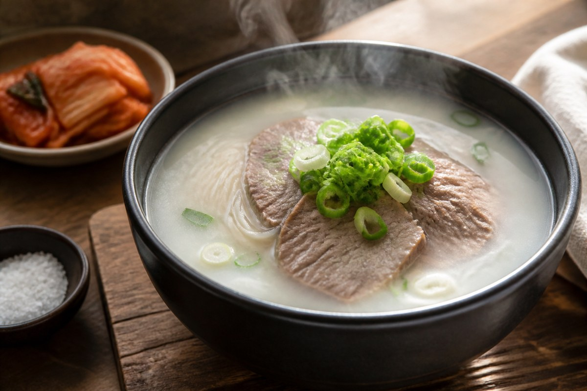

*▲ Beef bone broth delivers only 17 kcal per 100 g, yet a 12-hour simmer extracts roughly 2 g of collagen-derived peptides plus glycine and proline—while its calcium content remains near 10 mg per 100 g, far below milk.*

Quick answer <strong>Unsalted beef bone broth provides 17 calories, 3.3 g protein and 10 mg calcium per 100 g.</strong> Longer simmering converts more collagen to gelatin and raises protein, but calcium stays modest, so past two hours the gain is mostly texture.

Long simmered from beef bones and knuckles, **beef bone broth** anchors Korean seolleongtang and gomtang and has served for centuries as a convalescent food and a warming winter staple.

Over the past decade it has re-emerged in Western markets as a functional food, with U.S. search interest up 38% year over year as of November 2026—and with it, a layer of marketing claims that outruns the evidence.

Nutritionally, bone broth is a food of clear contrasts: **overstated where it is sold as a calcium source or protein powerhouse, and genuinely distinctive in its amino acid profile.** A long simmer does not dissolve bone mineral into the pot, and protein density stays near 3 to 4 g per 100 g, yet the proportion of **glycine** and **proline**—the signature residues of collagen—is hard to obtain from any other broth.

Drawing on USDA FoodData Central records and published human trials on collagen peptides and glycine, this monograph sets out the actual nutrient composition, four mechanisms with real supporting data, the practical effect of simmering time, and precautions for gout and kidney disease.

---

## 1. 12 or 24 Hours? What Long Simmering Really Extracts

Values vary widely with the bone-to-water ratio, simmering duration, and fat removal. The table below uses the median of 100 g measurements across beef bone broth products registered in USDA FoodData Central.

| Nutrient | Per 100 g | U.S. %DV |
| :--- | :--- | :--- |
| **Energy** | 17 kcal | 0.9% |
| **Water** | 95.00 g | See note¹ |
| **Carbohydrates** | 0.40 g | 0.2% |
| - Total Sugars | 0.30 g | See note¹ |
| - Dietary Fiber | 0.00 g | 0.0% |
| **Protein** | 3.30 g | 6.6% |
| **Total Fat** | 0.20 g | 0.3% |
| - Saturated Fat | 0.08 g | 0.4% |
| - Cholesterol | 1.00 mg | 0.3% |
| **Glycine** | ~0.45 g | No DV |
| **Proline & Hydroxyproline** | ~0.45 g | No DV |
| **Collagen-Derived Peptides** | ~2.00 g | No DV |
| **Sodium** | 122.00 mg | 5.3% |
| **Potassium** | 45.00 mg | 1.0% |
| **Calcium** | 10.00 mg | 0.8% |
| **Phosphorus** | 15.00 mg | 1.2% |
| **Magnesium** | 5.00 mg | 1.2% |
| **Iron** | 0.10 mg | 0.6% |
| **Zinc** | 0.10 mg | 0.9% |

*¹ How to read this table: Percent Daily Values (%DV) are calculated against the standard 2,000-kcal U.S. FDA adult reference intake. Water and total sugars carry 'See note¹' because they have no absolute daily requirement, and amino acids or collagen peptides carry 'No DV' (Daily Value not established). Across registered products, energy spans 14–21 kcal, protein 2.5–4.3 g, and sodium 35–180 mg per 100 g; unsalted homemade broth sits at the low end of the sodium range.*

*※ Data basis: each value is a median across several commercial beef-bone-broth products rather than a single analysed entry. Bone-to-water ratio, simmering time and fat removal differ by product, so no one USDA FoodData Central entry represents it; canned beef broth (FDC 171538) lists 7 kcal and 1.14 g protein and is far thinner.*

### What one cup and one bowl of bone broth deliver

Broth is drunk by the cup or the bowl, and the weight is mostly water.

| Portion | Edible weight | Energy | Protein |
| :--- | :--- | :--- | :--- |
| 1 cup | 240 g | 40.8 kcal | 7.92 g |
| 1 soup bowl | 300 g | 51 kcal | 9.90 g |
| 1 large pot (4 servings) | 1000 g | 170 kcal | 33.00 g |

*Note: one cup (240 g) is 41 kcal and 7.9 g protein; a 300 g soup bowl is 51 kcal. The sodium in a bowl depends entirely on how much salt and soy sauce went in, not on the bones.*

The calcium figure deserves emphasis. Even after twelve hours of simmering, calcium reaches only about 10 mg per 100 g—less than one tenth of the 113 mg in an equivalent weight of milk—because bone mineral is nearly insoluble in water. Treating bone broth as a calcium supplement is not supported by measurement.

---

## 2. What Are the Benefits of Beef Bone Broth? Four Evidence-Backed Effects

### 1) Collagen-Derived Peptides and Joint or Skin Tissue
Much of bone broth's protein is gelatinous collagen peptide. After digestion, prolyl-hydroxyproline and glycine-proline dipeptides reach the bloodstream and stimulate chondrocytes and dermal fibroblasts.

Randomized trials of 8–12 g of collagen peptides daily for 12–24 weeks reported reduced knee pain scores and improved joint function, with modest gains in skin elasticity. Importantly, **one 240 ml cup of broth yields only about 2–3 g of collagen peptides**—roughly a third of the clinical dose, so trial-level intake means three or more cups daily for months.

### 2) Glycine for Sleep Quality and Collagen Synthesis
Glycine accounts for roughly one third of all amino acid residues in collagen and participates in glutathione synthesis, hepatic phase II detoxification through glycine conjugation, and inhibitory neurotransmission.

A randomized trial of 3 g of glycine before bed shortened sleep latency and improved subjective sleep quality. Two to three cups of broth provide roughly 1 g, so a sleep-oriented protocol calls for a more concentrated reduction an hour before bedtime. In adults with normal kidney function, up to about 15 g of glycine daily is considered safe.

### 3) Intestinal Barrier Support and Digestive Tolerance
Broth supplies small amounts of glutamine and glycine, and collagen peptides provide fluid and electrolytes without strongly provoking gastric acid secretion. That glutamine is the principal fuel for enterocytes is well established, but **direct clinical evidence that broth regenerates the intestinal lining remains thin**; most "leaky gut" claims rest on cell or animal models with small samples.

What is defensible is tolerability: as a low-FODMAP liquid, broth rarely irritates a sensitive gut and delivers water and electrolytes together—useful during recovery or for older adults with small appetites.

### 4) Low-Calorie Satiety and Convalescent Protein and Electrolyte Support
At 17 kcal and 3.3 g of protein per 100 g, broth adds protein without a meaningful calorie load, along with trace chondroitin sulfate, hyaluronic acid, potassium, and magnesium. Meeting the daily protein requirement from broth alone, however, would take more than 1.5 liters—it is a supplement to a meal, not the meal itself.

---

## 3. Storing and Portioning Beef Bone Broth

- **Hours 1–4 (first boil):** Blood residues, coagulated protein, and free amino acids surface first. This liquid is low in protein and harsh in flavor and should be discarded. Start bones in cold water, bring to a near boil, blanch, then rinse under running water.
- **Hours 6–12 (primary extraction):** Collagen hydrolyzes into gelatin, and most protein and glycine release completes in this window. Hold the temperature at 90–95°C; a rolling 100°C boil emulsifies fat and protein into cloudy foam and increases loss.
- **Hours 12–24 (reduction):** Protein extraction rises only marginally—typically within 10–20%—while water evaporates and concentrates the broth. Glutamate increases for deeper umami, but purines and sodium concentrate alongside it. Beyond 24 hours, the energy and safety costs outweigh any nutritional gain.
- **The vinegar myth:** Adding acid slightly increases mineral dissolution, but the resulting calcium gain measures only a few milligrams per 100 g—not a meaningful contribution.
- **Umami and sodium control:** Garlic, onion, ginger, jujube, and black peppercorns add glutamate and guanylate synergy that reduces the salt needed. Season at the end, and chill the finished broth to lift the solidified fat cap—removing 30% or more of total fat and calories.

---

## 4. Who Should Avoid Beef Bone Broth? Side Effects and Cautions

- **Gout and hyperuricemia:** Long-simmered beef broth is purine-rich, and values vary too much by recipe for a standard figure. Anyone with a history of gout should avoid daily concentrated gomtang, abstain during flares, and otherwise limit it to once or twice weekly.
- **Chronic kidney disease:** Broth supplies sodium, phosphorus, and potassium together, so patients on electrolyte restriction should set intake with their nephrologist. Commercial broths can contain 230–440 mg of sodium per cup.
- **Hypertension and heart failure:** Heavily salted gomtang can exceed half the daily 2,000 mg sodium target in a single bowl. Favor the solids, keep the broth modest, and add salt separately.
- **Heavy metal questions:** A 2013 study reported comparatively elevated lead concentrations in some chicken bone broth samples; subsequent assessments found levels well within safety margins at ordinary intakes. Discussion with a clinician is warranted only for daily high-volume consumption.
- **Storage and food safety:** Protein-rich broth supports rapid growth of *Clostridium perfringens*. Never leave it out beyond two hours; hold above 60°C or chill quickly, then consume within three days refrigerated or one month frozen.

---

## 5. What Foods Pair Best with Beef Bone Broth?

- **[Tomato (Solanum lycopersicum)]({{ site.baseurl }}/en/posts/tomato-nutrition-benefits/)**: Vitamin C is an obligatory cofactor for collagen hydroxylation, so adding tomato to bone broth supports conversion of collagen peptides into stable connective tissue while contributing lycopene.
- **[Garlic (Allium sativum)]({{ site.baseurl }}/en/posts/garlic-nutrition-benefits/)**: Allicin and organosulfur compounds deepen the broth's umami while supporting endothelial function and lipid metabolism, offsetting the heaviness of a fatty bone broth.
- **[Onion (Allium cepa)]({{ site.baseurl }}/en/posts/onion-nutrition-benefits/)**: Quercetin and sulfur compounds in onion feed beneficial gut taxa and, alongside broth glycine and glutamine, gently support the intestinal mucosal environment.

---

## 6. Frequently Asked Questions (FAQ)

### Q1. Does simmering bone broth for 24 hours extract more collagen than 12 hours?
**A:** Not meaningfully. Most collagen-to-gelatin hydrolysis occurs within the 6–12 hour window, and extending to 24 hours raises protein yield by only about 10–20% while water evaporates away. Purines and sodium concentrate along with it. A gentle 90–95°C simmer for 8–12 hours is the practical balance between yield and effort.

### Q2. Is there real evidence that bone broth collagen helps joints?
**A:** Collagen peptides themselves have randomized trial support—8–12 g daily for 12 weeks or longer reduced knee pain and improved function. But a cup of broth supplies only 2–3 g, well below the clinical dose. Broth is best treated as part of a joint-friendly diet, with two to three cups daily or a collagen peptide supplement to close the gap.

### Q3. Should people with gout or kidney disease avoid beef bone broth?
**A:** For gout, limit concentrated beef or bone broth to once or twice weekly and avoid it entirely during flares, because purine content rises with simmering time. For chronic kidney disease with sodium, phosphorus, or potassium restriction, set intake with a nephrologist and check the sodium figure on any commercial broth label first.

  
📌 Related ranking guide

  <ul>
    <li><a href="/en/posts/liver-immunity-fatigue-recovery-foods/">Top 10 Foods for Fatigue Recovery, Liver & Immunity</a></li>
  </ul>

