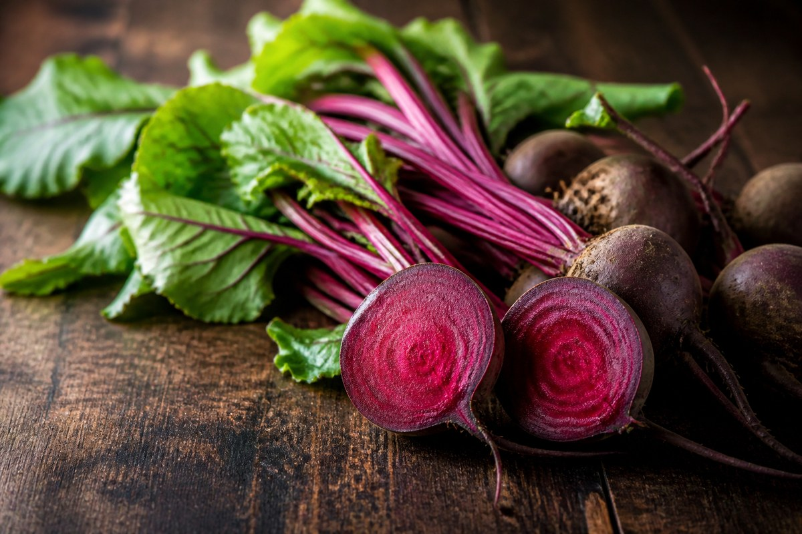

*▲ At just 43 kcal per 100 g, raw beetroot still carries 150–250 mg of dietary nitrate, 109 mcg of folate, and 128.7 mg of betaine. The magenta rings in the cross-section are concentric layers of betalain pigment.*

**Beetroot (*Beta vulgaris*)** has been described as a blood-purifying vegetable for centuries. Over the past two decades, sports science and vascular medicine have replaced folklore with a precise mechanism: the **nitrate–nitrite–nitric oxide pathway**.

Its distinguishing feature is nitrate concentration. Most vegetables contain tens of milligrams per 100 g; beetroot holds **150–250 mg**, and commercially concentrated beetroot "shots" deliver 300–500 mg per serving. The 200–800 mg nitrate doses that produced measurable blood pressure and performance effects in randomized trials sit squarely in that range.

Beetroot also supplies **betalains**, the water-soluble pigments responsible for its color, and **betaine**, a methyl donor in homocysteine metabolism. Energy density is among the lowest of any root vegetable at 43 kcal per 100 g.

Drawing on USDA FoodData Central profiles and published human trials, this monograph covers the precise composition of raw beetroot, four principal physiological effects, the practical choice between raw juice and boiled or steamed beets with respect to oxalate, and the cautions—beeturia, kidney stones, antihypertensive drugs—that deserve attention.

---

## 1. Quantitative Nutritional Composition (Per 100 g Raw)

Beetroot is roughly 88% water. Its carbohydrate fraction is nearly all sugars and fiber, and fat content is negligible.

| Nutrient | Per 100 g Raw | U.S. %DV |
| :--- | :--- | :--- |
| **Energy** | 43 kcal | 2.2% |
| **Water** | 87.58 g | See note¹ |
| **Carbohydrates** | 9.56 g | 3.5% |
| - Total Sugars | 6.76 g | See note¹ |
| - Dietary Fiber | 2.80 g | 10.0% |
| **Protein** | 1.61 g | 3.2% |
| **Total Fat** | 0.17 g | 0.2% |
| - Saturated Fat | 0.03 g | 0.1% |
| - Cholesterol | 0.00 mg | 0.0% |
| **Folate (DFE)** | 109.00 mcg | 27.3% |
| **Vitamin C** | 4.90 mg | 5.4% |
| **Vitamin B6** | 0.07 mg | 3.9% |
| **Vitamin A (RAE)** | 2.00 mcg | 0.2% |
| **Choline** | 6.00 mg | 1.1% |
| **Potassium** | 325.00 mg | 6.9% |
| **Magnesium** | 23.00 mg | 5.5% |
| **Iron** | 0.80 mg | 4.4% |
| **Copper** | 0.08 mg | 8.3% |
| **Manganese** | 0.33 mg | 14.3% |
| **Calcium** | 16.00 mg | 1.2% |
| **Sodium** | 78.00 mg | 3.4% |
| **Zinc** | 0.35 mg | 3.2% |
| **Betaine** | 128.70 mg | No DV |
| **Dietary Nitrate** | 150–250 mg | No DV |
| **Betalains (betanidin)** | 30–60 mg | No DV |
| **Oxalate** | 50–120 mg | No DV |

*¹ How to read this table: Percent Daily Values (%DV) are calculated against the standard 2,000-kcal U.S. FDA adult reference intake. Water and total sugars, which have no absolute daily requirement, are marked 'See note¹', while phytochemicals and antinutrients without an established allowance—nitrate, betalains, oxalate—carry 'No DV'.*

Cooking shifts the profile. Boiled beetroot remains about 44 kcal per 100 g, but **10–30% of water-soluble betalains, folate, and potassium leach into the cooking water.** Steaming or roasting whole limits those losses to 5–15%.

---

## 2. Four Evidence-Based Physiological Benefits

### 1) Dietary Nitrate, Nitric Oxide, and Blood Pressure
Oral bacteria reduce beetroot nitrate to nitrite, which the stomach and circulation convert to nitric oxide. NO relaxes vascular smooth muscle, widening vessels and lowering peripheral resistance—most efficiently in hypoxic conditions, which is precisely why the effect is pronounced during exercise.

Pooled randomized trials of beetroot juice report **average systolic reductions of roughly 3–5 mmHg**, peaking 1–3 hours after ingestion and persisting 6–12 hours. Daily intake stabilizes the effect over about two weeks. Heterogeneity across studies is substantial, so beetroot is an adjunct to, never a replacement for, antihypertensive therapy.

### 2) Betalains and 128.7 mg of Betaine
Betanidin, the core betalain, is a water-soluble antioxidant. Cell and animal studies report reduced lipid peroxidation and suppressed NF-κB and COX-2 signaling, and beetroot pigment remains stable in gastric acid—prompting research into gastric mucosal protection.

**Betaine** donates a methyl group in the methionine cycle, converting homocysteine back to methionine. Because elevated homocysteine injures vascular endothelium, beetroot's combination of folate and betaine supports that pathway from two directions.

### 3) Exercise Economy and Oxygen Efficiency (300–600 mg, 2–3 Hours Before)
Beetroot juice is the best-evidenced nitrate source in sports nutrition. Multiple randomized trials show that **300–600 mg of nitrate taken 2–3 hours before exercise** improves oxygen cost and time to exhaustion in endurance events by enhancing mitochondrial respiratory efficiency.

The effect is inconsistent for short maximal efforts such as 20–60 second sprints or one-repetition maximum lifts. Unlike caffeine, nitrate does not disturb sleep or cause a stimulant crash.

### 4) Folate, Fiber, and a 43 kcal Energy Density
A 100 g serving supplies 27% of the daily folate requirement. Folate is essential for red cell production, endothelial repair, and neural tube closure in early pregnancy. The 2.8 g of fiber feeds butyrate-producing gut bacteria.

At 43 kcal with 88% water, beetroot delivers high satiety per calorie. The 6.76 g of sugars means people monitoring glucose should keep portions to about 100 g at a time rather than drinking large volumes of juice at once.

---

## 3. Raw Versus Boiled: A Cooking Protocol That Cuts Oxalate by 25%

- **Boiling or steaming removes roughly 25% of the oxalate:** Beetroot carries 50–120 mg of oxalate per 100 g—moderate to high among vegetables. Boiling leaches soluble oxalate into the water, reducing **total oxalate by about 25% and soluble oxalate by 30–50%**. Anyone with a stone history should prefer steamed or boiled beets and discard the cooking liquid.
- **Cook whole and unpeeled:** Cutting or peeling before boiling drives betalains and folate straight into the water. Steam whole for 30–40 minutes, cool, then slip the skins off by hand—the lowest-loss method. Roasting at 200 °C for 40–60 minutes wrapped in foil limits moisture loss and concentrates sweetness.
- **Raw juice carries the most nitrate—and the most oxalate:** For blood pressure or performance goals, fresh raw juice is the most concentrated vehicle. Juicing strips virtually all fiber and leaves oxalate intact, so cap intake at **100–250 ml per day** and alternate with whole cooked beets.
- **Stabilize color with acid, avoid reactive metals:** Betalains are stable in acid and turn brown in alkali. A teaspoon of lemon juice or vinegar preserves the vivid color. Aluminum and cast iron promote discoloration and metallic off-flavors; stainless steel or enamel is preferable.
- **The greens are nutritious but higher in oxalate:** Beet greens surpass the root in folate, lutein, and nitrate but also in oxalate. Blanch, squeeze, and use modestly. Store roots trimmed of tops in a sealed bag for 2–3 weeks; keep leaves wrapped in damp paper towel for 2–3 days.

---

## 4. Precautions and Contraindications

- **Beeturia:** Unmetabolized betanin can tint urine pink to red in **roughly 10–14% of people**—more common with low stomach acid or rapid transit. It clears within one or two voids and is harmless. It can, however, be mistaken for hematuria and causes false-positive fecal occult blood tests; avoid beets for 48 hours before such testing, and seek care if discoloration persists or is accompanied by pain.
- **Calcium oxalate stone formers:** At 50–120 mg per 100 g, oxalate can raise recurrence risk. Avoid raw beetroot and juice, limit even steamed beets to about 50 g per day, and **pair them with calcium-rich foods** so oxalate binds in the gut rather than the kidney. Adequate fluid intake remains the foundation of prevention.
- **Hypotension and antihypertensive therapy:** Additive vasodilation can cause dizziness or orthostatic hypotension. **Co-administration with PDE5 inhibitors or nitrate-based antianginal drugs (nitroglycerin)** can drop blood pressure dangerously and should be avoided.
- **GI upset:** Betaine and fiber raise osmotic load; large servings cause loose stools and cramping. Start at 50 g. Beetroot is low in FODMAPs, so small portions are usually tolerated in IBS.
- **Chronic kidney disease:** At 325 mg of potassium per 100 g, a 250 ml glass of juice can exceed 800 mg—relevant under electrolyte restriction.
- **High-volume intake in pregnancy:** Beetroot is a useful folate source, but large volumes of high-nitrate juice are not advised during pregnancy. Normal culinary amounts of cooked beet are unproblematic.

---

## 5. Synergistic Food Pairings

- **[Carrots (Daucus carota)]({{ site.baseurl }}/en/posts/carrot-nutrition-benefits/)**: Beet betalains are water-soluble while carrot beta-carotene is fat-soluble, so the pair spans both antioxidant phases. A roasted beet-and-carrot salad dressed with olive oil captures the fat-soluble fraction too.
- **[Spinach (Spinacia oleracea)]({{ site.baseurl }}/en/posts/spinach-nutrition-benefits/)**: Beet folate joins spinach folate and iron in supporting red cell production, and their combined nitrate load amplifies nitric oxide availability. Because both are oxalate sources, stone formers should blanch, discard the water, and moderate portions.
- **[Apple (Malus domestica)]({{ site.baseurl }}/en/posts/apple-nutrition-benefits/)**: Apple vitamin C enhances reduction of beetroot's non-heme iron, and apple pectin adds the soluble fiber that juice lacks. The classic beet-apple-lemon juice works, but keep it to about 200 ml because of its sugar load.

---

## 6. Frequently Asked Questions (FAQ)

### Q1. Is raw beetroot juice or boiled beet better for blood pressure?
**A:** For blood pressure specifically, raw juice has the edge. Boiling and steaming leach 10–30% of nitrate and betalains into the cooking water, while juice concentrates nitrate most densely. Juice, however, has almost no fiber and retains all the oxalate. A practical target is 100–250 ml of beet juice or 100 g of steamed beet daily; the effect peaks 1–3 hours after ingestion and lasts 6–12 hours.

### Q2. My urine turns red after eating beetroot—should I see a doctor?
**A:** Most likely this is **beeturia**, a harmless pigment excretion seen in roughly 10–14% of people that clears after one or two voids. Seek care promptly if discoloration persists beyond a day or comes with painful urination, fever, or flank pain, since hematuria must be excluded. Stop beets 48 hours before a fecal occult blood test to avoid a false positive.

### Q3. Can I eat beetroot if I have kidney stones?
**A:** It depends on preparation. At 50–120 mg of oxalate per 100 g, beetroot is a risk for calcium oxalate stone formers, who should avoid raw beet and juice. Steaming reduces oxalate by about 25%, but even then keep intake under 50 g daily and eat beets with calcium-rich foods such as yogurt or cheese so oxalate binds in the intestine. Drinking 1–2 liters of water daily is the baseline preventive measure.

