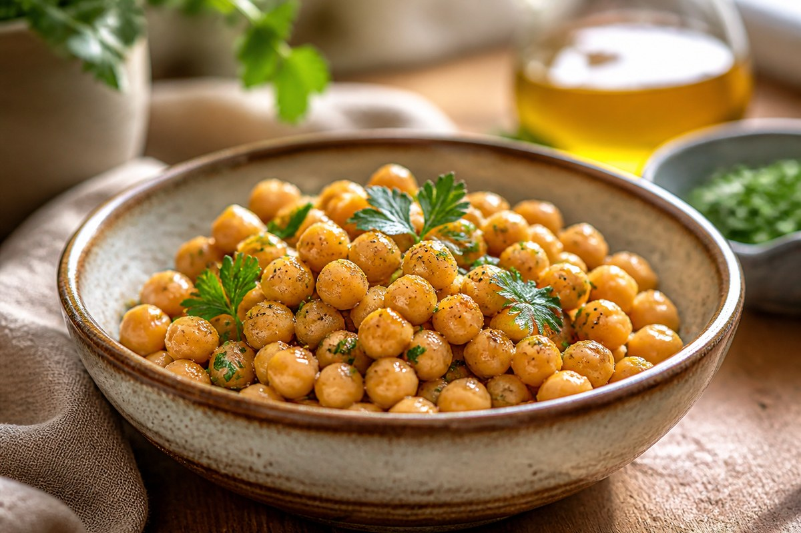

*▲ Supplying 8.86 grams of plant-derived protein and 7.60 grams of dietary fiber per 100 grams cooked, chickpeas (garbanzo beans) combine a low glycemic index (28–36) with dense folate, iron, and resistant starch to stabilize postprandial glucose and nourish colonic microbiota.*

Quick answer <strong>Boiled chickpeas provide 164 calories, 7.6 g fiber and 8.86 g protein per 100 g.</strong> That fiber is about 30 percent of the daily target, and resistant starch slows post-meal glucose, making chickpeas a practical rice substitute.

Also known globally as **garbanzo beans**, **chickpeas (*Cicer arietinum*)** serve as a foundational legume across Mediterranean and Middle Eastern dietary patterns—and for compelling biochemical reasons.

Unlike refined cereal starches that undergo rapid luminal hydrolysis into glucose, chickpea starch possesses a markedly elevated **amylose-to-amylopectin ratio** encased within intact cotyledon cell walls. Combined with substantial **resistant starch (Type 1 and Type 3)** and viscous dietary fiber, cooked chickpeas yield a remarkably low glycemic index (GI 28–37). Clinical feeding studies even document a reproducible **"second-meal effect,"** wherein consuming chickpeas at one meal blunts the glycemic excursion of a subsequent carbohydrate-rich meal hours later.

Beyond glycemic kinetics, 100 grams of boiled chickpeas supply **43% of the U.S. Daily Value for folate (172 mcg)** alongside meaningful concentrations of manganese, copper, iron, magnesium, and zinc—making them an exceptional micronutrient anchor for plant-forward and cardiometabolic nutrition.

Based on USDA FoodData Central analytical profiles and human intervention trials, this monograph details the nutrient composition, physiological mechanisms, and optimal preparation methods for chickpeas.

---

## 1. How Long Should You Soak Chickpeas? Digestion Tips

Cooked chickpeas contain roughly 60% water, zero cholesterol, and minimal saturated fat while packing dense protein, fermentable fiber, and trace minerals.

| Nutrient | Per 100 g | U.S. %DV |
| :--- | :--- | :--- |
| **Energy** | 164 kcal | 8.2% |
| **Water** | 60.21 g | See note¹ |
| **Carbohydrates** | 27.42 g | 10.0% |
| - Total Sugars | 4.80 g | See note¹ |
| - Dietary Fiber | 7.60 g | 27.1% |
| **Protein** | 8.86 g | 17.7% |
| **Total Fat** | 2.59 g | 3.3% |
| - Saturated Fat | 0.27 g | 1.4% |
| - Cholesterol | 0.00 mg | 0.0% |
| **Folate (DFE)** | 172.00 mcg | 43.0% |
| **Vitamin B6** | 0.14 mg | 8.2% |
| **Vitamin K** | 4.00 mcg | 3.3% |
| **Manganese** | 1.03 mg | 44.8% |
| **Copper** | 0.35 mg | 38.9% |
| **Iron** | 2.89 mg | 16.1% |
| **Phosphorus** | 168.00 mg | 13.4% |
| **Zinc** | 1.53 mg | 13.9% |
| **Magnesium** | 48.00 mg | 11.4% |
| **Potassium** | 291.00 mg | 6.2% |
| **Resistant Starch & Isoflavones** | Concentrated | No DV |

*¹ How to read this table: Percent Daily Values (%DV) are calculated against the standard 2,000-kcal U.S. FDA adult reference intake. Hydration and total sugars without an absolute daily requirement are marked 'See note¹', while non-essential bioactive compounds carry 'No DV' (Daily Value not established).*

*※ Source: [USDA FoodData Central FDC 173757](https://fdc.nal.usda.gov/food-details/173757/nutrients) — Chickpeas, mature seeds, cooked, boiled, without salt (SR Legacy). The 164 kcal and 8.86 g protein per 100 g in the table above are this entry’s values; a different cooking state changes them.*

### What half a cup, one cup and one spoonful of chickpeas deliver

Cooked chickpeas are measured by the cup. Weights below are USDA portion weights for boiled chickpeas without salt.

| Portion | Edible weight | Energy | Protein |
| :--- | :--- | :--- | :--- |
| 2 tbsp | 25 g | 41 kcal | 2.21 g |
| Half a cup | 82 g | 134.5 kcal | 7.27 g |
| 1 cup | 164 g | 269 kcal | 14.53 g |
| 100 g drained | 100 g | 164 kcal | 8.86 g |

*Note: one cup (164 g) is 269 kcal and 14.5 g protein, which is a full protein portion. Half a cup in a salad is the realistic single serving.*

---

## 2. What Are the Benefits of Chickpeas? Four Evidence-Backed Effects

### 1) Postprandial Glycemic Attenuation and Insulin Economy
Controlled crossover trials consistently show that substituting refined starches with whole chickpeas or chickpea-enriched meals lowers post-meal blood glucose peaks and reduces circulating insulin demand. The intact cellular matrix restricts pancreatic alpha-amylase penetration, slowing glucose entry into the portal vein.

### 2) Colonic Microbiota Support and Butyrate Generation
Chickpea galacto-oligosaccharides (raffinose family) and resistant starch bypass small-intestinal digestion and undergo anaerobic fermentation by beneficial colonic taxa such as *Bifidobacterium* and *Faecalibacterium prausnitzii*. The resulting short-chain fatty acid **butyrate** fuels colonocytes, strengthens tight-junction integrity, and dampens mucosal inflammation.

### 3) Hepatic Cholesterol Clearance and Lipid Profile Improvement
Soluble dietary fiber and plant phytosterols in chickpeas bind bile acids within the intestinal lumen, increasing fecal sterol excretion. To replenish the bile acid pool, hepatocytes upregulate LDL receptor expression and clear circulating LDL cholesterol from the bloodstream.

### 4) Satiety Hormone Signaling (GLP-1 and PYY) and Micronutrient Density
The dual presence of 8.86g protein and 7.60g fiber stimulates enteroendocrine L-cells to release **glucagon-like peptide-1 (GLP-1)** and **peptide YY (PYY)**, prolonging satiety between meals while supplying essential folate and iron for erythropoiesis.

---

## 3. Storing and Portioning Chickpeas

- **Soak for 8–12 Hours and Discard Soaking Water:** Dry chickpeas contain phytic acid (which chelates iron and zinc) and water-soluble raffinose oligosaccharides that cause flatulence. Soaking overnight and discarding the soaking liquid before boiling in fresh water markedly improves mineral bioavailability and gastrointestinal comfort.
- **Pair with Vitamin C to Unlock Non-Heme Iron:** Because chickpea iron is non-heme, dressing chickpea salads or hummus with fresh citrus juice, bell peppers, or tomatoes converts ferric iron ($Fe^{3+}$) into the readily absorbable ferrous form ($Fe^{2+}$).
- **Cook Thoroughly or Blend into Hummus:** Boiling until tender—or pureeing into hummus with extra-virgin olive oil and tahini—denatures trypsin inhibitors and improves amino acid digestibility.

---

## 4. Who Should Avoid Chickpeas? Side Effects and Cautions

- **FODMAP Sensitivity and Bloating:** Individuals with irritable bowel syndrome (IBS) may experience gas or distension from galacto-oligosaccharides. Start with modest portions (40–50g cooked) and rinse canned chickpeas thoroughly.
- **Potassium and Phosphorus Load in Renal Disease:** With 291 mg potassium and 168 mg phosphorus per 100g, patients managing advanced chronic kidney disease should coordinate intake with their nephrologist.
- **Never Consume Raw:** Raw chickpeas harbor lectins and protease inhibitors that are reliably inactivated only through thorough moist-heat cooking.

---

## 5. What Foods Pair Best with Chickpeas?

- **[Orange (Citrus × sinensis)]({{ site.baseurl }}/en/posts/orange-nutrition-benefits/)**: High ascorbic acid and citric acid in oranges significantly boost intestinal uptake of chickpea non-heme iron while brightening earthy legume flavors.
- **[Tomato (Solanum lycopersicum)]({{ site.baseurl }}/en/posts/tomato-nutrition-benefits/)**: Simmering chickpeas with tomatoes pairs plant protein and zinc with fat-soluble lycopene and organic acids for complementary cardiometabolic protection.
- **[Spinach (Spinacia oleracea)]({{ site.baseurl }}/en/posts/spinach-nutrition-benefits/)**: Combining chickpeas and spinach layers complementary folate, magnesium, and plant amino acids to support vascular nitric oxide and cellular energy metabolism.
- **[Natto](/en/posts/natto-nutrition-benefits/):** chickpea fiber and natto's spore-forming probiotics support gut health from two directions.

---

## 6. Frequently Asked Questions (FAQ)

### Q1. Are canned chickpeas as nutritious as home-boiled dried chickpeas?
**A:** Canned chickpeas retain nearly identical levels of protein, fiber, and resistant starch, though some water-soluble B vitamins leach into the brine. Simply drain and rinse canned chickpeas under cold running water for 30 seconds to remove up to 40% of added sodium and excess oligosaccharides.

### Q2. Can chickpeas fit into a low-glycemic or diabetes-friendly meal plan?
**A:** Yes. Despite containing 27.4g of total carbohydrates per 100g, 7.6g is dietary fiber and much of the starch is slowly digested amylose, resulting in a low glycemic index (28–36) and minimal post-meal glucose spikes when consumed in sensible portions (100–150g cooked).

### Q3. What is the best way to prevent gas and bloating when eating chickpeas?
**A:** Soak dried chickpeas for 8–12 hours, discard the soaking water completely, cook them until very tender (adding a strip of kombu seaweed or bay leaf helps), and introduce them gradually into your diet so colonic bacteria adapt smoothly.

  
📌 Related ranking guide

  <ul>
    <li><a href="/en/posts/high-protein-foods-ranking/">Top 10 High-Protein Foods: Grams per 100g and 100 kcal</a></li>
    <li><a href="/en/posts/low-gi-foods-blood-sugar-guide/">Top 10 Low-GI Foods to Lower Blood Sugar: GI and GL Chart</a></li>
  </ul>

