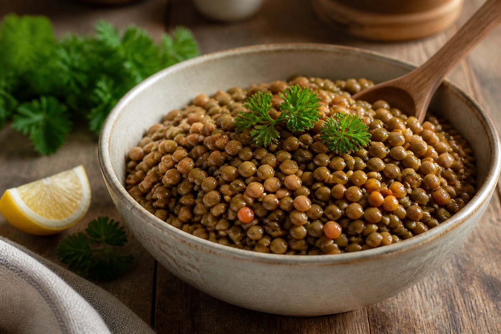

*▲ Dry lentils deliver 24.6 g of protein and 10.7 g of fiber per 100 g. Simmered, the same weight triples in volume, so a 100 g serving of cooked lentils settles at 116 kcal and 9.0 g of protein.*

Quick answer <strong>Dry lentils provide 352 calories, 24.63 g protein and 10.7 g fiber per 100 g.</strong> Their thin seed coat skips long soaking and 15 to 25 minutes of simmering finishes them, while a glycemic index of 32 keeps post-meal glucose gentle.

**Lentils (*Lens culinaris*)**—the small, lens-shaped legumes behind Indian dal, Middle Eastern shorbat adas, and European lentil stews—have fed settled agriculture for roughly ten thousand years. What separates them from beans and chickpeas is speed: **15 to 25 minutes in simmering water** and they are fully cooked, no overnight soak required, no pressure cooker necessary.

Nutritionally, their strength is not simply a high protein number. Per 100 g dry, lentils supply 24.6 g protein alongside 10.7 g fiber, 479 mcg folate, 6.5 mg iron, and 677 mg potassium—with only 0.15 g of saturated fat and no cholesterol at all.

Their starch is also structurally unusual. The high amylose fraction and intact cell walls mean digestive enzymes reach it slowly, producing a measured glycemic index of roughly 29–32—less than half that of white rice.

Drawing on USDA FoodData Central analytical profiles and published human trials, this monograph details the precise nutrient composition, four principal physiological effects, a practical soaking-and-cooking protocol that reduces phytic acid and bloating, and the kidney-disease and gout considerations that matter most.

---

## 1. How Many Calories Are in Lentils? (24.63 g protein, 10.7 g fiber per 100 g)

Because the water content of dry lentils is only about 8%, the figures below describe the **raw, uncooked legume**. Simmering multiplies weight roughly 2.5-fold: 100 g of cooked lentils contains 116 kcal, 9.0 g protein, and 7.9 g fiber.

| Nutrient | Per 100 g Dry | U.S. %DV |
| :--- | :--- | :--- |
| **Energy** | 352 kcal | 17.6% |
| **Water** | 8.06 g | See note¹ |
| **Carbohydrates** | 63.35 g | 23.0% |
| - Total Sugars | 2.03 g | See note¹ |
| - Dietary Fiber | 10.70 g | 38.2% |
| **Protein** | 24.63 g | 49.3% |
| **Total Fat** | 1.06 g | 1.4% |
| - Saturated Fat | 0.15 g | 0.8% |
| - Cholesterol | 0.00 mg | 0.0% |
| **Thiamin (B1)** | 0.87 mg | 72.8% |
| **Riboflavin (B2)** | 0.21 mg | 16.2% |
| **Niacin** | 2.61 mg | 16.3% |
| **Vitamin B6** | 0.54 mg | 31.8% |
| **Folate (DFE)** | 479.00 mcg | 119.8% |
| **Vitamin C** | 4.50 mg | 5.0% |
| **Vitamin E** | 0.49 mg | 3.3% |
| **Vitamin K** | 5.00 mcg | 4.2% |
| **Iron** | 6.51 mg | 36.2% |
| **Potassium** | 677.00 mg | 14.4% |
| **Phosphorus** | 281.00 mg | 22.5% |
| **Magnesium** | 47.00 mg | 11.2% |
| **Zinc** | 3.27 mg | 29.7% |
| **Copper** | 0.75 mg | 83.8% |
| **Manganese** | 1.39 mg | 60.6% |
| **Calcium** | 35.00 mg | 2.7% |
| **Sodium** | 6.00 mg | 0.3% |
| **Selenium** | 8.30 mcg | 15.1% |
| **Phytic Acid** | 0.3–0.6 g | No DV |

*¹ How to read this table: Percent Daily Values (%DV) are calculated against the standard 2,000-kcal U.S. FDA adult reference intake. Water and total sugars, which have no absolute daily requirement, are marked 'See note¹', while phytic acid—a non-essential antinutrient without an established allowance—carries 'No DV'.*

Translated into an actual portion, **one cup of cooked lentils (about 200 g) provides 232 kcal, 18 g of protein, and 15.8 g of fiber**—more protein and fiber than two bowls of white rice at the same energy load.

---

## 2. What Are the Benefits of Lentils? Four Evidence-Backed Effects

### 1) 24.6 g of Protein and a Lysine Advantage for Muscle and Satiety
Lentil protein is notably rich in **lysine**, the limiting amino acid in rice, wheat, and most cereals. Combining lentils with grains restores the complete amino acid profile and raises overall protein utilization—the biochemical logic behind dal-and-rice, lentils-and-barley, and mujaddara.

Protein also slows gastric emptying and stimulates satiety hormones including GLP-1 and PYY; controlled feeding studies consistently show legume-containing meals sustaining fullness longer than isocaloric refined-starch meals. Because plant protein carries a lower digestibility score (DIAAS) than animal protein, aim roughly 10–20% higher on total grams when lentils are the primary protein source.

### 2) A Glycemic Index of 32 and Resistant Starch Formation
Cooked lentils register a glycemic index near 29–32, well below white rice (70+), owing to their high amylose content and intact cellular structure. **Cooling cooked lentils overnight** retrogrades part of the starch into resistant starch type 3, further blunting the postprandial glucose curve—the basis for the lentil-salad effect in clinical feeding trials.

Randomized crossover studies substituting lentils for a portion of rice or potatoes report significantly lower postprandial glucose area under the curve, and meta-analyses of pulse intake consistently associate higher legume consumption with modestly lower HbA1c in people with type 2 diabetes.

### 3) Blood Pressure, Potassium, and the Pulse–Hypertension Literature
Each 100 g of dry lentils supplies 677 mg potassium, 47 mg magnesium, and 10.7 g fiber. Potassium promotes sodium excretion and vascular smooth-muscle relaxation, moving systolic pressure in a favorable direction at the population level.

Recent meta-analyses examining pulse consumption and incident hypertension report **lower hypertension risk among people eating legumes three or more times per week**. The evidence is largely observational, so causality remains unproven—but replacing refined carbohydrates with lentils independently cuts sodium and saturated fat intake, an effect that needs no mechanistic speculation.

### 4) Folate, Iron, and Seed-Coat Polyphenols
At 479 mcg of folate per 100 g dry, lentils exceed the daily requirement for most adults. Folate drives the remethylation pathway that clears homocysteine—an independent vascular risk marker—and is indispensable during early pregnancy for neural tube closure.

The 6.5 mg of iron is non-heme, absorbed at only 2–10%, but pairing lentils with vitamin C-rich vegetables can double or triple uptake. The red and green seed coats also carry **proanthocyanidins and flavonols**; cell and animal studies report NF-κB suppression and delayed LDL oxidation, though human outcome data remain limited.

---

## 3. Do Lentils Need Soaking? Cooking Time and Less Bloating

- **A 2–4 hour soak is optional but useful:** Unlike beans, lentils cook without soaking. A short soak nonetheless **reduces phytic acid by 20–30%** and shortens cooking time. Because phytic acid chelates iron and zinc, anyone with anemia or mineral-absorption concerns should soak. Beyond 12 hours, keep the bowl refrigerated to prevent fermentation.
- **Match the time to the variety:** Brown and green lentils need **20–25 minutes**, beluga (black) lentils 18–22 minutes, and split red or yellow lentils only **10–15 minutes**. A pressure cooker cuts this to 8–10 minutes, and soaked lentils finish 5–8 minutes sooner. Add ½ teaspoon of salt per cup of water so skins stay intact and seasoning penetrates.
- **Simmer, never boil hard:** Vigorous boiling ruptures the seed coats and yields mush. Bring to a boil, then drop to a bare simmer with only a few bubbles breaking the surface. Keep the cooking liquid—it holds water-soluble B vitamins and saponins—and use it as a soup base.
- **Manage gas by sprouting or titrating:** Lentil raffinose-family oligosaccharides ferment in the colon. Sprouting for 12–24 hours reduces them, and starting at 30 g per day while increasing over two to three weeks allows the microbiome to adapt. Canned lentils, drained and rinsed, shed both sodium and oligosaccharides.
- **Storage:** Dry lentils keep about a year in an airtight container away from heat; cooked lentils hold 4–5 days refrigerated or 3 months frozen. Portion and freeze after cooking for instant additions to rice, salads, and curries.

---

## 4. Who Should Avoid Lentils? Side Effects and Cautions

- **Chronic kidney disease:** The 677 mg potassium and 281 mg phosphorus per 100 g dry are significant under an electrolyte-restricted diet. Cooked lentils drop to about 369 mg potassium per 100 g, still a large share of a restricted allowance—nephrology dietitian guidance precedes any regular use, and dialysis patients face the tightest phosphorus and potassium limits.
- **Gout and hyperuricemia:** Lentils carry a moderate purine load (roughly 50–100 mg per 100 g cooked). Contemporary evidence indicates plant purines do not raise flare risk to the degree animal purines do, but intake should be reduced during an acute flare and held to 50–80 g daily in stable disease.
- **Bloating and IBS:** The galacto-oligosaccharide content can provoke gas in irritable bowel syndrome. Rinsed canned lentils, sprouted lentils, and a ceiling of about 50 g per serving are the practical mitigations.
- **Mineral chelation with heavy reliance on legumes:** Populations subsisting largely on lentils show reduced iron and zinc absorption. Soaking, sprouting, and fermentation (tempeh- or natto-style) are the most reliable phytic acid reductions; pairing with meat or a vitamin C source offsets residual binding.
- **Hypothyroidism on levothyroxine:** Legume isoflavones and saponins can impair levothyroxine absorption in theory and in some small studies. Separate the medication from lentil meals by at least four hours.
- **Raw lentils:** Lectin levels are far lower than in kidney beans, but saponins and oligosaccharides still cause GI distress. Cook thoroughly—there is no benefit to eating them raw.

---

## 5. What Foods Pair Best with Lentils?

- **[Chickpeas (Cicer arietinum)]({{ site.baseurl }}/en/posts/chickpea-nutrition-benefits/)**: With glycemic indices of roughly 32 and 28 respectively, the two pulses stack low-glycemic carbohydrate; lentils lead on protein, iron, and folate while chickpeas contribute resistant starch and a firmer bite. A 1:1 blend balances both nutrition and texture.
- **[Tofu (Glycine max)]({{ site.baseurl }}/en/posts/tofu-nutrition-benefits/)**: Soy supplies the methionine that lentils lack, while tofu calcium and isoflavones pair with lentil folate for vascular support. Mashed lentil-and-tofu patties cut saturated fat dramatically versus beef.
- **[Spinach (Spinacia oleracea)]({{ site.baseurl }}/en/posts/spinach-nutrition-benefits/)**: Spinach vitamin C enhances non-heme iron absorption, and its folate and lutein complement lentil protein for anemia and eye health. Blanch and squeeze spinach first, since its oxalate otherwise competes for the same iron.

---

## 6. Frequently Asked Questions (FAQ)

### Q1. Do lentils really contain 24.6 g of protein per 100 g, and how much remains after cooking?
**A:** That figure applies to **dry lentils**, which hold only about 8% water. Simmering roughly triples the weight, so 100 g of cooked lentils delivers 9.0 g of protein and 116 kcal. A typical 150–200 g cooked portion (60–80 g dry) supplies 14–18 g of protein plus 12–16 g of fiber. Protein density is lower than chicken breast at 23 g per 100 g, but lentils bring fiber, folate, and iron that meat does not.

### Q2. How long should lentils be soaked and cooked, and how is phytic acid reduced?
**A:** A 2–4 hour soak is sufficient and can be skipped entirely. Cooking takes 20–25 minutes for brown and green lentils, 18–22 for beluga, 10–15 for split red or yellow, and 8–10 in a pressure cooker. Soaking for 2–4 hours removes 20–30% of phytic acid; soaking beyond 12 hours or sprouting for 12–24 hours removes more. Reusing the cooking liquid in soup preserves water-soluble vitamins.

### Q3. Can people with kidney disease or gout still eat lentils?
**A:** It depends on the condition. Under potassium and phosphorus restriction, 100 g of cooked lentils still carries about 369 mg of potassium, so portions must be controlled and nephrology dietitian input is essential—especially for dialysis patients. During an acute gout flare, intake should be reduced; in stable disease, plant purines appear far less provocative than animal purines, and 50–80 g daily in divided portions is a reasonable ceiling.

  
📌 Related ranking guide

  <ul>
    <li><a href="/en/posts/high-protein-foods-ranking/">Top 10 High-Protein Foods: Grams per 100g and 100 kcal</a></li>
    <li><a href="/en/posts/low-gi-foods-blood-sugar-guide/">Top 10 Low-GI Foods to Lower Blood Sugar: GI and GL Chart</a></li>
  </ul>

