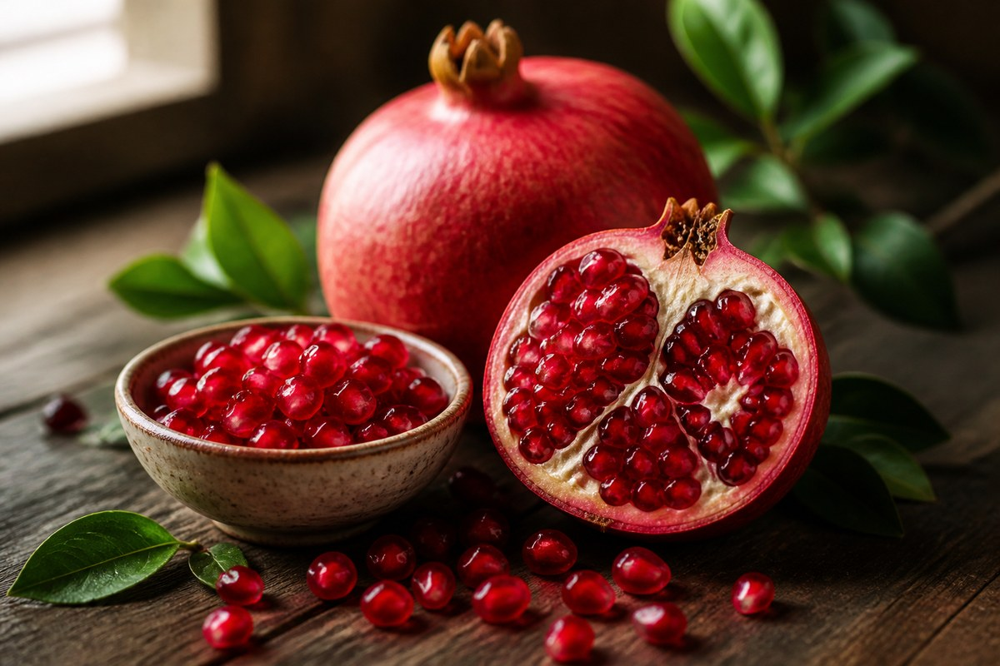

*▲ At just 83 kcal and 4.0 g of dietary fiber per 100 g, pomegranate arils deliver modest calories but extraordinary polyphenol density—punicalagin and related ellagitannins exceed 1 g in the peel and inner membranes, feeding the gut bacteria that produce urolithin A.*

Quick answer Raw pomegranate arils provide 83 calories, 4.0 g fiber and 10.2 mg vitamin C per 100 g. Gut bacteria convert its ellagitannins into urolithin A, which supports mitochondrial function, and whole arils deliver about four times the fiber of juice.

**Pomegranate (*Punica granatum*)** has been cultivated across Persia and the Mediterranean for more than four millennia, and modern biochemistry has finally explained its reputation as a "fruit of life."

What distinguishes it from blueberries, apples, or grapes is not its vitamin load but the concentration of **hydrolyzable ellagitannins**, chiefly **punicalagin**, together with punicalin and ellagic acid. Whole-fruit extracts routinely measure 1 to 2.5 g of punicalagin equivalents per liter.

The more surprising finding concerns how these molecules work. Ellagitannins are poorly absorbed intact. Instead they reach the colon, where resident bacteria hydrolyze and dehydroxylate them into **urolithins**—metabolites that enter the bloodstream and activate **mitophagy**, the selective recycling of damaged mitochondria.

However, not everyone converts. Gut microbial profiling identifies **urolithin metabotype A** (producers of urolithin A) in roughly 55–65% of adults, **metabotype B** in 10–25%, and **metabotype 0**—no measurable production—in 10–30%. This explains why two people can drink the same juice and report entirely different results.

Drawing on USDA FoodData Central analytical profiles and published human trials, this monograph details pomegranate's nutrient composition, its four principal physiological benefits, the practical choice between juice and whole arils, and the drug interactions that warrant caution.

---

## 1. How Many Calories Are in Pomegranate? (4.0 g fiber, 10.2 mg vitamin C per 100 g)

Edible arils are roughly 78% water, essentially free of cholesterol and saturated fat, and provide a meaningful share of vitamin K and copper alongside a high polyphenol load.

| Nutrient | Per 100 g | U.S. %DV |
| :--- | :--- | :--- |
| **Energy** | 83 kcal | 4.2% |
| **Water** | 77.93 g | See note¹ |
| **Carbohydrates** | 18.70 g | 6.8% |
| - Total Sugars | 13.67 g | See note¹ |
| - Dietary Fiber | 4.00 g | 14.3% |
| **Protein** | 1.67 g | 3.3% |
| **Total Fat** | 1.17 g | 1.5% |
| - Saturated Fat | 0.12 g | 0.6% |
| - Cholesterol | 0.00 mg | 0.0% |
| **Vitamin C** | 10.20 mg | 11.3% |
| **Vitamin K** | 16.40 mcg | 13.7% |
| **Folate (DFE)** | 38.00 mcg | 9.5% |
| **Vitamin B6** | 0.08 mg | 4.7% |
| **Vitamin E** | 0.60 mg | 4.0% |
| **Copper** | 0.16 mg | 17.6% |
| **Potassium** | 236.00 mg | 5.0% |
| **Phosphorus** | 36.00 mg | 2.9% |
| **Magnesium** | 12.00 mg | 2.9% |
| **Manganese** | 0.12 mg | 5.2% |
| **Iron** | 0.30 mg | 1.7% |
| **Zinc** | 0.35 mg | 3.2% |
| **Punicalagin & Ellagitannins** | 0.2–0.5 g arils / >1 g peel | No DV |

*¹ How to read this table: Percent Daily Values (%DV) are calculated against the standard 2,000-kcal U.S. FDA adult reference intake. Water and total sugars, which have no absolute daily requirement, are marked 'See note¹', while non-essential bioactive polyphenols carry 'No DV' (Daily Value not established).*

By comparison, **100% pressed pomegranate juice** provides about 54 kcal, 12.7 g of sugars, and only 0.1 g of fiber per 100 ml. Pressing strips away the fiber that moderates glycemic response while concentrating sugar—a critical distinction for anyone monitoring glucose.

---

## 2. What Are the Benefits of Pomegranate? Four Evidence-Backed Effects

### 1) Urolithin A Production and Mitochondrial Quality Control
Colonic bacteria convert punicalagin and ellagic acid into urolithin A, which activates the PINK1/Parkin pathway and removes depolarized mitochondria through mitophagy while improving respiratory efficiency in remaining organelles.

In a four-month randomized trial, urolithin A supplementation improved hamstring muscle endurance and mitochondrial biomarkers in middle-aged and older adults; a separate knee osteoarthritis trial reported lower inflammatory markers. Critically, those studies used **500–1,000 mg per day**—far above the trace urolithin concentrations achievable from dietary fruit. Pomegranate functions as a substrate, not a substitute for pharmaceutical doses.

### 2) Endothelial Function and LDL Oxidation Resistance
Pomegranate polyphenols increase endothelial nitric oxide bioavailability and inhibit NADPH oxidase, lowering vascular oxidative stress. Meta-analyses of pomegranate juice trials report modest reductions in systolic blood pressure of roughly 2–5 mmHg, with substantial heterogeneity across studies.

Human feeding studies also show that LDL particles isolated after pomegranate consumption resist ex vivo oxidation more strongly. Because oxidized LDL is the initiating step in foam-cell formation and atherogenesis, this mechanism carries meaningful cardiometabolic weight even without hard outcome data.

### 3) Postprandial Glycemic Moderation
Whole arils pair 13.7 g of sugars with 4.0 g of dietary fiber, so glucose enters the bloodstream more gradually than from an equivalent sugar load in juice form. Pomegranate polyphenols additionally inhibit α-amylase and α-glucosidase activity in vitro.

In a small trial of adults with type 2 diabetes, three months of pomegranate juice consumption did not worsen HbA1c and reduced lipid peroxidation markers. For glycemic control, whole arils in portions of 100 g or less remain the safer choice.

### 4) Anti-Inflammatory Signaling and Micronutrient Density
Ellagic acid and urolithins suppress NF-κB translocation and COX-2 expression, lowering pro-inflammatory cytokine output in cell and animal models. A randomized gingivitis trial using pomegranate extract mouthwash reduced plaque and bleeding scores, and a pilot study in prostate cancer patients reported slowed PSA doubling time—preliminary findings only, not a basis for treatment.

Nutritionally, 100 g of arils supplies 23% of the Korean adequate intake for vitamin K and 20% of the U.S. DV for copper. Vitamin K activates osteocalcin in bone and clotting factors in the liver, while copper is required for iron metabolism and superoxide dismutase activity.

---

## 3. Juice or Arils? Which Pomegranate Form Absorbs Better

- **Keep the inner membranes, discard only the outer rind:** Punicalagin concentrates in the mesocarp and the white membranes surrounding the arils—often tenfold higher than in the juicy pulp itself. Home juicing that leaves some white membrane intact preserves far more ellagitannins. Remove the tough outer skin, which concentrates bitter tannins and surface residues.
- **Chew or crush the seeds:** Pomegranate seeds carry punicic acid, a conjugated linoleic acid isomer, plus insoluble fiber. Swallowed whole, they pass through undigested; crushing them releases both.
- **Pair with a little fat and protein:** Yogurt, nuts, or cheese improve absorption of lipophilic polyphenols and support enzymatic conversion in the gut. Drinking concentrated juice on an empty stomach invites acid reflux.
- **Timing and storage:** Morning meals or 1–2 hours before exercise work well. Refrigerated, separated arils keep about five days; frozen, up to six months.

---

## 4. Who Should Avoid Pomegranate? Side Effects and Cautions

- **Warfarin and vitamin K antagonists:** At 16.4 mcg of vitamin K per 100 g, a large swing in pomegranate intake can destabilize the INR. Keep intake consistent and coordinate monitoring intervals with your clinician.
- **Statins and CYP-mediated clearance:** Pomegranate juice inhibits CYP3A4 and CYP2C9 in vitro and in small human studies, and has been reported to raise rosuvastatin exposure by roughly 1.4-fold. Clinical significance appears limited, but persistent muscle pain or elevated liver enzymes warrant disclosure of both the drug and the juice.
- **Antihypertensives and glucose-lowering agents:** Additive blood-pressure reduction may cause dizziness or hypotension. Separate juice from medication by 1–2 hours.
- **GERD, gastritis, and IBS:** Juice pH sits near 3, and tannins can irritate gastric mucosa. Start with small portions of arils and avoid fasting consumption; excess intake can cause diarrhea or cramping.
- **Chronic kidney disease:** With 236 mg of potassium per 100 g, intake should be discussed with a nephrologist when electrolyte restriction applies.

---

## 5. What Foods Pair Best with Pomegranate?

- **[Orange (Citrus × sinensis)]({{ site.baseurl }}/en/posts/orange-nutrition-benefits/)**: High ascorbic acid regenerates oxidized polyphenol radicals, extending pomegranate's antioxidant network while brightening its astringent edge.
- **[Spinach (Spinacia oleracea)]({{ site.baseurl }}/en/posts/spinach-nutrition-benefits/)**: Pomegranate vitamin C enhances reduction of spinach's non-heme iron, while spinach folate and vitamin K complement pomegranate polyphenols for endothelial support.
- **[Blueberry (Vaccinium corymbosum)]({{ site.baseurl }}/en/posts/blueberry-nutrition-benefits/)**: Anthocyanins and ellagitannins represent two distinct polyphenol classes, broadening oxidative defense coverage in a single bowl.

---

## 6. Frequently Asked Questions (FAQ)

### Q1. Is pomegranate juice as nutritious as eating the arils?
**A:** No. Per 100 ml, 100% pressed juice contains 12.7 g of sugars but only 0.1 g of fiber, versus 4.0 g of fiber in 100 g of fresh arils. Fiber slows glucose absorption and prolongs satiety, and much of the punicalagin in the inner membranes is lost during commercial pressing. If you prefer juice, blend whole arils with a little of the white membrane at home.

### Q2. Does eating pomegranate automatically produce urolithin A in the body?
**A:** Only if you carry the right gut bacteria. Roughly 55–65% of adults belong to urolithin metabotype A and convert ellagitannins efficiently, while 10–30% (metabotype 0) produce little or none. A fiber-rich diet that sustains microbial diversity supports conversion—and unconverted ellagic acid still exerts its own antioxidant and anti-inflammatory activity.

### Q3. How much pomegranate is safe daily, and does it interact with warfarin or blood pressure medication?
**A:** Most adults can enjoy 100–200 g of arils (about half to one medium fruit) daily. Anyone taking warfarin should keep pomegranate intake steady rather than varying widely, because 16.4 mcg of vitamin K per 100 g can shift the INR. People on statins or antihypertensives should separate juice from medication by 1–2 hours and report dizziness or muscle pain promptly.

