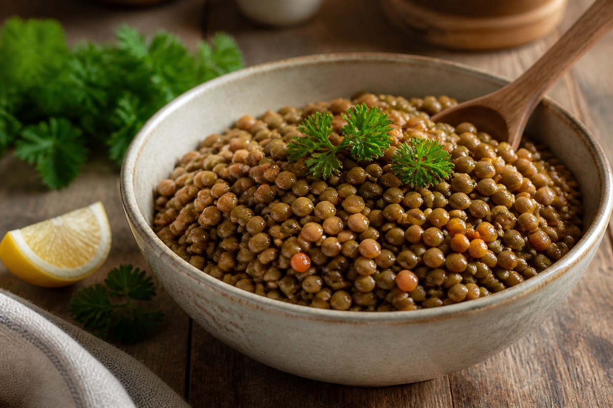

*▲ 건조 렌틸콩 100g에는 단백질 24.6g과 식이섬유 10.7g이 들어 있습니다. 물에 불려 삶으면 무게가 약 2.5배로 늘어나, 실제로 한 끼에 먹는 삶은 렌틸콩 100g은 116kcal·단백질 9.0g 수준입니다.*

한 줄 결론 <strong>건조 렌틸콩 100g은 352kcal, 단백질 24.63g, 식이섬유 10.7g입니다.</strong> 껍질이 얇아 불리는 시간이 거의 필요 없고 15~25분이면 익습니다. 국제 GI 표에서 렌틸콩은 16~32 범위로 등재돼 있고 대표값이 32입니다(2008년 판 29~32, 2021년 판 16~32). 실제 혈당 반응은 품종·조리 정도·같이 먹는 음식에 따라 달라집니다.

콩알만 한 납작한 원반 모양의 **렌틸콩(Lentil, *Lens culinaris*)** 은 인도 달(Dal), 중동의 렌틸 수프, 유럽의 스튜까지 수천 년째 세계 식탁의 주 단백질 공급원입니다. 다른 콩과 달리 **불리는 시간이 짧고 15~25분이면 완전히 익어** 바쁜 평일 저녁에도 부담이 없습니다.

최근 국내에서 렌틸콩 검색량이 급증한 배경은 '저속노화'와 '혈당 스파이크' 키워드입니다. 정제 탄수화물을 줄이는 대신 **저혈당지수(GI) 전분과 식이섬유, 식물성 단백질을 한 번에 채우는 재료**로 렌틸콩이 다시 주목받고 있는 것입니다.

영양학적으로 렌틸콩의 강점은 단순히 '단백질이 많다'가 아닙니다. 100g당 단백질 24.6g에 식이섬유 10.7g, 엽산 479mcg, 철분 6.5mg, 칼륨 677mg이 **한 알에 함께 압축**되어 있다는 점입니다. 육류 단백질과 달리 포화지방이 0.15g에 불과하고 콜레스테롤은 전혀 없습니다.

아래에서는 USDA FoodData Central 표준 데이터를 기준으로 건조 렌틸콩 100g의 영양 성분, 혈당·혈압과 관련해 알려진 내용, 피트산과 팽만감을 줄이는 불리기·삶기 가이드, 그리고 신장질환·통풍 환자가 확인해야 할 주의사항을 정리했습니다.

---

## 1. 렌틸콩 칼로리와 영양성분은? (단백질 24.63g·식이섬유 10.7g)

렌틸콩은 수분이 8% 남짓인 건조 콩이므로, 표의 수치는 **밥에 넣기 전 마른 상태 100g** 기준입니다. 물에 불려 삶으면 무게가 약 2.5배로 늘어나므로 삶은 렌틸콩 100g의 열량은 116kcal, 단백질 9.0g, 식이섬유 7.9g으로 낮아집니다.

| 영양 성분 (Nutrient) | 함량 (건조 100g당) | 1일 권장 섭취량 비율 (한국인 성인 기준) |
| :--- | :--- | :--- |
| **열량 (Energy)** | 352 kcal | 17.6% |
| **수분 (Water)** | 8.06 g | 별도 표기¹ |
| **탄수화물 (Carbohydrates)** | 63.35 g | 19.5% |
| - 총 당류 (Total Sugars) | 2.03 g | 별도 표기¹ |
| - 식이섬유 (Dietary Fiber) | 10.70 g | 42.8% |
| **단백질 (Protein)** | 24.63 g | 44.8% |
| **지방 (Total Fat)** | 1.06 g | 2.0% |
| - 포화지방산 (Saturated Fat) | 0.15 g | 1.0% |
| - 콜레스테롤 (Cholesterol) | 0.00 mg | 0.0% |
| **티아민 (Vitamin B1)** | 0.87 mg | 72.8% |
| **리보플라빈 (Vitamin B2)** | 0.21 mg | 15.1% |
| **나이아신 (Niacin)** | 2.61 mg | 20.1% |
| **비타민 B6 (Vitamin B6)** | 0.54 mg | 38.6% |
| **엽산 (Folate, DFE)** | 479.00 mcg | 119.8% |
| **비타민 C (Vitamin C)** | 4.50 mg | 4.5% |
| **비타민 E (Vitamin E)** | 0.49 mg | 4.1% |
| **비타민 K (Vitamin K)** | 5.00 mcg | 7.1% |
| **철분 (Iron)** | 6.51 mg | 65.1% |
| **칼륨 (Potassium)** | 677.00 mg | 19.3% |
| **인 (Phosphorus)** | 281.00 mg | 40.1% |
| **마그네슘 (Magnesium)** | 47.00 mg | 12.7% |
| **아연 (Zinc)** | 3.27 mg | 38.5% |
| **구리 (Copper)** | 0.75 mg | 83.3% |
| **망간 (Manganese)** | 1.39 mg | 34.8% |
| **칼슘 (Calcium)** | 35.00 mg | 5.0% |
| **나트륨 (Sodium)** | 6.00 mg | 0.3% |
| **셀레늄 (Selenium)** | 8.30 mcg | 15.1% |
| **피트산 (Phytic Acid)** | 0.3~0.6 g | 기준치 없음 |

*¹ 표 읽는 법: 한국인 영양소 섭취기준(2020) 1일 권장량(열량 2,000kcal, 탄수화물 324g, 식이섬유 25g, 단백질 55g, 엽산 400mcg, 철분 10mg, 칼륨 3,500mg 등)을 적용했습니다. 수분과 총 당류처럼 절대 권장량 대신 적정 비율로 관리되는 항목은 '별도 표기¹', 피트산처럼 공식 기준치가 없는 성분은 '기준치 없음'으로 표시했습니다.*

*※ 출처: [USDA FoodData Central FDC 172420](https://fdc.nal.usda.gov/food-details/172420/nutrients) — Lentils, raw (SR Legacy). 표의 100g당 열량 352 kcal과 단백질 24.63 g은 이 항목의 값이며, 조리 상태가 다르면 값도 달라집니다.*

건조 100g 기준 수치가 크게 보이는 이유는 수분이 빠져 있기 때문입니다. 실제 섭취량으로 환산하면 **삶은 렌틸콩 1컵(약 200g)이 232kcal·단백질 18g·식이섬유 15.8g**으로, 같은 열량의 흰쌀밥 두 공기보다 단백질과 식이섬유가 훨씬 많습니다.

---

## 2. 렌틸콩 효능은 무엇일까? 근거와 함께 본 4가지 포인트

### 1) 식물성 단백질 24.6g과 라이신 — 근감소·포만감 관리
렌틸콩 단백질은 필수아미노산 중 **라이신(Lysine)** 이 풍부합니다. 쌀·밀 같은 곡류는 라이신이 부족하기 때문에, 밥에 렌틸콩을 섞으면 곡류의 제한아미노산이 채워져 단백질 이용 효율이 올라갑니다.

단백질은 위 배출 속도를 늦추고 포만 호르몬(글루카곤유사펩타이드-1, PYY) 분비를 자극합니다. 같은 열량의 흰쌀밥 식사와 비교한 연구들에서 콩류를 곁들인 식사가 식후 포만감을 더 오래 유지했습니다. 다만 식물성 단백질은 소화 흡수율(DIAAS)이 동물성보다 낮으므로, 1일 단백질 목표를 채울 때는 육류보다 10~20% 더 넉넉히 잡는 것이 현실적인 지침입니다(정확한 보정치는 개인 식단에 따라 다름).

### 2) GI 32의 저혈당지수 전분과 저항성 전분 — 식후 혈당 완만화
삶은 렌틸콩의 혈당지수(GI)는 약 29~32로, 같은 무게의 흰쌀밥(GI 70 이상)의 절반 이하입니다. 렌틸콩 전분은 아밀로스 비율이 높고 세포벽이 단단해 소화효소가 접근하기 어렵기 때문입니다.

특히 렌틸콩을 삶아 **냉장 보관했다가 차갑게 먹으면** 전분 일부가 저항성 전분으로 재결정화되어 혈당 반응이 더 낮아집니다. 제2형 당뇨병 환자를 대상으로 한 무작위 시험에서도 렌틸콩을 밥의 일부와 교체한 식사가 식후 혈당 곡선(AUC)을 유의하게 낮췄습니다. 같은 이유로 콩류 섭취량이 많은 사람은 장기 혈당 지표인 HbA1c가 낮은 경향이 여러 메타분석에서 반복 확인되었습니다.

### 3) 혈압·혈관 기능 개선과 콩류 메타분석
렌틸콩은 칼륨 677mg, 마그네슘 47mg, 식이섬유 10.7g을 함께 공급합니다. 칼륨은 나트륨 배출을 촉진하고 혈관 평활근 이완을 도와 수축기 혈압을 낮추는 방향으로 작용합니다.

최근 콩류(렌틸콩·병아리콩·콩) 섭취와 고혈압 발생 위험을 다룬 메타분석들은 **주 3~4회 이상 콩류를 먹는 군에서 고혈압 위험이 낮은 경향**을 보고했습니다. 관찰연구 중심이라 인과로 단정할 수는 없지만, 렌틸콩을 정제 탄수화물 대체재로 쓰는 것만으로도 나트륨·포화지방 섭취가 함께 줄어드는 이점이 있습니다.

### 4) 엽산 479mcg·철분 6.5mg — 혈관과 적혈구, 그리고 폴리페놀
건조 100g의 엽산은 479mcg로 1일 권장량을 넘습니다. 엽산은 호모시스테인 대사에 필요하고, 임신 전·초기에 충분히 섭취하면 신경관 결손 위험을 낮추는 것으로 알려져 있습니다. 철분 6.5mg은 비헴철이라 흡수율이 대체로 낮지만, 같은 끼니에 비타민 C가 많은 채소를 곁들이면 흡수량이 늘어난다는 연구가 있습니다(증가 폭은 식사 구성과 개인 철 상태에 따라 다름).

렌틸콩의 붉은색·녹색 껍질에는 **프로안토시아니딘과 플라보놀**이 들어 있습니다. 색소 성분의 항산화·항염 작용은 세포·동물 실험에서 NF-κB 활성 억제와 LDL 산화 지연으로 보고되었지만, 인체 임상 근거는 아직 제한적이며 질병을 예방한다는 뜻은 아닙니다.

---

## 3. 렌틸콩은 불려야 할까? 삶는 시간과 팽만감 줄이는 법

- **불리기는 2~4시간이면 충분(필수는 아님):** 다른 콩과 달리 렌틸콩은 불리지 않아도 익습니다. 다만 2~4시간 물에 담그면 피트산이 줄어들고 조리 시간이 짧아집니다(감소율은 물의 양·온도·시간에 따라 달라 문헌마다 다름). 피트산은 철분·아연 같은 미네랄과 결합해 흡수를 막는 물질이라, 빈혈이나 미네랄 보충이 필요한 사람은 불리는 과정을 거치는 편이 좋습니다. 12시간 이상 불리면 피트산 감소 폭은 더 커지지만, 여름철엔 냉장에서 불려야 신맛이 나지 않습니다.

- **삶는 시간은 품종별로 다릅니다:** 갈색·녹색 렌틸콩은 끓는 물에서 **20~25분**, 벨루가(검은 렌틸콩)는 18~22분, 껍질을 벗긴 **레드·옐로 렌틸콩은 10~15분**입니다. 압력솥은 8~10분이면 충분하고, 불린 콩은 5~8분 단축됩니다. 삶는 물 1컵당 소금 1/2작은술을 넣으면 껍질이 터지지 않고 간이 배어듭니다.

- **부글부글 끓이지 말고 약불에서 뭉근하게:** 강불로 끓이면 껍질이 벗겨져 흐물흐물해집니다. 끓어오르면 불을 낮춰 거품만 살짝 올라오는 상태를 유지하세요. 조리 후 남은 물은 버리지 말고 수프 베이스로 쓰면 수용성 비타민과 사포닌 손실을 줄일 수 있습니다.

- **팽만감이 심하다면 발아·서서히 늘리기:** 렌틸콩의 올리고당(라피노스 계열)은 장내세균이 발효시키며 가스를 만듭니다. 12~24시간 발아시키거나 하루 30g부터 시작해 2~3주에 걸쳐 늘리면 적응됩니다. 통조림 렌틸콩은 이미 익고 헹궈 쓰면 염분과 올리고당이 일부 빠져 편합니다.

- **보관:** 건조 렌틸콩은 밀폐 용기로 서늘한 곳에서 1년, 삶은 것은 냉장 4~5일·냉동 3개월입니다. 삶아서 소분 냉동해 두면 밥·샐러드·카레에 바로 넣을 수 있습니다.

---

## 4. 렌틸콩 부작용과 주의할 점은?

- **만성 신장 질환자:** 칼륨 677mg·인 281mg(건조 100g)은 전해질 제한 식단에서 부담이 됩니다. 삶은 렌틸콩 100g은 칼륨 369mg 수준이지만, 여전히 하루 허용량의 상당 부분을 차지하므로 신장내과 영양 상담을 먼저 받아야 합니다. 특히 투석 환자는 인·칼륨 제한이 엄격합니다.

- **통풍·고요산혈증:** 렌틸콩은 퓨린 함량이 중간 정도(조리 후 100g당 약 50~100mg)인 식품입니다. 최근 연구들은 식물성 퓨린이 통풍 발작 위험을 크게 높이지 않는다고 보고합니다. 다만 급성 발작기에는 섭취를 줄이고, 안정기에도 한 번에 많은 양을 먹기보다 나눠 먹는 편이 좋습니다. 구체적인 섭취량은 주치의·영양사와 상의하세요.

- **복부 팽만·과민성 대장 증후군(IBS):** FODMAP 중 GOS(갈락토올리고당)가 많아 IBS 환자에게는 가스를 유발할 수 있습니다. 통조림을 헹궈 먹거나, 발아 콩을 쓰고, 하루 50g 이하로 제한하는 방법이 현실적입니다.

- **피트산·미네랄 흡수 간섭:** 렌틸콩을 주식으로 대량 섭취하는 경우 철분·아연 흡수가 저하될 수 있습니다. 불리기·발아·발효(템페·낫토 방식)가 피트산을 줄이는 가장 확실한 방법이며, 육류·비타민 C 급원과 함께 먹으면 결합 효과가 완화됩니다.

- **갑상선 기능 저하증:** 콩류의 이소플라본과 사포닌은 이론적으로 갑상선 호르몬제(레보티록신) 흡수를 방해할 수 있습니다. 약 복용 후 최소 4시간 간격을 두세요.

- **익히지 않은 렌틸콩:** 렌틸콩은 다른 콩보다 렉틴 함량이 낮아 생으로도 위험도가 크지 않지만, 소화 불편과 사포닌 자극을 피하려면 반드시 충분히 익혀 먹습니다.

---

## 5. 렌틸콩과 함께 먹으면 좋은 음식은?

- **[병아리콩 (Chickpea)]({{ site.baseurl }}/posts/chickpea-nutrition-benefits/)**: 렌틸콩과 병아리콩은 GI가 각각 29~32, 약 28로 모두 낮은 축에 속합니다. 렌틸콩이 열량·단백질·철분에서 우위라면 병아리콩은 식감과 저항성 전분이 강점이어서, 두 콩을 1:1로 섞으면 영양 프로필과 포만감이 모두 보완됩니다.

- **[두부 (Tofu)]({{ site.baseurl }}/posts/tofu-nutrition-benefits/)**: 렌틸콩에 부족한 메티오닌을 보충하고, 두부의 칼슘·이소플라본과 렌틸콩의 엽산이 혈관 건강을 함께 뒷받침합니다. 렌틸콩을 으깨 두부와 섞어 구운 패티는 포화지방을 크게 낮춘 대체 단백질 요리입니다.

- **[시금치 (Spinach)]({{ site.baseurl }}/posts/spinach-nutrition-benefits/)**: 시금치의 비타민 C는 렌틸콩 비헴철의 흡수를 돕고, 렌틸콩의 단백질과 시금치의 엽산을 한 끼에 함께 얻을 수 있습니다. 단, 시금치 옥살산이 철분 결합을 일부 방해하므로 데쳐서 물기를 짜 사용하는 편이 낫습니다.

---

## 6. 자주 묻는 질문 (FAQ)

### Q1. 렌틸콩 100g에 단백질이 정말 24.6g인가요? 삶으면 얼마나 줄어드나요?
**A:** 24.6g은 수분이 8%뿐인 **건조 상태 100g** 기준입니다. 물에 불려 삶으면 무게가 약 2.5배가 되므로, 삶은 렌틸콩 100g의 단백질은 9.0g, 열량은 116kcal입니다. 한 끼에 삶은 렌틸콩 150~200g(건조 60~80g)을 먹으면 단백질 14~18g과 식이섬유 12~16g을 확보합니다. 닭가슴살 100g(단백질 23g)보다 단백질 밀도는 낮지만, 식이섬유와 엽산·철분까지 함께 들어온다는 점이 다릅니다.

### Q2. 렌틸콩은 얼마나 불리고 몇 분 삶아야 하나요? 피트산은 어떻게 줄이나요?
**A:** 불리기는 2~4시간이면 충분하고, 급하면 생략해도 됩니다. 삶는 시간은 갈색·녹색 20~25분, 벨루가 18~22분, 껍질 벗긴 레드·옐로 10~15분이며, 압력솥은 8~10분입니다. 피트산은 불리는 시간이 길수록 줄어들며(감소율은 문헌마다 다름), 12시간 이상 불리거나 발아시키면 더 줄어듭니다. 삶은 물을 버리지 않고 수프에 활용하면 수용성 비타민 손실은 줄지만, 피트산도 함께 섭취하게 됩니다.

### Q3. 신장질환이나 통풍이 있어도 렌틸콩을 먹어도 되나요?
**A:** 상태에 따라 다릅니다. 만성 신장 질환으로 칼륨·인 제한을 받는 경우 삶은 렌틸콩 100g에 칼륨 369mg이 들어 있어 양을 반드시 조절해야 하고, 투석 환자는 신장내과 영양 상담이 필수입니다. 통풍은 급성 발작기에는 섭취를 줄이고, 식물성 퓨린은 동물성과 달리 발작 위험을 크게 높이지 않는다는 연구가 우세합니다. 안정기에도 한 번에 많이 먹기보다 나눠 먹는 편이 좋으며, 구체적인 양은 주치의·영양사와 상의하세요.

  
📌 관련 순위 가이드

  <ul>
    <li><a href="/posts/high-protein-foods-ranking/">단백질 많은 음식 TOP 10: 100g당 함량과 흡수율 비교</a></li>
    <li><a href="/posts/low-gi-foods-blood-sugar-guide/">혈당 낮추는 음식 TOP 10: 저혈당 지수(GI) 순위표</a></li>
  </ul>

