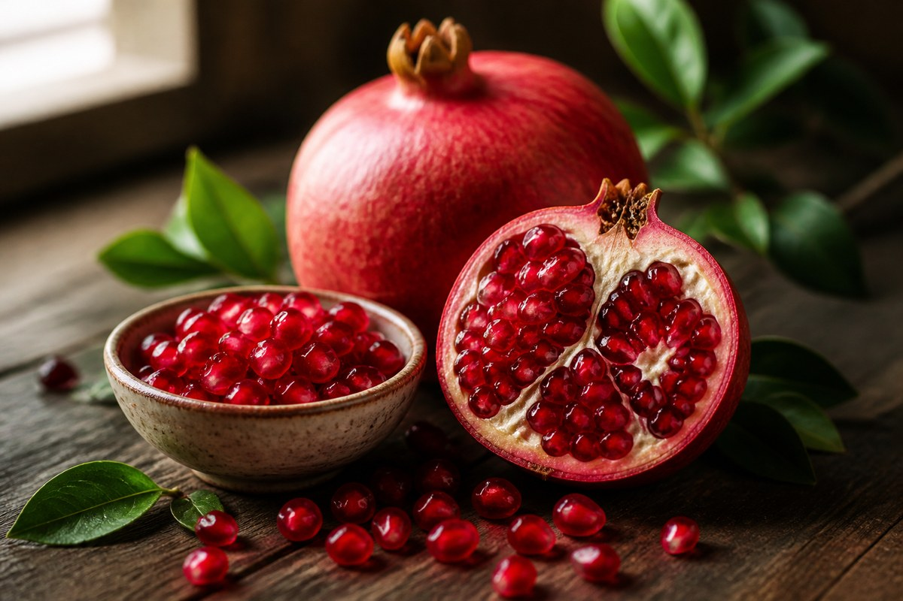

*▲ 생석류 100g은 83kcal·식이섬유 4.0g에 불과하지만, 껍질과 속껍질에는 푸니칼라진 등 엘라지타닌이 1g 이상 농축되어 있습니다. 이 폴리페놀이 장내세균을 거쳐 우롤리틴 A(Urolithin A)로 전환되는 것이 최근 석류 연구의 핵심입니다.*

한 줄 결론 <strong>생석류 과육 100g은 83kcal, 식이섬유 4.0g, 비타민C 10.2mg입니다.</strong> 엘라지타닌은 장내 미생물이 우롤리틴 A로 바꿔 미토콘드리아 기능을 돕고, 즙보다 알갱이째 먹을 때 식이섬유를 4배 더 얻습니다.

붉은 루비빛 알갱이(아릴)가 빽빽하게 박힌 **석류(Pomegranate, *Punica granatum*)** 는 고대 페르시아와 지중해에서 '생명의 열매'로 불려온 대표적인 늦가을 과일입니다. 국내에서는 11월부터 12월까지가 제철로, 알갱이가 단단하고 껍질이 팽팽한 것이 좋은 석류입니다.

식품영양학에서 석류가 주목받는 이유는 비타민이나 미네랄보다 **엘라지타닌(Ellagitannin)** 계열 폴리페놀, 그중에서도 **푸니칼라진(Punicalagin)** 의 압도적인 함량에 있습니다. 사과·블루베리 같은 다른 과일의 폴리페놀과 결정적으로 다른 지점입니다.

더 흥미로운 사실은 이 폴리페놀이 우리 몸에서 직접 작동하지 않는다는 점입니다. 석류를 먹으면 대장에 도달한 엘라지타닌을 장내 미생물이 단계적으로 분해해 **우롤리틴 A(Urolithin A)** 라는 저분자 대사물질로 바꾸는데, 이 물질이 손상된 미토콘드리아를 선택적으로 분해·재활용하는 '마이트로지(Mitophagy)'를 유도하는 신호로 작용한다는 연구가 지난 10년간 집중적으로 발표되었습니다. 2026년 11월 현재 'Urolithin A', 'urolithin A benefits' 검색량이 전년 대비 80~100% 급증한 배경입니다.

다만 석류를 먹는 모든 사람이 우롤리틴 A를 만드는 것은 아닙니다. 장내세균 조성에 따라 우롤리틴 A 생성형(메타보타입 A)은 전체 인구의 약 55~65%, 우롤리틴 B 생성형은 10~25%, 아예 전환하지 못하는 메타보타입 0은 10~30%로 보고됩니다. 같은 석류즙을 마셔도 체감 효과가 사람마다 크게 갈리는 이유가 여기에 있습니다.

아래에서는 USDA FoodData Central 표준 데이터를 기준으로 생석류 100g의 정밀 영양 성분, 우롤리틴 A 전환을 포함한 4대 핵심 효능, 석류즙과 생석류 중 무엇을 골라야 하는지에 대한 기준, 그리고 반드시 알아야 할 약물 상호작용을 정리했습니다.

---

## 1. 석류 칼로리와 영양성분은? (식이섬유 4.0g·비타민C 10.2mg)

석류는 껍질을 제외한 식용 가능한 알갱이(아릴) 100g 기준으로, 수분이 약 78%를 차지하고 지방·콜레스테롤이 거의 없는 대신 당류와 식이섬유가 함께 들어 있습니다.

| 영양 성분 (Nutrient) | 함량 (100g당) | 1일 권장 섭취량 비율 (한국인 성인 기준) |
| :--- | :--- | :--- |
| **열량 (Energy)** | 83 kcal | 4.2% |
| **수분 (Water)** | 77.93 g | 별도 표기¹ |
| **탄수화물 (Carbohydrates)** | 18.70 g | 5.8% |
| - 총 당류 (Total Sugars) | 13.67 g | 별도 표기¹ |
| - 식이섬유 (Dietary Fiber) | 4.00 g | 16.0% |
| **단백질 (Protein)** | 1.67 g | 3.0% |
| **지방 (Total Fat)** | 1.17 g | 2.2% |
| - 포화지방산 (Saturated Fat) | 0.12 g | 0.8% |
| - 콜레스테롤 (Cholesterol) | 0.00 mg | 0.0% |
| **비타민 C (Vitamin C)** | 10.20 mg | 10.2% |
| **비타민 K (Vitamin K)** | 16.40 mcg | 23.4% |
| **엽산 (Folate, DFE)** | 38.00 mcg | 9.5% |
| **비타민 B6 (Vitamin B6)** | 0.08 mg | 5.3% |
| **비타민 E (Vitamin E)** | 0.60 mg | 5.0% |
| **구리 (Copper)** | 0.16 mg | 20.0% |
| **칼륨 (Potassium)** | 236.00 mg | 6.7% |
| **인 (Phosphorus)** | 36.00 mg | 5.1% |
| **마그네슘 (Magnesium)** | 12.00 mg | 3.8% |
| **망간 (Manganese)** | 0.12 mg | 3.4% |
| **철분 (Iron)** | 0.30 mg | 3.0% |
| **아연 (Zinc)** | 0.35 mg | 3.5% |
| **푸니칼라진·엘라지타닌** | 과육 0.2~0.5 g / 껍질 1 g 이상 | 기준치 없음 |

*¹ 표 읽는 법: 한국인 영양소 섭취기준(2020) 1일 권장량(열량 2,000kcal, 단백질 55g, 탄수화물 324g, 식이섬유 25g, 비타민 C 100mg, 비타민 K 70mcg, 엽산 400mcg 등)을 적용했습니다. 수분과 총 당류처럼 절대 권장량 대신 적정 비율이나 총열량 대비 제한치로 관리되는 항목은 '별도 표기¹', 생리활성 폴리페놀은 공식 기준치가 없어 '기준치 없음'으로 표시했습니다.*

참고로 시판 **100% 착즙 석류주스**는 100ml 기준 약 54kcal, 당류 12.7g, 식이섬유 0.1g으로, 같은 무게의 생석류보다 열량은 낮아 보이지만 **식이섬유가 사실상 사라지고 당류 농도가 높아집니다.** 가당 석류 음료는 100ml당 당류가 10g을 넘는 경우가 많아 라벨의 '착즙 100%' 표기를 반드시 확인해야 합니다.

---

## 2. 석류 효능은 무엇일까? 과학으로 입증된 4대 효과

### 1) 우롤리틴 A 생성과 미토콘드리아 기능 개선(마이트로지)
석류의 푸니칼라진은 위와 소장에서 엘라그산으로 가수분해된 뒤, 대장 미생물의 탈수산화 반응을 거쳐 우롤리틴 A로 전환됩니다. 우롤리틴 A는 PINK1/Parkin 경로를 활성화해 기능이 떨어진 미토콘드리아를 자가포식으로 제거하고, 남은 미토콘드리아의 호흡 효율을 높이는 것으로 보고되었습니다.

무작위 배정 임상시험에서 우롤리틴 A를 4개월간 섭취한 중·고령자 그룹은 햄스트링 근지구력과 미토콘드리아 바이오마커가 개선되었고, 무릎 골관절염 환자 대상 시험에서는 염증 지표가 낮아졌습니다. 다만 이들 시험의 용량은 하루 500~1,000mg으로, **석류 과일 섭취로 체내에서 만들어지는 우롤리틴 A 농도보다 훨씬 높은 수준**이라는 점은 분명히 구분해서 이해해야 합니다. 석류는 '약'이 아니라 이 전환 경로를 위한 원료 공급원입니다.

### 2) 혈관 내피 기능 개선과 LDL 산화 억제
석류 폴리페놀은 혈관 내피의 산화질소(NO) 생성을 늘리고, NADPH 산화효소 활성을 낮춰 산화 스트레스를 줄입니다. 여러 메타분석에서 석류즙 섭취군의 수축기 혈압이 평균 2~5mmHg 낮아지는 경향이 보고되었으나, 연구 간 편차가 커서 약물 대체로 보기는 어렵습니다.

또한 인체 시험에서 석류즙 섭취 후 분리한 LDL 입자가 산화 자극에 더 강하게 저항하는 것으로 나타났습니다. LDL이 산화되면 대식세포가 이를 탐식해 혈관벽 플라크를 만드는 첫 단계가 시작되므로, 이 지점은 심혈관 위험 관리에서 의미가 있습니다.

### 3) 식후 혈당 완만화와 인슐린 감수성
생석류 알갱이는 당류 13.7g과 식이섬유 4.0g이 함께 들어 있어, 같은 양의 당을 함유한 주스보다 혈당 상승 속도가 느립니다. 폴리페놀이 소화효소(α-아밀라아제·α-글루코시다아제)를 부분적으로 저해하는 것도 도움이 됩니다.

제2형 당뇨병 환자를 대상으로 한 소규모 시험에서는 석류즙 3개월 섭취가 당화혈색소(HbA1c)를 악화시키지 않았고 지질 과산화 지표는 낮췄습니다. 혈당 조절이 필요한 경우에도 **주스보다 알갱이를 통째로, 하루 100g 이내**가 안전한 선택입니다.

### 4) 항염 신호 억제와 비타민 K·구리 등 미량 영양 공급
엘라그산과 우롤리틴은 NF-κB와 COX-2 신호를 억제해 염증성 사이토카인 생성을 줄이는 것으로 세포·동물 실험에서 확인되었습니다. 잇몸 염증(치은염) 환자를 대상으로 한 석류 추출물 구강 세정 시험에서는 플라크와 출혈 지수가 감소했고, 전립선암 환자 소규모 파일럿 시험에서는 PSA 상승 속도가 늦춰진 사례가 보고되었습니다. 모두 예비 연구 단계이므로 치료 목적의 사용은 금물입니다.

영양학적으로도 석류 100g은 비타민 K 1일 충분섭취량의 23%, 구리의 20%를 채웁니다. 비타민 K는 혈액 응고와 뼈의 오스테오칼신 활성화에, 구리는 철분 대사와 항산화 효소( SOD ) 작동에 필수적입니다.

---

## 3. 석류는 즙이 좋을까, 알갱이가 좋을까? 흡수율 비교

- **껍질과 속껍질을 버리지 말고 함께 착즙하기:** 푸니칼라진은 과육보다 껍질(중과피)과 알갱이를 감싼 흰색 속껍질에 10배 이상 농축되어 있습니다. 알갱이만 짜낸 즙은 엘라지타닌 함량이 크게 떨어지므로, 가정에서 착즙할 때는 껍질 안쪽 흰 부분을 조금 남겨 함께 갈아주는 것이 유리합니다. 단, 겉껍질의 쓴맛과 농약 잔류를 고려해 유기농이 아니면 겉껍질은 제거하세요.

- **알갱이 속 씨앗을 반드시 씹어 먹기:** 석류씨에는 푸니식산(Punicic acid, 오메가-5 계열 공액지방산)과 불용성 섬유가 들어 있습니다. 씹지 않고 통째로 삼키면 소화되지 않고 배출되므로, 알갱이를 터뜨려 즙과 함께 씨앗을 갈아 먹는 것이 영양 손실을 줄입니다.

- **지방·단백질 식품과 함께 섭취:** 우롤리틴 생성과 지용성 폴리페놀 흡수를 위해서는 요거트·견과류·치즈처럼 지방이 약간 있는 식품과 조합하는 편이 좋습니다. 공복에 진한 석류즙만 마시면 위산 역류를 유발하기 쉽습니다.

- **섭취 시점과 보관:** 아침 식사와 함께 또는 운동 1~2시간 전이 무난합니다. 알갱이를 분리해 밀폐 용기에 담으면 냉장 5일, 냉동은 6개월까지 보관할 수 있습니다.

---

## 4. 석류 부작용과 주의할 점은?

- **와파린 등 항응고제 복용자:** 석류 100g에 비타민 K가 16.4mcg 들어 있어, 섭취량이 크게 달라지면 국제정상화비율(INR)이 흔들릴 수 있습니다. 석류즙을 매일 마시기 시작했다면 복용량과 섭취량을 일정하게 유지하고, INR 검사 주기를 의료진과 상의하세요.

- **스타틴·일부 약물과의 상호작용:** 석류즙은 시험관 및 인체 소규모 연구에서 CYP3A4·CYP2C9 효소를 부분적으로 억제해 로수바스타틴 등 일부 약물의 혈중 농도를 높일 수 있는 것으로 보고되었습니다. 임상적 영향은 크지 않다는 평가가 우세하지만, 근육통이나 간 수치 이상이 생기면 복용 중인 약과 석류 섭취를 함께 의료진에게 알려야 합니다.

- **혈압약·혈당강하제 병용:** 혈압을 낮추는 작용이 있어 약물과 겹치면 어지럼증·저혈압이 나타날 수 있습니다. 약 복용 직후의 진한 석류즙 음용은 피하고 1~2시간 간격을 두세요.

- **위식도 역류·위염·과민성 대장:** 석류즙의 산도는 pH 3 안팎으로 높은 편이며, 탄닌이 위 점막을 자극할 수 있습니다. 속이 쓰린 경우 알갱이 소량부터 시작하고 공복 음용은 피하세요. 과량 섭취 시 설사·복통이 생길 수 있습니다.

- **신장 질환자:** 칼륨 236mg/100g으로, 전해질 제한이 필요한 만성 신장 질환자는 섭취량을 의료진과 상의해야 합니다.

---

## 5. 석류와 함께 먹으면 좋은 음식은?

- **[오렌지 (Orange)]({{ site.baseurl }}/posts/orange-nutrition-benefits/)**: 석류의 폴리페놀과 오렌지의 고농도 비타민 C는 서로의 항산화 네트워크를 재생시키며, 산뜻한 산미가 석류 특유의 떫은맛을 잡아 줍니다.

- **[시금치 (Spinach)]({{ site.baseurl }}/posts/spinach-nutrition-benefits/)**: 석류의 비타민 C가 시금치의 비헴철 환원을 도와 흡수율을 높이고, 시금치의 엽산·비타민 K와 석류의 폴리페놀이 혈관 내피 건강을 함께 뒷받침합니다.

- **[블루베리 (Blueberry)]({{ site.baseurl }}/posts/blueberry-nutrition-benefits/)**: 안토시아닌과 엘라지타닌이라는 서로 다른 계열의 폴리페놀을 동시에 공급해, 산화 스트레스 방어 스펙트럼을 넓힐 수 있는 조합입니다.

---

## 6. 자주 묻는 질문 (FAQ)

### Q1. 석류즙과 생석류 알갱이 중 어느 쪽이 영양이 더 높나요?
**A:** 생석류 알갱이가 더 유리합니다. 100% 착즙 석류주스는 100ml당 당류 12.7g에 식이섬유가 0.1g으로 사실상 없지만, 생석류 100g은 당류 13.7g과 식이섬유 4.0g을 함께 공급합니다. 식이섬유가 함께 있어야 식후 혈당 상승이 완만해지고 포만감도 오래갑니다. 즙 형태가 필요하다면 껍질 안쪽 흰 부분을 조금 포함해 직접 갈아 만드는 것이 푸니칼라진 손실을 줄입니다.

### Q2. 우롤리틴 A는 석류를 먹으면 몸에서 저절로 만들어지나요?
**A:** 장내세균 조성에 따라 다릅니다. 엘라지타닌을 우롤리틴 A로 전환하는 메타보타입 A는 전체 인구의 약 55~65%로 보고되며, 10~30%는 전환 능력이 거의 없는 메타보타입 0으로 분류됩니다. 우롤리틴 생성력을 높이려면 섬유소가 풍부한 식단으로 장내 미생물 다양성을 유지하는 것이 우선이고, 전환되지 않은 엘라그산도 자체적인 항산화·항염 작용을 하므로 섭취 자체가 무의미하지는 않습니다.

### Q3. 석류를 매일 먹어도 되나요? 와파린·혈압약과 함께 먹어도 안전한가요?
**A:** 일반 성인은 알갱이 기준 하루 100~200g(중간 크기 석류 반 개~한 개)이 적당합니다. 와파린 복용자는 비타민 K 함량 때문에 석류 섭취량을 갑자기 크게 늘리거나 줄이지 말고 일정하게 유지하며 INR을 모니터링해야 합니다. 스타틴·혈압약 복용자는 약 복용과 1~2시간 간격을 두고, 어지럼증이나 근육통이 생기면 즉시 의료진에게 알리세요.

  
📌 관련 순위 가이드

  <ul>
    <li><a href="/posts/antioxidant-anti-aging-foods-guide/">항산화·노화 방지 음식 TOP 10: 폴리페놀·카로티노이드 순위</a></li>
  </ul>

