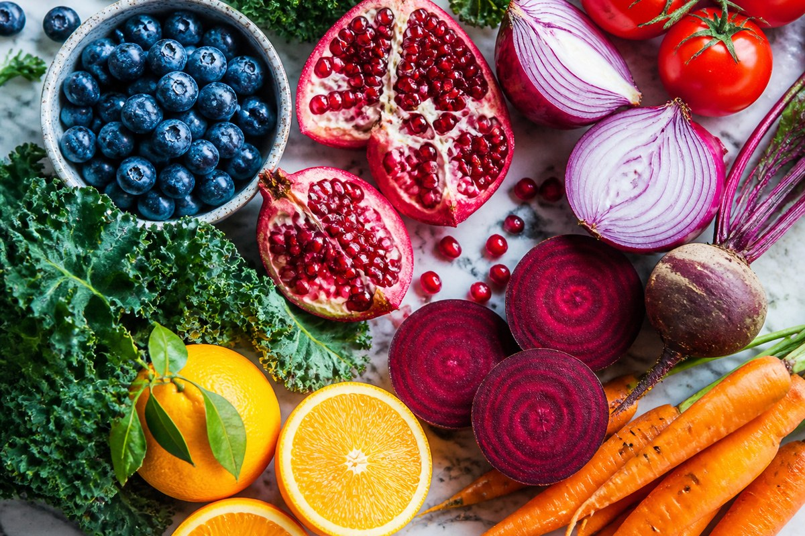

*▲ 항산화 성분은 색소에 들어 있습니다. 보라·빨강·주황·진녹색이 진할수록 폴리페놀과 카로티노이드가 많습니다.*

한 줄 결론 폴리페놀 밀도가 가장 높은 것은 <strong>블루베리(안토시아닌)와 석류(푸니칼라진)</strong>이고, 카로티노이드로는 <strong>시금치의 루테인+제아잔틴 12,198µg</strong>과 <strong>당근의 베타카로틴 8,285µg</strong>이 앞섭니다. 항산화 성분은 대부분 지용성이라 기름과 함께 익혀야 흡수가 늘어납니다.

"항산화"는 세포가 산소를 쓰면서 생기는 활성산소(ROS)를 중화하는 작용입니다. 활성산소는 DNA·단백질·세포막 지질을 산화시켜 노화와 만성 염증, 혈관 손상에 관여합니다. 식물은 자외선과 병원균에 맞서기 위해 폴리페놀·카로티노이드·비타민 같은 방어 물질을 만들고, 우리는 그것을 먹습니다.

중요한 구분이 있습니다. **폴리페놀(수용성)**은 블루베리의 안토시아닌, 석류의 푸니칼라진, 양파의 퀘르세틴, 오렌지의 헤스페리딘처럼 물에 녹는 색소·쓴맛 성분입니다. **카로티노이드(지용성)**는 토마토의 라이코펜, 당근의 베타카로틴, 케일·시금치의 루테인처럼 기름에 녹는 색소입니다. 이 차이가 조리법을 결정합니다.

아래 순위는 USDA 식품성분 데이터와 공개된 식품 폴리페놀 함량 자료를 참고해 **100g당 폴리페놀·카로티노이드 농도와 임상 근거의 무게를 함께 고려한 편집 순위**입니다. 품종·재배지·수확 시기에 따라 값이 달라지므로 상대 순위로 읽어 주세요.

---

## 1. 항산화 음식 순위는? (대표 성분 비교표)

| 식재료 | 대표 항산화 성분 (100g당) | 섭취 포인트 |
| :--- | :--- | :--- |
| **1위 블루베리** | 안토시아닌 약 100~200mg | 급속 냉동해도 안토시아닌 손실이 작아 냉동 베리가 실용적 |
| **2위 석류** | 푸니칼라진·엘라지타닌 (과육 0.2~0.5g) | 장내 세균이 우롤리틴A로 전환, 즙보다 생과·씨앗 |
| **3위 딸기** | 안토시아닌·엘라그산, 비타민C 58.8mg | 생과로 먹고, 꼭지를 딴 뒤 흐르는 물에 세척 |
| **4위 케일** | 루테인+제아잔틴 6,261µg, 설포라판 전구체 | 지용성이라 올리브유와 함께, 데치면 3분 이내 |
| **5위 시금치** | 루테인+제아잔틴 12,198µg, 베타카로틴 5,626µg | 데치면 옥살산이 물에 빠져 흡수 부담 감소 |
| **6위 비트** | 베타인 128.7mg, 베탈라인 30~60mg | 찌면 베타인 보존율이 높고 질산염도 유지 |
| **7위 당근** | 베타카로틴 8,285µg | 생보다 기름에 볶거나 익혀 먹을 때 흡수율 상승 |
| **8위 토마토** | 라이코펜 약 2,500µg | 익히고 기름을 더하면 생과보다 흡수 지표가 높음 |
| **9위 오렌지** | 헤스페리딘 28.5mg, 비타민C 53.2mg | 흰 속껍질에 헤스페리딘이 많아 통째로 먹는 편이 유리 |
| **10위 양파** | 퀘르세틴 약 13~20mg | 생으로 먹을 때 보존, 껍질 추출물은 별개 제품 |

## 2. 수용성과 지용성은 왜 나눠서 봐야 하나?

- **수용성(폴리페놀·비타민C):** 물에 녹고 열에 약합니다. 블루베리·딸기·석류는 가열하지 않고 먹는 것이 유리하고, 삶으면 조리수로 빠져나갑니다.
- **지용성(카로티노이드):** 기름에 녹아야 장에서 흡수됩니다. 당근·토마토·케일은 기름을 소량 더해 익히면 혈중 농도가 유의하게 올라간다는 연구가 있습니다(토마토 페이스트와 생토마토 비교, 1997).
- **함께 먹으면 상승합니다.** 비타민C는 다른 항산화 성분의 재생에 관여하고, 지방은 카로티노이드 흡수를 돕습니다. 토마토+올리브유, 당근+들기름, 케일+아보카도 조합이 대표적입니다.
- **껍질을 버리면 절반을 버립니다.** 사과 껍질의 폴리페놀, 오렌지 속껍질의 헤스페리딘, 포도 껍질의 레스베라트롤처럼 항산화 성분은 껍질·씨앗 주변에 집중됩니다.

## 3. 흡수를 늘리는 조리법은?

| 조리법 | 유리한 식재료 | 이유 |
| :--- | :--- | :--- |
| 생으로 | 블루베리·딸기·석류 | 수용성 안토시아닌의 열 손실 방지 |
| 기름에 볶기 | 당근·토마토·케일 | 지용성 카로티노이드의 생체이용률 상승 |
| 데치기(1~3분) | 시금치·케일 | 옥살산 감소, 비타민K는 대부분 유지 |
| 찌기 | 비트 | 베타인·질산염 보존율이 삶기보다 높음 |

기름의 양은 1작은술(5g, 약 40kcal)이면 충분합니다. 항산화 성분 흡수를 위해 기름을 많이 넣으면 열량이 이득을 상쇄합니다.

## 4. 항산화 보충제를 먹어야 하나?

결론은 **음식으로 먹는 편이 낫다**입니다.

- **고용량 보충제는 기대와 다른 결과가 나옵니다.** 베타카로틴 고용량 보충제를 복용한 흡연자군에서 폐암 위험이 오히려 높아진 대규모 연구(ATBC, CARET)가 있었습니다. 항산화제는 음식 속 복합 성분으로 작용할 때 효과가 나타나는 것으로 이해됩니다.
- **비타민C·E 단독 보충은 감기 예방·노화 지표 개선에서 일관된 효과가 없습니다.** 코크란 리뷰들을 보면 일반 인구에서 감기 발생률 감소는 미미했습니다.
- **식품 섭취는 관찰 연구에서 일관된 연관성을 보입니다.** 채소·과일 섭취량이 많은 집단에서 심혈관 질환·일부 암 발생률이 낮다는 결과가 반복 관찰됩니다. 다만 이것은 연관성이지 인과 증명은 아닙니다.
- **질환이 있거나 약을 복용 중이면 보충제는 상의하세요.** 항응고제·항암제와 상호작용하는 성분이 있습니다.

## 5. 항산화 식품 섭취 시 주의할 점은?

- **와파린 복용자는 비타민K를 일정하게.** 케일(389.6µg)·시금치(482.9µg)는 비타민K가 매우 많습니다. 갑자기 양을 늘리면 INR이 떨어집니다.
- **신장 결석 병력자는 옥살산을 확인하세요.** 시금치·비트·케일에는 옥살산이 들어 있습니다. 데치면 30~50% 줄고, 칼슘과 함께 먹으면 결석 위험이 낮아집니다.
- **칼륨 제한 식이 중이라면 양을 조절하세요.** 시금치 558mg·아보카도 485mg·비트 325mg은 100g당 칼륨입니다.
- **과일은 총량을 지키세요.** 항산화 성분이 좋아도 과일 500g을 매일 먹으면 당 섭취가 과해집니다. 하루 200~300g이 무난합니다.

## 6. 함께 읽으면 좋은 식재료 가이드

- **[블루베리](/posts/blueberry-nutrition-benefits/)** — 57kcal, 안토시아닌과 비타민C 9.7mg.
- **[석류](/posts/pomegranate-nutrition-benefits/)** — 83kcal, 푸니칼라진과 우롤리틴A.
- **[딸기](/posts/strawberry-nutrition-benefits/)** — 32kcal, 비타민C 58.8mg과 엘라그산.
- **[케일](/posts/kale-nutrition-benefits/)** — 35kcal, 루테인+제아잔틴 6,261µg.
- **[시금치](/posts/spinach-nutrition-benefits/)** — 23kcal, 루테인+제아잔틴 12,198µg.
- **[비트](/posts/beetroot-nutrition-benefits/)** — 43kcal, 베타인 128.7mg과 질산염.
- **[당근](/posts/carrot-nutrition-benefits/)** — 41kcal, 베타카로틴 8,285µg.
- **[토마토](/posts/tomato-nutrition-benefits/)** — 18kcal, 라이코펜과 비타민C 13.7mg.
- **[오렌지](/posts/orange-nutrition-benefits/)** — 47kcal, 헤스페리딘 28.5mg.
- **[양파](/posts/onion-nutrition-benefits/)** — 40kcal, 퀘르세틴과 프럭탄.
- **[체리 (Cherry)](/posts/cherry-nutrition-benefits/):** 안토시아닌 20~60mg/100g으로 색소 항산화 성분이 가장 진한 과일군입니다.

## 7. 자주 묻는 질문 (FAQ)

**Q1. 항산화 성분이 가장 많은 음식은 무엇인가요?**
폴리페놀 기준으로는 블루베리와 석류가 앞서고, 카로티노이드 기준으로는 시금치(루테인 12,198µg)와 당근(베타카로틴 8,285µg)이 앞섭니다. 한 가지만 고르기보다 색이 다른 채소·과일을 섞어 먹는 것이 낫습니다.

**Q2. 항산화 음식은 익혀 먹으면 효과가 없나요?**
아닙니다. 라이코펜·베타카로틴 같은 지용성 성분은 오히려 익히고 기름을 더할 때 흡수가 늘어납니다. 다만 비타민C와 일부 안토시아닌은 열에 약해 생으로 먹는 것이 유리합니다.

**Q3. 블루베리는 냉동과 생과 중 어느 쪽이 좋나요?**
급속 냉동 블루베리는 안토시아닌 손실이 크지 않아 연중 섭취에 실용적입니다. 다만 제품의 설탕·시럽 첨가 여부를 확인하고, 해동 후 흘러나온 즙에는 수용성 성분이 일부 포함되므로 함께 드세요.

