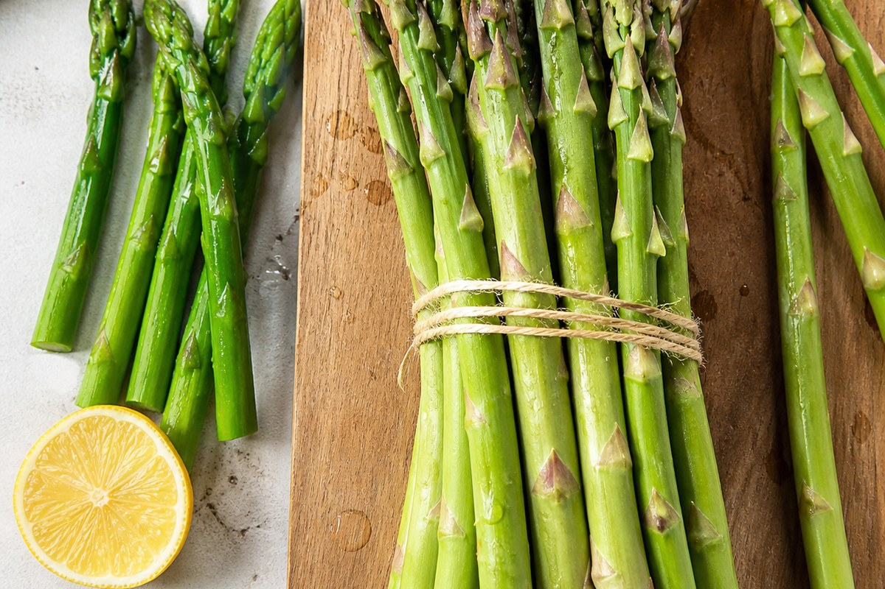

*▲ 아스파라거스 100g은 20kcal, 단백질 2.2g, 엽산 52µg, 식이섬유 2.1g입니다. 5~6줄기(약 100g)가 20kcal로, 같은 무게 밥의 10분의 1 수준 열량에 엽산 하루 권장량의 13%를 담고 있습니다.*

한 줄 결론 <strong>아스파라거스 100g은 20kcal, 단백질 2.2g, 엽산 52µg, 식이섬유 2.1g입니다.</strong> 5~6줄기(약 100g)가 20kcal에 불과해 저칼로리 식단의 부피를 채우기 좋고, 프리바이오틱 프룩탄(이눌린형) 2~3g과 글루타치온을 함께 담고 있습니다. 다만 비타민C는 조리 중 절반까지 손실되므로 데치는 시간을 2분 이내로 줄이는 것이 핵심입니다.

4~6월이 국내산 성수기이고, 수입산은 연중 유통됩니다. **아스파라거스(Asparagus officinalis)** 는 채소 중에서도 단백질 비율이 높고(100g당 2.2g, 열량 대비 44%), 엽산·비타민K·글루타치온이 함께 들어 있는 몇 안 되는 채소입니다.

가장 많이 검색되는 질문은 **"아스파라거스 칼로리가 정말 낮나"**, **"먹고 나서 소변 냄새가 나는 이유"**, **"이눌린이 장에 좋다는데 프리바이오틱인가"** 입니다. 결론부터 정리하면 **열량은 100g당 20kcal로 채소 중 최저 수준이고, 냄새는 아스파라긴산 대사산물 때문이며 건강에 해롭지 않습니다.** 이눌린(프룩탄)은 실제로 장내 유익균의 먹이가 되지만, 과민성 대장증후군이 있으면 오히려 가스를 유발할 수 있습니다.

아래에서는 USDA FoodData Central 수치를 기준으로 아스파라거스 100g·1회분 영양, 이눌린·엽산·글루타치온·아스파라긴산의 작용과 근거, 영양 손실을 줄이는 조리법, 그리고 퓨린·옥살산·FODMAP 주의사항을 정리했습니다.

---

## 1. 아스파라거스 칼로리와 영양성분은? (100g 20kcal)

아래 수치는 **아스파라거스(생것, 질긴 밑동 제거) 100g** 기준입니다. 데치면 수분이 늘어 100g당 열량이 22kcal로 조금 올라가지만, 실제 접시에 담기는 양은 생것보다 줄어듭니다.

| 영양 성분 (Nutrient) | 함량 (100g당) | 1일 권장 섭취량 비율 (한국인 성인 기준) |
| :--- | :--- | :--- |
| **열량 (Energy)** | 20 kcal | 1.0% |
| **수분 (Water)** | 93.22 g | 별도 표기¹ |
| **탄수화물 (Carbohydrates)** | 3.88 g | 1.2% |
| - 총 당류 (Total Sugars) | 1.88 g | 1.9% |
| - 식이섬유 (Dietary Fiber) | 2.10 g | 8.4% |
| - 프룩탄·이눌린형 (Fructans) | 2.0~3.0 g | 별도 표기¹ |
| **단백질 (Protein)** | 2.20 g | 4.0% |
| **지방 (Total Fat)** | 0.12 g | 0.2% |
| - 콜레스테롤 (Cholesterol) | 0.00 mg | 0.0% |
| **엽산 (Folate)** | 52 µg DFE | 13.0% |
| **비타민K (Vitamin K)** | 41.6 µg | 34.7% |
| **비타민C (Vitamin C)** | 5.60 mg | 5.6% |
| **비타민A (Vitamin A, RAE)** | 38 µg RAE | 5.4% |
| **칼륨 (Potassium)** | 202 mg | 5.8% |
| **철분 (Iron)** | 2.14 mg | 17.8% |
| **칼슘 (Calcium)** | 24 mg | 3.4% |
| **마그네슘 (Magnesium)** | 14 mg | 3.5% |
| **글루타치온 (Glutathione)** | 13~20 mg | 기준치 없음 |
| **아스파라긴산 (Asparagine)** | 200~400 mg | 기준치 없음 |
| **나트륨 (Sodium)** | 2 mg | 0.1% |

**표 읽는 법:** 열량·탄수화물·단백질·지방·나트륨 %는 식품 표시용 1일 영양성분 기준치(2,000kcal) 대비, 비타민·무기질 %는 한국인 영양소 섭취기준 성인 권장량 대비입니다. ¹수분·프룩탄·글루타치온·아스파라긴산은 1일 기준치가 없어 절대량만 적었습니다. **비타민K 41.6µg은 녹색 채소 중 중간 수준**으로 시금치(482µg)의 10분의 1이지만, 항응고제 복용자는 섭취량을 일정하게 유지해야 합니다. 프룩탄은 품종·수확 시기에 따라 1~4g 범위로 변동합니다.

<strong>출처:</strong> 식품의약품안전처·농촌진흥청 국가표준식품성분표(K-FIND) · <a href="https://fdc.nal.usda.gov/" rel="nofollow noopener" target="_blank">USDA FoodData Central</a> · <a href="https://pubmed.ncbi.nlm.nih.gov/" rel="nofollow noopener" target="_blank">PubMed 문헌</a>

### 실생활 환산: 아스파라거스 5줄기·한 묶음은 몇 kcal인가?

| 섭취 기준 | 중량 | 열량과 핵심 수치 |
| :--- | :--- | :--- |
| 1줄기(중간 굵기) | 약 16 g | 3.2 kcal |
| 1회분 5~6줄기 | 약 100 g | **20 kcal** · 엽산 52 µg · 단백질 2.2 g |
| 한 묶음(200~250g) | 250 g | 50 kcal · 식이섬유 5.3 g · 엽산 130 µg |
| 데친 아스파라거스 100g | 생것 130 g 상당 | 22 kcal · 비타민C 2.8~4 mg(손실 후) |
| 올리브유 1큰술 추가 | 14 g | +120 kcal (총 140 kcal) |

**열량의 함정은 소스입니다.** 아스파라거스 자체가 20kcal여도 버터·마요네즈·올리브유를 두르면 한 접시가 150kcal를 넘습니다. 레몬즙·발사믹·소금·후추로 간을 하면 25kcal 이내로 유지됩니다.

---

## 2. 과학적으로 입증된 4대 건강 효능

### H3. 이눌린(프룩탄)은 정말 프리바이오틱인가?

네. 아스파라거스 100g에 프룩탄 2~3g이 들어 있어 장내 비피도박테리아의 먹이가 됩니다. 다만 IBS 환자에게는 가스·팽만을 유발할 수 있습니다.

프리바이오틱스는 사람이 소화하지 못하는 탄수화물로, 대장에서 유익균이 발효해 **짧은사슬지방산(부티르산·아세트산·프로피온산)** 을 만듭니다. 부티르산은 대장 점막 세포의 주 연료로, 장벽 투과성을 낮추고 염증을 억제합니다.

아스파라거스의 프룩탄 함량은 2~3g/100g으로, 1회분(100g)으로 유효 용량(보통 3~5g/일)의 절반 이상을 채웁니다. 양파·마늘·통밀과 함께 먹으면 하루 프리바이오틱스 목표를 쉽게 넘길 수 있습니다.

주의할 점은 **FODMAP**입니다. 프룩탄은 장내에서 발효되며 가스를 만들기 때문에, 과민성 대장증후군(IBS)이 있는 사람은 아스파라거스 섭취 후 복부 팽만·경련을 느낄 수 있습니다. 이 경우 50g(2~3줄기)부터 시작해 양을 조절하세요.

### H3. 엽산 52µg은 임신 준비에 의미가 있나?

일부만 채웁니다. 아스파라거스 100g은 엽산 52µg으로 임신 준비 권장량(400µg)의 13%이며, 300g을 먹어도 156µg입니다. 보충제를 대체할 수 없습니다.

엽산은 DNA 합성과 세포 분열에 필수인 비타민B9입니다. 임신 초기 엽산 부족은 신경관 결손(척추이분증) 위험과 관련이 있어, 임신을 준비하는 여성에게는 **400µg/일 보충**이 권고됩니다. 아스파라거스는 자연 엽산 공급원으로 유용하지만, 음식만으로 400µg을 채우려면 800g 가까이 필요합니다.

일반 성인에게는 호모시스테인 대사 지원이 주요 역할입니다. 엽산·비타민B6·B12가 부족하면 호모시스테인이 올라가 혈관 내피를 손상시키는데, 아스파라거스는 이 세 가지 중 두 가지(엽산·B6)를 함께 공급합니다.

### H3. 글루타치온과 아스파라긴산은 어떤 작용을 하나?

글루타치온은 간 해독과 항산화의 중심 물질이고, 아스파라거스는 채소 중 글루타치온 함량이 가장 높은 축에 듭니다. 아스파라긴산은 피로 회복 보조로 쓰이지만 근거는 제한적입니다.

글루타치온은 세포 내 주요 항산화제이자 해독 효소(글루타치온-S-전이효소)의 기질입니다. 아스파라거스 100g의 글루타치온은 13~20mg으로, 브로콜리·시금치와 함께 채소 중 상위군에 속합니다. 다만 **조리하면 30~60%가 손실**되므로 살짝 데치거나 생으로 먹는 편이 유리합니다.

아스파라긴산은 아미노산의 하나로, 일본에서 피로 회복·알코올 대사 보조 성분으로 건강기능식품에 쓰입니다. 아스파라거스 100g에 200~400mg 들어 있지만, **섭취 후 피로 회복을 확인한 임상시험은 소수이고 규모가 작습니다.** 숙취 해소를 목적으로 아스파라거스를 과신하지는 마세요.

### H3. 저칼로리인데 포만감이 좋은 이유는?

수분 93%와 식이섬유 2.1g이 부피를 만들고, 단백질 2.2g이 열량 대비 44%를 차지해 포만 신호를 보강합니다.

아스파라거스의 열량 밀도는 0.2kcal/g으로, 밥(1.3kcal/g)의 6분의 1입니다. 같은 접시 부피로 20kcal를 채우면 위 팽창 자극이 생기고, 씹는 시간이 길어져 식사 속도가 느려집니다.

단백질 비율이 높은 점도 특징입니다. 채소 중 단백질이 열량의 40% 이상을 차지하는 경우는 드물며, 이는 식후 포만 호르몬(GLP-1, PYY) 분비를 자극하는 데 일부 기여합니다.

---

## 3. 영양 손실을 줄이는 조리·섭취 가이드

- **데치는 시간은 2분 이내.** 끓는 물에 넣고 90~120초면 아삭함이 유지되고 비타민C 손실이 30% 이내로 줄어듭니다. 3분을 넘기면 비타민C는 절반, 엽산도 30% 이상 사라집니다.
- **찜이 데치기보다 유리합니다.** 수증기로 익히면 수용성 비타민이 물로 빠져나가지 않아 엽산·비타민C 보존율이 15~25% 높습니다.
- **밑동 2~3cm는 잘라내고, 껍질은 벗기지 마세요.** 껍질에는 아스파라긴산과 식이섬유가 집중돼 있습니다. 굵은 줄기는 밑동만 살짝 깎아내면 됩니다.
- **기름은 먹기 직전에.** 비타민K·베타카로틴은 지용성이라 올리브유와 함께 먹으면 흡수율이 오르지만, 조리 전에 두르면 열로 산화됩니다. 구운 뒤 마지막에 뿌리세요.
- **보관은 물컵에 세워 냉장.** 밑동을 1cm 잘라 물 2cm에 세워두면 3~5일 신선도가 유지됩니다. 삶은 것은 밀폐 용기에 담아 3일 안에 드세요.

---

## 4. 섭취 시 주의사항 및 부작용

- **소변 냄새:** 아스파라긴산이 대사되며 생기는 메탄티올·디메틸설파이드가 원인입니다. **건강에 해롭지 않으며**, 냄새를 느끼는 능력은 유전자(OR2M7)에 따라 개인차가 큽니다. 냄새가 신경 쓰이면 조리 후 물을 충분히 마시세요.
- **과민성 대장증후군(IBS):** 프룩탄 2~3g은 저FODMAP 식이 중에는 제한 대상입니다. 팽만이 있으면 50g부터 시작하세요.
- **퓨린·통풍:** 아스파라거스는 퓨린이 중간 정도(100g당 50mg 내외)입니다. 식물성 퓨린은 통풍 위험과의 연관이 육류·해산물보다 약하지만, 급성 발작기에는 양을 줄이는 편이 안전합니다.
- **옥살산 결석:** 옥살산이 중간 수준으로, 신장결석 병력이 있다면 하루 100g 이내로 제한하고 물을 충분히 마시세요.
- **항응고제 복용:** 비타민K 41.6µg/100g으로 시금치보다 낮지만, 섭취량이 갑자기 늘면 INR이 흔들릴 수 있습니다. 와파린 복용자는 양을 일정하게 유지하세요.

---

## 5. 자주 묻는 질문 (FAQ)

**Q1. 아스파라거스는 하루에 얼마나 먹어도 되나요?**  
**하루 100~200g(5~10줄기)** 이 적당합니다. 20~40kcal에 엽산 52~104µg, 식이섬유 2.1~4.2g을 확보할 수 있습니다. 프리바이오틱스 효과를 노린다면 100g 이상이 좋지만, IBS·신장결석 병력이 있으면 100g 이내로 제한하세요.

**Q2. 아스파라거스를 먹으면 소변 냄새가 나는 게 건강에 문제인가요?**  
아닙니다. 아스파라긴산이 황 함유 대사산물로 분해되며 나는 정상적인 현상이고, 신장 기능과 무관합니다. 냄새를 감지하는 능력은 유전자에 따라 달라 어떤 사람은 전혀 느끼지 못합니다. 수분을 충분히 마시면 냄새가 옅어집니다.

**Q3. 아스파라거스는 생으로 먹어도 되나요?**  
굵기가 가는 순은 생으로도 먹을 수 있지만, 세포벽이 단단해 소화가 어렵고 옥살산·사포닌 자극이 있을 수 있습니다. 90~120초 데치거나 3~4분 구우면 영양 손실을 최소화하면서 소화 부담을 줄일 수 있습니다.

---

## 6. 아스파라거스와 함께 먹으면 좋은 음식

- **[시금치 (Spinach)](/posts/spinach-nutrition-benefits/):** 시금치의 엽산(146µg/100g)과 아스파라거스의 엽산을 합치면 한 끼로 200µg에 가까운 엽산을 확보합니다. 다만 시금치는 옥살산이 많아 결석 병력자는 양을 조절하세요.
- **[달걀 (Egg)](/posts/egg-nutrition-benefits/):** 달걀의 완전 단백질과 콜린이 아스파라거스의 엽산과 함께 호모시스테인 대사를 지원합니다. 아스파라거스·달걀 볶음은 단백질 14g의 저녁 반찬이 됩니다.
- **[브로콜리 (Broccoli)](/posts/broccoli-nutrition-benefits/):** 브로콜리의 설포라판과 아스파라거스의 글루타치온이 서로 다른 해독 경로(2상 해독 효소 vs 직접 항산화)를 활성화합니다.
- **[연어 (Salmon)](/posts/salmon-nutrition-benefits/):** 아스파라거스의 비타민K·베타카로틴은 지용성이라 연어의 오메가3 지방과 함께 먹으면 흡수율이 올라갑니다. 오븐에 함께 구우면 한 접시로 300kcal 이내 식사가 완성됩니다.

  
📌 관련 순위 가이드

  <ul>
    <li><a href="/posts/low-calorie-high-satiety-foods/">저칼로리 포만감 다이어트 음식 TOP 10: 100g 비교</a></li>
    <li><a href="/posts/liver-immunity-fatigue-recovery-foods/">간·면역·피로 회복 음식 TOP 10</a></li>
    <li><a href="/posts/antioxidant-anti-aging-foods-guide/">항산화·노화 방지 음식 TOP 10: 비타민C·폴리페놀 비교</a></li>
  </ul>

---

## 7. 아스파라거스 핵심 요약

- **열량: 100g 20kcal, 5~6줄기 20kcal.** 채소 중 최저 열량군이며 수분 93%로 포만감이 큽니다.
- **엽산 52µg(권장량 13%), 비타민K 41.6µg.** 임신 준비에는 보충제를 병행해야 합니다.
- **프리바이오틱 프룩탄 2~3g.** 장내 유익균의 먹이지만 IBS에는 가스를 유발할 수 있습니다.
- **글루타치온 13~20mg.** 채소 중 상위군이지만 조리하면 30~60% 손실됩니다.
- **조리는 2분 데치기 또는 찜, 소스는 레몬·발사믹으로.** 열량은 소스에서 결정됩니다.

