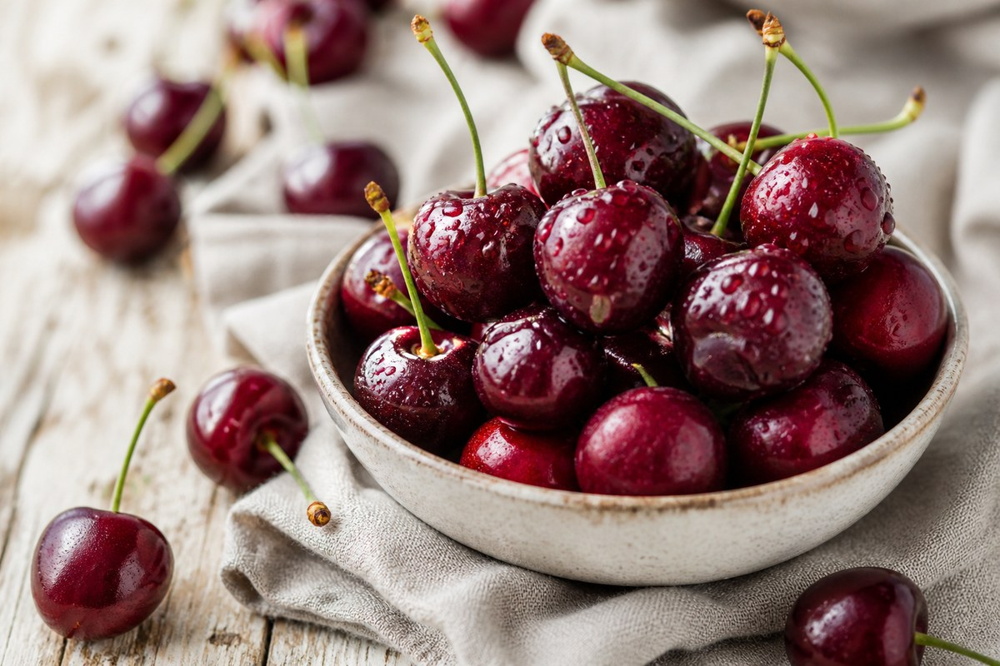

*▲ 생체리 100g은 63kcal, 식이섬유 2.1g, 칼륨 222mg입니다. 한 컵(약 21알, 154g)은 97kcal로, 같은 부피의 과자보다 열량이 4분의 1 수준이면서 안토시아닌과 칼륨을 함께 담고 있습니다.*

한 줄 결론 <strong>생체리 100g은 63kcal, 당류 12.82g, 식이섬유 2.1g이고 1컵(약 21알)은 97kcal입니다.</strong> 체리는 혈당지수(GI) 22의 저혈당 과일이며, 통풍 발작 위험을 35% 낮췄다는 대규모 관찰연구가 있습니다. 다만 수면 효과는 멜라토닌 함량(100g당 0.13µg)만으로 설명되지 않아, 보조적 습관으로 보는 것이 정확합니다.

5~7월이 국내 생체리 성수기이고, 연중으로는 칠레·미국산 냉동 체리와 체리 농축액이 유통됩니다. 체리는 **안토시아닌(시아니딘 계열) 색소**가 과일 중에서도 진하게 농축된 식품으로, 항염·항산화·요산 대사 연구의 단골 주제입니다.

가장 많이 검색되는 질문은 **"체리 먹으면 잠이 잘 오나"**, **"통풍에 체리가 정말 좋나"**, **"체리 하루 몇 알이 적당한가"** 입니다. 결론부터 정리하면 **통풍은 관찰연구 근거가 상당히 일관되지만 혈중 요산을 직접 낮추지는 못하고, 수면은 객관적 지표(수면 효율·총 수면시간)에서만 개선이 확인**됐습니다.

아래에서는 USDA FoodData Central 수치를 기준으로 체리 1컵·1알 영양, 멜라토닌과 트립토판의 실제 함량, 통풍·항염 임상 근거, 그리고 과당·칼륨·씨앗 관련 주의사항을 정리했습니다.

---

## 1. 체리 칼로리와 영양성분은? (100g 63kcal·1컵 97kcal)

아래 수치는 **생체리(스위트 체리, 씨 포함 중량) 100g** 기준입니다. 체리는 씨와 꼭지를 버리므로 실제 가식부는 1컵(154g)에서 약 130g입니다.

| 영양 성분 (Nutrient) | 함량 (100g당) | 1일 권장 섭취량 비율 (한국인 성인 기준) |
| :--- | :--- | :--- |
| **열량 (Energy)** | 63 kcal | 3.2% |
| **수분 (Water)** | 82.25 g | 별도 표기¹ |
| **탄수화물 (Carbohydrates)** | 16.01 g | 4.9% |
| - 총 당류 (Total Sugars) | 12.82 g | 12.8% |
| - 식이섬유 (Dietary Fiber) | 2.10 g | 8.4% |
| **단백질 (Protein)** | 1.06 g | 1.9% |
| **지방 (Total Fat)** | 0.20 g | 0.4% |
| - 콜레스테롤 (Cholesterol) | 0.00 mg | 0.0% |
| **비타민C (Vitamin C)** | 7.00 mg | 7.0% |
| **비타민A (Vitamin A, RAE)** | 3 µg RAE | 0.4% |
| **칼륨 (Potassium)** | 222 mg | 6.3% |
| **칼슘 (Calcium)** | 13 mg | 1.9% |
| **마그네슘 (Magnesium)** | 11 mg | 2.8% |
| **철분 (Iron)** | 0.36 mg | 3.0% |
| **총 안토시아닌 (Anthocyanins)** | 20~60 mg | 기준치 없음 |
| **멜라토닌 (Melatonin)** | 0.10~0.14 µg | 기준치 없음 |
| **트립토판 (Tryptophan)** | 9 mg | 기준치 없음 |
| **나트륨 (Sodium)** | 0 mg | 0.0% |

**표 읽는 법:** 열량·탄수화물·단백질·지방·나트륨 %는 식품 표시용 1일 영양성분 기준치(2,000kcal) 대비, 비타민·무기질 %는 한국인 영양소 섭취기준 성인 권장량 대비입니다. ¹수분·안토시아닌·멜라토닌·트립토판은 1일 기준치가 없어 절대량만 적었습니다. **멜라토닌 0.1µg은 수면 보충제 1정(0.5~5mg)의 5만분의 1 수준**이라는 점을 기억하면 아래 수면 효과 설명이 이해됩니다. 안토시아닌은 품종(빙체리·레인ier 등)과 숙성도에 따라 3배 이상 차이가 납니다.

<strong>출처:</strong> 식품의약품안전처·농촌진흥청 국가표준식품성분표(K-FIND) · <a href="https://fdc.nal.usda.gov/" rel="nofollow noopener" target="_blank">USDA FoodData Central</a> · <a href="https://pubmed.ncbi.nlm.nih.gov/" rel="nofollow noopener" target="_blank">PubMed 문헌</a>

### 체리 1알·1컵·농축액은 몇 kcal인가?

| 섭취 기준 | 중량 | 열량과 핵심 수치 |
| :--- | :--- | :--- |
| 1알 | 약 7 g | 4.4 kcal |
| 10알 | 약 70 g | 44 kcal · 당류 9 g |
| 1컵(약 21알) | 154 g | **97 kcal** · 식이섬유 3.2 g · 칼륨 342 mg |
| 타르트 체리 농축액 30 ml | 원과 90 g 상당 | 100~120 kcal · 안토시아닌 고농축 |
| 체리 주스 240 ml | 원과 약 90 g | 110~130 kcal · 식이섬유 대부분 손실 |

체리 10알(44kcal)은 다이어트 간식으로 부담이 없습니다. 문제는 **체리 주스와 농축액**입니다. 주스 한 컵은 체리 90g분의 당을 식이섬유 없이 담아, 같은 당을 더 빠르게 흡수시킵니다.

---

## 2. 과학적으로 입증된 4대 건강 효능

### H3. 체리를 먹으면 정말 잠이 잘 오나?

객관적 수면 지표에서는 개선이 확인됐지만, 체리 속 멜라토닌 양만으로는 설명되지 않습니다. 수면제가 아니라 습관 보조로 보세요.

타르트 체리(Montmorency)의 멜라토닌은 그램당 약 13ng, 즉 **100g에 0.13µg**입니다. 수면 보충제의 표준 용량(0.5~5mg)과 비교하면 1만분의 1 이하입니다. 그래서 체리의 수면 효과를 "멜라토닌 때문"이라고 단정하기는 어렵습니다.

2023년 체리와 수면에 관한 체계적 문헌고찰·메타분석(8개 연구)에서는 **객관적 수면 효율이 효과크기 0.63, 총 수면시간이 1.21만큼 증가**했습니다. 반면 주관적으로 느끼는 수면의 질은 유의한 차이가 없었습니다. 연구진은 트립토판 분해 억제와 IL-1β·TNF-α 같은 수면 유도 사이토카인 조절을 대안 기전으로 제시했습니다.

실용적으로는 **취침 1~2시간 전 체리 10~15알 또는 농축액 30ml**가 시험에서 쓰인 용량에 가깝습니다. 카페인을 줄이고 규칙적인 취침 시간을 함께 지키는 것이 우선입니다.

### H3. 통풍에 체리가 정말 효과가 있나?

발작 위험을 낮춘다는 관찰연구는 일관되지만, 혈중 요산 수치를 직접 떨어뜨리지는 못합니다. 약물 치료를 대체할 수 없습니다.

2012년 대규모 통풍 환자 코호트 연구(Arthritis & Rheumatism)에서 **체리를 먹은 군은 급성 통풍 발작 위험이 35% 낮았고(교차비 0.65), 체리 추출물을 함께 복용한 군은 75% 낮았습니다.** 안토시아닌이 잔틴산화효소를 억제하고 염증성 사이토카인을 줄이는 기전이 실험실에서 확인됩니다.

다만 2019년 무작위 대조시험(Rheumatology)에서는 **타르트 체리 농축액을 28일간 먹어도 혈청 요산 수치와 요산 배설량에 차이가 없었습니다.** 2023년 통풍 환자 282명 대상 무작위 시험에서는 요산 강하제를 시작하는 환자에게 체리 혼합물을 먹였을 때 **발작 횟수와 CRP가 감소**했습니다.

정리하면 체리는 **염증을 줄여 발작 '빈도'를 낮추는 보조 식품**이고, 요산을 낮추는 약(알로퓨리놀·페북소스타트)을 대신하지 못합니다. 급성 발작기에는 약을 우선하고 체리는 식사로만 드세요.

### H3. 안토시아닌은 항염·근육 회복에 도움이 되나?

소규모 시험에서 격렬한 운동 후 근육통·산화 스트레스 지표가 개선됐습니다. 효과는 '회복을 조금 앞당기는' 수준입니다.

체리의 진한 붉은색은 시아니딘-3-루티노사이드 등 안토시아닌에서 나옵니다. 이 성분은 **COX-2 효소 활성을 억제**하고 혈관 내피의 산화 스트레스 반응을 낮추는 기전이 보고됐습니다.

마라톤·사이클 같은 편심성 운동 후 타르트 체리 주스를 마신 연구에서 **근육통(VAS)과 크레아틴키나아제(CK) 상승폭이 위약군보다 낮았습니다.** 다만 대상자가 10~20명 수준인 소규모 연구이고, 일상적인 가벼운 운동에서는 차이가 크지 않습니다.

### H3. 칼륨과 식이섬유는 어떤 역할을 하나?

체리 1컵에 칼륨 342mg과 식이섬유 3.2g이 들어 있어, 나트륨 배출과 배변 규칙성을 동시에 돕습니다.

칼륨 222mg/100g은 과일 중 중간 이상입니다. 국물·가공식품이 많은 식단에서 체리 한 컵은 나트륨-칼륨 균형을 개선하는 데 실질적으로 기여합니다.

식이섬유 2.1g은 사과(2.4g)와 비슷하며, 그중 상당 부분이 펙틴입니다. 펙틴은 수용성 섬유로 장내 점도를 높여 당 흡수를 완만하게 하고, 콜레스테롤 배출을 돕습니다.

---

## 3. 흡수율을 높이는 조리·섭취 가이드

- **신선 체리는 씻어서 바로, 냉동 체리는 해동 없이.** 냉동 체리는 영하 18℃에서 6개월 보관 가능하며, 해동하면 세포가 터져 즙이 흐르므로 요거트·스무디에 바로 넣는 편이 좋습니다.
- **농축액은 물이나 탄산수에 희석해.** 타르트 체리 농축액 30ml는 원과 90g 상당의 안토시아닌을 담고 있지만 당도 농축돼 있습니다. 물 200ml에 희석하면 열량을 30kcal 이하로 낮출 수 있습니다.
- **지방과 함께 먹으면 카로티노이드 흡수가 오릅니다.** 체리는 카로티노이드 함량이 낮지만, 요거트·견과류와 함께 먹으면 지용성 성분 흡수가 전반적으로 좋아집니다.
- **취침 전 섭취는 1~2시간 전에.** 너무 늦게 먹으면 위 부담과 잦은 야간 배뇨로 수면을 방해할 수 있습니다.
- **씨는 삼켜도 되지만 씹지 마세요.** 체리 씨에는 아미그달린(시안화물 전구체)이 소량 들어 있어, 다량을 씹어 먹으면 문제가 될 수 있습니다. 실수로 삼킨 몇 개는 소화되지 않고 배출됩니다.

---

## 4. 섭취 시 주의사항 및 부작용

- **과당 부담:** 체리 1컵의 당류는 19.7g(가식부 기준)으로, 과당 비율이 높습니다. 과민성 대장증후군(IBS)이나 과당 흡수 장애가 있으면 복부 팽만·설사가 생길 수 있습니다.
- **만성신장질환:** 칼륨 222mg/100g은 과일 중 높은 편입니다. 칼륨 제한 식이 중이라면 한 번에 10알 이하로 제한하세요.
- **당뇨:** GI 22로 낮지만 1컵의 당류가 20g에 가깝습니다. 한 번에 10~15알(44~66kcal)이 적당합니다.
- **항응고제·항혈소판제:** 체리의 안토시아닌은 시험관에서 혈소판 응집을 억제하는 방향으로 작용합니다. 항혈전제를 복용한다면 과량 섭취는 피하고, 수술 전에는 섭취량을 줄이는 편이 안전합니다.
- **농약 잔류:** 체리는 잔류 농약 검출 순위에 자주 오르는 과일입니다. 흐르는 물에 30초 이상 문질러 씻거나, 식초물(물 1L에 식초 1큰술)에 5분 담갔다 헹구세요.

---

## 5. 자주 묻는 질문 (FAQ)

**Q1. 체리는 하루에 몇 알이 적당한가요?**  
**하루 15~20알(1컵 이하, 70~97kcal)** 이 적당합니다. 당류가 13~20g이므로 당뇨가 있다면 10알(44kcal)으로 제한하고 식사 직후에 드세요. 수면 목적이라면 취침 1~2시간 전 10~15알이 시험 용량에 가깝습니다.

**Q2. 체리 주스와 생체리 중 어느 쪽이 좋나요?**  
생체리가 납니다. 주스 240ml는 체리 90g분의 당을 담고 식이섬유는 대부분 사라집니다. 수면·통풍 연구에서 쓰인 타르트 체리 농축액은 생과일로 대량 섭취가 어려운 경우의 대안이며, 30ml를 물에 희석해 드세요.

**Q3. 체리를 먹으면 혈당이 오르나요?**  
GI 22로 낮은 편이라 크게 오르지 않습니다. 다만 1컵에 당류가 20g 가까이 되므로, 한 번에 1컵 이상 먹거나 공복에 주스로 마시면 혈당이 빠르게 오를 수 있습니다. 식사 후 디저트로 10~15알이 가장 안정적입니다.

---

## 6. 체리와 함께 먹으면 좋은 음식

- **[블루베리 (Blueberry)](/posts/blueberry-nutrition-benefits/):** 블루베리의 안토시아닌과 체리의 시아니딘 계열이 서로 다른 항산화 경로를 채웁니다. 냉동 베리 믹스 한 컵이면 항산화 섭취를 한 번에 끌어올릴 수 있습니다.
- **[키위 (Kiwi)](/posts/kiwi-nutrition-benefits/):** 키위의 비타민C(92.7mg)는 체리에 부족한 수용성 항산화 성분을 보완합니다. 야식 대신 키위 1개와 체리 10알을 먹으면 열량 100kcal 이하로 수면 전 간식이 완성됩니다.
- **[시금치 (Spinach)](/posts/spinach-nutrition-benefits/):** 시금치의 마그네슘(79mg/100g)과 체리의 칼륨이 근육 이완과 혈압 조절에 함께 작용합니다. 운동 후 샐러드에 체리를 얹는 조합이 대표적입니다.
- **[두부 (Tofu)](/posts/tofu-nutrition-benefits/):** 체리의 트립토판(9mg)은 단백질 식품과 함께 먹을 때 뇌로 더 잘 전달됩니다. 두부 샐러드에 체리를 더하면 수면 호르몬 합성에 필요한 아미노산 조합이 갖춰집니다.

  
📌 관련 순위 가이드

  <ul>
    <li><a href="/posts/antioxidant-anti-aging-foods-guide/">항산화·노화 방지 음식 TOP 10: 비타민C·폴리페놀 비교</a></li>
    <li><a href="/posts/low-gi-foods-blood-sugar-guide/">혈당 낮추는 음식 TOP 10: 저혈당 지수(GI) 순위표</a></li>
    <li><a href="/posts/liver-immunity-fatigue-recovery-foods/">간·면역·피로 회복 음식 TOP 10</a></li>
  </ul>

---

## 7. 체리 핵심 요약

- **열량: 100g 63kcal, 1컵(21알) 97kcal, 10알 44kcal.** 다이어트 간식으로 부담이 없는 열량입니다.
- **수면: 객관적 지표에서만 개선.** 멜라토닌 양(0.13µg)만으로는 설명되지 않으므로 취침 1~2시간 전 10~15알을 습관으로.
- **통풍: 발작 위험 35% 감소(관찰연구).** 혈중 요산은 낮추지 못하므로 약물 치료를 대체할 수 없습니다.
- **안토시아닌 20~60mg/100g.** 항염·운동 후 회복 보조 근거가 있습니다.
- **주의: 과당·칼륨·농약 잔류.** IBS·신장질환자는 양을 줄이고, 흐르는 물에 충분히 씻으세요.

