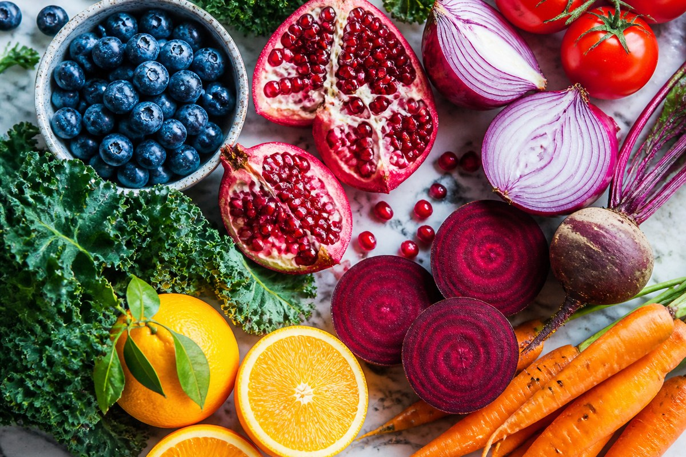

*▲ Antioxidants live in pigments. The deeper the purple, red, orange or dark green, the more polyphenols and carotenoids the food carries.*

Quick answer Polyphenol density is highest in blueberries (anthocyanins) and pomegranate (punicalagin), while among carotenoids spinach leads with 12,198 mcg of lutein plus zeaxanthin per 100 g and carrots with 8,285 mcg of beta-carotene. Most of these compounds are fat soluble, so eating them with a little oil raises absorption.

Antioxidant activity means neutralizing reactive oxygen species (ROS) produced as cells use oxygen. ROS oxidize DNA, proteins and membrane lipids, contributing to aging, chronic inflammation and vascular damage. Plants build polyphenols, carotenoids and vitamins to defend against UV light and pathogens, and we eat those defenses.

The split matters. **Polyphenols (water soluble)** include blueberry anthocyanins, pomegranate punicalagin, onion quercetin and orange hesperidin. **Carotenoids (fat soluble)** include tomato lycopene, carrot beta-carotene and the lutein in kale and spinach. That difference decides how you should cook them.

This ranking draws on USDA food composition data and published polyphenol content tables, weighing per-100 g concentration together with the strength of clinical evidence. Values shift with variety, soil and harvest time, so read it as a relative order.

---

## 1. Which foods are highest in antioxidants? (Compound chart)

| Food | Key antioxidants (per 100 g) | How to eat it |
| :--- | :--- | :--- |
| **1. Blueberry** | Anthocyanins, roughly 100–200 mg | Fast-frozen berries lose little, making frozen fruit practical |
| **2. Pomegranate** | Punicalagin and ellagitannins (0.2–0.5 g in arils) | Gut bacteria convert them to urolithin A; whole arils beat juice |
| **3. Strawberry** | Anthocyanins, ellagic acid, 58.8 mg vitamin C | Eat raw, hull first, then rinse under running water |
| **4. Kale** | 6,261 mcg lutein plus zeaxanthin, sulforaphane precursors | Fat soluble, so pair with olive oil; blanch for under 3 minutes |
| **5. Spinach** | 12,198 mcg lutein plus zeaxanthin, 5,626 mcg beta-carotene | Blanching leaches oxalates and lightens the load on kidneys |
| **6. Beetroot** | 128.7 mg betaine, 30–60 mg betalains | Steaming preserves betaine and dietary nitrate best |
| **7. Carrot** | 8,285 mcg beta-carotene | Absorption rises when cooked with a little fat |
| **8. Tomato** | About 2,500 mcg lycopene | Cooking with oil lifts absorption markers above raw tomato |
| **9. Orange** | 28.5 mg hesperidin, 53.2 mg vitamin C | Hesperidin sits in the white pith, so eat the segments whole |
| **10. Onion** | Roughly 13–20 mg quercetin | Best preserved raw; peel extracts are a separate product |

## 2. Why water-soluble and fat-soluble need separate treatment

- **Water soluble (polyphenols, vitamin C):** dissolve in water and degrade with heat. Blueberries, strawberries and pomegranate are best raw, since boiling leaches them into cooking water.
- **Fat soluble (carotenoids):** need fat to be absorbed in the intestine. Cooking carrots, tomatoes and kale with a little oil measurably raises blood levels, as seen when tomato paste was compared with raw tomato in 1997.
- **Together they work better.** Vitamin C helps regenerate other antioxidants, and fat carries carotenoids across the gut wall. Tomato with olive oil, carrot with sesame oil and kale with avocado are the classic pairings.
- **Discarding the peel wastes half the benefit.** Apple peel polyphenols, orange pith hesperidin and grape skin resveratrol all concentrate in the outer layers and seeds.

## 3. Which cooking methods increase absorption?

| Method | Best for | Reason |
| :--- | :--- | :--- |
| Raw | Blueberries, strawberries, pomegranate | Avoids heat loss of water-soluble anthocyanins |
| Sauté with oil | Carrots, tomatoes, kale | Raises bioavailability of fat-soluble carotenoids |
| Blanch 1–3 minutes | Spinach, kale | Cuts oxalates while keeping most vitamin K |
| Steam | Beetroot | Preserves betaine and nitrate better than boiling |

One teaspoon of oil (5 g, about 40 kcal) is enough. Pouring more oil to chase absorption cancels the benefit in calories.

## 4. Should you take antioxidant supplements?

Food first is the better answer.

- **High-dose supplements have produced disappointing results.** Large trials of high-dose beta-carotene in smokers (ATBC, CARET) found higher lung cancer risk rather than lower. Antioxidants appear to work as part of a food matrix, not as isolated pills.
- **Vitamin C and E alone show no consistent benefit.** Cochrane reviews found minimal reduction in common cold incidence in the general population, and no reliable effect on aging markers.
- **Food intake shows consistent associations.** Populations eating more vegetables and fruit have lower rates of cardiovascular disease and some cancers, although this is association rather than proof of cause.
- **Ask a clinician if you take medication.** Several compounds interact with anticoagulants and chemotherapy agents.

## 5. What should you watch when eating antioxidant-rich foods?

- **Keep vitamin K steady on warfarin.** Kale (389.6 mcg) and spinach (482.9 mcg) are extremely high in vitamin K, and sudden increases drop INR.
- **Check oxalates with a history of kidney stones.** Spinach, beetroot and kale contain oxalates. Blanching removes 30–50%, and eating them with calcium lowers stone risk.
- **Watch potassium on a restricted diet.** Spinach (558 mg), avocado (485 mg) and beetroot (325 mg) are per 100 g.
- **Keep fruit portions sensible.** Even antioxidant-rich fruit adds up to excess sugar past 500 g a day; 200–300 g daily is a comfortable range.

## 6. Related ingredient guides

- **[Blueberry](/en/posts/blueberry-nutrition-benefits/)** — 57 kcal with anthocyanins and 9.7 mg vitamin C.
- **[Pomegranate](/en/posts/pomegranate-nutrition-benefits/)** — 83 kcal, punicalagin and urolithin A.
- **[Strawberry](/en/posts/strawberry-nutrition-benefits/)** — 32 kcal with 58.8 mg vitamin C and ellagic acid.
- **[Kale](/en/posts/kale-nutrition-benefits/)** — 35 kcal with 6,261 mcg lutein plus zeaxanthin.
- **[Spinach](/en/posts/spinach-nutrition-benefits/)** — 23 kcal with 12,198 mcg lutein plus zeaxanthin.
- **[Beetroot](/en/posts/beetroot-nutrition-benefits/)** — 43 kcal, 128.7 mg betaine and dietary nitrate.
- **[Carrot](/en/posts/carrot-nutrition-benefits/)** — 41 kcal with 8,285 mcg beta-carotene.
- **[Tomato](/en/posts/tomato-nutrition-benefits/)** — 18 kcal, lycopene and 13.7 mg vitamin C.
- **[Orange](/en/posts/orange-nutrition-benefits/)** — 47 kcal with 28.5 mg hesperidin.
- **[Onion](/en/posts/onion-nutrition-benefits/)** — 40 kcal with quercetin and fructans.

## 7. Frequently asked questions

**Q1. Which food has the most antioxidants?**
By polyphenols, blueberries and pomegranate lead; by carotenoids, spinach (12,198 mcg lutein) and carrots (8,285 mcg beta-carotene). Mixing vegetables and fruit of different colors beats picking a single winner.

**Q2. Do antioxidants survive cooking?**
Yes. Fat-soluble compounds such as lycopene and beta-carotene are better absorbed after cooking with oil. Vitamin C and some anthocyanins are heat sensitive, so those foods are best eaten raw.

**Q3. Are frozen blueberries as good as fresh?**
Fast-frozen blueberries lose little anthocyanin and are practical year round. Check for added sugar or syrup, and use the thawed juice too, since water-soluble compounds collect there.

