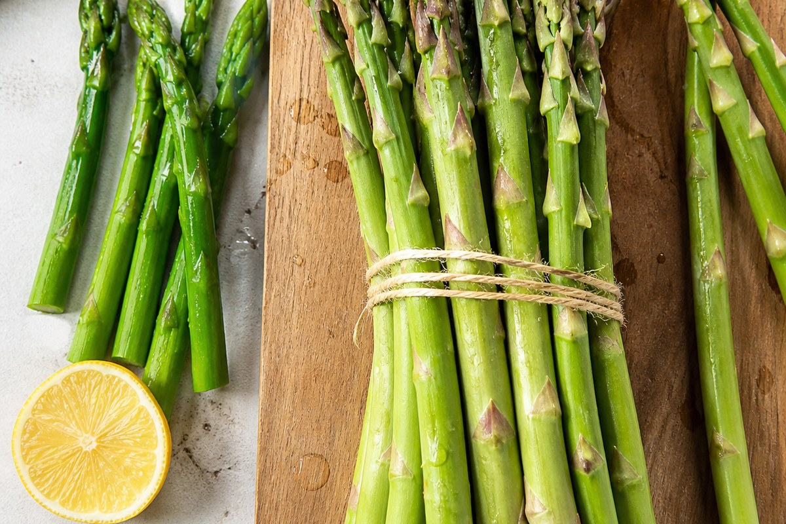

*▲ Raw asparagus supplies 20 calories, 2.2 g protein, 52 µg folate and 2.1 g fiber per 100 g. Five to six spears make a 20-calorie serving that carries 13% of the daily folate requirement and one of the highest glutathione contents of any vegetable.*

Quick answer <strong>Asparagus provides 20 calories, 2.2 g protein, 52 µg folate and 2.1 g fiber per 100 g, with 41.6 µg vitamin K.</strong> Five to six spears (about 100 g) are only 20 calories, making it one of the most volumizing vegetables per calorie. Its prebiotic fructans feed gut bacteria, but cooking for more than two minutes destroys up to half its vitamin C and a third of its glutathione.

Asparagus season peaks from April through June, with imports filling the rest of the year. Nutritionally it is unusual among vegetables for its protein share—2.2 g per 100 g is 44% of its total calories—and for combining folate, vitamin K, glutathione and prebiotic fructans in one low-energy package.

The questions people bring are consistent: **is the calorie count really that low**, **why does it change urine odor**, and **does the inulin actually act as a prebiotic**. The answers: yes at 20 kcal per 100 g, the odor comes from sulfur-containing metabolites of asparagine and is harmless, and the fructans do feed beneficial bacteria—but they also explain why people with IBS react to asparagus.

---

## 1. Asparagus Calories and Nutrition (20 kcal per 100 g)

Values below describe **raw asparagus with the woody base trimmed**. Boiled asparagus measures 22 kcal per 100 g because it absorbs water, but the portion on your plate is smaller than the raw weight you started with.

| Nutrient | Per 100 g Raw | U.S. %DV |
| :--- | :--- | :--- |
| **Energy** | 20 kcal | 1.0% |
| **Water** | 93.22 g | See note¹ |
| **Carbohydrates** | 3.88 g | 1.4% |
| - Total Sugars | 1.88 g | See note¹ |
| - Dietary Fiber | 2.10 g | 7.5% |
| - Fructans (inulin-type) | 2.0–3.0 g | See note¹ |
| **Protein** | 2.20 g | 4.4% |
| **Total Fat** | 0.12 g | 0.2% |
| - Cholesterol | 0.00 mg | 0.0% |
| **Folate** | 52 µg DFE | 13.0% |
| **Vitamin K** | 41.6 µg | 34.7% |
| **Vitamin C** | 5.60 mg | 6.2% |
| **Vitamin A (RAE)** | 38 µg | 4.2% |
| **Potassium** | 202 mg | 4.3% |
| **Iron** | 2.14 mg | 11.9% |
| **Calcium** | 24 mg | 1.8% |
| **Magnesium** | 14 mg | 3.3% |
| **Glutathione** | 13–20 mg | No DV |
| **Asparagine** | 200–400 mg | No DV |
| **Sodium** | 2 mg | 0.1% |

**How to read the table:** energy, carbohydrate, protein, fat and sodium percentages use U.S. Daily Values for a 2,000 kcal diet; vitamins and minerals use adult RDAs or AIs. ¹Water, total sugars, fructans, glutathione and asparagine have no Daily Value, so absolute amounts are shown.

<strong>Sources:</strong> <a href="https://fdc.nal.usda.gov/" rel="nofollow noopener" target="_blank">USDA FoodData Central</a> · Korean National Standard Food Composition Table (K-FIND) · <a href="https://pubmed.ncbi.nlm.nih.gov/" rel="nofollow noopener" target="_blank">PubMed literature</a>

### Real-world portions

| Portion | Weight | Calories and key nutrients |
| :--- | :--- | :--- |
| 1 medium spear | ~16 g | 3.2 kcal |
| 1 serving, 5–6 spears | ~100 g | **20 kcal** · 52 µg folate · 2.2 g protein |
| 1 bunch | 250 g | 50 kcal · 5.3 g fiber · 130 µg folate |
| 100 g after blanching | from 130 g raw | 22 kcal · vitamin C reduced 30–50% |
| Plus 1 tbsp olive oil | 14 g | +120 kcal (140 kcal total) |

**The calorie trap is the dressing.** Plain asparagus is 20 calories; butter, mayonnaise or a heavy vinaigrette turns the same plate into 150 calories or more. Lemon juice, balsamic vinegar, salt and pepper keep it under 25.

---

## 2. Four Evidence-Based Benefits

### H3. Is the inulin in asparagus a real prebiotic?

Yes. Asparagus carries 2–3 g of fructans per 100 g, which feed bifidobacteria and increase short-chain fatty acid production—while causing gas in people with IBS.

At 2–3 g per 100 g, one serving of asparagus delivers more than half the 3–5 g daily prebiotic dose typically used in studies. Combined with onion, garlic or whole grains, the daily target is easy to reach.

The downside is the FODMAP effect: fructans ferment rapidly and produce gas. People with irritable bowel syndrome may notice bloating and cramping after asparagus. Starting with two or three spears and increasing gradually separates a normal response from a genuine intolerance.

### H3. Does 52 µg of folate matter for pregnancy planning?

Only partly. Asparagus provides 52 µg per 100 g—13% of the 400 µg recommended before and during early pregnancy—so a 300 g serving still reaches only 156 µg. Supplements remain necessary.

Folate is required for DNA synthesis and cell division. Low intake around conception raises the risk of neural tube defects, which is why 400 µg of folic acid daily is recommended for anyone who could become pregnant. Asparagus is a useful food source but cannot substitute: reaching 400 µg from asparagus alone would require nearly 800 g.

For the general population, folate's main job is homocysteine metabolism. Folate, vitamin B6 and B12 convert homocysteine back to methionine; when any is deficient, homocysteine rises and damages vascular endothelium. Asparagus supplies two of the three—folate and vitamin B6.

### H3. What do glutathione and asparagine actually do?

Glutathione is the body's central antioxidant and detoxification molecule, and asparagus ranks among the highest vegetables for it. Asparagine is marketed for fatigue, but the evidence is thin.

Glutathione is a tripeptide used directly to neutralize free radicals and as a substrate for glutathione-S-transferase, a phase II detoxification enzyme. Asparagus delivers 13–20 mg per 100 g, placing it with broccoli and spinach at the top of the vegetable range. Cooking destroys 30–60%, so brief blanching or grilling preserves more than boiling.

Asparagine is a non-essential amino acid present at 200–400 mg per 100 g. In Japan it is used in supplements marketed for fatigue and alcohol metabolism, but human trials are few and small. Treat asparagus as a good vegetable, not a hangover cure.

### H3. Why is asparagus so filling for so few calories?

Water makes up 93% of its weight and fiber adds 2.1 g, while protein accounts for 44% of its calories—an unusual combination that stretches the stomach and slows eating.

---

## 3. Cooking to Preserve Nutrients

- **Blanch for 90–120 seconds.** Beyond two minutes, vitamin C losses pass 50% and folate declines by a third.
- **Steam rather than boil.** Steaming keeps water-soluble vitamins out of the cooking water and preserves 15–25% more folate and vitamin C than boiling.
- **Trim the base, keep the skin.** The peel holds fiber and asparagine; only the woody bottom 2–3 cm needs removing. For thick spears, peel just the lowest few centimeters.

---

## 4. Cautions and Side Effects

- **Urine odor:** asparagine breaks down into methanethiol and dimethyl sulfide. It is harmless and unrelated to kidney function. The ability to smell it depends on the OR2M7 receptor gene, so some people never notice. Drinking water dilutes it.
- **Irritable bowel syndrome:** fructans are restricted on a low-FODMAP diet. If you bloat, start with 50 g and build up.
- **Gout:** asparagus is moderate in purines (around 50 mg per 100 g). Plant purines carry a weaker association with flares than meat and seafood, but limiting intake during an acute flare is reasonable.
- **Kidney stones:** oxalate content is moderate. With a history of calcium oxalate stones, keep to 100 g a day and maintain fluid intake.
- **Warfarin:** at 41.6 µg vitamin K per 100 g, asparagus is lower than spinach, but abrupt increases can shift the INR. Keep the weekly amount steady.

---

## 5. Frequently Asked Questions

**Q1. How much asparagus can I eat a day?**  
One hundred to two hundred grams (5–10 spears) is a sensible range, providing 20–40 kcal, 52–104 µg folate and 2.1–4.2 g fiber. For prebiotic benefit, 100 g or more is better; with IBS or a history of kidney stones, stay at or below 100 g.

**Q2. Is asparagus urine odor a health problem?**  
No. It is a normal result of asparagine breaking down into sulfur-containing compounds and has nothing to do with kidney function. The ability to detect the odor is genetic, and drinking water makes it fainter.

**Q3. Can asparagus be eaten raw?**  
Thin spears can, though the cell walls are tough and oxalate and saponins may irritate a sensitive stomach. Blanching for 90–120 seconds or grilling for three to four minutes preserves most nutrients while making it easier to digest.

---

## 6. Synergistic Food Pairings

- **[Spinach](/en/posts/spinach-nutrition-benefits/):** spinach folate (146 µg per 100 g) plus asparagus folate approaches 200 µg in one meal. Both are oxalate sources, so people with stone history should avoid stacking large portions.
- **[Egg](/en/posts/egg-nutrition-benefits/):** egg provides complete protein and choline, which work with asparagus folate on homocysteine metabolism. An asparagus and egg scramble delivers 14 g of protein for under 250 calories.
- **[Broccoli](/en/posts/broccoli-nutrition-benefits/):** broccoli sulforaphane activates phase II detoxification enzymes while asparagus glutathione supplies the substrate those enzymes consume—two steps of the same pathway.
- **[Salmon](/en/posts/salmon-nutrition-benefits/):** asparagus vitamin K and carotenoids are fat-soluble, so salmon's omega-3 fat improves absorption when the two are roasted together on one tray.

  
📌 Related rankings

  <ul>
    <li><a href="/en/posts/low-calorie-high-satiety-foods/">Top 10 Low-Calorie High-Satiety Foods per 100 g</a></li>
    <li><a href="/en/posts/liver-immunity-fatigue-recovery-foods/">Top 10 Foods for Liver, Immunity and Fatigue Recovery</a></li>
    <li><a href="/en/posts/antioxidant-anti-aging-foods-guide/">Top 10 Antioxidant Foods: Vitamin C and Polyphenol Comparison</a></li>
  </ul>

---

## 7. Bottom Line

- **Folate and vitamin K:** 52 µg folate (13% DV) and 41.6 µg vitamin K per 100 g; pregnancy still requires a supplement.
- **Prebiotics:** 2–3 g fructans feed bifidobacteria, but they are the reason IBS sufferers bloat.
- **Glutathione:** 13–20 mg per 100 g, one of the highest vegetable sources, with 30–60% lost to cooking.
- **Cooking:** two-minute blanch or steam, fat added after cooking, and lemon instead of butter to keep the plate under 25 calories.

