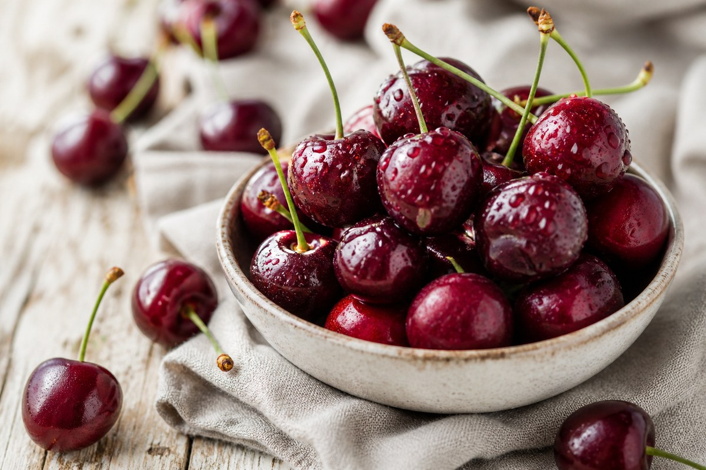

*▲ Sweet cherries provide 63 calories, 2.1 g fiber and 222 mg potassium per 100 g. A one-cup serving (154 g with pits) is 97 calories and delivers 20–60 mg of anthocyanins, the pigments behind most of the fruit's research interest.*

Quick answer <strong>Sweet cherries contain 63 calories, 12.8 g sugar and 2.1 g fiber per 100 g, with a glycemic index of 22–46; one cup (about 21 cherries) is 97 calories.</strong> Observational data link cherry intake to a 35% lower risk of gout flares, while sleep trials show objective improvements only. The melatonin in a serving is about 0.13 µg—one-ten-thousandth of a supplement dose—so the effect comes from more than melatonin alone.

Cherry season runs from May through July in Korea and the United States, with frozen tart cherries and juice concentrate available year-round. What distinguishes cherries nutritionally is not vitamin C (7 mg per 100 g is modest) but their **anthocyanin density**—the highest among common temperate fruits—and the clinical literature built around it.

The three recurring questions are **whether cherries help you sleep**, **whether they help gout**, and **how many cherries a day are reasonable**. The evidence supports a nuanced answer: gout flare reduction has the strongest observational backing, serum urate does not fall, and sleep benefits appear in objective measures such as total sleep time and efficiency rather than in how people say they feel.

---

## 1. Cherry Calories and Nutrition (63 kcal per 100 g)

Values are for **raw sweet cherries, weighed with pits**. Roughly 15% of the weight is pit and stem, so a level cup (154 g) provides about 130 g of edible fruit.

| Nutrient | Per 100 g Raw | U.S. %DV |
| :--- | :--- | :--- |
| **Energy** | 63 kcal | 3.2% |
| **Water** | 82.25 g | See note¹ |
| **Carbohydrates** | 16.01 g | 5.8% |
| - Total Sugars | 12.82 g | See note¹ |
| - Dietary Fiber | 2.10 g | 7.5% |
| **Protein** | 1.06 g | 2.1% |
| **Total Fat** | 0.20 g | 0.3% |
| - Cholesterol | 0.00 mg | 0.0% |
| **Vitamin C** | 7.00 mg | 7.8% |
| **Vitamin A (RAE)** | 3 µg | 0.3% |
| **Potassium** | 222 mg | 4.7% |
| **Calcium** | 13 mg | 1.0% |
| **Magnesium** | 11 mg | 2.6% |
| **Iron** | 0.36 mg | 2.0% |
| **Total anthocyanins** | 20–60 mg | No DV |
| **Melatonin** | 0.10–0.14 µg | No DV |
| **Tryptophan** | 9 mg | No DV |
| **Sodium** | 0 mg | 0.0% |

**How to read the table:** energy, carbohydrate, protein, fat and sodium percentages follow U.S. Daily Values for a 2,000 kcal diet; vitamins and minerals use adult RDAs or AIs. ¹Water, total sugars, anthocyanins, melatonin and tryptophan have no Daily Value, so absolute amounts are shown. Keep the melatonin figure in perspective: 0.13 µg is roughly one-fiftieth-thousandth of a 0.5–5 mg sleep supplement. Anthocyanin content varies more than threefold by cultivar, with deep red Bing and Lapins types at the high end.

*※ Source: [USDA FoodData Central FDC 171719](https://fdc.nal.usda.gov/food-details/171719/nutrients) — Cherries, sweet, raw (SR Legacy). The 63 kcal and 1.06 g protein per 100 g in the table above are this entry’s values; a different cooking state changes them.*

<strong>Sources:</strong> <a href="https://fdc.nal.usda.gov/" rel="nofollow noopener" target="_blank">USDA FoodData Central</a> · Korean National Standard Food Composition Table (K-FIND) · <a href="https://pubmed.ncbi.nlm.nih.gov/" rel="nofollow noopener" target="_blank">PubMed literature</a>

### Real-world portions

| Portion | Weight | Calories and key nutrients |
| :--- | :--- | :--- |
| 1 cherry | ~7 g | 4.4 kcal |
| 10 cherries | ~70 g | 44 kcal · 9 g sugar |
| 1 cup (~21 cherries) | 154 g | **97 kcal** · 3.2 g fiber · 342 mg potassium |
| 30 ml tart cherry concentrate | ~90 g fruit equivalent | 100–120 kcal · anthocyanins concentrated |
| 240 ml cherry juice | ~90 g fruit | 110–130 kcal · fiber largely lost |

Ten cherries at 44 calories make an easy snack. Juice and concentrate are where the sugar arrives without the fiber that normally slows absorption.

---

## 2. Four Evidence-Based Benefits

### H3. Do cherries actually help you sleep?

Objective measures improve; subjective sleep quality does not consistently change. The melatonin dose is too small to explain the effect, so treat cherries as a habit aid rather than a sleep aid.

Tart cherries (Montmorency) contain about 13 ng of melatonin per gram—0.13 µg per 100 g—which is one to two orders of magnitude below supplement doses. A 2023 systematic review and meta-analysis of eight trials found that cherry intake significantly increased **objective sleep efficiency (effect size 0.63) and total sleep time (1.21)**, while subjectively reported sleep efficiency and duration showed no significant change.

The proposed mechanisms extend beyond melatonin: cherry intake raises urinary melatonin metabolites, reduces tryptophan degradation (making more tryptophan available for serotonin and melatonin synthesis), and modulates somnogenic cytokines including IL-1β and TNF-α.

### H3. Is cherry effective for gout?

Observational evidence is consistent: cherry intake is associated with about 35% fewer gout flares. But serum urate does not fall, so cherries complement urate-lowering therapy rather than replacing it.

A large case-crossover study of gout patients published in *Arthritis & Rheumatism* found that cherry intake over two days was associated with a **35% lower risk of acute flare (odds ratio 0.65)**, and cherry extract use with a 75% lower risk. Anthocyanins inhibit xanthine oxidase and reduce inflammatory cytokine production in laboratory models—plausible mechanisms for fewer flares without lower urate.

Two randomized trials temper that: a 2019 study in *Rheumatology* found no effect of tart cherry concentrate at any dose (7.5–30 ml twice daily for 28 days) on serum urate or urinary urate excretion, and a 2023 randomized trial in 282 men with gout found no difference in urate lowering but **fewer flares, lower CRP and a better urine albumin-to-creatinine ratio** in the cherry group starting febuxostat.

### H3. Do anthocyanins reduce inflammation and muscle soreness?

Small trials show lower soreness and creatine kinase after strenuous exercise. The effect is a modest head start on recovery, not a performance enhancer.

Cherry anthocyanins—mainly cyanidin-3-rutinoside and cyanidin-3-glucoside—inhibit cyclooxygenase-2 activity and lower oxidative stress markers in endothelial cells. In trials of marathon and cycling recovery, tart cherry juice before and after eccentric exercise reduced perceived soreness and blunted the rise in creatine kinase compared with placebo.

### H3. What do the potassium and fiber in cherries contribute?

One cup supplies 342 mg potassium and 3.2 g fiber, supporting sodium balance and bowel regularity alongside the anthocyanins.

---

## 3. Preparation and Absorption Tips

---

## 4. Cautions and Side Effects

- **Fructose load:** a cup of cherries carries about 20 g of sugar with a high fructose fraction. People with IBS or fructose malabsorption may notice bloating and loose stools; 10 cherries is a safer trial dose.
- **Chronic kidney disease:** potassium at 222 mg per 100 g is high for a fruit. If you are on potassium restriction, keep servings to 10 cherries.
- **Diabetes:** the glycemic index of 22–46 is low, but a full cup still carries 20 g of sugar. Ten to fifteen cherries (44–66 kcal) per sitting is the sensible pattern.
- **Anticoagulant and antiplatelet medication:** cherry anthocyanins inhibit platelet aggregation in vitro. Avoid large daily intakes if you take warfarin, clopidogrel or DOACs, and reduce intake before surgery.

---

## 5. Frequently Asked Questions

**Q1. How many cherries should I eat a day?**  
Fifteen to twenty cherries—one cup or less, 70–97 kcal—suits most adults. Because a cup carries 13–20 g of sugar, people with diabetes should cap intake at 10 cherries (44 kcal) and eat them after a meal. For sleep, 10–15 cherries one to two hours before bed matches trial protocols.

**Q2. Is cherry juice as good as whole cherries?**  
No. A 240 ml glass contains the sugar of about 90 g of fruit with almost none of the fiber, so glucose rises faster. Tart cherry concentrate used in sleep and gout trials is a practical alternative when eating 100 g of fresh fruit twice daily is unrealistic—dilute 30 ml in water.

**Q3. Do cherries raise blood sugar?**  
Their glycemic index of 22–46 is low, so the rise is gradual. But a full cup carries close to 20 g of sugar, and juice on an empty stomach will spike glucose faster than whole fruit. Ten to fifteen cherries as a post-meal dessert is the most stable pattern.

---

## 6. Synergistic Food Pairings

- **[Blueberry](/en/posts/blueberry-nutrition-benefits/):** blueberry anthocyanins and cherry cyanidins act through different antioxidant pathways; a frozen berry mix covers more ground per bowl than either alone.
- **[Kiwi](/en/posts/kiwi-nutrition-benefits/):** kiwi's 92.7 mg vitamin C per 100 g fills the water-soluble antioxidant gap that cherries leave. One kiwi plus ten cherries is a pre-bed snack under 100 calories.
- **[Spinach](/en/posts/spinach-nutrition-benefits/):** spinach magnesium (79 mg per 100 g) and cherry potassium support muscle relaxation and blood pressure together; a spinach salad with cherries is the classic pairing.
- **[Tofu](/en/posts/tofu-nutrition-benefits/):** cherry tryptophan crosses into the brain more efficiently when eaten with other protein, and tofu supplies the amino acid mix for serotonin and melatonin synthesis.

  
📌 Related rankings

  <ul>
    <li><a href="/en/posts/antioxidant-anti-aging-foods-guide/">Top 10 Antioxidant Foods: Vitamin C and Polyphenol Comparison</a></li>
    <li><a href="/en/posts/low-gi-foods-blood-sugar-guide/">Top 10 Low-Glycemic Foods: GI and GL Ranking Table</a></li>
    <li><a href="/en/posts/liver-immunity-fatigue-recovery-foods/">Top 10 Foods for Liver, Immunity and Fatigue Recovery</a></li>
  </ul>

---

## 7. Bottom Line

- **Calories:** 63 kcal per 100 g, 97 kcal per cup, 44 kcal per 10 cherries—one of the easiest fruits to fit into a deficit.
- **Sleep:** objective sleep efficiency and total sleep time improve in pooled trials; the melatonin dose (0.13 µg) is too small to be the mechanism on its own.
- **Gout:** cherry intake is linked to 35% fewer flares, but urate does not fall. Keep urate-lowering medication.
- **Anthocyanins:** 20–60 mg per 100 g with credible anti-inflammatory and recovery evidence at small scale.
- **Cautions:** fructose, potassium, platelet effects with anticoagulants, and pesticide residue—rinse well and keep portions moderate.

