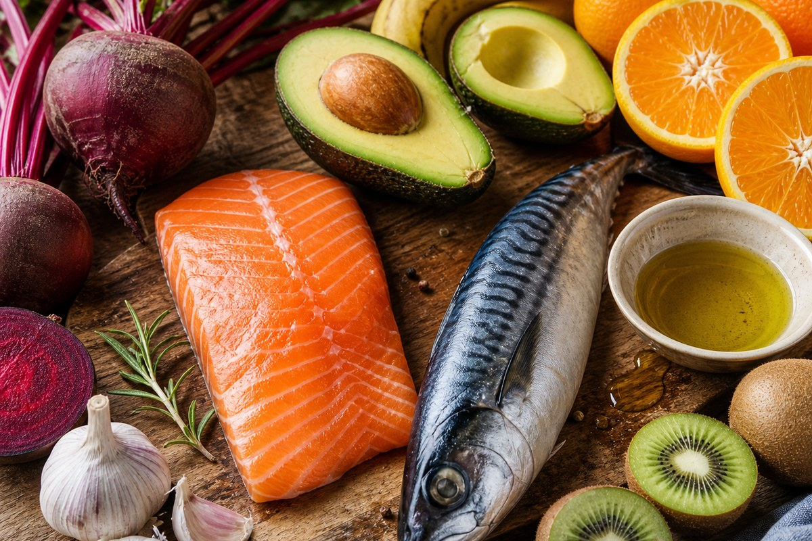

*▲ Heart health is managed through three routes rather than one food: nitrate for vessel dilation, potassium to excrete sodium, and omega-3 for triglycerides and inflammation.*

Quick answer Blood pressure responds most to beetroot (150–250 mg nitrate) and garlic (1,000–1,500 mg alliin), while triglycerides respond to mackerel (2,299 mg EPA plus DHA) and salmon (2,150 mg). Potassium comes from avocado (485 mg) and banana (358 mg), and cutting sodium below 2,000 mg a day matters more than any single addition.

Blood pressure and cholesterol are not separate problems. When the vessel lining is damaged, LDL cholesterol penetrates it and forms plaque, narrowing the artery and raising pressure. Cardiovascular guidelines therefore target the whole eating pattern, most famously DASH, built on vegetables, fruit, whole grains and lean protein.

That pattern works through three routes.

1. **Nitrate to nitric oxide (NO):** relaxes blood vessels and lowers pressure. Highest in beetroot and spinach.
2. **Potassium against sodium:** blocks sodium reabsorption in the kidney. Highest in avocado, banana and kiwi.
3. **Omega-3 against triglycerides and inflammation:** EPA and DHA lower triglycerides and calm platelet aggregation. Highest in mackerel and salmon.

The ranking below places ten ingredients already covered on this site into those three routes using USDA data. If you take blood pressure medication, remember that food supports treatment and never replaces it.

---

## 1. Which foods support blood pressure and heart health?

| Food | Heart-related compounds (per 100 g) | How to eat it |
| :--- | :--- | :--- |
| **1. Beetroot** | 150–250 mg dietary nitrate, 128.7 mg betaine | Steam or juice raw; keep juice under 200 ml |
| **2. Garlic** | 1,000–1,500 mg total alliin, 14.2 mcg selenium | Crush and rest 10 minutes to form allicin; 1–2 cloves raw |
| **3. Spinach** | About 250 mg nitrate, 558 mg potassium, folate | Blanch and dress without salt; watch vitamin K |
| **4. Mackerel** | 898 mg EPA plus 1,401 mg DHA | Grill twice a week, season with lemon and herbs |
| **5. Salmon** | About 2,150 mg EPA plus DHA, 36.5 mcg selenium | Cooked is safer than raw; smoked adds sodium |
| **6. Avocado** | 485 mg potassium, monounsaturated fat, 6.7 g fiber | Half a fruit in salads, as a swap for saturated fat |
| **7. Banana** | 358 mg potassium, 2.6 g fiber | One a day; check potassium limits in kidney disease |
| **8. Orange** | 28.5 mg hesperidin, 53.2 mg vitamin C | Eat whole rather than juiced for endothelial benefit |
| **9. Kiwi** | 312 mg potassium, 92.7 mg vitamin C | One or two a day; keep steady on anticoagulants |
| **10. Tofu** | Isoflavones, 350 mg calcium, 121 mg potassium | Swap in for animal protein; multiple LDL trials |

## 2. How does each route lower blood pressure?

- **Nitrate (beetroot, spinach):** oral bacteria convert nitrate to nitrite, which the vessel lining turns into nitric oxide, relaxing the artery. Small trials show systolic pressure dropping for hours after beetroot juice. Antibacterial mouthwash can blunt this pathway.
- **Potassium (avocado, banana, kiwi):** potassium opposes sodium and lowers pressure. The American Heart Association suggests 3,500–5,000 mg a day for adults, but reduced kidney function makes high potassium dangerous, so confirm first.
- **Omega-3 (mackerel, salmon):** EPA and DHA reduce triglyceride synthesis in the liver and calm platelet aggregation and inflammation. For prevention, 250–500 mg of EPA plus DHA a day is the usual target, which one 100 g serving of mackerel covers.

## 3. Which foods lower cholesterol?

- **Soluble fiber traps bile acids.** Oats, legumes and apple pectin bind bile acids for excretion, and the liver spends cholesterol rebuilding them, which pulls LDL down.
- **Replacing saturated fat comes first.** Swapping butter, pork belly and processed meat for avocado, nuts and olive oil lowers LDL reliably. Substitution beats addition.
- **Soy protein (tofu) and plant protein:** meta-analyses show soy protein lowering LDL modestly. The larger benefit is that it delivers protein with little saturated fat.
- **Eggs are not automatically harmful.** Many studies find one egg a day does not meaningfully raise cholesterol in healthy adults. With diabetes or high cholesterol, judge it alongside total fat intake.

## 4. Why does cooking method matter?

| Food | Best method | Avoid |
| :--- | :--- | :--- |
| Beetroot | Steaming, fresh juice | Sweet pickled beetroot |
| Garlic | Crush raw, rest 10 minutes | Frying until burnt |
| Spinach | Blanch and dress | Long boiling in broth (potassium loss) |
| Mackerel, salmon | Grill or steam | Salted braise, smoked (sodium) |
| Avocado | Raw in salad | Blended with mayonnaise |

Sodium should stay under 2,000 mg a day (about 5 g salt). Broths, pickles and processed meat supply most of it, so halving soy sauce in cooking does more than adding a new superfood.

## 5. What should you watch out for?

- **Do not stop medication for food.** Beetroot and garlic are supporting measures. Never stop or reduce prescribed drugs on your own, and tell your doctor about diet changes.
- **Potassium-sparing diuretics and kidney disease require caution.** Avocado, banana, spinach and kiwi carry 300–560 mg of potassium per 100 g, which can be unsafe when potassium is restricted.
- **Keep vitamin K steady on anticoagulants.** Spinach and kale affect INR, so keep portions consistent rather than spiking intake.
- **Fish oil plus aspirin may raise bleeding risk.** Discuss high-dose omega-3 supplements with your doctor if you take antiplatelet drugs.

## 6. Related ingredient guides

- **[Beetroot](/en/posts/beetroot-nutrition-benefits/)** — 43 kcal with 150–250 mg nitrate and betaine.
- **[Garlic](/en/posts/garlic-nutrition-benefits/)** — 149 kcal with alliin and 14.2 mcg selenium.
- **[Spinach](/en/posts/spinach-nutrition-benefits/)** — 23 kcal with 250 mg nitrate and 558 mg potassium.
- **[Mackerel](/en/posts/mackerel-nutrition-benefits/)** — 205 kcal with 898 mg EPA and 1,401 mg DHA.
- **[Salmon](/en/posts/salmon-nutrition-benefits/)** — 208 kcal with 2,150 mg omega-3.
- **[Avocado](/en/posts/avocado-nutrition-benefits/)** — 160 kcal with 485 mg potassium and oleic acid.
- **[Banana](/en/posts/banana-nutrition-benefits/)** — 89 kcal with 358 mg potassium.
- **[Orange](/en/posts/orange-nutrition-benefits/)** — 47 kcal with 28.5 mg hesperidin.
- **[Kiwi](/en/posts/kiwi-nutrition-benefits/)** — 61 kcal with 312 mg potassium and 92.7 mg vitamin C.
- **[Tofu](/en/posts/tofu-nutrition-benefits/)** — 76 kcal with isoflavones and 350 mg calcium.

## 7. Frequently asked questions

**Q1. Which food lowers blood pressure fastest?**
Beetroot (nitrate) and garlic (alliin) have the strongest evidence. The effect is a few mmHg with wide individual variation, so cutting sodium and managing weight come first.

**Q2. Mackerel or salmon: which is better?**
Total omega-3 is slightly higher in mackerel (2,299 mg) than salmon (2,150 mg), while salmon leads on vitamin D (11 mcg) and selenium. Alternate oily fish twice a week and either choice works.

**Q3. Should I stop eating eggs if my cholesterol is high?**
For most people one egg a day is not a problem. Cutting saturated fat from pork belly, butter and processed meat and reducing total calories affects LDL more. If your numbers are high, set portions with your doctor.

