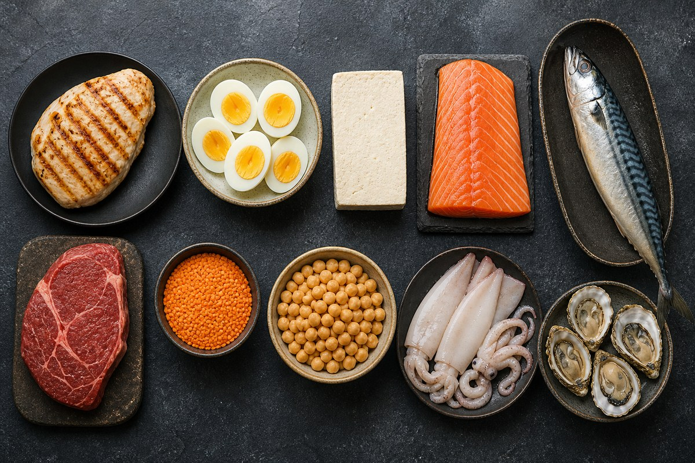

*▲ Protein content looks different depending on whether you measure per 100 g of food or per 100 kcal. Chicken breast delivers 23.1 g per 100 g, or 21.0 g per 100 kcal.*

Quick answer Dry red lentils top the list by weight at 24.6 g of protein per 100 g, followed by chicken breast at 23.1 g. Per 100 kcal, chicken breast (21.0 g), squid and shrimp lead, and the highest digestibility scores (PDCAAS 0.9–1.0) belong to eggs, poultry, fish and soy.

Adults need roughly 0.91 g of protein per kilogram of body weight per day (Korean DRIs, 2020). For a 60 kg adult that is about 55 g, and people who train with weights often aim for 1.2–1.6 g/kg (72–96 g).

The problem is that "high-protein food" lists mix their bases. Some quote raw meat per 100 g, others cooked meat per 100 g, and still others dried legumes per 100 g. When the bases are mixed, dry lentils appear to beat beef, even though what reaches your plate is soaked and boiled beans weighing two and a half times more.

This guide puts the USDA FoodData Central figures used across this site into one table and ranks ten foods three ways: protein per 100 g of food, protein per 100 kcal, and digestibility (PDCAAS). Every value states whether it refers to a raw, cooked or dry basis, and no cell is left blank.

---

## 1. Which foods contain the most protein? (Top 10 per 100 g)

| Food (per 100 g, basis stated) | Protein | Protein per 100 kcal |
| :--- | :--- | :--- |
| **1. Red lentils (dry)** | 24.63 g | 7.0 g |
| **2. Chicken breast (raw)** | 23.10 g | 21.0 g |
| **3. Salmon (raw)** | 20.40 g | 9.8 g |
| **4. Beef sirloin (raw)** | 20.30 g | 10.1 g |
| **5. Mackerel (raw)** | 18.60 g | 9.1 g |
| **6. Squid (raw)** | 15.60 g | 17.0 g |
| **7. Egg (whole, raw)** | 12.56 g | 8.8 g |
| **8. Chickpeas (boiled)** | 8.86 g | 5.4 g |
| **9. Tofu (firm, raw)** | 8.08 g | 10.6 g |
| **10. Oysters (raw)** | 7.13 g | 10.5 g |

Basis: lentils are **dry raw weight**; everything else is raw or the cooked state noted in brackets.

## 2. How to read this table: why the lentil ranking is misleading

- **Dry legumes roughly double and a half in weight when cooked.** Soaked and boiled lentils weigh 2.3–2.5 times their dry weight, which drops protein density to about 9–10 g per 100 g of cooked lentils. A 100 g spoonful of cooked lentils delivers less than half the protein of 100 g of chicken breast.
- **Per 100 kcal the order changes.** Chicken breast 21.0 g, squid 17.0 g, tofu 10.6 g, oysters 10.5 g and beef 10.1 g lead. If you are cutting calories and protecting muscle at the same time, this column is the practical one.
- **Fat content decides density.** Salmon (208 kcal) and sirloin (201 kcal) carry the same 20 g of protein, but much of their energy is fat, so the same protein dose costs nearly twice the calories of chicken breast (110 kcal).
- **Count eggs by the piece.** One 50 g egg holds about 6.3 g of protein. The per-100 g number looks modest, but people eat two or three at a sitting, so the real contribution is large.

## 3. Which protein is absorbed best? (PDCAAS)

Content matters less than how much of it your body actually absorbs and uses for muscle. The PDCAAS score used by the FAO combines the essential amino acid pattern with true digestibility, with 1.00 as the maximum.

| Food | PDCAAS reference range | Absorption notes |
| :--- | :--- | :--- |
| Egg | 1.00 (reference protein) | Ideal amino acid pattern, digestibility preserved by cooking |
| Chicken breast, beef | 0.92–1.00 | Rich in leucine, strong trigger for muscle protein synthesis |
| Salmon, mackerel, squid, oysters | 0.90–1.00 | Little connective tissue, fast digestion, high amino acid score |
| Tofu (soy protein) | 0.90–1.00 | The only plant protein close to 1.00 |
| Chickpeas | 0.71–0.78 | Enough lysine, but limiting in methionine |
| Lentils | 0.52–0.63 | Methionine is limiting; combine with grains to fill the gap |

PDCAAS scores single foods. Pairing legumes with grains (rice, barley, bread) supplies the missing amino acids and lifts the combined score, which is why lentil rice and chickpea grain bowls work so well.

## 4. How do you reach 30 g of protein per meal?

| Combination | What it contains | Total protein |
| :--- | :--- | :--- |
| Muscle recovery | Chicken breast 100 g + 1 egg | 29.4 g |
| Mediterranean | Salmon 100 g + tofu 50 g | 24.4 g |
| Plant-based | Cooked lentils 150 g + tofu 100 g | 22.4 g |
| Quick fix | 3 eggs + oysters 100 g | 44.8 g |

A typical adult target is 20–30 g per meal. These figures assume the dish is eaten with rice or vegetables and use raw weights, so cooking losses are not counted.

## 5. What should you watch when eating more protein?

- **Kidney disease changes the calculation.** People with chronic kidney disease may need to limit total protein because waste products are harder to clear. The figures here are references for healthy adults.
- **Keep red and processed meat in moderation.** Sirloin brings zinc and heme iron, but processed meats add sodium and saturated fat. Two to three servings of 100 g a week is a reasonable ceiling.
- **Always cook legumes.** Raw lentils and chickpeas contain enzyme inhibitors and phytates. Soak, then simmer lentils for 15–20 minutes and chickpeas for 40–60 minutes after soaking.
- **Spread intake across the day.** Muscle protein synthesis responds best to 20–40 g per meal, so three balanced meals beat one large protein dinner.

## 6. Related ingredient guides

- **[Chicken breast](/en/posts/chicken-breast-nutrition-benefits/)** — 23.1 g protein per 100 g with under 1.5 g fat.
- **[Chicken thigh](/en/posts/chicken-thigh-nutrition-benefits/)** — 119 kcal and 19.7 g protein skinless, with 2.5 times the iron of breast.
- **[Salmon](/en/posts/salmon-nutrition-benefits/)** — 20.4 g protein plus 2,150 mg omega-3 per 100 g.
- **[Beef sirloin](/en/posts/beef-sirloin-nutrition-benefits/)** — 1.48 mg heme iron and 3.55 mg zinc.
- **[Mackerel](/en/posts/mackerel-nutrition-benefits/)** — 898 mg EPA and 1,401 mg DHA per 100 g.
- **[Egg](/en/posts/egg-nutrition-benefits/)** — the PDCAAS 1.00 reference protein.
- **[Tofu](/en/posts/tofu-nutrition-benefits/)** — 8.1 g plant protein with 350 mg calcium.
- **[Lentils](/en/posts/lentil-nutrition-benefits/)** — 24.6 g protein per 100 g dry, GI 32.
- **[Chickpeas](/en/posts/chickpea-nutrition-benefits/)** — 8.9 g protein and 7.6 g fiber per 100 g boiled.
- **[Squid](/en/posts/squid-nutrition-benefits/)** — 15.6 g protein at 92 kcal, 17.0 g per 100 kcal.
- **[Oysters](/en/posts/oyster-nutrition-benefits/)** — 7.1 g protein with 16.6 mg zinc.
- **[Natto](/en/posts/natto-nutrition-benefits/):** 17.72 g of protein per 100 g, or 8.9 g in a 50 g pack, ranks among the top plant proteins.
- **[Laver](/en/posts/laver-nutrition-benefits/):** dried laver delivers 38.5 g protein per 100 g, the highest density by weight on this list.

## 7. Frequently asked questions

**Q1. If I pick only one high-protein food, which should it be?**
By weight, dry lentils (24.6 g per 100 g); for real meals, chicken breast (23.1 g per 100 g). Counting calories, chicken breast and squid win.

**Q2. Can plant protein alone meet my daily target?**
Yes, but you need more volume. Legumes and tofu score 0.6–1.0 on PDCAAS, so less of the protein is retained. Tofu 200 g plus cooked lentils 150 g plus chickpeas 100 g reaches roughly 45 g.

**Q3. How many eggs a day are safe?**
Healthy adults commonly eat one or two a day, and two or three if they train with weights. If you have diabetes, high cholesterol or elevated LDL, discuss total fat intake with your doctor.

