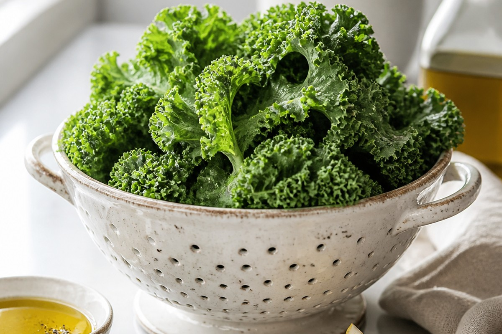

*▲ Raw kale delivers 389.6 mcg of vitamin K, 93.4 mg of vitamin C, and 6,261 mcg of lutein + zeaxanthin per 100 g for just 35 kcal. Massaging or cooking kale with olive oil unlocks its fat-soluble carotenoids.*

Quick answer <strong>Raw kale provides 35 calories, 389.6 mcg vitamin K and 93.4 mg vitamin C per 100 g.</strong> That vitamin K is more than four times the daily target, so warfarin users need a consistent intake rather than avoidance.

Cold weather makes **kale (*Brassica oleracea* var. *sabellica*)** sweeter—frost triggers the plant to convert stored starches into natural sugars, softening the bitter edge of its ruffled dark leaves. Among cruciferous greens, few vegetables rival kale's ratio of micronutrients to calories.

Two practical questions drive most kitchen decisions with kale: **"Should I blend it raw or steam it?"** and **"Does kale cause kidney stones like spinach?"** On the first, raw or lightly massaged kale preserves heat-sensitive vitamin C and myrosinase (the enzyme behind sulforaphane), whereas light steaming (2–3 minutes) with olive oil improves bile-acid binding and carotenoid bioaccessibility. On the second, unlike spinach, **kale is a genuinely low-oxalate green** (roughly 10–20 mg per 100 g), making its calcium far more bioavailable.

Drawing on USDA FoodData Central analytical profiles, below is the 100 g breakdown, four evidence-backed health benefits, simple preparation steps to tame tough stems, and clear guidance on warfarin and thyroid health.

---

## 1. How Many Calories Are in Kale? (389.6 mcg vitamin K, 254 mg calcium per 100 g)

The figures below reflect **raw green kale leaves (*Brassica oleracea*) per 100 g**. Even a 50 g salad portion supplies well over 100% of the daily vitamin K requirement and substantial lutein.

| Nutrient | Per 100 g Raw | U.S. %DV |
| :--- | :--- | :--- |
| **Energy** | 35 kcal | 1.8% |
| **Water** | 89.63 g | See note¹ |
| **Carbohydrates** | 4.42 g | 1.6% |
| - Total Sugars | 0.99 g | See note¹ |
| - Dietary Fiber | 4.10 g | 14.6% |
| **Protein** | 2.92 g | 5.8% |
| **Total Fat** | 1.49 g | 1.9% |
| - Saturated Fat | 0.18 g | 0.9% |
| - Cholesterol | 0.00 mg | 0.0% |
| **Vitamin K** | 389.60 mcg | 324.7% |
| **Vitamin C** | 93.40 mg | 103.8% |
| **Vitamin A (RAE)** | 241.00 mcg | 26.8% |
| **Folate (DFE)** | 62.00 mcg | 15.5% |
| **Vitamin B6** | 0.15 mg | 8.8% |
| **Calcium** | 254.00 mg | 19.5% |
| **Manganese** | 0.92 mg | 40.0% |
| **Potassium** | 348.00 mg | 7.4% |
| **Iron** | 1.60 mg | 8.9% |
| **Magnesium** | 33.00 mg | 7.9% |
| **Sodium** | 53.00 mg | 2.3% |
| **Lutein + Zeaxanthin** | 6,261.00 mcg | No DV |
| **Oxalic Acid** | ~10–20 mg | No DV |

*¹ Water and total sugars carry no U.S. Daily Value (%DV); intrinsic sugars inside intact plant cell walls behave differently from added sugars.*

### How to Read the Table: Bioavailable Calcium Without the Oxalate Trap
Raw kale provides **254 mg of calcium per 100 g** alongside just **10–20 mg of oxalic acid**—roughly thirty times lower than spinach (600–970 mg). Because oxalate does not lock up kale's calcium in the gut, human absorption studies show kale's calcium bioavailability rivals or slightly exceeds cow's milk (~30–40%).

---

## 2. What Are the Benefits of Kale? Four Evidence-Backed Effects

### ① Macular Protection from 6,261 mcg Lutein & Zeaxanthin
Kale ranks near the very top of common vegetables for **lutein and zeaxanthin**. These macular carotenoids filter high-energy blue light in the retina and quench photo-oxidative stress, supporting long-term visual contrast and macular health.

### ② Exceptional Vitamin K for Clotting Balance and Bone Matrix
At **389.6 mcg per 100 g** (325% U.S. DV), kale is an extraordinary source of vitamin K1 (phylloquinone). Beyond hepatic clotting factors, vitamin K activates **osteocalcin**, the bone-building protein that binds calcium into mineralized bone matrix.

### ③ Cruciferous Glucosinolates & Sulforaphane Defense
Chopping or chewing raw kale brings glucosinolates into contact with the enzyme myrosinase, yielding **isothiocyanates such as sulforaphane and indole-3-carbinol**, which upregulate Phase II cellular detoxification and antioxidant defense pathways.

### ④ Bile-Acid Binding & Lipid Support
Experimental digestion assays show that kale fiber and protein fractions bind bile acids in the intestinal lumen—and **light steaming actually increases bile-acid binding capacity** compared with raw leaves (Kahlon et al., 2008), supporting healthy cholesterol turnover.

---

## 3. Raw Kale Juice or Steamed Kale? What Changes

- **De-Stem & Massage with Olive Oil:** Strip the tough central rib from the leaves, chop, and **massage for 1–2 minutes with a teaspoon of extra-virgin olive oil, lemon juice, and a pinch of salt**. This breaks down the waxy cuticle, eliminates bitterness, and supplies the lipid needed to absorb lutein and vitamin K.
- **Keep Heat Brief (2–3 Minutes):** Prolonged boiling leaches water-soluble vitamin C (93.4 mg) and folate into the cooking water. **Light steaming for 2–3 minutes or a quick 30–60 second sauté** softens tough fibers while keeping most micronutrients intact.
- **Smoothie Pairing Rule:** If blending raw kale into a green smoothie, include a fat source such as **avocado, chia seeds, or almond butter** so fat-soluble carotenoids are actually absorbed.

---

## 4. Kale Cautions: Thyroid, Oxalate and Warfarin

- **Warfarin (Coumadin) Consistency:** Because kale is extraordinarily rich in vitamin K (389.6 mcg/100 g), sudden spikes or drops in kale intake can alter INR stability on warfarin. Patients on vitamin K antagonists do not necessarily have to ban kale, but must **keep daily vitamin K intake consistent** under clinician guidance.
- **Raw Kale & Thyroid Goitrogens:** Cruciferous vegetables contain glucosinolate-derived compounds that can compete with iodine uptake **if consumed raw in massive quantities daily** alongside iodine deficiency. Moderate portions—especially lightly steamed or sautéed—pose no issue for most people, though those with hypothyroidism should avoid extreme daily raw-kale juicing.
- **Potassium & Advanced Kidney Disease:** While kale is low-oxalate, 100 g still carries **348 mg of potassium**. Individuals on strict renal potassium restrictions should moderate portions or leach potassium via blanching.

---

## 5. Frequently Asked Questions (FAQ)

**Q1. Is kale healthier raw or cooked?**  
Both have strengths: raw kale massaged with olive oil maximizes vitamin C and active myrosinase for sulforaphane, whereas lightly steaming kale for 2–3 minutes with oil softens fiber, reduces potential goitrogenic activity, and enhances bile-acid binding and carotenoid release.

**Q2. Is kale high in oxalates like spinach?**  
No. Spinach averages 600–970 mg of oxalates per 100 g, whereas kale contains only about 10–20 mg. Kale is a low-oxalate leafy green whose calcium is highly absorbable and far gentler for people prone to calcium oxalate kidney stones.

**Q3. Do you have to remove kale stems?**  
For raw salads, yes—removing the thick central rib dramatically improves texture. Rather than discarding the stems, dice them finely and sauté them with garlic and onions or simmer them in soup stock.

---

## 6. What Foods Pair Best with Kale?

- **[Avocado](/en/posts/avocado-nutrition-benefits/):** Avocado's monounsaturated fats dramatically boost intestinal micelle formation and absorption of kale's 6,261 mcg lutein + zeaxanthin and vitamin K.
- **[Spinach](/en/posts/spinach-nutrition-benefits/):** Blanching kale with spinach puts vitamin K, folate and lutein from two leafy greens on one plate.
- **[Orange](/en/posts/orange-nutrition-benefits/):** Citrus vitamin C and citric acid enhance absorption of kale's plant-based non-heme iron (1.60 mg/100 g) while brightening its earthy flavor.

---

## 7. Kale per Day: How Much Do You Need?

- Per 100 g raw, kale packs **389.6 mcg vitamin K, 93.4 mg vitamin C, 254 mg bioavailable calcium, and 6,261 mcg lutein + zeaxanthin** for just **35 kcal**.
- Unlike spinach, kale is **low in oxalates (~10–20 mg/100 g)**, making it a safer green for calcium absorption and kidney-stone prevention.
- Always pair kale with a healthy fat such as **olive oil or avocado**—whether massaged raw or steamed for 2–3 minutes—to unlock its fat-soluble nutrients.

  
📌 Related ranking guide

  <ul>
    <li><a href="/en/posts/antioxidant-anti-aging-foods-guide/">Top 10 Antioxidant Foods for Anti-Aging: Polyphenol List</a></li>
    <li><a href="/en/posts/low-calorie-high-satiety-foods/">Top 10 Low-Calorie High-Satiety Foods: 100g Calories</a></li>
  </ul>

