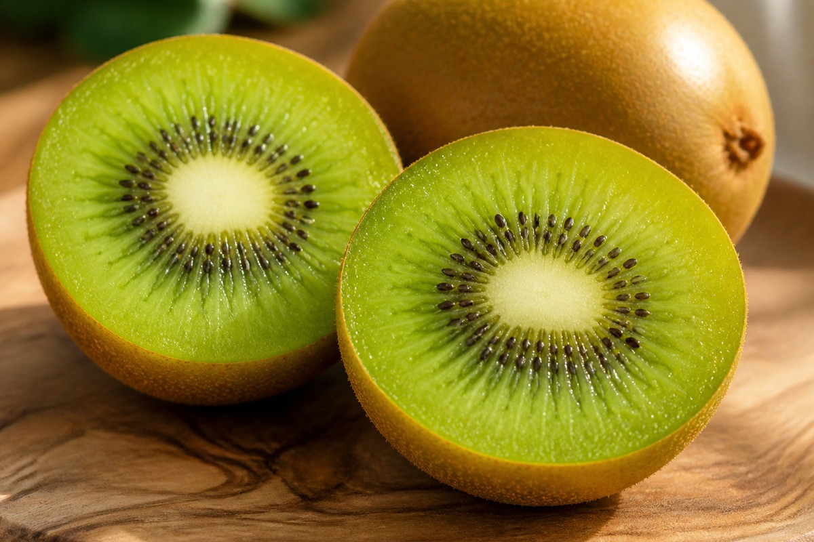

*▲ Raw green kiwifruit delivers 92.7 mg of vitamin C per 100 g (103% of the U.S. Daily Value), while gold kiwi reaches 161.3 mg. Eating the washed skin raises total fiber and polyphenol intake substantially.*

Quick answer <strong>Raw green kiwi provides 61 calories, 92.7 mg vitamin C and 3.0 g fiber per 100 g.</strong> A trial of two kiwis a day increased bowel movements, and its actinidin enzyme helps break down protein after a meat-heavy meal.

Peak harvest from November through late winter makes **kiwifruit (*Actinidia deliciosa* and *Actinidia chinensis*)** one of the highest nutrient-density fruits in the produce aisle. Gram for gram, a single green kiwi packs more vitamin C than an orange alongside **actinidin**, a natural proteolytic enzyme rarely found in common table fruits.

Choosing between **green (Hayward) and gold (SunGold) kiwi** depends on your goal. Green kiwi carries roughly double the dietary fiber (3.0 g vs 1.4 g per 100 g) and far more actinidin, making it the clear winner for bowel regularity and protein digestion. Gold kiwi, meanwhile, delivers **161.3 mg of vitamin C per 100 g**—about 1.7 times the concentration of green kiwi—with a sweeter, less acidic profile.

Using USDA FoodData Central analytical profiles and randomized clinical trials, this guide breaks down the 100 g nutrition table, four evidence-backed physiological benefits, how to eat the skin safely, and who needs to watch for oral allergy syndrome or potassium intake.

---

## 1. How Many Calories Are in Kiwi? (92.7 mg vitamin C, 3.0 g fiber per 100 g)

The values below reflect **raw green kiwifruit (edible flesh, *Actinidia deliciosa*)**. For comparison, **gold kiwifruit** provides 63 kcal, 161.3 mg vitamin C (179% DV), and 1.4 g dietary fiber per 100 g.

| Nutrient | Per 100 g Raw | U.S. %DV |
| :--- | :--- | :--- |
| **Energy** | 61 kcal | 3.1% |
| **Water** | 83.07 g | See note¹ |
| **Carbohydrates** | 14.66 g | 5.3% |
| - Total Sugars | 8.99 g | See note¹ |
| - Dietary Fiber | 3.00 g | 10.7% |
| **Protein** | 1.14 g | 2.3% |
| **Total Fat** | 0.52 g | 0.7% |
| - Saturated Fat | 0.03 g | 0.2% |
| - Cholesterol | 0.00 mg | 0.0% |
| **Vitamin C** | 92.70 mg | 103.0% |
| **Vitamin K** | 40.30 mcg | 33.6% |
| **Vitamin E (Alpha-Tocopherol)** | 1.46 mg | 9.7% |
| **Folate (DFE)** | 25.00 mcg | 6.3% |
| **Vitamin B6** | 0.06 mg | 3.5% |
| **Potassium** | 312.00 mg | 6.6% |
| **Copper** | 0.13 mg | 14.4% |
| **Magnesium** | 17.00 mg | 4.0% |
| **Calcium** | 34.00 mg | 2.6% |
| **Iron** | 0.31 mg | 1.7% |
| **Sodium** | 3.00 mg | 0.1% |
| **Lutein + Zeaxanthin** | 122.00 mcg | No DV |
| **Actinidin** | Proteolytic enzyme | No DV |

*¹ Water and total sugars have no established U.S. Daily Value (%DV) on standard nutrition labels; federal dietary guidelines advise keeping added sugars below 10% of daily calories, whereas kiwi's sugars are intrinsic to whole-fruit cell walls.*

### How to Read the Table: Green vs. Gold Kiwi
- **Green Kiwi (Hayward):** Higher insoluble/soluble fiber (3.0 g/100 g) and high **actinidin** activity make it superior for constipation relief, post-meal protein digestion, and gentler glycemic response (GI ~39–47).
- **Gold Kiwi (SunGold):** At **161.3 mg vitamin C per 100 g**, one medium gold kiwi easily exceeds an adult's entire daily vitamin C requirement while offering lower acidity for sensitive mouths.

---

## 2. What Are the Benefits of Kiwi? Four Evidence-Backed Effects

### ① Chronic Constipation: Two Green Kiwis a Day Outperform Psyllium in Trials
In an international multicenter randomized controlled trial of 184 adults with functional constipation or constipation-predominant IBS (*American Journal of Gastroenterology*, Gearry et al., 2023), eating **two peeled green kiwifruits daily for 4 weeks** increased complete spontaneous bowel movements by **1.53 to 1.73 per week**—matching or outperforming 7.5 g of psyllium husk while causing noticeably less bloating and abdominal discomfort. Kiwi cell-wall fiber swells to roughly 3–4 times its dry volume in water, softening stool naturally.

### ② Actinidin Enzyme Support for Protein Digestion
**Actinidin** is a cysteine protease native to green kiwifruit that remains active across stomach pH ranges. Consuming a green kiwi alongside meat, eggs, or dairy meals accelerates gastric breakdown of tough dietary proteins and eases post-meal heaviness.

### ③ Dual Water- and Fat-Soluble Antioxidant Network
Kiwifruit pairs **92.7 mg of vitamin C** with **1.46 mg of vitamin E** per 100 g—an uncommon combination in low-fat fruits. Vitamin C regenerates oxidized vitamin E and converts plant-based non-heme iron into its more absorbable ferrous state during digestion.

### ④ Evening Kiwi Intake and Sleep Quality Research
Kiwis naturally contain **serotonin precursors** and folate. A small 4-week intervention trial (Lin et al., 2011) in adults with self-reported sleep disturbances found shorter sleep onset latency and improved sleep efficiency when participants ate two kiwis one hour before bedtime; larger blinded trials are still needed, so view it as supportive rather than a primary sleep therapy.

---

## 3. Can You Eat Kiwi Skin? Actinidin and Washing

- **Eating the Skin Boosts Fiber by Up to ~50%:** Gold kiwis have smooth, nearly hairless skin that can be rinsed and eaten whole. For green kiwis, **rub the fuzzy skin under cool running water with a soft produce brush or clean cloth** and slice thinly—retaining the skin adds substantial insoluble fiber and polyphenols.
- **Ripening Tip:** Firm, unripe kiwis soften in **2–3 days at room temperature inside a paper bag with an apple or banana**, which releases natural ethylene gas. Refrigerate once they yield gently to thumb pressure.
- **Dairy & Gelatin Timing:** Because actinidin digests milk proteins and gelatin, mixing kiwi into yogurt or milk ahead of time creates bitter peptides and prevents gelatin from setting. Add fresh kiwi **right before serving**.

---

## 4. Who Should Avoid Kiwi? Side Effects and Cautions

- **Oral Allergy Syndrome (OAS) & Latex Cross-Reactivity:** Tingling, itching, or burning of the lips and tongue can stem from actinidin, calcium oxalate raphides, or true IgE allergy (Act d 1). People allergic to **natural rubber latex, bananas, or avocados** carry a higher risk of cross-reactivity.
- **Warfarin Consistency:** Green kiwi provides **40.3 mcg of vitamin K per 100 g**. Patients taking warfarin do not need to avoid kiwi altogether, but should keep daily intake steady rather than swinging sharply.
- **Potassium & Kidney Stones:** With 312 mg of potassium per 100 g and modest oxalates concentrated near the seeds and skin, individuals with advanced chronic kidney disease or recurrent calcium oxalate stones should moderate portions and stay hydrated.

---

## 5. Frequently Asked Questions (FAQ)

**Q1. Is green or gold kiwi better for constipation?**  
Green kiwi is substantially better. It contains more than twice as much dietary fiber (3.0 g vs. 1.4 g per 100 g) and higher levels of the digestive enzyme actinidin, which is why clinical constipation trials specifically use two green kiwis daily.

**Q2. Why does kiwi sometimes make my tongue or mouth tingle?**  
A mild prickly sensation is usually caused by kiwi's actinidin enzyme, fruit acids, and microscopic calcium oxalate crystals irritating oral mucosa. If tingling progresses to lip swelling, hives, or throat tightness, stop eating it immediately as that indicates a true food allergy.

**Q3. Is it safe to eat kiwi skin?**  
Yes. Washed kiwi skin is completely edible and boosts fiber, folate, and antioxidant intake. Smooth-skinned gold kiwis are easiest to eat whole; for fuzzy green kiwis, gently scrubbing the fuzz off under running water before slicing makes the texture pleasant.

---

## 6. What Foods Pair Best with Kiwi?

- **[Spinach](/en/posts/spinach-nutrition-benefits/):** Pairing kiwi's abundant vitamin C with spinach's plant-based non-heme iron noticeably improves iron bioavailability in salads and smoothies.
- **[Strawberries](/en/posts/strawberry-nutrition-benefits/):** Slicing kiwi with strawberries doubles the vitamin C on the plate while keeping the dessert low in calories.
- **[Avocado](/en/posts/avocado-nutrition-benefits/):** Avocado's monounsaturated fats and vitamin E complement kiwi's vitamin C and lutein, creating a balanced water- and lipid-soluble antioxidant meal.
- **[Persimmon](/en/posts/persimmon-nutrition-benefits/):** kiwi has the stronger evidence for regularity, while persimmon leads on vitamin A and soluble fiber.
- **[Cherry](/en/posts/cherry-nutrition-benefits/):** one kiwi plus ten cherries makes a pre-bed snack under 100 calories.

---

## 7. Kiwi per Day: How Much Do You Need?

- Pick **gold kiwi** when maximizing **vitamin C (161.3 mg/100 g)**; pick **green kiwi** for **bowel regularity (3.0 g fiber) and protein digestion (actinidin)**.
- For constipation support, **two green kiwis a day** with adequate water for 2–4 weeks mirrors the protocol validated in clinical trials.
- Wash and eat the skin—especially on gold kiwis—to capture extra fiber and polyphenols effortlessly.

  
📌 Related ranking guide

  <ul>
    <li><a href="/en/posts/low-calorie-high-satiety-foods/">Top 10 Low-Calorie High-Satiety Foods: 100g Calories</a></li>
    <li><a href="/en/posts/heart-blood-pressure-cholesterol-foods/">Top 10 Foods for Blood Pressure, Cholesterol & Heart</a></li>
  </ul>

