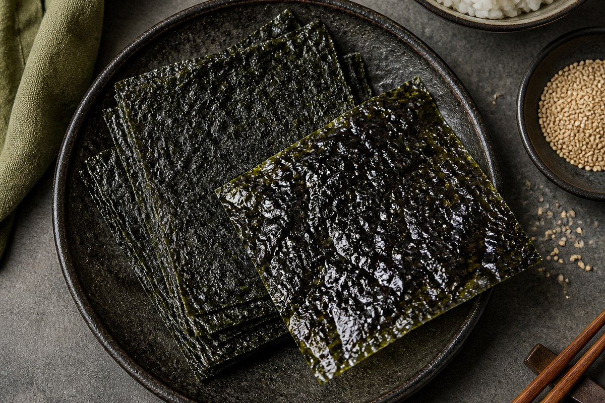

*▲ Dried laver delivers 202 calories, 38.5 g protein, 45.6 g fiber and 2,655 mg potassium per 100 g. One full sheet weighs about 2 g and carries only 4 calories—but five sheets supply 3.9 g protein, comparable to one egg.*

Quick answer <strong>Dried laver contains 202 calories, 38.5 g protein, 45.6 g fiber and 148 mg vitamin C per 100 g, while a single 2 g sheet is only 4 calories.</strong> Its nutrient density per gram is among the highest of any food, and five sheets match an egg for protein. The catch is iodine at 1,000–3,000 µg per 100 g, so two to five sheets a day keeps thyroid risk low while 100 g would exceed the tolerable upper limit.

Laver—*Porphyra* and *Pyropia* species, sold as gim in Korea and nori in Japan—is the seaweed most people eat without thinking about it: wrapped around rice, floated in soup, crumbled over vegetables. Its nutrition labels are spectacular per 100 g and almost meaningless per bite, which is why both the health claims and the iodine warnings need sizing to actual portions.

The questions readers bring are consistent: **is laver really that low in calories**, **does eating a lot of it harm the thyroid**, and **is seasoned nori worse than plain**. The answers: a sheet is 4 calories and five sheets are 20, the iodine question is real but depends on how many sheets you eat, and seasoned nori carries 17 times the fat and 1.4 times the sodium of plain dried laver.

---

## 1. Laver Nutrition: 202 Calories and 38.5 g Protein per 100 g

Values below describe **dried laver (gim for gimbap), edible portion**. Because a sheet weighs about 2 g, per-100 g figures overstate any single serving. The portion table below converts them to what people actually eat.

| Nutrient | Per 100 g Dried | U.S. %DV |
| :--- | :--- | :--- |
| **Energy** | 202 kcal | 10.1% |
| **Water** | 6.0 g | See note¹ |
| **Carbohydrates** | 46.2 g | 16.8% |
| - Total Sugars | 0.0 g | 0.0% |
| - Dietary Fiber | 45.6 g | 162.9% |
| **Protein** | 38.5 g | 77.0% |
| **Total Fat** | 2.82 g | 3.6% |
| - Saturated Fat | 0.83 g | 4.2% |
| - Cholesterol | 0.00 mg | 0.0% |
| **Vitamin C** | 148 mg | 164% |
| **Vitamin A (RAE)** | 1,100 µg | 122% |
| **Vitamin B12** | 2–5 µg | 83–208% |
| **Iron** | 8.48 mg | 47.1% |
| **Calcium** | 184 mg | 14.2% |
| **Potassium** | 2,655 mg | 56.5% |
| **Iodine** | 1,000–3,000 µg | See note¹ |
| **Sodium** | 903 mg | 39.3% |
| **Taurine** | 1,200–1,500 mg | No DV |

**How to read the table:** energy, carbohydrate, protein, fat and sodium percentages use U.S. Daily Values for a 2,000 kcal diet; vitamins and minerals use adult RDAs or AIs. ¹Water and iodine have no Daily Value, so absolute amounts are shown. **Iodine is the number to watch:** 100 g of laver can exceed the 1,100 µg tolerable upper intake level for U.S. adults several times over, but a 2 g sheet carries only 20–60 µg against a 150 µg daily requirement.

*※ Data basis: the figures follow the Korean national seafood composition table and the MFDS food nutrient database for dried laver (gim for gimbap). USDA FoodData Central has no dried-laver entry — only raw laver (FDC 168458, 35 kcal and 5.81 g protein per 100 g) — so that entry is not cited as the source of these numbers.*

<strong>Sources:</strong> <a href="https://fdc.nal.usda.gov/" rel="nofollow noopener" target="_blank">USDA FoodData Central</a> · Korean National Standard Food Composition Table (K-FIND) · <a href="https://pubmed.ncbi.nlm.nih.gov/" rel="nofollow noopener" target="_blank">PubMed literature</a>

### Real-world portions

| Portion | Weight | Calories and key nutrients |
| :--- | :--- | :--- |
| 1 full sheet | ~2 g | **4 kcal** · 0.8 g protein · 0.9 g fiber |
| 5 sheets | ~10 g | **20 kcal** · 3.9 g protein · 0.85 mg iron |
| 10 sheets | ~20 g | 40 kcal · 200–600 µg iodine |
| 1 snack pack of seasoned nori | 4–5 g | 25–30 kcal · 50–80 mg sodium · 2 g fat |
| 100 g seasoned nori | 100 g | 500–600 kcal · 49 g fat · 1,299 mg sodium |

**Seasoned nori is a different food.** Plain dried laver carries 2.82 g fat per 100 g; oil-brushed seasoned nori carries 49.2 g—17 times more—with sodium rising from 903 mg to 1,299 mg. Buying plain sheets and toasting them with a teaspoon of sesame oil per ten sheets keeps both numbers low.

---

## 2. Four Evidence-Based Benefits

### H3. Do five sheets of laver really match an egg for protein?

Almost. Five sheets (10 g) provide 3.9 g protein against 6.3 g in one large egg, but gram for gram laver holds three times the protein of egg.

### H3. Does eating a lot of laver harm the thyroid?

It depends on the amount. One to five sheets supply 20–300 µg iodine, well within safe limits; 100 g would exceed the upper limit. With thyroid disease, keep to two or three sheets.

Iodine is the raw material for thyroid hormones T3 and T4. The adult requirement is 150 µg a day and the tolerable upper intake level is 1,100 µg in the United States and 2,400 µg in Korea. Laver at 1,000–3,000 µg per 100 g is lower than kelp or wakame but still concentrated.

Two situations warrant care. **Autoimmune thyroid disease** such as Hashimoto's thyroiditis can worsen with excess iodine, and **Graves' disease** treatment often requires iodine restriction. In both cases, one or two sheets a day and limited seaweed soup is the safer pattern.

### H3. Is the 148 mg of vitamin C in laver actually usable?

Partly. Five sheets deliver about 15 mg, and toasting destroys another 30–50%. Treat laver as an iron-absorption helper rather than a vitamin C source.

At realistic intakes the number shrinks: five sheets give 14.8 mg, or 15% of the daily requirement. Toasting over a flame or in a dry pan destroys a further third to half.

### H3. What do the fiber, iron and potassium actually contribute?

Five sheets provide 4.5 g fiber, 0.85 mg iron and 265 mg potassium—making fiber the strongest practical contribution, at roughly 18% of the daily target.

Potassium is 2,655 mg per 100 g by weight but only 265 mg per five sheets—less than one banana. Sodium rises in parallel at 903 mg per 100 g, so laver is not a free food for blood pressure management.

---

## 3. Buying, Toasting and Storing

- **Buy plain sheets and toast them yourself.** Ten seconds per side in a dry pan over low heat, then brush with a quarter teaspoon of sesame oil: the aroma returns while fat and sodium stay a fifth of the seasoned product.
- **Never toast longer than 15–20 seconds per side.** Laver scorches at around 200 °C and turns bitter within seconds; pull it as soon as the color deepens and it crisps.
- **Use plain laver for gimbap and rice balls.** Seasoned sheets absorb moisture from rice, go limp and turn rancid faster.
- **Crumble instead of salting.** Crushed laver over soup or vegetables adds glutamate and taurine umami, letting you cut added salt without losing flavor.

---

## 4. Cautions and Side Effects

- **Iodine excess:** with Hashimoto's, Graves' disease or thyroid nodules, keep to two or three sheets a day and discuss iodine intake with your clinician. Pregnancy raises iodine needs but not the upper limit.
- **Sodium:** plain laver carries 903 mg per 100 g and seasoned laver 1,299 mg. For hypertension, choose plain sheets and stay within five a day.
- **Rancidity:** oil-brushed nori oxidizes quickly. Finish an opened pack within two to three weeks and discard it if it smells fishy or paint-like.
- **Mold:** white spots may be salt crystals or mold. If the sheet smells musty or feels damp, discard it.

---

## 5. Frequently Asked Questions

**Q1. How many sheets of laver can I eat a day?**  
Two to five sheets (4–20 kcal) suits healthy adults, supplying 20–300 µg iodine and 2–4.5 g fiber. With thyroid disease, stay at two or three sheets, and limit seasoned snack packs to one a day because of sodium.

**Q2. Is seasoned nori worse than plain dried laver?**  
Yes for fat and sodium. Plain laver has 2.82 g fat and 903 mg sodium per 100 g; seasoned nori has 49.2 g fat and 1,299 mg sodium. One 4–5 g snack pack is only 25–30 kcal, but eating several packs adds sodium quickly.

**Q3. Does the iodine in laver raise thyroid cancer risk?**  
At usual intakes of two to five sheets a day, no causal link between iodine intake and thyroid cancer has been established. Excess iodine can aggravate autoimmune thyroid disease, so people with those conditions should avoid large amounts and keep regular checkups.

---

## 6. Synergistic Food Pairings

- **[Egg](/en/posts/egg-nutrition-benefits/):** egg protein (6.3 g each) plus laver protein and iron makes a gimbap or omelet roll a 12 g protein dish, and egg yolk fat improves absorption of laver's fat-soluble vitamins.
- **[Spinach](/en/posts/spinach-nutrition-benefits/):** spinach non-heme iron (2.71 mg per 100 g) plus laver iron, with laver's vitamin C assisting absorption, is the logic behind seasoning spinach salad with crushed laver.
- **[Natto](/en/posts/natto-nutrition-benefits/):** natto protein and vitamin K2 with laver iodine and iron make natto gimbap a balanced roll; people with thyroid disease should moderate the laver.
- **[Tofu](/en/posts/tofu-nutrition-benefits/):** tofu calcium (74 mg per 100 g) with laver calcium and magnesium supports bone health, and crumbled laver over braised tofu adds umami without extra salt.

  
📌 Related rankings

  <ul>
    <li><a href="/en/posts/low-calorie-high-satiety-foods/">Top 10 Low-Calorie High-Satiety Foods per 100 g</a></li>
    <li><a href="/en/posts/high-protein-foods-ranking/">Top 10 High-Protein Foods per 100 g</a></li>
    <li><a href="/en/posts/heart-blood-pressure-cholesterol-foods/">Top 10 Foods for Blood Pressure and Cholesterol</a></li>
  </ul>

---

## 7. Bottom Line

- **Protein density:** 38.5 g per 100 g, three times egg by weight, rich in lysine to complement rice.
- **Iodine:** 1,000–3,000 µg per 100 g. Two to five sheets a day is safe; thyroid disease calls for two or three.
- **Vitamin C:** the 148 mg per 100 g figure shrinks to about 15 mg in five sheets, and toasting removes more.
- **Plain beats seasoned:** 17 times less fat and lower sodium, with better texture in rice dishes.

