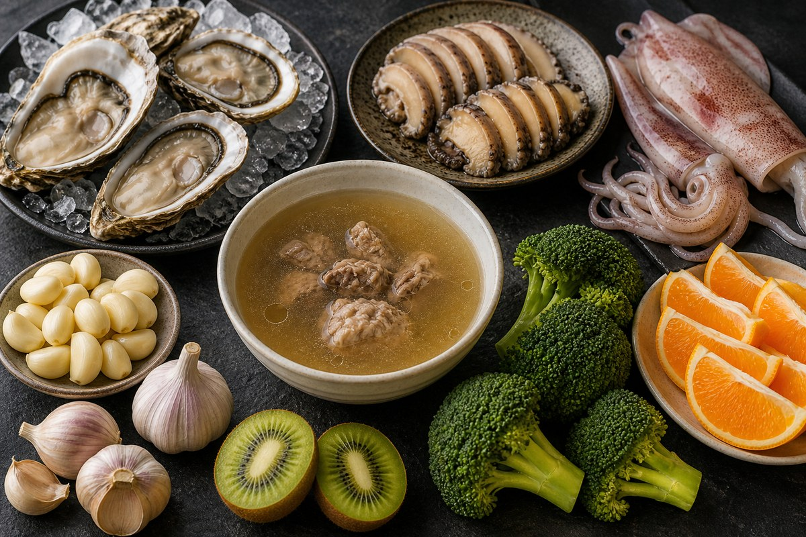

*▲ Three nutrient groups drive fatigue recovery: zinc and selenium for immunity, vitamin C and folate for cell repair, and taurine and glycine for liver metabolism and nerve calming.*

Quick answer Zinc is dominated by oysters at 16.6 mg per 100 g, about 166% of the adult male requirement. Vitamin C peaks in kale (93.4 mg), kiwi (92.7 mg) and broccoli (89.2 mg), while taurine from squid and abalone and glycine from bone broth support liver metabolism.

Fatigue rarely has a single cause. It comes from too little sleep, from low iron or vitamin B12, or from lingering inflammation and infection. That is why "energy foods" lists usually mix ingredients that do quite different jobs.

This guide separates three purposes.

1. **Immunity (zinc, selenium):** oysters, abalone, beef and garlic. Zinc supports T-cell maturation and antibody production.
2. **Cell repair (vitamin C, folate, iron):** kale, kiwi, broccoli and orange. Vitamin C drives collagen synthesis and antioxidant defense, folate drives cell division.
3. **Liver metabolism and nerve calming (taurine, glycine):** squid, abalone and bone broth. Taurine supports bile acid conjugation and osmotic balance, while glycine is an inhibitory neurotransmitter.

Figures are per 100 g from USDA FoodData Central. Cooking method strongly affects how much of each nutrient survives.

---

## 1. Which foods help fatigue recovery and immunity?

| Food | Key nutrients (per 100 g) | Fatigue and immunity role |
| :--- | :--- | :--- |
| **1. Oysters** | 16.6 mg zinc, 16 mcg B12, 520 mg taurine | About 166% of the zinc requirement; always cook them |
| **2. Abalone** | 44.8 mcg selenium, 17.1 g protein, taurine | Selenium near a full daily requirement, high protein, low fat |
| **3. Beef sirloin** | 3.55 mg zinc, 1.48 mg heme iron, 20.3 g protein | Heme iron acts directly on iron-deficiency fatigue |
| **4. Kale** | 93.4 mg vitamin C, 389.6 mcg vitamin K, 1.6 mg iron | 93% of the vitamin C target plus antioxidant pigments |
| **5. Kiwi** | 92.7 mg vitamin C, 3.0 g fiber | Fast-absorbing vitamin C with actinidin for digestion |
| **6. Broccoli** | 89.2 mg vitamin C, 63 mcg folate, sulforaphane precursors | Folate is required for cell division and blood formation |
| **7. Orange** | 53.2 mg vitamin C, 28.5 mg hesperidin | Citrus hesperidin supports capillary integrity |
| **8. Garlic** | 1,000–1,500 mg alliin, 14.2 mcg selenium | Antibacterial and antiviral activity; heat reduces allicin |
| **9. Squid** | 450 mg taurine, 15.6 g protein, 1.3 mcg B12 | Supports bile flow at only 92 kcal |
| **10. Bone broth** | 0.45 g glycine, 2.0 g collagen peptides | 17 kcal of fluid and electrolytes; modest protein |

## 2. Which nutrient fixes which kind of fatigue?

- **Iron-deficiency anemia:** fatigue, dizziness and brittle nails. The heme iron in sirloin (1.48 mg) absorbs at 15–25%, far above plant non-heme iron at 2–5%. Adding vitamin C pushes absorption higher.
- **Vitamin B12 deficiency:** common on plant-only diets or after gastric surgery. Oysters (16 mcg), abalone and squid supply it. B12 maintains myelin sheaths and red cell production.
- **Recovery after infection or inflammation:** needs zinc and selenium. One 100 g serving of oysters covers 16.6 mg zinc and 22 mcg selenium together.
- **Poor sleep and stress:** small studies suggest glycine from bone broth may lower core temperature and improve sleep quality, though the evidence is still limited.

## 3. How does zinc support immunity?

- **It is required for T-cell maturation and antibody production.** Deficiency raises infection frequency and slows wound healing. In clinical settings, zinc supplementation shortened diarrheal and pneumonia episodes in children.
- **Daily needs are 10 mg for adult men and 8 mg for women.** One 100 g serving of oysters (16.6 mg) exceeds a full day. The upper limit is 35 mg; chronic excess causes copper deficiency and anemia.
- **Food beats supplements.** High-dose zinc tablets cause nausea and taste changes. Oysters, beef and garlic supply zinc alongside other minerals in balance.
- **Plant zinc absorbs poorly.** Phytates in legumes and grains bind zinc; soaking and fermenting reduce phytates and improve absorption.

## 4. Is bone broth really a recovery food?

- **Its nutrients are water and amino acids.** A 100 ml serving carries 17 kcal, 3.3 g protein and 0.45 g glycine. Collagen peptides are present, but total protein is small.
- **The evidence is limited.** Claims that collagen regenerates joints are inconsistent in human trials. Warm fluid, electrolytes and glycine do help when appetite is poor.
- **Check the sodium.** Commercial bone broths often run 300–600 mg of sodium per 100 ml. Simmering your own lets you control it.
- **It is high in purines.** With gout or elevated uric acid, keep bone broth and rich beef soups to a minimum.

## 5. Which cooking methods preserve these nutrients?

| Food | Best method | Caution |
| :--- | :--- | :--- |
| Oysters | Heat above 85 °C (steam, soup) | Raw oysters carry norovirus and Vibrio risk |
| Broccoli, kale | Blanch 1–3 minutes or steam | Long boiling leaches vitamin C |
| Garlic | Crush and rest 10 minutes before use | Burning in oil destroys allicin |
| Kiwi, orange | Eat raw | Juice loses the fiber |
| Beef | Cook to medium or less | Avoid charred surfaces |

## 6. Related ingredient guides

- **[Oysters](/en/posts/oyster-nutrition-benefits/)** — 68 kcal with 16.6 mg zinc and 520 mg taurine.
- **[Abalone](/en/posts/abalone-nutrition-benefits/)** — 105 kcal with 44.8 mcg selenium and 17.1 g protein.
- **[Beef sirloin](/en/posts/beef-sirloin-nutrition-benefits/)** — 3.55 mg zinc and 1.48 mg heme iron.
- **[Kale](/en/posts/kale-nutrition-benefits/)** — 35 kcal with 93.4 mg vitamin C.
- **[Kiwi](/en/posts/kiwi-nutrition-benefits/)** — 61 kcal with 92.7 mg vitamin C.
- **[Broccoli](/en/posts/broccoli-nutrition-benefits/)** — 34 kcal with 89.2 mg vitamin C and 63 mcg folate.
- **[Orange](/en/posts/orange-nutrition-benefits/)** — 47 kcal with 53.2 mg vitamin C.
- **[Garlic](/en/posts/garlic-nutrition-benefits/)** — 149 kcal with alliin and selenium.
- **[Squid](/en/posts/squid-nutrition-benefits/)** — 92 kcal with 450 mg taurine.
- **[Beef bone broth](/en/posts/beef-bone-broth-nutrition-benefits/)** — 17 kcal with 0.45 g glycine.

## 7. Frequently asked questions

**Q1. Which single food is best for fatigue?**
It depends on the cause. For immunity and zinc, oysters (16.6 mg zinc); for anemic fatigue, beef sirloin (1.48 mg heme iron); for antioxidant and cell repair, kale (93.4 mg vitamin C).

**Q2. How much zinc do I need?**
Adult men need 10 mg a day and women 8 mg, with an upper limit of 35 mg. A single 100 g serving of oysters already exceeds a day's need, so adding a supplement easily overshoots.

**Q3. Should I take large doses of vitamin C when I feel a cold coming?**
Cochrane reviews find little preventive effect in the general population. Some trials report a slightly shorter duration when taken after onset. Meeting the 100 mg daily requirement is enough for most people.

