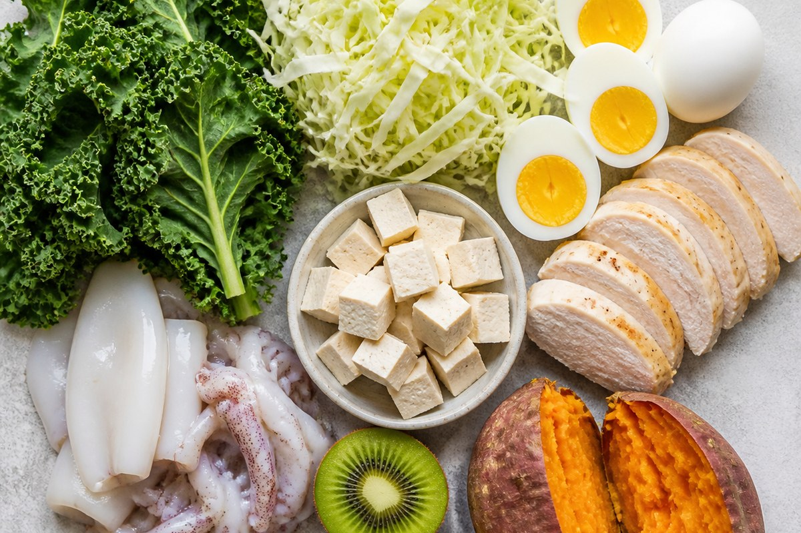

*▲ Satiety comes from volume, water, fiber and protein, not from calories. How much food you can eat per 100 kcal is the real variable in a diet.*

Quick answer Spinach (23 kcal) and cabbage (25 kcal) carry the fewest calories per 100 g, while chicken breast (23.1 g protein at 110 kcal) and eggs keep you full longest per calorie. A 300 kcal meal fits chicken breast 100 g, cabbage 200 g and one kiwi.

Most diets fail because of hunger. Cut calories alone and appetite rebounds within two to three weeks, usually through late-night snacks and sweets. That is why nutrition research now asks how long a given number of calories keeps you full rather than how few you can survive on.

Four things drive satiety: **volume and water**, which stretch the stomach wall; **fiber**, which slows gastric emptying; **protein**, which drives satiety hormone responses; and **slowly digested starch** such as resistant starch. When all four are high, hunger returns late even on a low-calorie plate.

This guide ranks ten low-calorie ingredients already covered on this site by calories per 100 g and explains how each contributes to fullness. All figures come from USDA FoodData Central and reflect raw weight or the stated cooked state.

---

## 1. Which foods are lowest in calories? (Top 10 per 100 g)

| Food (per 100 g) | Calories | What creates satiety |
| :--- | :--- | :--- |
| **1. Spinach** | 23 kcal | About 91% water, 2.2 g fiber, folate |
| **2. Cabbage** | 25 kcal | About 92% water, 2.5 g fiber, vitamin U |
| **3. Broccoli** | 34 kcal | 2.6 g fiber, 2.8 g protein, 89.2 mg vitamin C |
| **4. Kale** | 35 kcal | 4.1 g fiber, among the highest of any vegetable |
| **5. Kiwi** | 61 kcal | 3.0 g fiber, 83% water, actinidin |
| **6. Tofu** | 76 kcal | 8.1 g protein, 350 mg calcium, isoflavones |
| **7. Sweet potato** | 86 kcal | 3.0 g fiber, resistant starch, beta-carotene |
| **8. Squid** | 92 kcal | 15.6 g protein, 1.4 g fat, taurine |
| **9. Chicken breast** | 110 kcal | 23.1 g protein, under 1.5 g fat |
| **10. Egg** | 143 kcal | 12.6 g protein, 9.5 g fat, choline |

Figures are per 100 g raw, except sweet potato and tofu listed as sold. Cooking fat adds substantially, so count oils separately.

## 2. What the Satiety Index shows

A University of Sydney team measured how filling 38 foods were against white bread (set at 100) and found **boiled potato at 323**, fish 225, oatmeal 209, apple 197, beef 176, egg 150 and lentils 133. Croissants (47) and cakes (65) were the least filling per calorie (Holt et al., 1995).

Three lessons follow.

- **Water and volume dominate.** Boiled potato wins because it weighs a lot per 100 kcal. Cabbage, spinach and watermelon work the same way.
- **Protein keeps hunger away longer.** Foods with a high protein share, such as chicken breast, eggs, tofu and squid, blunt hunger three to four hours later. Protein at 20–30% of meal energy performs best in most trials.
- **Liquids fill you less.** The same calories as juice leave you hungry sooner than whole fruit, because chewing and fiber structure generate satiety signals.

## 3. Which cooking methods help a diet?

- **Boil or steam instead of baking.** Roasting sweet potato pushes GI to 80–90 and removes water, raising calories per 100 g. Steaming keeps GI at 45–55 and preserves volume.
- **Oil doubles the calorie count.** One tablespoon (15 g) of cooking oil is about 120 kcal, more than 100 g of chicken breast. Blanch, steam or air-fry, then finish with a small drizzle.
- **Shred cabbage and kale to stretch chewing time.** Bulking up the plate slows eating, and meals lasting over 20 minutes allow satiety signals to arrive.
- **Keep 20–30 g of protein per meal.** Vegetable-only plans last two weeks before muscle loss and appetite rebound. Put chicken breast, eggs or tofu in every meal.

## 4. How do you build a 300 kcal meal?

| Plate | Calories | Protein |
| :--- | :--- | :--- |
| Chicken breast 100 g + cabbage 200 g + 1 kiwi | 110 + 50 + 48 = 208 kcal | 24 g |
| Tofu 150 g + spinach 100 g + 1 egg | 114 + 23 + 72 = 209 kcal | 19 g |
| Squid 100 g + broccoli 150 g + sweet potato 100 g | 92 + 51 + 86 = 229 kcal | 20 g |
| Kale 100 g + 2 eggs + cabbage 150 g | 35 + 143 + 38 = 216 kcal | 27 g |

These plates are side dishes without rice. Adding half a bowl of rice (about 150 kcal) brings a meal to 350–380 kcal.

## 5. What are the traps of a low-calorie diet?

- **Protein shortage is the biggest risk.** Below 1,200 kcal a day with under 50 g of protein, muscle loss, hair shedding and menstrual irregularity can follow. Keep at least 1.0–1.2 g per kilogram of body weight.
- **Too much raw cruciferous vegetable upsets the gut.** More than 500 g a day of raw broccoli and cabbage causes bloating and gas. Blanch or steam, and moderate the amount.
- **Watch sodium in dressings and broths.** A single dressing can add 200 kcal to a low-calorie salad. Swapping to soy, vinegar and mustard cuts that to a third.
- **Do not drive fat to zero.** Fat is needed for hormones and fat-soluble vitamin absorption. Keep roughly 20% of daily calories from fat.

## 6. Related ingredient guides

- **[Spinach](/en/posts/spinach-nutrition-benefits/)** — 23 kcal per 100 g with 91% water, the lowest energy density here.
- **[Cabbage](/en/posts/cabbage-nutrition-benefits/)** — 25 kcal, with vitamin U supporting the stomach lining.
- **[Broccoli](/en/posts/broccoli-nutrition-benefits/)** — 34 kcal with 89.2 mg vitamin C.
- **[Kale](/en/posts/kale-nutrition-benefits/)** — 35 kcal and 4.1 g fiber, the highest among these vegetables.
- **[Kiwi](/en/posts/kiwi-nutrition-benefits/)** — 61 kcal, 3.0 g fiber and 92.7 mg vitamin C.
- **[Tofu](/en/posts/tofu-nutrition-benefits/)** — 76 kcal with 8.1 g protein and 350 mg calcium.
- **[Sweet potato](/en/posts/sweet-potato-nutrition-benefits/)** — 86 kcal with resistant starch and beta-carotene.
- **[Squid](/en/posts/squid-nutrition-benefits/)** — 92 kcal with 15.6 g protein and 1.4 g fat.
- **[Chicken breast](/en/posts/chicken-breast-nutrition-benefits/)** — 110 kcal with 23.1 g protein and under 1.5 g fat.
- **[Egg](/en/posts/egg-nutrition-benefits/)** — 143 kcal with 12.6 g protein and a Satiety Index of 150.
- **[Asparagus](/en/posts/asparagus-nutrition-benefits/):** 20 kcal per 100 g with 93% water puts it at the bottom of this ranking.

## 7. Frequently asked questions

**Q1. Which food has the fewest calories?**
Spinach (23 kcal) and cabbage (25 kcal). Eating only those leaves you short on protein, so pair them with chicken breast, tofu or eggs, which deliver the most protein per calorie.

**Q2. What should I eat first to reduce hunger?**
Start with 100–150 g of cabbage, spinach or broccoli, then the protein, then the carbohydrate. The same calories keep you full longer in that order.

**Q3. Can I eat sweet potato at night?**
Yes. At 86 kcal per 100 g it is lower than rice (about 130 kcal per 100 g) and higher in fiber. Roasted sweet potato raises both GI and calories, so choose steamed portions of 100–150 g.

