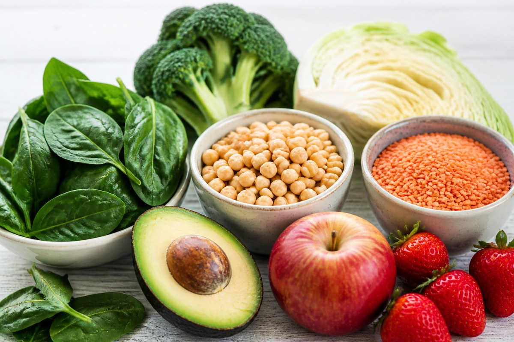

*▲ Low-GI ingredients are mostly high in fiber and water with little starch. The same food can double its GI depending on whether it is baked or boiled.*

Quick answer Spinach, broccoli and avocado raise blood sugar most slowly, but they carry only 3.6–8.5 g of carbohydrate per 100 g and have no measured GI in the international tables. Among foods that actually carry carbohydrates, chickpeas (28–37) and lentils (16–32) rank lowest, while boiled sweet potato (46–63) jumps to 80–90 once roasted.

The glycemic index (GI) compares how fast 50 g of carbohydrate raises blood glucose against pure glucose (100). Anything at or below 55 is low GI, 56–69 is medium and 70 or above is high. It is used for diabetes care, weight management and for reducing post-meal drowsiness.

GI describes speed, not amount. Watermelon scores 72, yet a single slice carries little carbohydrate, so the actual glucose rise stays modest. That is why the glycemic load (GL), which multiplies GI by the carbohydrate in a serving, is read alongside it. The table below lists both.

The ranking uses the international GI database (2008) and USDA nutrient data, applied consistently to ten ingredients already covered on this site. GI shifts with cooking method, variety and ripeness, so read it as a relative order rather than a fixed number.

---

## 1. Which foods raise blood sugar least? (GI and GL chart)

| Food (per 100 g) | GI | GL per 100 g (approx.) |
| :--- | :--- | :--- |
| **1. Spinach** | no measured value¹ | 3.6 g carbohydrate² |
| **2. Broccoli** | no measured value¹ | 6.6 g carbohydrate² |
| **3. Avocado** | no measured value¹ | 8.5 g carbohydrate² |
| **4. Cabbage** | no measured value¹ | 5.8 g carbohydrate² |
| **5. Chickpeas (boiled)** | 28–37 | 7.7–10.1 |
| **6. Lentils (100 g cooked)** | 16–32 | 3.2–6.4 |
| **7. Apple** | 36–44 | 5.0–6.1 |
| **8. Strawberry** | 40 | 3.1 |
| **9. Kiwi (green)** | 39–53 | 5.7–7.8 |
| **10. Sweet potato (boiled)** | 46–63 | 9.3–12.7 |

GL is calculated as GI × carbohydrate per 100 g ÷ 100, and each range multiplies the low and high ends of both. A GL of 10 or less is low, 11–19 is medium and 20 or above is high.

¹ The international GI tables (Atkinson et al., 2021) list no measured value for these four vegetables: a GI test uses a 50 g carbohydrate load, which a food carrying 3–9 g per 100 g cannot supply. ² With no measurable GI, the table gives carbohydrate per 100 g instead of a GL.

## 2. What is the difference between GI and GL?

- **GI is speed; GL is total load.** Spinach carries only 3.6 g of carbohydrate per 100 g and has no measured GI, so its load stays under 1 whatever index is assumed. Sweet potato sits at GI 46–63 with 20 g of carbohydrate, pushing GL to 9–13.
- **Keep single servings under GL 20.** A bowl of white rice (210 g, about 65 g carbohydrate) has a GL near 46. The same weight of cooked lentils lands around 13, roughly a quarter of the load.
- **Low-GI foods still add up.** Avocado carries just 8.5 g of carbohydrate per 100 g with no measured GI, so even a whole 200 g fruit stays near a load of 2, but low-GI foods that are calorie dense, such as nuts, add energy quickly. The index never cancels the calorie count.

## 3. Why does cooking change the GI?

- **Sweet potato is 45–55 boiled and 80–90 roasted.** Baking activates beta-amylase, which breaks starch into maltose, raising both sweetness and GI. Steam or boil it, and cool before eating to increase resistant starch.
- **Legumes stay low even after boiling.** Chickpeas and lentils have a high amylose ratio and tough cell walls, so digestive enzymes have limited access. Canned chickpeas score similarly but carry sodium, so rinse them.
- **Fruit rises as it ripens.** An under-ripe banana (GI ~42) sits well below a fully ripe one (GI 62). Berries and apples eaten with the skin keep fiber that slows sugar absorption, while juicing removes it.
- **Vinegar and protein blunt the curve.** Taking a spoonful of vinegar or eating the protein portion first has been reported to lower the post-meal glucose curve, though the size of the effect varies by person.

## 4. What meal order reduces blood sugar spikes?

| Order | Eat first | Why it helps |
| :--- | :--- | :--- |
| 1 | Vegetables (spinach, broccoli, cabbage) | Fiber slows gastric emptying and starch breakdown |
| 2 | Protein (tofu, eggs, fish) | Delays emptying and reduces the carbohydrate eaten afterwards |
| 3 | Carbohydrates (rice, sweet potato) last | The same carbohydrate produces a gentler glucose peak |

This sequence follows small studies in which the same meal produced a lower post-meal rise when vegetables came first. People on diabetes medication should not replace treatment with meal order alone.

## 5. What should you watch when choosing low-GI foods?

- **Check potassium if you have kidney disease.** Spinach (558 mg) and avocado (485 mg) are high in potassium per 100 g, which matters if you are on a potassium-restricted diet.
- **Keep vitamin K steady on warfarin.** Spinach, broccoli and kale are rich in vitamin K, and swinging intake destabilizes INR. Consistency in portion size is what counts.
- **Low GI does not mean unlimited.** Nuts and avocado are calorie dense, and large legume portions cause bloating. One serving of legumes (100–150 g cooked) a day is a comfortable range.
- **Test your own response.** A 2015 study in Cell showed individual glycemic responses to identical foods vary widely. The GI chart is a starting point; your two-hour post-meal reading is the final reference.

## 6. Related ingredient guides

- **[Spinach](/en/posts/spinach-nutrition-benefits/)** — no measured GI (3.6 g carbohydrate), 23 kcal and 2.2 g fiber per 100 g.
- **[Broccoli](/en/posts/broccoli-nutrition-benefits/)** — no measured GI (6.6 g carbohydrate), with 89.2 mg vitamin C and sulforaphane precursors.
- **[Avocado](/en/posts/avocado-nutrition-benefits/)** — no measured GI (8.5 g carbohydrate), 6.7 g fiber and 485 mg potassium.
- **[Cabbage](/en/posts/cabbage-nutrition-benefits/)** — no measured GI (5.8 g carbohydrate), 2.5 g fiber and vitamin U.
- **[Chickpeas](/en/posts/chickpea-nutrition-benefits/)** — GI 28–37 with 7.6 g fiber, the lowest load among legumes here.
- **[Lentils](/en/posts/lentil-nutrition-benefits/)** — GI 16–32, delivering resistant starch and protein together.
- **[Apple](/en/posts/apple-nutrition-benefits/)** — GI 36–44, with peel pectin slowing sugar absorption.
- **[Strawberry](/en/posts/strawberry-nutrition-benefits/)** — GI 40 with only 4.9 g of sugar per 100 g.
- **[Kiwi](/en/posts/kiwi-nutrition-benefits/)** — green kiwi GI 39–53, with 3.0 g fiber.
- **[Sweet potato](/en/posts/sweet-potato-nutrition-benefits/)** — GI 46–63 boiled, 80–90 roasted.
- **[Tangerine](/en/posts/tangerine-nutrition-benefits/):** glycemic index 42–52 and a load near 5 make it a safe dessert fruit for diabetes.
- **[Cherry](/en/posts/cherry-nutrition-benefits/):** a glycemic index of 22–46 puts cherries among the lowest-impact fruits on this list.
- **[Persimmon](/en/posts/persimmon-nutrition-benefits/):** fresh fruit is far gentler than dried persimmon, which concentrates 30 g of sugar per 100 g.

## 7. Frequently asked questions

**Q1. Which food lowers blood sugar fastest?**
Food does not lower glucose; it slows the rise. Start with ingredients that carry only 3–9 g of carbohydrate per 100 g, such as spinach, broccoli and avocado, and move carbohydrates later in the meal.

**Q2. Is fruit bad for diabetes?**
Low-GI, low-GL fruit (strawberry 3.1, apple 5.0–6.1, kiwi 5.7–7.8) is rarely a problem at 100–150 g once or twice a day. The bigger issue is juice and dried fruit, where fiber falls and sugar concentrates.

**Q3. If I eat rice, what should I pair it with?**
Switch to mixed grains, eat vegetables and protein first, then the rice. The post-meal peak drops even with the same portion. Mixing lentils or chickpeas into rice at about 30 percent also lowers the GI.

