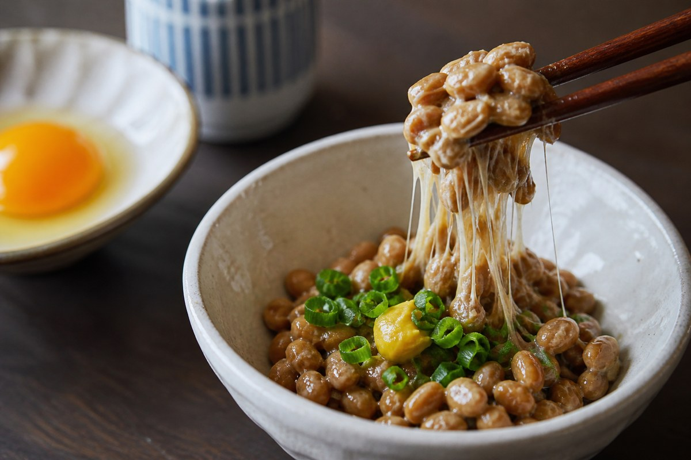

*▲ Natto delivers 212 calories, 17.7 g protein and 5.4 g fiber per 100 g, with 939–1,103 µg of vitamin K2 as menaquinone-7. One typical 50 g pack carries 106 calories, 8.9 g protein and five times an adult's daily vitamin K need.*

Quick answer <strong>Natto provides 212 calories, 17.72 g protein, 5.4 g fiber and 939–1,103 µg of vitamin K2 (MK-7) per 100 g.</strong> A standard 50 g pack is 106 calories with 8.9 g protein, and its MK-7 content exceeds the 180 µg dose used in bone and artery trials several times over. Anyone taking warfarin should talk to their prescriber before adding natto to the diet.

Fermented foods moved to the center of gut-health research as microbiome sequencing became routine, and natto—whole soybeans fermented with *Bacillus subtilis* var. *natto*—sits at the useful end of that category. It combines a complete plant protein, prebiotic fiber, spore-forming probiotics, vitamin K2 in the menaquinone-7 form, and the enzyme nattokinase in a single 50 gram pack.

Readers arrive with three questions: **how much natto to eat**, **whether nattokinase really dissolves clots**, and **why natto is said to clash with warfarin**. The honest answers: one pack a day is plenty, nattokinase has promising but small human trials and is not a substitute for anticoagulant drugs, and the warfarin issue is real because of vitamin K, not because natto is dangerous.

---

## 1. Natto Nutrition: 212 Calories, 17.7 g Protein per 100 g

Values below describe **fresh natto, plain**. Retail packs weigh 45–55 g and include a tare sauce and mustard sachet, so per-pack numbers are more useful than per-100 g figures for daily planning.

| Nutrient | Per 100 g | U.S. %DV |
| :--- | :--- | :--- |
| **Energy** | 212 kcal | 10.6% |
| **Water** | 55.0 g | See note¹ |
| **Carbohydrates** | 12.68 g | 4.6% |
| - Total Sugars | 4.89 g | See note¹ |
| - Dietary Fiber | 5.40 g | 19.3% |
| **Protein** | 17.72 g | 35.4% |
| **Total Fat** | 11.00 g | 14.1% |
| - Saturated Fat | 1.59 g | 8.0% |
| - Cholesterol | 0.00 mg | 0.0% |
| **Vitamin K2 (MK-7)** | 939–1,103 µg | See note¹ |
| **Vitamin K1 (phylloquinone)** | 23.1 µg | 19.3% |
| **Calcium** | 217 mg | 16.7% |
| **Iron** | 8.60 mg | 47.8% |
| **Magnesium** | 115 mg | 27.4% |
| **Potassium** | 729 mg | 15.5% |
| **Zinc** | 1.90 mg | 17.3% |
| **Sodium** | 7 mg | 0.3% |
| **Nattokinase activity** | 20–40 FU/g (1,000–2,000 FU per 50 g pack) | No DV |

**How to read the table:** energy, carbohydrate, protein, fat and sodium percentages use U.S. Daily Values for a 2,000 kcal diet; vitamin and mineral percentages use adult RDAs or AIs. ¹Water, total sugars and MK-7 have no established Daily Value, so absolute amounts are shown. MK-7 ranges from 939 µg per 100 g in Japanese analytical studies to 1,103 µg in the Korean food database. Because MK-7 has a plasma half-life of roughly three days—far longer than vitamin K1—blood levels stay stable without eating natto daily.

*※ Data basis: the figures follow the Korean food nutrient database and commercial natto labels. The USDA FoodData Central entry Natto (FDC 172443) lists 211 kcal and 19.4 g protein per 100 g; strain and soybean blend shift that protein figure.*

<strong>Sources:</strong> <a href="https://fdc.nal.usda.gov/" rel="nofollow noopener" target="_blank">USDA FoodData Central</a> · Korean National Standard Food Composition Table (K-FIND) · <a href="https://pubmed.ncbi.nlm.nih.gov/" rel="nofollow noopener" target="_blank">PubMed literature</a>

### Real-world portions

| Portion | Weight | Calories and key nutrients |
| :--- | :--- | :--- |
| Half pack | 25 g | 53 kcal · 4.4 g protein · 275 µg MK-7 |
| Standard pack | 50 g | **106 kcal** · 8.9 g protein · 2.7 g fiber · 550 µg MK-7 |
| Two packs | 100 g | 212 kcal · 17.7 g protein · 1,103 µg MK-7 |
| Pack with tare sauce | 50 g + 8 g sauce | 120 kcal · 400–500 mg sodium added |

Natto's own sodium is only 7 mg per 100 g. The soy sauce sachet is what turns a low-sodium food into a moderate one, which is why using half the tare is the single most useful adjustment.

---

## 2. Four Evidence-Based Benefits

### H3. How much protein does one pack of natto provide?

One 50 g pack delivers 8.9 g of protein—about 1.5 large eggs—for 106 calories, roughly 15% of a 60 g daily target.

### H3. Does nattokinase actually dissolve blood clots?

In the laboratory it is a potent fibrinolytic enzyme, but human trials are small. Expect a food-level benefit, not a replacement for aspirin, warfarin or DOACs.

Nattokinase is a serine protease produced during fermentation. It degrades fibrin directly and increases tissue plasminogen activator (t-PA) activity, the body's own clot-dissolving pathway. A randomized trial of 2,000 FU daily for 12 weeks reported reduced D-dimer and improved blood flow markers in adults with risk factors, and smaller studies suggest modest blood pressure reductions.

### H3. What does vitamin K2 (MK-7) do for bones and arteries?

MK-7 activates osteocalcin, which binds calcium into bone, and matrix Gla protein, which keeps calcium out of artery walls. A three-year trial with 180 µg daily improved bone density and arterial stiffness.

In a three-year randomized controlled trial in postmenopausal women, 180 µg of MK-7 daily preserved lumbar spine bone mineral density and improved markers of arterial stiffness compared with placebo. One 50 g pack of natto supplies about three times that dose, so eating natto three or four times a week comfortably covers the requirement.

### H3. Is the natto bacillus a real probiotic?

Yes. *Bacillus subtilis* natto forms heat-resistant spores that survive stomach acid, and small studies report increased bifidobacteria and improved stool quality.

Unlike most yogurt cultures, the natto bacillus survives processing and gastric transit as a spore, germinating in the small intestine. Japanese intervention studies report increases in *Bifidobacterium* populations and improvements in stool frequency and consistency after regular natto intake.

---

## 3. How to Eat Natto for Best Absorption

- **Warm it briefly.** Refrigerated natto has stiff, gummy strands. Twenty to thirty seconds in a microwave or a scoop over hot rice restores aroma and enzyme activity.
- **Use half the tare sauce.** A full sachet adds 400–500 mg sodium to a food that naturally contains 7 mg per 100 g. Replace the rest with mustard, scallion, sesame or perilla.
- **Stir 20–30 times, not 100.** Over-stirring incorporates air, toughens the polyglutamate strands and volatilizes the aroma compounds.
- **Three or four times a week is enough.** Because MK-7 persists for days, frequency matters less than consistency. Frozen packs keep a month; thaw and eat immediately.

---

## 4. Cautions and Side Effects

- **Warfarin (Coumadin): this one matters.** Warfarin works by blocking vitamin K recycling, so a sudden increase in vitamin K intake lowers the INR and reduces protection against clots—while abruptly stopping natto can send the INR too high. The rule is consistency: if you eat natto, eat a similar amount every week and monitor the INR with your clinician.
- **Stop two weeks before surgery.** Both the fibrinolytic activity of nattokinase and the vitamin K content argue for discontinuing natto and nattokinase supplements before elective procedures.
- **Gout and hyperuricemia:** fermented soy is moderate-to-high in purines. During an acute flare, keep to half a pack a day and maintain fluid intake; outside flares, one pack is generally acceptable.
- **Soy allergy:** avoid natto entirely if you react to soy protein. Hives, lip swelling or throat itching after eating require stopping and medical review.
- **The smell:** ammonia and diacetyl compounds from fermentation cause natto's characteristic odor. Scallion, ginger and perilla mask it effectively without adding sodium.

---

## 5. Frequently Asked Questions

**Q1. How much natto should I eat per day?**  
One 50 g pack (106 kcal, 8.9 g protein) covers vitamin K2, protein and fiber needs. Because MK-7 has a half-life of about three days, three to four packs a week maintains blood levels. For protein purposes, two packs (212 kcal, 17.7 g protein) is still reasonable.

**Q2. Can nattokinase replace blood thinners?**  
No. Small trials show favorable changes in clotting markers, but there is no evidence that nattokinase substitutes for aspirin, warfarin or direct oral anticoagulants. If you have a thrombotic condition or take anticoagulants, keep natto at food level and never adjust medication on your own.

**Q3. Does natto reduce the effect of warfarin?**  
Yes, it can lower the INR. Natto contains 600–1,100 µg of vitamin K per 100 g, eight to fifteen times the daily requirement. Patients on warfarin should not start or stop natto abruptly; if they eat it, they should keep the weekly amount steady and have the INR monitored.

---

## 6. Synergistic Food Pairings

- **[Tofu](/en/posts/tofu-nutrition-benefits/):** tofu calcium and natto vitamin K2 work in the same direction—one supplies the mineral, the other activates the proteins that deposit it in bone.
- **[Chickpea](/en/posts/chickpea-nutrition-benefits/):** chickpea fiber and natto's spore-forming probiotics support gut ecology from two angles; a bowl with both clears 15 g of protein per serving.
- **[Laver (Nori)](/en/posts/laver-nutrition-benefits/):** natto rice wrapped in laver combines natto protein with laver's 8.5 mg iron per 100 g, making a balanced iron and protein meal.
- **[Spinach](/en/posts/spinach-nutrition-benefits/):** spinach vitamin K1 and natto MK-7 cover clotting and bone pathways respectively. People on anticoagulants should keep both amounts steady rather than eliminating either.

  
📌 Related rankings

  <ul>
    <li><a href="/en/posts/high-protein-foods-ranking/">Top 10 High-Protein Foods per 100 g</a></li>
    <li><a href="/en/posts/heart-blood-pressure-cholesterol-foods/">Top 10 Foods for Blood Pressure and Cholesterol</a></li>
    <li><a href="/en/posts/liver-immunity-fatigue-recovery-foods/">Top 10 Foods for Liver, Immunity and Fatigue Recovery</a></li>
  </ul>

---

## 7. Bottom Line

- **Per pack:** 50 g of natto is 106 kcal with 8.9 g protein, 2.7 g fiber and roughly 550 µg of MK-7.
- **Vitamin K2:** 939–1,103 µg per 100 g, several times the 180 µg dose used in bone and artery trials.
- **Nattokinase:** real fibrinolytic activity in the lab, small human trials, no substitute for anticoagulant therapy.
- **Warfarin users:** keep intake consistent and coordinate with the prescriber—this is the one caution that changes medical management.
- **Practical:** warm it, halve the sauce, stir briefly, and eat three or four times a week.

