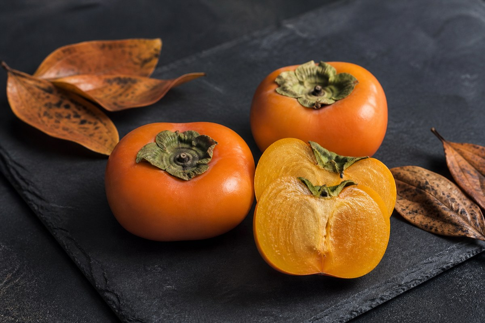

*▲ Raw Japanese persimmon delivers 70 calories, 3.6 g fiber and 81 µg vitamin A (RAE) per 100 g. Non-astringent Fuyu types carry under 0.1% soluble tannin, while astringent Hachiya fruit carries around 1% until fully ripened.*

Quick answer <strong>A raw persimmon provides 70 calories, 18.6 g carbohydrate, 3.6 g fiber and 81 µg vitamin A per 100 g; one medium Fuyu fruit is about 118 calories.</strong> Non-astringent varieties do not cause constipation in any study of people, but astringent persimmons and dried persimmons eaten in quantity on an empty stomach can form gastric bezoars, and dried fruit triples the sugar per gram.

Persimmons ripen from late October into November and are unusual among fruits for splitting into two eating experiences: crisp, mildly sweet non-astringent fruit (Fuyu, Jiro) and soft, jammy astringent fruit (Hachiya) that must lose its tannins before it is edible. Nutritionally they are closer to a starchy fruit than to a berry, with fiber and provitamin A far above most table fruits.

The questions readers bring are consistent: **do persimmons cause constipation**, **can you eat them on an empty stomach**, and **is dried persimmon the same food**. The answers turn on tannin chemistry and water content, not on the fruit's sugar alone.

---

## 1. Persimmon Calories and Nutrition (70 kcal per 100 g)

Values below are for **raw Japanese persimmon, edible portion**. Cultivar changes the numbers: Korean Fuyu-type sweet persimmons measure about 57 kcal and 28.8 mg vitamin C per 100 g, while the USDA composite value for the species is 70 kcal with 7.5 mg vitamin C. Both are correct—they describe different cultivars.

| Nutrient | Per 100 g Raw | U.S. %DV |
| :--- | :--- | :--- |
| **Energy** | 70 kcal | 3.5% |
| **Water** | 80.32 g | See note¹ |
| **Carbohydrates** | 18.59 g | 6.8% |
| - Total Sugars | 12.53 g | See note¹ |
| - Dietary Fiber | 3.60 g | 12.9% |
| **Protein** | 0.58 g | 1.2% |
| **Total Fat** | 0.19 g | 0.2% |
| - Cholesterol | 0.00 mg | 0.0% |
| **Vitamin A (RAE)** | 81 µg | 9.0% |
| - Beta-carotene | 253 µg | See note¹ |
| **Vitamin C** | 7.50 mg | 8.3% |
| **Potassium** | 161 mg | 3.4% |
| **Manganese** | 0.355 mg | 15.4% |
| **Copper** | 0.113 mg | 12.6% |
| **Folate** | 8 µg DFE | 2.0% |
| **Soluble tannin** | Fuyu <0.1% · Hachiya ~1% | No DV |
| **Sodium** | 1 mg | 0.0% |

**How to read the table:** energy, carbohydrate, protein, fat and sodium percentages use U.S. Daily Values for a 2,000 kcal diet. Vitamin A, vitamin C, potassium, manganese, copper and folate percentages use adult RDAs or AIs. ¹Water, total sugars and beta-carotene have no established Daily Value, so absolute amounts are shown. Manganese at 15% DV is notable for a fruit: it supports bone matrix formation and superoxide dismutase, an internal antioxidant enzyme.

*※ Source: [USDA FoodData Central FDC 169941](https://fdc.nal.usda.gov/food-details/169941/nutrients) — Persimmons, japanese, raw (SR Legacy). The 70 kcal and 0.58 g protein per 100 g in the table above are this entry’s values; a different cooking state changes them.*

### What one persimmon and half a fruit deliver

Persimmons are counted. Weights below are USDA portion weights for a Japanese persimmon.

| Portion | Edible weight | Energy | Protein |
| :--- | :--- | :--- | :--- |
| Half a fruit | 84 g | 58.8 kcal | 0.49 g |
| 1 fruit (6 cm) | 168 g | 117.6 kcal | 0.97 g |
| 100 g | 100 g | 70 kcal | 0.58 g |

*Note: one fruit (168 g) is 118 kcal and 21 g of sugar. For blood-sugar control, half a fruit (84 g) with a protein food is a better single serving than a whole one.*

<strong>Sources:</strong> <a href="https://fdc.nal.usda.gov/" rel="nofollow noopener" target="_blank">USDA FoodData Central</a> · Korean National Standard Food Composition Table (K-FIND) · <a href="https://pubmed.ncbi.nlm.nih.gov/" rel="nofollow noopener" target="_blank">PubMed literature</a>

### Fresh, soft-ripe and dried persimmon compared

| Form | Calories per 100 g | Sugars | Fiber | Vitamin C | Typical serving |
| :--- | :--- | :--- | :--- | :--- | :--- |
| Non-astringent fresh (Fuyu) | 70 kcal | 12.5 g | 3.6 g | 7.5 mg | 1 fruit (168 g) · 118 kcal |
| Astringent, fully ripe (Hachiya) | 69 kcal | 12.3 g | 2.8 g | 17.5 mg | 1 fruit (150 g) · 104 kcal |
| Dried (hoshigaki) | 201 kcal | 29.8 g | 8.5 g | 2.7 mg | 1 piece (40 g) · 80 kcal |

Drying removes water, so sugar and fiber concentrate in the remaining mass. **Dried persimmon carries 2.4 times the sugar of fresh fruit per 100 g**, which is why three pieces are a very different metabolic event from three fresh fruits.

---

## 2. Four Evidence-Based Benefits

### H3. Do persimmons actually cause constipation?

Not the non-astringent ones. Fuyu-type persimmons contain 3.6 g fiber per 100 g with under 0.1% soluble tannin, and no human study links them to constipation.

The constipation reputation comes from soluble tannins in astringent varieties. Soluble tannins bind salivary and gastric proteins, forming dense complexes that slow gastric emptying and taste harsh. Non-astringent cultivars such as Fuyu stop accumulating soluble tannins while the fruit is still young, so they are edible crisp and contain almost none of the reactive form.

### H3. Can you eat persimmons on an empty stomach?

Non-astringent fruit, yes. Astringent persimmons and dried persimmons are better eaten after a meal, because concentrated tannin plus gastric acid can form a bezoar.

A phytobezoar is a mass of undigested tannin-protein material that can obstruct the stomach outlet and cause pain, nausea and early satiety. Case series repeatedly identify the same pattern: astringent persimmons or dried persimmons consumed on an empty stomach over weeks, most often in people with prior gastric surgery, diabetic gastroparesis or delayed gastric emptying.

For a healthy person eating one or two ripe persimmons as dessert, bezoar formation has not been reported. Risk falls further when the fruit is fully ripened (soluble tannin converted to insoluble form), peeled, and eaten with protein foods such as yogurt, milk or tofu that saturate the tannin-binding capacity before it reaches the stomach lining.

### H3. How much vitamin A and vitamin C do persimmons deliver?

A persimmon supplies 81 µg vitamin A (RAE) and 7.5–28.8 mg vitamin C per 100 g depending on cultivar, with soft-ripe fruit trading vitamin C for four times the beta-carotene.

Persimmon is one of the few fruits that contributes meaningful provitamin A. The 253 µg of beta-carotene in 100 g converts to retinol as needed and supports corneal and respiratory mucosal integrity. Korean Fuyu-type fruit measures higher in vitamin C (28.8 mg, 29% of the Korean RDA) and lower in beta-carotene (72 µg), while soft-ripe Hachiya reaches roughly 284 µg beta-carotene with vitamin C dropping to about 17 mg.

Because carotenoids are fat-soluble, absorption improves when persimmon is eaten with nuts, yogurt or a meal containing oil—an argument for persimmon in salads rather than alone.

### H3. What do potassium and manganese contribute?

One medium fruit provides about 270 mg potassium and 0.6 mg manganese, supporting blood-pressure balance and bone-related enzyme activity.

Manganese is a cofactor for glycosyltransferases involved in cartilage and bone matrix synthesis, and for manganese superoxide dismutase inside mitochondria. One fruit covers about 26% of the daily requirement—unusually high for a fruit.

---

## 3. Preparation and Absorption Tips

- **Peel astringent varieties.** Tannin concentrates in the skin and just beneath it. Peeling removes much of the astringency and most of the bezoar risk.
- **Ripen astringent fruit before eating.** Store Hachiya in a sealed bag with an apple or banana for three to five days; ethylene converts soluble tannins into insoluble, non-astringent forms.
- **Keep dried persimmons to one or two pieces.** One piece is 80 calories with 12 g sugar, equivalent to half a fresh fruit's sugar in a bite-sized package.
- **Eat after a meal rather than as an empty-stomach snack.** Post-meal buffering reduces the acid environment that drives tannin-protein coagulation, and blunts the glucose rise.
- **Store at 0–5 °C once ripe.** Firm Fuyu keeps three to four weeks chilled; soft-ripe fruit should be used within three or four days; dried persimmons freeze well for six months.

---

## 4. Cautions and Side Effects

- **Bezoar risk groups:** prior gastric surgery, gastroparesis, or a diet of astringent persimmons on an empty stomach. Persistent abdominal pain, vomiting or early fullness warrants medical evaluation.
- **Diabetes and dried fruit:** fresh persimmon at 118 kcal per fruit is manageable, but three dried pieces deliver about 240 kcal and 36 g sugar. Keep to one or two pieces and pair with protein or fat.
- **Chronic kidney disease:** potassium is moderate in fresh fruit (161 mg/100 g) but rises to 551 mg/100 g in dried persimmon. Follow your potassium target.
- **Iron and calcium binding:** tannins reduce non-heme iron absorption within the same meal. If you take iron supplements for anemia, separate them from persimmon by at least two hours.

---

## 5. Frequently Asked Questions

**Q1. Do persimmons cause constipation?**  
Non-astringent persimmons do not. They carry 3.6 g fiber per 100 g with under 0.1% soluble tannin, and no human study establishes a constipation link. Astringent varieties and dried persimmons eaten in quantity on an empty stomach, especially without adequate fluid, are where reports of hard stools and gastric discomfort originate.

**Q2. How many persimmons can I eat a day?**  
One to two fresh fruits (118–236 kcal) is a sensible daily ceiling for most adults. Dried persimmons should stay at one or two pieces, and people with diabetes should limit themselves to one small fresh fruit or half a large one, eaten after a meal.

**Q3. Is dried persimmon as healthy as fresh?**  
It is a different food rather than a better or worse one. Drying concentrates fiber (8.5 g vs 3.6 g per 100 g) and minerals, but also concentrates sugar (29.8 g vs 12.5 g) and destroys most vitamin C. Use it as a small sweet, not as a fruit serving.

---

## 6. Synergistic Food Pairings

- **[Spinach](/en/posts/spinach-nutrition-benefits/):** persimmon vitamin C assists non-heme iron absorption from spinach, though people with a history of calcium oxalate stones should avoid stacking oxalate-rich greens and tannin-rich fruit in one meal.
- **[Tofu](/en/posts/tofu-nutrition-benefits/):** if bezoars are a concern, pairing persimmon with tofu or yogurt saturates tannin binding capacity with protein before it can clump, and adds calcium that tannins would otherwise chelate.
- **[Sweet Potato](/en/posts/sweet-potato-nutrition-benefits/):** sweet potato beta-carotene and persimmon vitamin C cover both fat-soluble and water-soluble antioxidant defenses in a single autumn snack under 250 calories.
- **[Kiwi](/en/posts/kiwi-nutrition-benefits/):** if regularity is the actual goal, kiwi has the stronger evidence—a trial of two green kiwis daily increased bowel movements, an outcome never demonstrated for persimmon.

  
📌 Related rankings

  <ul>
    <li><a href="/en/posts/low-gi-foods-blood-sugar-guide/">Top 10 Low-Glycemic Foods: GI and GL Ranking Table</a></li>
    <li><a href="/en/posts/antioxidant-anti-aging-foods-guide/">Top 10 Antioxidant Foods: Vitamin C and Polyphenol Comparison</a></li>
    <li><a href="/en/posts/heart-blood-pressure-cholesterol-foods/">Top 10 Foods for Blood Pressure and Cholesterol</a></li>
  </ul>

---

## 7. Bottom Line

- **Calories:** 70 kcal per 100 g, about 118 kcal per medium fruit. Dried persimmon is 201 kcal per 100 g.
- **Constipation:** the reputation belongs to astringent tannins, not the fruit as a whole. Non-astringent varieties carry 3.6 g fiber and negligible soluble tannin.
- **Empty stomach:** fine for Fuyu, avoid for Hachiya and dried persimmon, especially after gastric surgery.
- **Nutrients:** strong for vitamin A, manganese and fiber; vitamin C depends heavily on cultivar and ripeness.
- **Dried fruit is concentrated sugar:** treat one piece as half a fruit, not as a vegetable-like snack.

