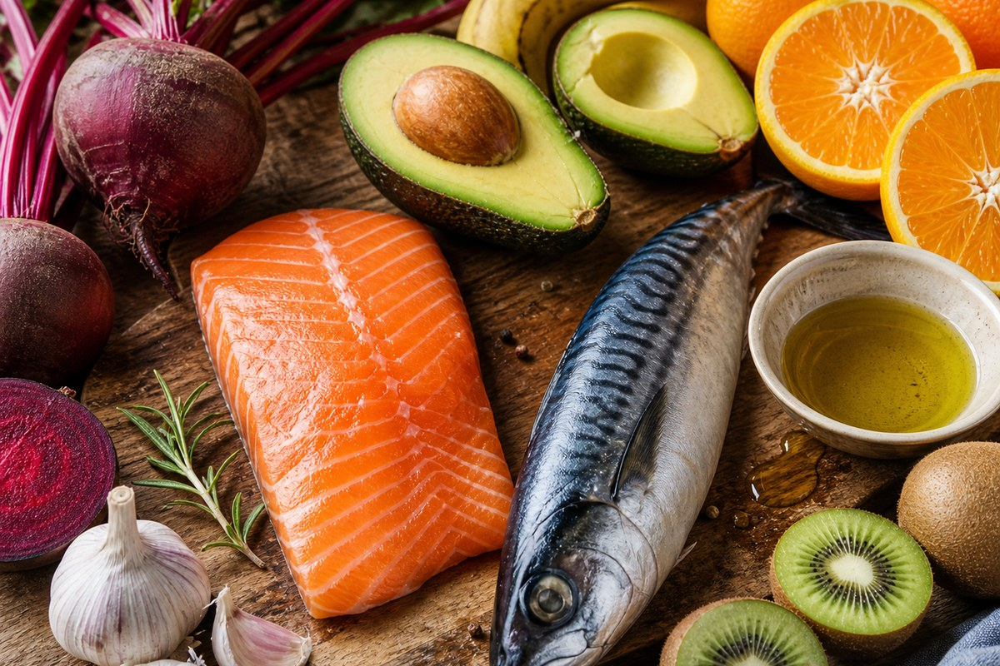

*▲ 혈관 건강은 한 가지 음식이 아니라 세 가지 경로로 관리됩니다. 질산염(혈관 확장), 칼륨(나트륨 배출), 오메가-3(중성지방·염증)입니다.*

한 줄 결론 혈압에는 <strong>비트(질산염 150~250mg)</strong>와 <strong>마늘(알린 1,000~1,500mg)</strong>, 중성지방에는 <strong>고등어(EPA+DHA 2,299mg)</strong>와 <strong>연어(2,150mg)</strong>가 가장 근거가 탄탄합니다. 칼륨은 아보카도 485mg·바나나 358mg으로 채우고, 나트륨은 하루 2,000mg 이하로 줄이는 것이 우선입니다.

혈압과 콜레스테롤은 따로 관리되지 않습니다. 혈관 내피가 손상되면 LDL 콜레스테롤이 침투해 동맥경화반이 생기고, 혈관이 좁아지면 혈압이 오릅니다. 그래서 심혈관 질환 예방 지침은 하나의 식품이 아니라 **식사 패턴 전체**를 봅니다. 대표적인 것이 DASH 식단(채소·과일·통곡물·저지방 단백질 중심)입니다.

이 식사 패턴이 작동하는 경로는 세 가지입니다.

1. **질산염 → 산화질소(NO):** 혈관을 이완시켜 혈압을 낮춥니다. 비트·시금치에 많습니다.
2. **칼륨 → 나트륨 배출:** 신장에서 나트륨 재흡수를 막아 혈압을 낮춥니다. 아보카도·바나나·키위에 많습니다.
3. **오메가-3 → 중성지방·염증:** EPA·DHA가 중성지방을 낮추고 혈소판 응집을 완화합니다. 고등어·연어에 많습니다.

아래 순위는 USDA 데이터를 기준으로 블로그에서 다룬 식재료 10종을 위 세 경로에 배치한 것입니다. 혈압약을 복용 중이라면 식품은 약을 대체하지 않는다는 점을 먼저 기억해 주세요.

---

## 1. 혈압·혈관 건강 음식 순위는?

| 식재료 | 혈압·혈관 관련 성분 (100g당) | 섭취 포인트 |
| :--- | :--- | :--- |
| **1위 비트** | 식이 질산염 150~250mg, 베타인 128.7mg | 찌거나 생으로 갈아 마시기, 비트주스는 200ml 이내 |
| **2위 마늘** | 총 알린 1,000~1,500mg, 셀레늄 14.2µg | 으깨서 10분 두면 알리신 생성, 생으로 하루 1~2쪽 |
| **3위 시금치** | 질산염 약 250mg, 칼륨 558mg, 엽산 | 데쳐서 나트륨 없이 무침, 비타민K 주의 |
| **4위 고등어** | EPA 898mg + DHA 1,401mg | 주 2회 구이, 소금 대신 레몬·허브 |
| **5위 연어** | EPA+DHA 약 2,150mg, 셀레늄 36.5µg | 생연어보다 익힌 것이 안전, 훈제는 나트륨 확인 |
| **6위 아보카도** | 칼륨 485mg, 단일불포화지방, 식이섬유 6.7g | 반 개를 샐러드에, 포화지방 대체용으로 활용 |
| **7위 바나나** | 칼륨 358mg, 식이섬유 2.6g | 하루 1개, 신장질환자는 칼륨 제한 확인 |
| **8위 오렌지** | 헤스페리딘 28.5mg, 비타민C 53.2mg | 통째로 먹고 주스는 피하기, 혈관 내피 기능 개선 |
| **9위 키위** | 칼륨 312mg, 비타민C 92.7mg | 하루 1~2개, 항응고제 복용자는 양을 일정하게 |
| **10위 두부** | 이소플라본, 칼슘 350mg, 칼륨 121mg | 동물성 단백질 대체, LDL 개선 연구 다수 |

## 2. 혈압을 낮추는 세 가지 경로는 무엇인가?

- **질산염 경로(비트·시금치):** 질산염은 입안 세균에 의해 아질산염으로 바뀌고, 혈관 내피에서 산화질소로 전환되어 혈관을 이완시킵니다. 비트주스 섭취 후 수축기 혈압이 수 시간 동안 낮아졌다는 소규모 시험들이 있습니다. 항균 구강 세척제를 쓰면 이 경로가 약해질 수 있습니다.
- **칼륨 경로(아보카도·바나나·키위):** 칼륨은 나트륨과 길항해 혈압을 낮춥니다. 미국 심장협회는 성인 하루 칼륨 3,500~5,000mg을 권고합니다. 다만 신장 기능이 떨어진 사람에게는 위험할 수 있어 반드시 확인이 필요합니다.
- **오메가-3 경로(고등어·연어):** EPA·DHA는 간에서 중성지방 합성을 줄이고, 혈소판 응집과 염증 반응을 완화합니다. 심혈관 질환 예방을 위한 하루 권장량은 EPA+DHA 250~500mg 수준이며, 고등어 100g 한 번이면 충분합니다.

## 3. 콜레스테롤 수치를 낮추는 식품은?

- **수용성 식이섬유가 담즙산을 붙잡습니다.** 귀리·콩류·사과의 펙틴은 장에서 담즙산을 묶어 배출시키고, 간은 콜레스테롤을 써서 담즙산을 다시 만듭니다. 그만큼 혈중 LDL이 내려갑니다.
- **포화지방을 바꾸는 것이 먼저입니다.** 버터·삼겹살·가공육의 포화지방을 아보카도·견과류·올리브유의 불포화지방으로 바꾸면 LDL이 유의하게 감소합니다. 식품을 추가하는 것보다 교체가 효과적입니다.
- **이소플라본(두부)과 식물성 단백질:** 대두 단백질이 LDL을 소폭 낮춘다는 메타분석이 있습니다. 효과는 크지 않지만 포화지방이 적은 단백질 공급원이라는 점이 더 중요합니다.
- **계란은 무조건 나쁘지 않습니다.** 건강한 성인에서 하루 1개 수준의 계란 섭취가 혈중 콜레스테롤을 유의하게 올리지 않았다는 연구가 다수입니다. 당뇨·고지혈증이 있으면 총 지방 섭취와 함께 판단하세요.

## 4. 조리법이 혈관 건강을 바꾸는 이유는?

| 식재료 | 권장 조리법 | 피해야 할 방식 |
| :--- | :--- | :--- |
| 비트 | 찜·생즙 | 설탕 넣은 비트 절임 |
| 마늘 | 생으로 다져 10분 후 사용 | 기름에 오래 볶아 태우기 |
| 시금치 | 데쳐서 무침 | 국물에 오래 끓이기(칼륨 손실) |
| 고등어·연어 | 구이·찜 | 소금간 조림·훈제(나트륨) |
| 아보카도 | 생으로 샐러드 | 마요네즈 소스와 함께 갈기 |

나트륨은 하루 2,000mg(소금 5g) 이하가 권고됩니다. 국물·장아찌·가공육이 대부분을 차지하므로, 조리할 때 간장을 절반으로 줄이는 것이 식품을 추가하는 것보다 효과가 큽니다.

## 5. 주의할 점은?

- **혈압약 복용자는 식품으로 약을 대체하지 마세요.** 비트·마늘 섭취는 보조 수단입니다. 약을 임의로 중단하거나 감량하지 말고, 식단 변화는 의사에게 알리세요.
- **칼륨 보존 이뇨제·신장질환자는 고칼륨 식품을 주의하세요.** 아보카도·바나나·시금치·키위는 100g당 칼륨이 300~560mg입니다. 고칼륨혈증 위험이 있는 경우 양을 제한해야 합니다.
- **항응고제 복용 시 비타민K를 일정하게.** 시금치·케일의 비타민K는 INR에 영향을 줍니다. 섭취량을 갑자기 늘리지 말고 일정하게 유지하세요.
- **생선 기름과 아스피린을 함께 쓰면 출혈 위험이 올라갈 수 있습니다.** 고용량 오메가-3 보충제와 항혈소판제를 병용할 때는 의사와 상의하세요.

## 6. 함께 읽으면 좋은 식재료 가이드

- **[비트](/posts/beetroot-nutrition-benefits/)** — 43kcal, 질산염 150~250mg과 베타인.
- **[마늘](/posts/garlic-nutrition-benefits/)** — 149kcal, 알린과 셀레늄 14.2µg.
- **[시금치](/posts/spinach-nutrition-benefits/)** — 23kcal, 질산염 250mg과 칼륨 558mg.
- **[고등어](/posts/mackerel-nutrition-benefits/)** — 205kcal, EPA 898mg+DHA 1,401mg.
- **[연어](/posts/salmon-nutrition-benefits/)** — 208kcal, 오메가-3 2,150mg.
- **[아보카도](/posts/avocado-nutrition-benefits/)** — 160kcal, 칼륨 485mg과 올레산.
- **[바나나](/posts/banana-nutrition-benefits/)** — 89kcal, 칼륨 358mg.
- **[오렌지](/posts/orange-nutrition-benefits/)** — 47kcal, 헤스페리딘 28.5mg.
- **[키위](/posts/kiwi-nutrition-benefits/)** — 61kcal, 칼륨 312mg과 비타민C 92.7mg.
- **[두부](/posts/tofu-nutrition-benefits/)** — 76kcal, 이소플라본과 칼슘 350mg.

## 7. 자주 묻는 질문 (FAQ)

**Q1. 혈압을 가장 빨리 낮추는 음식은 무엇인가요?**
비트(질산염)와 마늘(알린)이 근거가 가장 많습니다. 다만 효과는 수 mmHg 수준이고 개인차가 크므로, 나트륨을 줄이고 체중을 관리하는 것이 우선입니다.

**Q2. 고등어와 연어 중 무엇이 더 좋나요?**
오메가-3 총량은 고등어(2,299mg)가 연어(2,150mg)보다 약간 높고, 연어는 비타민D(11µg)와 셀레늄이 강점입니다. 등푸른생선을 주 2회, 번갈아 드시면 충분합니다.

**Q3. 콜레스테롤이 높으면 계란을 끊어야 하나요?**
대부분은 하루 1개 수준에서 문제가 되지 않습니다. 오히려 포화지방(삼겹살·버터·가공육)과 총열량을 줄이는 것이 LDL에 더 큰 영향을 줍니다. 수치가 높다면 의사와 상의해 섭취량을 정하세요.

