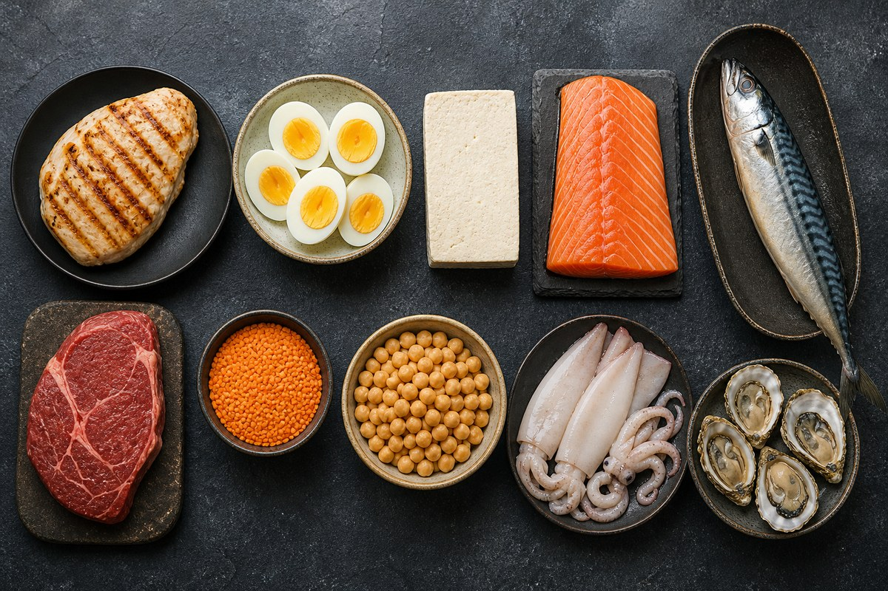

*▲ 단백질 함량은 '무게 100g'보다 '칼로리 100kcal에 단백질이 얼마나 들어 있는가'로 보면 순위가 달라집니다. 닭가슴살은 100g당 23.1g이지만, 100kcal당으로 계산하면 21.0g입니다.*

한 줄 결론 100g당 단백질이 가장 많은 것은 <strong>건조 렌틸콩 24.6g</strong>, 그다음이 <strong>닭가슴살 23.1g</strong>입니다. 다만 같은 열량으로 따지면 닭가슴살(100kcal당 21.0g)과 새우·오징어가 앞서고, 흡수율(PDCAAS)은 계란·닭가슴살·생선이 0.9~1.0으로 가장 높습니다.

단백질은 체중 1kg당 하루 0.91g(2020 한국인 영양소 섭취기준, 성인)이 권장됩니다. 몸무게 60kg이면 하루 약 55g, 근력 운동을 병행한다면 1.2~1.6g/kg(72~96g)까지 늘리는 경우가 많습니다. 문제는 "무엇을 먹어야 그 양을 채우는가"입니다.

시중의 '고단백 식품' 목록은 기준이 제각각입니다. 어떤 목록은 생고기 100g으로, 어떤 목록은 익힌 고기 100g으로, 또 어떤 목록은 건조 콩 100g으로 수치를 제시합니다. 기준이 섞이면 렌틸콩이 소고기보다 단백질이 많다는 결론이 나오지만, 실제로 밥상에 오르는 것은 물에 불려 삶은 콩입니다.

이 글은 블로그에서 이미 다룬 식재료들의 **USDA FoodData Central 표준 수치**를 같은 표에 놓고, ①무게 100g당 함량, ②열량 100kcal당 밀도, ③소화 흡수율(PDCAAS) 세 가지로 다시 정리했습니다. 표의 빈칸은 없애고, 각 수치의 기준 상태(생것·삶은 것·건조)를 함께 적었습니다.

---

## 1. 단백질 많은 음식 순위는? (100g당 함량 TOP 10)

| 식재료 (100g당, 기준 상태 표기) | 단백질 | 100kcal당 단백질(밀도) |
| :--- | :--- | :--- |
| **1위 렌틸콩 (건조)** | 24.63 g | 7.0 g |
| **2위 닭가슴살 (생것)** | 23.10 g | 21.0 g |
| **3위 연어 (생것)** | 20.40 g | 9.8 g |
| **4위 소고기 등심 (생것)** | 20.30 g | 10.1 g |
| **5위 고등어 (생것)** | 18.60 g | 9.1 g |
| **6위 오징어 (생것)** | 15.60 g | 17.0 g |
| **7위 계란 (전란, 생것)** | 12.56 g | 8.8 g |
| **8위 병아리콩 (삶은 것)** | 8.86 g | 5.4 g |
| **9위 두부 (부침용, 생것)** | 8.08 g | 10.6 g |
| **10위 굴 (생것)** | 7.13 g | 10.5 g |

표의 기준: 렌틸콩은 **건조 원물 100g**입니다. 나머지는 모두 조리 전 생것 또는 표기된 상태(병아리콩은 삶은 것) 기준입니다.

## 2. 표 읽는 법: 왜 렌틸콩 1위를 그대로 믿으면 안 되는가?

- **건조 콩 100g은 삶으면 약 230~250g이 됩니다.** 렌틸콩을 물에 불려 삶으면 무게가 2.3~2.5배 늘고, 단백질 밀도는 100g당 9~10g 수준으로 내려갑니다. 즉 실제로 한 숟가락 떠 먹는 삶은 렌틸콩 100g은 닭가슴살 100g의 절반 이하입니다.
- **열량 100kcal당으로 보면 순위가 뒤집힙니다.** 닭가슴살 21.0g, 오징어 17.0g, 두부 10.6g, 굴 10.5g, 소고기 10.1g 순입니다. 체중 감량과 단백질 섭취를 동시에 노린다면 이 열이 더 실용적입니다.
- **지방 함량이 밀도를 결정합니다.** 연어(208kcal)와 소고기 등심(201kcal)은 단백질이 20g대로 같지만 열량의 상당 부분이 지방입니다. 같은 20g을 먹어도 열량은 닭가슴살(110kcal)의 두 배 가까이 됩니다.
- **계란은 '개수'로 계산하세요.** 계란 한 개(약 50g)는 단백질 6.3g입니다. 100g당 12.6g이라는 숫자만 보면 낮아 보이지만, 한 끼에 2~3개를 먹는 식품이라 실제 기여도는 큽니다.

## 3. 단백질 흡수율은 어떤 음식이 높을까? (PDCAAS 기준)

단백질은 함량보다 **체내에 얼마나 흡수되어 근육 합성에 쓰이는가**가 중요합니다. FAO가 쓰는 PDCAAS(단백질 소화율 보정 아미노산 점수)는 1.00을 최고로 두고, 필수아미노산 패턴과 소화율을 함께 반영합니다.

| 식재료 | PDCAAS 참고 범위 | 흡수·소화 포인트 |
| :--- | :--- | :--- |
| 계란 | 1.00 (기준 단백질) | 필수아미노산 패턴이 이상적, 열에 익혀도 소화율 유지 |
| 닭가슴살·소고기 | 0.92~1.00 | 류신이 풍부해 근육 단백질 합성 자극에 유리 |
| 연어·고등어·오징어·굴 | 0.90~1.00 | 결합조직이 적어 소화가 빠르고 아미노산 점수가 높음 |
| 두부(대두 단백) | 0.90~1.00 | 식물성 단백 중 유일하게 1.00에 근접 |
| 병아리콩 | 0.71~0.78 | 라이신은 충분하지만 메티오닌이 부족 |
| 렌틸콩 | 0.52~0.63 | 메티오닌이 제한 아미노산, 곡물과 함께 먹으면 보완 |

PDCAAS는 식품 단독 기준입니다. 콩류와 곡물(쌀·보리)을 한 끼에 함께 먹으면 서로 부족한 아미노산을 채워 점수가 올라갑니다. 렌틸콩밥, 병아리콩 샐러드에 통곡물을 곁들이는 이유입니다.

## 4. 한 끼 단백질 30g은 어떻게 채울까?

| 조합 | 구성 | 단백질 합계 |
| :--- | :--- | :--- |
| 근육 회복형 | 닭가슴살 100g + 계란 1개 | 29.4 g |
| 지중해식 | 연어 100g + 두부 50g | 24.4 g |
| 식물성 | 삶은 렌틸콩 150g + 두부 100g | 22.4 g |
| 간편식 | 계란 3개 + 굴 100g | 44.8 g |

일반 성인의 한 끼 권장량은 20~30g입니다. 위 조합은 모두 밥이나 채소 반찬과 함께 먹는 것을 전제로 했고, 조리 중 수분 손실은 고려하지 않은 생것 기준입니다.

## 5. 단백질을 많이 먹을 때 주의할 점은?

- **신장 질환이 있다면 단백질 총량을 먼저 상의하세요.** 만성 신장질환자는 단백질 대사산물 배출이 어려워 섭취량 제한이 필요할 수 있습니다. 이 글의 수치는 건강한 성인의 참고값입니다.
- **붉은 고기와 가공육은 빈도를 조절하세요.** 소고기 등심은 아연과 철분이 풍부하지만, 가공육(베이컨·소시지)은 나트륨과 포화지방이 많습니다. 주 2~3회, 한 번에 100g 내외가 무난합니다.
- **콩류는 익혀서 드세요.** 생 렌틸콩·병아리콩에는 소화 효소 억제 물질과 피트산이 있어 충분히 불리고 삶아야 합니다. 렌틸콩은 15~20분, 병아리콩은 불린 뒤 40~60분 삶습니다.
- **한 번에 몰아 먹기보다 나눠 드세요.** 단백질은 한 끼 20~40g 구간에서 근육 합성 반응이 가장 효율적이라는 연구가 많습니다. 세 끼에 고르게 나누는 편이 낫습니다.

## 6. 함께 읽으면 좋은 식재료 가이드

- **[닭가슴살](/posts/chicken-breast-nutrition-benefits/)** — 100g당 단백질 23.1g, 지방 1.5g 미만의 기준 식품입니다.
- **[닭다리살](/posts/chicken-thigh-nutrition-benefits/)** — 껍질 제거 시 119kcal·단백질 19.7g, 닭가슴살보다 철분 2.5배·아연 2.4배입니다.
- **[연어](/posts/salmon-nutrition-benefits/)** — 단백질 20.4g과 오메가-3 2,150mg을 함께 담은 생선입니다.
- **[소고기 등심](/posts/beef-sirloin-nutrition-benefits/)** — 헴철 1.48mg과 아연 3.55mg이 강점입니다.
- **[고등어](/posts/mackerel-nutrition-benefits/)** — EPA 898mg·DHA 1,401mg의 등푸른생선입니다.
- **[계란](/posts/egg-nutrition-benefits/)** — PDCAAS 1.00의 기준 단백질입니다.
- **[두부](/posts/tofu-nutrition-benefits/)** — 식물성 단백 8.1g과 칼슘 350mg을 함께 줍니다.
- **[렌틸콩](/posts/lentil-nutrition-benefits/)** — 건조 100g 단백질 24.6g, GI 32의 콩류입니다.
- **[병아리콩](/posts/chickpea-nutrition-benefits/)** — 삶은 100g 단백질 8.9g, 식이섬유 7.6g입니다.
- **[오징어](/posts/squid-nutrition-benefits/)** — 92kcal에 단백질 15.6g, 100kcal당 밀도 17.0g입니다.
- **[굴](/posts/oyster-nutrition-benefits/)** — 단백질 7.1g과 아연 16.6mg을 동시에 채웁니다.
- **[낫토 (Natto)](/posts/natto-nutrition-benefits/):** 100g당 단백질 17.72g, 1팩(50g) 8.9g으로 이 순위표 상위권에 해당합니다.
- **[김 (Laver)](/posts/laver-nutrition-benefits/):** 마른김 100g의 단백질은 38.5g으로 무게당 단백질 밀도가 가장 높은 식품군입니다.

## 7. 자주 묻는 질문 (FAQ)

**Q1. 단백질이 가장 많은 음식 하나만 고르면 무엇인가요?**
"무게당"으로는 건조 렌틸콩(100g당 24.6g), "한 끼 실사용"으로는 닭가슴살(100g당 23.1g)입니다. 열량 대비 효율까지 보면 닭가슴살과 오징어가 앞섭니다.

**Q2. 식물성 단백질만으로 하루 단백질을 채울 수 있나요?**
가능하지만 양을 더 늘려야 합니다. 두부·콩류는 흡수율이 0.6~1.0으로 동물성보다 낮아, 같은 양을 먹어도 체내 이용량이 적습니다. 두부 200g+삶은 렌틸콩 150g+병아리콩 100g을 조합하면 약 45g을 채울 수 있습니다.

**Q3. 계란은 하루 몇 개까지 괜찮나요?**
건강한 성인이라면 하루 1~2개를 기본으로, 근력 운동을 하는 경우 2~3개까지 무리 없는 경우가 많습니다. 다만 당뇨·고지혈증이 있거나 콜레스테롤 수치가 높다면 총 지방 섭취와 함께 의사와 상의하세요.

