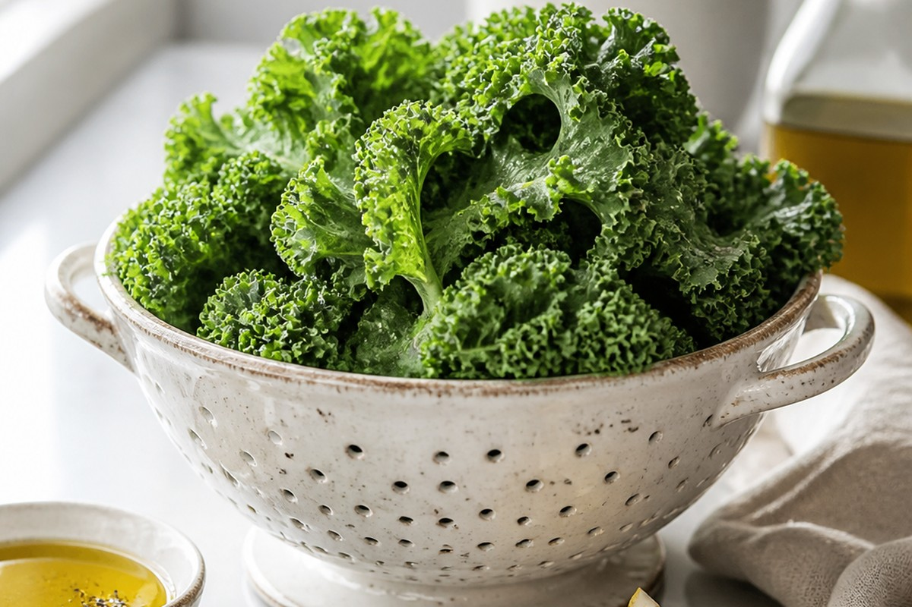

*▲ 생케일 100g은 단 35kcal에 불과하지만, 비타민 K 389.6mcg, 비타민 C 93.4mg, 눈 건강 색소인 루테인·제아잔틴 6,261mcg이 압축되어 있습니다. 올리브오일을 살짝 곁들이면 지용성 비타민과 루테인 흡수율이 크게 올라갑니다.*

한 줄 결론 <strong>생케일 100g은 35kcal, 비타민K 389.6mcg, 비타민C 93.4mg, 칼슘 254mg입니다.</strong> 비타민K가 하루 권장량의 4배를 넘어 와파린을 복용하면 섭취량을 일정하게 유지해야 하고, 데치면 부피가 줄어 더 많이 먹을 수 있습니다.

겨울철 서리를 맞을수록 잎의 당도가 올라가고 쌉싸름한 맛이 부드러워지는 **케일(Kale, *Brassica oleracea* var. *sabellica*)** 은 브로콜리·양배추와 같은 십자화과(배추과) 채소 중에서도 영양 밀도가 최상위권에 속합니다.

케일을 먹을 때 가장 흔한 고민은 **"생으로 갈아 마시는 게 좋을까, 살짝 데쳐 먹는 게 좋을까?"** 입니다. 영양학적으로는 **비타민 C와 설포라판 생성 효소(미로시나아제)는 생식이나 가벼운 찜(2~3분)에서 잘 보존**되고, **지용성인 루테인·베타카로틴은 올리브오일을 곁들여 가볍게 익힐 때 흡수율이 높아집니다**. 또한 시금치와 달리 **케일은 옥살산 함량이 매우 낮은 저옥살산 채소**여서 신장결석 부담이 훨씬 적다는 점도 중요한 차별점입니다.

아래에서는 USDA FoodData Central 표준 데이터 기준으로 생케일 100g의 영양 성분, 눈·혈관·항산화 4대 효능, 질긴 줄기를 부드럽게 만드는 올리브오일 마사지·데치기 가이드, 그리고 와파린 복용자와 갑상선 질환자가 확인해야 할 주의사항을 정리했습니다.

---

## 1. 케일 칼로리와 영양성분은? (비타민K 389.6mcg·비타민C 93.4mg·칼슘 254mg)

아래 수치는 **생케일(가식부, 잎) 100g** 기준입니다. 1회 샐러드·스무디 분량(약 50~70g)만 먹어도 하루 비타민 K 권장량을 훌쩍 넘기고, 비타민 C와 루테인을 풍부하게 보충할 수 있습니다.

| 영양 성분 (Nutrient) | 함량 (100g당) | 1일 권장 섭취량 비율 (한국인 성인 기준) |
| :--- | :--- | :--- |
| **열량 (Energy)** | 35 kcal | 1.8% |
| **수분 (Water)** | 89.63 g | 별도 표기¹ |
| **탄수화물 (Carbohydrates)** | 4.42 g | 1.4% |
| - 총 당류 (Total Sugars) | 0.99 g | 별도 표기¹ |
| - 식이섬유 (Dietary Fiber) | 4.10 g | 16.4% |
| **단백질 (Protein)** | 2.92 g | 5.3% |
| **지방 (Total Fat)** | 1.49 g | 2.8% |
| - 포화지방산 (Saturated Fat) | 0.18 g | 1.2% |
| - 콜레스테롤 (Cholesterol) | 0.00 mg | 0.0% |
| **비타민 K (Vitamin K)** | 389.60 mcg | 556.6% |
| **비타민 C (Vitamin C)** | 93.40 mg | 93.4% |
| **비타민 A (Vitamin A, RAE)** | 241.00 mcg | 30.1% |
| **엽산 (Folate, DFE)** | 62.00 mcg | 15.5% |
| **비타민 B6 (Vitamin B6)** | 0.15 mg | 10.7% |
| **칼슘 (Calcium)** | 254.00 mg | 36.3% |
| **망간 (Manganese)** | 0.92 mg | 23.0% |
| **칼륨 (Potassium)** | 348.00 mg | 9.9% |
| **철분 (Iron)** | 1.60 mg | 16.0% |
| **마그네슘 (Magnesium)** | 33.00 mg | 8.9% |
| **나트륨 (Sodium)** | 53.00 mg | 2.7% |
| **루테인 + 제아잔틴 (Lutein + Zeaxanthin)** | 6,261.00 mcg | 기준치 없음 |
| **옥살산 (Oxalic Acid)** | 약 10~20 mg | 기준치 없음 |

*¹ 수분과 총 당류는 한국인 영양소 섭취기준(KDRIs)상 일일 백분율 기준치가 별도로 설정되어 있지 않습니다.*

### 표 읽는 법: 칼슘 흡수율과 저옥살산의 이점
케일 100g에는 칼슘이 254mg 들어 있는데, **옥살산 함량(10~20mg)이 시금치(600~970mg)에 비해 30배 이상 낮습니다.** 옥살산이 칼슘 흡수를 방해하지 않으므로, 실제 체내 칼슘 흡수율은 시금치보다 훨씬 높고 우유(약 30%)와 비슷한 수준으로 평가됩니다.

---

## 2. 케일 효능은 무엇일까? 과학으로 입증된 4대 효과

### ① 눈 황반 보호: 6,261mcg의 고농축 루테인·제아잔틴
케일은 녹황색 채소 중에서도 **루테인(Lutein)과 제아잔틴(Zeaxanthin)** 밀도가 최상위권입니다. 이 두 카로티노이드 색소는 망막 중심부(황반)에 직접 축적되어 청색광(블루라이트)을 걸러내고 광산화 스트레스를 줄여 노인성 황반변성과 눈의 피로 완화에 도움을 줍니다.

### ② 혈관·뼈 건강을 지키는 초고함량 비타민 K
생케일 100g에는 비타민 K1(필로퀴논)이 **389.6mcg** (한국 성인 남성·여성 권장량의 약 5배 이상) 들어 있습니다. 비타민 K는 간에서 혈액 응고 인자를 활성화할 뿐 아니라, 뼈 기질 단백질인 **오스테오칼신(Osteocalcin)** 을 활성화해 칼슘이 뼈에 단단히 결합하도록 돕습니다.

### ③ 십자화과 특유의 글루코시놀레이트·설포라판 항산화 방어
케일을 씹거나 잘게 다지면 세포 내 미로시나아제(Myrosinase) 효소가 글루코시놀레이트와 반응해 **설포라판(Sulforaphane)** 과 인돌-3-카비놀 같은 이소티오시아네이트 계열 파이토케미컬을 생성합니다. 이 성분들은 간과 세포의 해독 효소(Phase II 효소) 발현을 촉진하는 것으로 알려져 있습니다.

### ④ 담즙산 결합 식이섬유와 콜레스테롤 관리
케일의 4.1g 식이섬유와 특정 단백질 분획은 장내에서 담즙산과 결합해 배설을 유도하며, 찐 케일에서 담즙산 결합능이 생케일보다 더 높아진다는 실험 결과도 보고되어 있습니다(Kahlon et al., 2008).

---

## 3. 케일은 생주스가 좋을까, 데쳐야 할까? 옥살산과 영양 비교

- **질긴 줄기 제거 & 올리브오일 마사지:** 케일 가운데의 두꺼운 심(줄기)은 떼어내고 잎만 썬 뒤, **엑스트라 버진 올리브오일 1작은술과 레몬즙, 소금 한 꼬집을 뿌려 1~2분간 손으로 주물러 주면** 잎 표면의 왁스층이 부드러워져 생으로 먹어도 질기지 않고 루테인·비타민 K·비타민 A 흡수율이 배가됩니다.
- **데치기·찜은 2~3분 이내로 짧게:** 오래 삶으면 수용성 비타민 C(93.4mg)와 엽산이 물로 빠져나갑니다. 끓는 물에 **30초~1분 살짝 데치거나 찜기에서 2~3분만 찌면** 풋내는 날아가고 소화가 편해지며 영양 손실도 최소화됩니다.
- **케일 주스 팁:** 믹서에 갈아 마실 때는 바나나·사과·아보카도 또는 견과류 소량을 함께 넣어야 **지용성 영양소(루테인·베타카로틴·비타민 K)가 헛되지 않고 체내로 흡수**됩니다.

---

## 4. 케일 부작용과 갑상선·와파린 주의점은?

- **와파린(항응고제) 복용 시 섭취량 일정 유지 필수:** 비타민 K는 혈액 응고에 관여하므로 와파린의 약효를 직접 상쇄할 수 있습니다. 와파린을 복용 중이라면 케일 주스를 갑자기 매일 마시거나 중단하지 말고, **의료진과 상의해 매일 일정한 양만 유지**해야 합니다.
- **생케일 과다 섭취와 갑상선(고이트로겐):** 케일 등 십자화과 채소를 **생으로 매일 수백 g씩 장기 과다 섭취**하면 글루코시놀레이트 대사산물이 요오드 흡수를 방해할 수 있습니다. 요오드 결핍이 없는 일반인은 걱정할 수준이 아니지만, **갑상선 기능 저하증**이 있다면 생주스 과용을 피하고 **데치거나 익혀 드시는 것**이 안전합니다.
- **신장결석·만성 신부전:** 앞서 설명했듯 케일은 저옥살산 채소라 결석 걱정은 적지만, 100g당 **칼륨이 348mg** 들어 있어 고칼륨혈증 위험이 있는 만성 신부전 환자는 물에 데쳐 칼륨을 일부 뺀 뒤 소량만 섭취해야 합니다.

---

## 5. 자주 묻는 질문 (FAQ)

**Q1. 케일은 생으로 갈아 마시는 게 좋나요, 데쳐 먹는 게 좋나요?**  
목적에 따라 다릅니다. 비타민 C와 설포라판을 최대화하려면 생으로 올리브오일·레몬즙을 곁들이는 편이 좋고, 위장이 약하거나 갑상선 기능 저하가 있거나 루테인 흡수·담즙산 배출을 노린다면 2~3분 가볍게 찌거나 데쳐 올리브오일과 드시는 편이 더 편하고 안전합니다.

**Q2. 케일도 시금치처럼 신장결석(옥살산)을 유발하나요?**  
아닙니다. 시금치(100g당 옥살산 약 600~970mg)와 달리 케일은 옥살산이 10~20mg 수준으로 매우 낮은 저옥살산 채소입니다. 칼슘 흡수 방해도 적어 결석 위험군에게 시금치의 훌륭한 대안이 됩니다.

**Q3. 케일 줄기까지 다 먹어야 하나요?**  
줄기에도 식이섬유가 풍부하지만 생식에서는 너무 질겨 식감을 해칩니다. 샐러드나 쌈에는 잎만 떼어 쓰고, 남긴 줄기는 잘게 썰어 볶음 요리나 수프 육수에 넣으면 버리지 않고 활용할 수 있습니다.

---

## 6. 케일과 함께 먹으면 좋은 음식은?

- **[아보카도 (Avocado)](/posts/avocado-nutrition-benefits/):** 아보카도의 단일불포화지방이 케일 100g당 6,261mcg에 달하는 지용성 루테인·제아잔틴과 비타민 K의 체내 흡수율을 극대화합니다.
- **[시금치 (Spinach)](/posts/spinach-nutrition-benefits/):** 케일과 시금치를 함께 데쳐 무치면 잎채소의 비타민K·엽산·루테인을 한 접시에 담을 수 있습니다.
- **[오렌지 (Orange)](/posts/orange-nutrition-benefits/):** 오렌지의 풍부한 비타민 C와 구연산이 케일의 식물성 철분(1.60mg) 흡수를 돕고 풋내를 상큼하게 잡아 줍니다.

---

## 7. 케일 하루 얼마나 먹을까? 핵심 요약

- 케일 100g은 **35kcal에 비타민 K 389.6mcg, 비타민 C 93.4mg, 루테인·제아잔틴 6,261mcg** 이 담긴 최상급 녹황색 채소입니다.
- **저옥살산 채소**여서 칼슘 흡수율이 높고 신장결석 부담이 시금치보다 훨씬 적습니다.
- **올리브오일이나 아보카도 같은 건강한 지방을 반드시 곁들여야** 케일의 핵심 지용성 영양소를 온전히 흡수할 수 있습니다.

  
📌 관련 순위 가이드

  <ul>
    <li><a href="/posts/antioxidant-anti-aging-foods-guide/">항산화·노화 방지 음식 TOP 10: 폴리페놀·카로티노이드 순위</a></li>
    <li><a href="/posts/low-calorie-high-satiety-foods/">저칼로리 포만감 다이어트 음식 TOP 10: 100g 비교</a></li>
  </ul>

