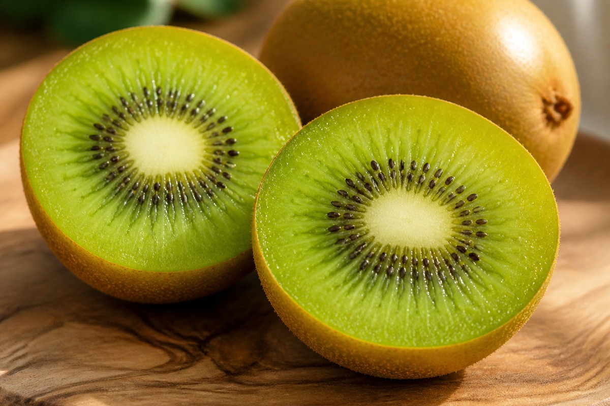

*▲ 생 그린키위 100g에는 비타민 C 92.7mg(성인 일일 권장량의 92.7%)이, 골드키위 100g에는 무려 161.3mg이 들어 있습니다. 껍질째 먹으면 식이섬유와 폴리페놀 섭취량이 약 50% 더 늘어납니다.*

한 줄 결론 <strong>생그린키위 100g은 61kcal, 비타민C 92.7mg, 식이섬유 3.0g입니다.</strong> 하루 2개를 먹은 임상시험에서 배변 횟수가 늘었고, 액티니딘이 단백질 소화를 도와 고기 요리 뒤 소화 부담을 줄입니다.

11월부터 본격적으로 제철이 시작되는 **키위(Kiwi, *Actinidia deliciosa* / *Actinidia chinensis*)** 는 작은 달걀 크기 한 알(약 75~80g)에 오렌지나 레몬 못지않은 **고밀도 비타민 C와 천연 소화 효소 '액티니딘(Actinidin)'** 을 꽉 채운 과일입니다.

키위를 고를 때 가장 많이 묻는 질문은 **"그린키위와 골드키위 중 무엇이 더 좋은가?"** 와 **"진짜 변비에 하루 2개로 효과가 있는가?"** 입니다. 실제 영양 데이터를 비교하면, **비타민 C 함량은 골드키위(100g당 161.3mg)가 그린키위(92.7mg)보다 약 1.7배 높고**, 반대로 **변비 개선에 기여하는 불용성·수용성 식이섬유(3.0g vs 1.4g)와 액티니딘 효소는 그린키위가 더 풍부**합니다.

아래에서는 USDA FoodData Central 표준 데이터를 바탕으로 그린키위 100g의 영양 성분과 골드키위와의 차이, 변비·수면·면역·소화에 대한 과학적 4대 효능, 껍질째 먹는 안전 세척법, 그리고 입술·혀 따가움(구강 알레르기 증후군)과 신장결석 주의사항을 정리했습니다.

---

## 1. 키위 칼로리와 영양성분은? (비타민C 92.7mg·식이섬유 3.0g)

아래 수치는 가장 보편적인 **그린키위(과육, 생것) 100g** 기준입니다. **골드키위(SunGold 등)** 는 열량 63kcal로 비슷하지만 비타민 C가 161.3mg으로 약 1.7배 높고, 식이섬유는 1.4g으로 그린키위의 절반 수준입니다.

| 영양 성분 (Nutrient) | 함량 (100g당) | 1일 권장 섭취량 비율 (한국인 성인 기준) |
| :--- | :--- | :--- |
| **열량 (Energy)** | 61 kcal | 3.1% |
| **수분 (Water)** | 83.07 g | 별도 표기¹ |
| **탄수화물 (Carbohydrates)** | 14.66 g | 4.5% |
| - 총 당류 (Total Sugars) | 8.99 g | 별도 표기¹ |
| - 식이섬유 (Dietary Fiber) | 3.00 g | 12.0% |
| **단백질 (Protein)** | 1.14 g | 2.1% |
| **지방 (Total Fat)** | 0.52 g | 1.0% |
| - 포화지방산 (Saturated Fat) | 0.03 g | 0.2% |
| - 콜레스테롤 (Cholesterol) | 0.00 mg | 0.0% |
| **비타민 C (Vitamin C)** | 92.70 mg | 92.7% |
| **비타민 K (Vitamin K)** | 40.30 mcg | 57.6% |
| **비타민 E (Vitamin E, α-토코페롤)** | 1.46 mg | 12.2% |
| **엽산 (Folate, DFE)** | 25.00 mcg | 6.3% |
| **비타민 B6 (Vitamin B6)** | 0.06 mg | 4.5% |
| **칼륨 (Potassium)** | 312.00 mg | 8.9% |
| **구리 (Copper)** | 0.13 mg | 14.4% |
| **마그네슘 (Magnesium)** | 17.00 mg | 4.6% |
| **칼슘 (Calcium)** | 34.00 mg | 4.9% |
| **철분 (Iron)** | 0.31 mg | 3.1% |
| **나트륨 (Sodium)** | 3.00 mg | 0.2% |
| **루테인 + 제아잔틴 (Lutein + Zeaxanthin)** | 122.00 mcg | 기준치 없음 |
| **액티니딘 (Actinidin)** | 단백질 분해 효소 | 기준치 없음 |

*¹ 수분과 총 당류는 한국인 영양소 섭취기준(KDRIs)상 일일 상한/권장 백분율 기준치가 별도로 설정되어 있지 않습니다. (총 당류 권장 상한은 총 에너지의 10~20% 이내)*

### 표 읽는 법: 그린 vs 골드키위, 목적에 따라 고르세요
- **그린키위 (Hayward):** 식이섬유(3.0g/100g)와 천연 단백질 분해 효소 액티니딘이 훨씬 많아 **만성 변비·고기 소화·혈당 조절(GI 약 39~47)** 목적에 유리합니다.
- **골드키위 (SunGold):** 비타민 C(161.3mg/100g)가 그린키위의 1.7배이고 엽산(31~38mcg)도 더 많아 **환절기 피로·면역력 보충·임산부 간식**으로 적합합니다.

---

## 2. 키위 효능은 무엇일까? 과학으로 입증된 4대 효과

### ① 만성 변비 개선: 하루 그린키위 2개의 임상적 효과
다기관 무작위 대조 임상시험(Gearry et al., 2023, *American Journal of Gastroenterology*)에서 기능성 변비 및 변비형 과민성장증후군(IBS-C) 성인 184명에게 **4주간 매일 그린키위 2개**를 섭취하게 한 결과, 완전 자발적 배변 횟수가 주당 평균 **1.53~1.73회 증가**해 차전자피(Psyllium 7.5g)보다 복부 팽만감과 복통을 덜 유발하면서도 동등 이상의 배변 개선 효과를 보였습니다. 키위의 세포벽 식이섬유가 수분을 머금고 부피가 약 3~4배 부풀어 올라 대변을 부드럽게 밀어내기 때문입니다.

### ② 천연 단백질 분해 효소 '액티니딘'의 소화 촉진
키위 특유의 **액티니딘(Actinidin)** 은 위장관 내 단백질 분해를 돕는 시스테인 프로테아제 효소입니다. 육류, 달걀, 유제품 등 고단백 식사를 한 뒤 그린키위 1개를 먹거나 갈비 양념에 키위를 소량 넣으면, 위 배출 속도가 빨라지고 식후 더부룩함이 줄어듭니다.

### ③ 비타민 C·비타민 E·폴리페놀의 복합 항산화 및 철분 흡수 상승
키위는 비타민 C(수용성)와 비타민 E(지용성, 1.46mg/100g)를 함께 함유한 드문 과일입니다. 특히 식물성 철분(비헴철)과 함께 먹으면 비타민 C가 철분을 환원시켜 장내 흡수율을 크게 끌어올립니다.

### ④ 취침 전 섭취와 수면의 질 연구
키위에는 신경전달물질인 **세로토닌(Serotonin)** 전구체와 항산화 물질이 들어 있습니다. 수면 장애가 있는 성인을 대상으로 취침 1시간 전 키위 2개를 4주간 섭취하게 한 소규모 임상 연구에서 입면 잠복기 단축과 수면 효율 개선이 보고된 바 있으며(Lin et al., 2011), 다만 대규모 재현 연구가 더 필요한 보조적 근거로 이해하는 것이 정확합니다.

---

## 3. 키위는 껍질째 먹어도 될까? 액티니딘과 세척법

- **껍질째 먹으면 식이섬유·엽산·항산화제 최대 50% 증가:** 골드키위는 껍질에 털이 거의 없어 물에 씻기만 해도 거부감 없이 먹을 수 있고, 그린키위도 **베이킹소다나 깨끗한 수세미로 겉면 잔털을 문질러 씻은 뒤 얇게 슬라이스**하면 식이섬유 섭취량을 1.5배 가까이 늘릴 수 있습니다.
- **후숙 팁:** 구매 직후 단단한 키위는 **사과나 바나나와 함께 종이봉투에 넣어 실온(18~22℃)에 2~3일** 두면 에틸렌 가스 작용으로 빠르게 말랑해지며 당도가 올라갑니다. 말랑해진 뒤에는 냉장 보관하세요.
- **우유·젤라틴 주의:** 키위의 액티니딘 효소가 우유 단백질이나 젤라틴을 분해해 쓴맛이 나거나 굳지 않게 만듭니다. 요거트·우유와 섞을 때는 **먹기 직전에 올리고**, 스무디는 갈자마자 바로 마시는 것이 좋습니다.

---

## 4. 키위 부작용과 알레르기 주의점은?

- **구강 알레르기 증후군(OAS) 및 라텍스 교차 알레르기:** 키위를 먹었을 때 입술·혀·목구멍이 따갑거나 가렵다면 액티니딘이나 키위 알레르겐(Act d 1 등)에 의한 반응일 수 있습니다. 특히 **라텍스·바나나·아보카도 알레르기**가 있는 분은 교차 반응 위험이 높으므로 주의해야 합니다.
- **와파린(항응고제) 복용자:** 그린키위 100g에는 비타민 K가 40.3mcg 들어 있습니다. 소량 자체보다 **섭취량을 하루 1~2개 내외로 일정하게 유지**하는 것이 중요합니다.
- **칼륨 제한 및 옥살산 신장결석 주의:** 100g당 칼륨이 312mg 들어 있어 만성 신부전 환자는 섭취량 조절이 필요합니다. 또한 키위 씨와 껍질 부위에는 옥살산(수산)이 소량 포함되므로 칼슘옥살산 결석 병력이 있다면 과다 섭취를 피하고 물을 충분히 마시는 것이 안전합니다.

---

## 5. 자주 묻는 질문 (FAQ)

**Q1. 그린키위와 골드키위 중 변비에는 어떤 게 더 좋나요?**  
그린키위가 더 효과적입니다. 그린키위는 100g당 식이섬유가 3.0g으로 골드키위(1.4g)의 2배 이상이며, 장운동을 자극하고 단백질 소화를 돕는 액티니딘 효소 함량도 훨씬 높습니다.

**Q2. 키위를 먹으면 입안과 혀가 따가운 이유가 뭔가요?**  
키위 속 단백질 분해 효소인 액티니딘과 유기산, 미세한 칼슘옥살산 결정이 입안 점막을 자극하기 때문입니다. 혀가 가볍게 얼얼한 정도를 넘어 입술이 붓거나 목이 간지럽다면 알레르기 반응일 수 있으므로 즉시 섭취를 중단하세요.

**Q3. 키위 껍질은 정말 먹어도 괜찮나요?**  
네, 먹을 수 있습니다. 잔털이 적은 골드키위는 깨끗이 씻어 그대로 먹기 좋고, 그린키위도 흐르는 물에 문질러 잔털을 제거하면 식이섬유와 폴리페놀을 훨씬 많이 섭취할 수 있습니다. 다만 구강이 예민하거나 농약 잔류가 걱정된다면 껍질을 깎아 드시는 것이 안전합니다.

---

## 6. 키위와 함께 먹으면 좋은 음식은?

- **[시금치 (Spinach)](/posts/spinach-nutrition-benefits/):** 시금치의 풍부한 식물성 철분(2.71mg/100g)을 키위의 비타민 C가 환원시켜 체내 철분 흡수율을 극대화합니다.
- **[딸기 (Strawberry)](/posts/strawberry-nutrition-benefits/):** 키위와 딸기를 함께 담으면 비타민C를 두 배로 챙기면서 열량은 낮게 유지할 수 있습니다.
- **[아보카도 (Avocado)](/posts/avocado-nutrition-benefits/):** 키위의 비타민 C와 아보카도의 단일불포화지방·비타민 E가 결합해 지용성·수용성 항산화 방어망을 동시에 채워 줍니다.

---

## 7. 키위 하루 얼마나 먹을까? 핵심 요약

- **비타민 C가 목표면 골드키위(161.3mg), 변비·소화가 목표면 그린키위(식이섬유 3.0g + 액티니딘)** 를 선택하세요.
- 변비 개선을 노린다면 **매일 그린키위 2개**를 충분한 물과 함께 2~4주 꾸준히 드시는 것이 임상 근거에 가장 가깝습니다.
- 고기 요리 후 디저트로 그린키위 1개를 먹으면 **식후 더부룩함을 줄이는 천연 소화제** 역할을 톡톡히 해냅니다.

  
📌 관련 순위 가이드

  <ul>
    <li><a href="/posts/low-calorie-high-satiety-foods/">저칼로리 포만감 다이어트 음식 TOP 10: 100g 비교</a></li>
    <li><a href="/posts/heart-blood-pressure-cholesterol-foods/">혈압·혈관 건강 음식 TOP 10: 콜레스테롤·중성지방 관리</a></li>
  </ul>

