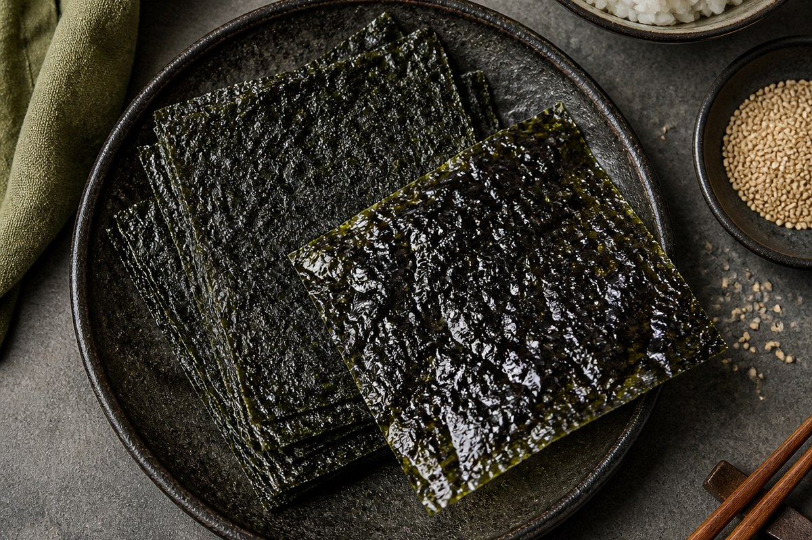

*▲ 마른김 100g은 202kcal, 단백질 38.5g, 식이섬유 45.6g, 칼륨 2,655mg입니다. 한 장(전장 약 2g)은 4kcal에 불과하지만, 5장(10g)이면 단백질 3.9g으로 달걀 1개에 맞먹습니다.*

한 줄 결론 <strong>마른김 100g은 202kcal, 단백질 38.5g, 식이섬유 45.6g, 비타민C 148mg이고 김 1장(2g)은 4kcal입니다.</strong> 무게 대비 단백질·식이섬유가 많은 식품이며, 5장(10g)이면 단백질 3.9g으로 달걀 1개(6.3g)의 약 60%입니다. 다만 요오드가 100g당 1,000~3,000µg으로 제품·산지에 따라 편차가 커서, '하루 몇 장이면 안전하다'고 일괄로 말할 수 없습니다.

11월부터 이듬해 2월까지 겨울 김은 비타민C와 단백질 함량이 가장 높습니다. **김(Laver, *Porphyra yezoensis*)** 은 한국인이 가장 많이 먹는 해조류로, 밥·국·김밥·반찬 어디에나 들어가지만 "100g당 영양"과 "실제 먹는 양"의 간극이 큰 식품이기도 합니다.

가장 많이 검색되는 질문은 **"김 칼로리가 정말 낮나"**, **"김 많이 먹으면 갑상선에 나쁜가"**, **"조미김과 마른김 중 뭐가 좋나"** 입니다. 결론부터 정리하면 **김 1장은 4kcal로 열량 부담이 거의 없고, 5장을 먹어도 20kcal**입니다. 문제는 열량이 아니라 **요오드·나트륨**이며, 특히 조미김은 지방과 나트륨이 100g당 각각 49g·1,300mg에 이릅니다.

아래에서는 국립수산과학원 표준수산물성분표와 식약처 식품영양성분 DB를 기준으로 마른김 100g·1장 영양, 요오드의 갑상선 영향, 비타민C·철분·식이섬유의 실제 기여도, 그리고 조미김과 마른김의 차이를 정리했습니다.

---

## 1. 김 칼로리와 영양성분은? (1장 4kcal·100g 202kcal)

아래 수치는 **마른김(김밥용 김, 말린 것) 가식부 100g** 기준입니다. 김은 1장이 2g 안팎이라 100g당 수치를 그대로 체감하기 어렵습니다. 표 아래 실생활 환산을 함께 보세요.

| 영양 성분 (Nutrient) | 함량 (100g당) | 1일 권장 섭취량 비율 (한국인 성인 기준) |
| :--- | :--- | :--- |
| **열량 (Energy)** | 202 kcal | 10.1% |
| **수분 (Water)** | 6.0 g | 별도 표기¹ |
| **탄수화물 (Carbohydrates)** | 46.2 g | 14.2% |
| - 총 당류 (Total Sugars) | 0.0 g | 0.0% |
| - 식이섬유 (Dietary Fiber) | 45.6 g | 182.4% |
| **단백질 (Protein)** | 38.5 g | 70.0% |
| **지방 (Total Fat)** | 2.82 g | 5.2% |
| - 포화지방 (Saturated Fat) | 0.83 g | 5.5% |
| - 콜레스테롤 (Cholesterol) | 0.00 mg | 0.0% |
| **비타민C (Vitamin C)** | 148 mg | 148% |
| **비타민A (Vitamin A, RAE)** | 1,100 µg RAE | 157% |
| **비타민B12 (Vitamin B12)** | 2~5 µg | 83~208% |
| **철분 (Iron)** | 8.48 mg | 70.7% |
| **칼슘 (Calcium)** | 184 mg | 26.3% |
| **칼륨 (Potassium)** | 2,655 mg | 75.9% |
| **요오드 (Iodine)** | 1,000~3,000 µg | 별도 표기¹ |
| **나트륨 (Sodium)** | 903 mg | 45.2% |
| **타우린 (Taurine)** | 1,200~1,500 mg | 기준치 없음 |

**표 읽는 법:** 열량·탄수화물·단백질·지방·나트륨 %는 식품 표시용 1일 영양성분 기준치(2,000kcal) 대비, 비타민·무기질 %는 한국인 영양소 섭취기준 성인 권장량 대비입니다. ¹수분·요오드는 1일 기준치가 없어 절대량만 적었습니다. **요오드는 100g당 1,000~3,000µg으로, 성인 1일 상한섭취량(2,400µg)을 100g만으로 넘길 수 있습니다.** 그러나 1장은 2g이므로 실제로는 20~60µg에 불과합니다. 식이섬유 182%는 '100g을 먹었을 때'의 이론값이며, 5장(10g)으로는 4.5g입니다.

*※ 데이터 기준: 표의 수치는 국립수산과학원 표준수산물성분표와 식약처 식품영양성분 DB의 마른김(김밥용 김, 말린 것) 분석값입니다. USDA FoodData Central에는 마른김 항목이 없고 생김(FDC 168458, 100g당 35 kcal·단백질 5.81 g)만 있어, 건조 상태가 다른 두 값을 같은 기준으로 인용하지 않았습니다.*

<strong>출처:</strong> 식품의약품안전처·농촌진흥청 국가표준식품성분표(K-FIND) · <a href="https://fdc.nal.usda.gov/" rel="nofollow noopener" target="_blank">USDA FoodData Central</a> · <a href="https://pubmed.ncbi.nlm.nih.gov/" rel="nofollow noopener" target="_blank">PubMed 문헌</a>

### 실생활 환산: 김 1장·5장·한 봉지는 몇 kcal인가?

| 섭취 기준 | 중량 | 열량과 핵심 수치 |
| :--- | :--- | :--- |
| 김 1장(전장) | 약 2 g | **4 kcal** · 단백질 0.8 g · 식이섬유 0.9 g |
| 김 5장 | 약 10 g | **20 kcal** · 단백질 3.9 g · 철분 0.85 mg |
| 김 10장 | 약 20 g | 40 kcal · 요오드 200~600 µg |
| 조미김 1봉(4~5g) | 4.5 g | 25~30 kcal · 나트륨 50~80 mg · 지방 2 g |
| 조미김 100g | 100 g | 500~600 kcal · 지방 49 g · 나트륨 1,299 mg |

**같은 '김'이라도 조미김은 다른 식품입니다.** 마른김 100g의 지방이 2.82g인데 조미김은 49.2g으로 17배이며, 나트륨도 903mg에서 1,299mg으로 늘어납니다. 다이어트나 혈압 관리 중이라면 **마른김을 사서 참기름을 살짝 두르고 굽는 편**이 낫습니다.

---

## 2. 과학적으로 입증된 4대 건강 효능

### H3. 김 5장이면 단백질이 달걀 1개와 같나?

같지는 않습니다. 김 5장(10g)의 단백질은 3.9g, 달걀 1개(50g)는 6.3g으로 김 5장은 달걀의 약 60% 수준입니다. 무게당으로는 김(38.5g/100g)이 달걀(12.6g/100g)의 3배이지만, 김은 마른 상태라 한 번에 먹는 양이 훨씬 적습니다.

김 단백질은 필수아미노산 조성이 좋아, 아미노산 점수로 평가하면 곡물보다 훨씬 우수합니다. 특히 **라이신·트레오닌**이 풍부해 밥 중심 식사의 부족한 아미노산을 보완합니다. 김밥·주먹밥처럼 밥과 함께 먹는 조합이 영양학적으로 합리적인 이유입니다.

다만 5장을 한 끼에 먹는 경우는 드물고, 실제로는 1~3장을 반찬으로 먹습니다. 단백질 공급원으로 기대하려면 **하루 5~10장**을 꾸준히 먹는 편이 현실적입니다.

### H3. 김을 많이 먹으면 갑상선에 나쁜가?

양에 따라 다릅니다. 김 1~5장은 요오드 20~300µg으로 안전 범위이고, 100g(50장)을 먹으면 상한섭취량을 넘습니다. 갑상선 질환이 있다면 하루 2~3장 이하로 제한하세요.

요오드는 갑상선 호르몬(T3·T4)의 원료로, 성인 1일 권장량은 150µg, 상한섭취량은 2,400µg입니다. 김의 요오드는 100g당 1,000~3,000µg으로 미역·다시마보다는 적지만 여전히 매우 높은 편입니다.

문제가 되는 경우는 두 가지입니다. **① 하시모토 갑상선염 등 자가면역 갑상선 질환**이 있는 사람이 요오드를 과량 섭취하면 갑상선 기능 저하가 악화될 수 있습니다. **② 갑상선 기능 항진증(그레이브스병)** 치료 중에는 요오드 제한이 필요합니다. 이 경우 김은 하루 1~2장으로 줄이고, 미역국·다시마 육수도 함께 제한해야 합니다.

건강한 사람은 하루 2~5장(40~300µg) 수준에서 요오드 과잉 위험이 보고되지 않았습니다.

### H3. 김의 비타민C 148mg은 실제로 유효한가?

일부만 유효합니다. 마른김 100g에 148mg이지만 실제 섭취량(5장=10g)으로는 15mg이고, 굽는 과정에서 30~50%가 더 줄어듭니다.

김의 비타민C는 다른 채소와 달리 **건조 과정에서 산화가 적어** 비교적 잘 보존됩니다. 국립수산과학원 분석에서 마른김 100g의 비타민C가 148mg으로 보고된 것은 이 때문입니다.

그러나 실제 섭취량으로 환산하면 5장(10g)에 14.8mg으로, 성인 권장량의 15% 수준입니다. 조미김은 굽고 기름을 두르는 과정에서 비타민 C가 일부 손실됩니다. 비타민C 공급원으로 김을 주력으로 삼기보다는, **철분 흡수를 돕는 보조 식품**으로 보는 것이 정확합니다.

### H3. 식이섬유·철분·칼륨은 실제로 얼마나 기여하나?

5장(10g) 기준 식이섬유 4.5g, 철분 0.85mg, 칼륨 265mg입니다. 특히 식이섬유는 5장으로 하루 권장량의 18%를 채워 변비 개선에 실질적입니다.

김의 식이섬유는 45.6g/100g으로, 그중 대부분이 불용성입니다. 불용성 섬유는 대변 부피를 늘려 장 통과 시간을 단축합니다. **김 5장 + 물 한 컵**은 변비가 있는 사람에게 부담 없는 습관입니다.

철분은 8.48mg/100g으로, 5장에 0.85mg입니다. 비헴철이라 흡수율이 대체로 낮지만, 김에 함께 들어 있는 비타민 C가 흡수를 돕습니다. 빈혈이 있다면 김만으로는 부족하고, 육류·조개류와 함께 먹어야 합니다.

칼륨 2,655mg/100g은 무게당으로는 매우 높지만, 5장 기준 265mg으로 바나나 한 개(358mg)보다 적습니다. 김을 많이 먹는 날은 나트륨(903mg/100g)도 함께 늘어나는 점을 기억하세요.

---

## 3. 영양 손실을 줄이는 조리·섭취 가이드

- **마른김을 사서 직접 굽세요.** 조미김은 지방 49g·나트륨 1,299mg/100g입니다. 마른김에 참기름 반 티스푼을 앞뒤로 바르고 프라이팬에 10~15초씩 구우면 향은 살리고 지방·나트륨은 5분의 1로 줄일 수 있습니다.
- **굽는 시간은 10~15초.** 김은 200℃에서 20초만 넘겨도 타고 쓴맛이 납니다. 약불에서 앞뒤로 짧게, 색이 짙어지면 바로 꺼내세요.
- **김밥·주먹밥에는 마른김을.** 조미김은 밥의 수분을 흡수해 눅눅해지고, 지방 산패로 냄새가 빨리 납니다. 김밥용 마른김이 보관·식감 모두 유리합니다.
- **밀봉·냉동 보관.** 김은 습기를 먹으면 곰팡이와 산패가 빨라집니다. 지퍼백에 건조제와 함께 넣어 냉동 보관하면 6개월 이상 보관되고, 꺼내자마자 바삭함이 살아 있습니다.
- **국·무침에는 김가루.** 김을 잘게 부숴 국이나 나물무침에 얹으면 나트륨을 늘리지 않고 감칠맛(글루탐산·타우린)을 더할 수 있습니다.

---

## 4. 섭취 시 주의사항 및 부작용

- **요오드 과잉:** 갑상선 질환(하시모토·그레이브스병·갑상선 결절)이 있으면 하루 2~3장 이하로 제한하고 담당 의사와 상의하세요. 임신 중에는 요오드 요구량이 늘지만 상한도 있으므로 과량 섭취는 피해야 합니다.
- **나트륨:** 마른김 100g에 903mg, 조미김은 1,299mg입니다. 고혈압이 있다면 조미김 대신 마른김을, 하루 5장 이내로 드세요.
- **지방 산패:** 조미김은 기름을 두르고 구워 지방이 산화되기 쉽습니다. 개봉 후 2~3주 안에 먹고, 비린 냄새가 나면 버리세요.
- **소화:** 불용성 식이섬유가 많아 한 번에 10장 이상 먹으면 복부 팽만·변비가 오히려 심해질 수 있습니다. 물을 충분히 드세요.
- **곰팡이:** 김 표면의 흰 반점은 곰팡이 또는 염분 결정입니다. 냄새가 나거나 축축하면 곰팡이이므로 섭취하지 마세요.

---

## 5. 자주 묻는 질문 (FAQ)

**Q1. 김은 하루에 몇 장까지 먹어도 되나요?**  
제품마다 요오드 함량 차이가 커서 '몇 장까지'를 일괄로 정할 수는 없습니다. 마른김 2~5장(4~20kcal)은 식이섬유 2~4.5g을 얻는 현실적인 양이고, 이 정도를 먹는 사람에서 요오드 문제가 보고된 사례는 드뭅니다. 다만 갑상선 질환(특히 자가면역 갑상선염·그레이브스병)이 있다면 섭취량을 의사와 상의하고, 조미김은 나트륨 때문에 한 번에 여러 봉을 먹지 않도록 하세요.

**Q2. 조미김과 마른김 중 어떤 게 건강에 좋나요?**  
마른김이 납니다. 마른김 100g의 지방은 2.82g·나트륨 903mg인데, 조미김은 지방 49.2g·나트륨 1,299mg입니다. 조미김 한 봉(4~5g)은 열량 25~30kcal로 크지 않지만, 여러 봉을 먹으면 나트륨이 빠르게 누적됩니다.

**Q3. 김에 요오드가 많아 갑상선암 위험이 높아지나요?**  
일반적인 식사 수준의 김 섭취와 갑상선암의 인과관계는 확립되지 않았습니다. 다만 요오드 과잉은 자가면역 갑상선 질환자의 기능 이상을 악화시킬 수 있다는 보고가 있어, 해당 질환이 있으면 섭취량을 의사와 상의하고 정기 검진을 받는 편이 좋습니다.

---

## 6. 김과 함께 먹으면 좋은 음식

- **[달걀 (Egg)](/posts/egg-nutrition-benefits/):** 달걀의 완전 단백질(6.3g/개)과 김의 단백질·철분을 함께 먹으면 김밥·계란말이 한 접시가 단백질 12g 식사가 됩니다. 달걀 노른자의 지용성 비타민 흡수도 김의 지방이 돕습니다.
- **[시금치 (Spinach)](/posts/spinach-nutrition-benefits/):** 시금치의 비헴철(2.71mg/100g)과 김의 철분을 함께 먹고, 김의 비타민C가 흡수를 돕습니다. 나물무침에 김가루를 얹는 조합이 대표적입니다.
- **[낫토 (Natto)](/posts/natto-nutrition-benefits/):** 낫토의 단백질·비타민K2와 김의 요오드·철분이 함께 들어가면 낫토김밥 한 줄이 영양 균형 식사가 됩니다. 다만 갑상선 질환이 있으면 김 양을 조절하세요.
- **[두부 (Tofu)](/posts/tofu-nutrition-benefits/):** 두부의 칼슘(74mg/100g)과 김의 칼슘·마그네슘이 함께 뼈 건강에 기여합니다. 김을 부숴 두부조림에 얹으면 나트륨을 늘리지 않고 감칠맛을 낼 수 있습니다.

  
📌 관련 순위 가이드

  <ul>
    <li><a href="/posts/low-calorie-high-satiety-foods/">저칼로리 포만감 다이어트 음식 TOP 10: 100g 비교</a></li>
    <li><a href="/posts/high-protein-foods-ranking/">고단백 음식 TOP 10: 100g당 단백질 순위</a></li>
    <li><a href="/posts/heart-blood-pressure-cholesterol-foods/">혈압·혈관 건강 음식 TOP 10: 나트륨·칼륨 관리</a></li>
  </ul>

---

## 7. 김 핵심 요약

- **열량: 1장 4kcal, 5장 20kcal.** 열량 부담은 거의 없고 단백질 3.9g을 얻습니다.
- **단백질 38.5g/100g.** 무게당으로 달걀의 3배, 라이신이 풍부해 밥과 잘 맞습니다.
- **요오드 1,000~3,000µg/100g.** 마른김 2~5장은 대개 40~300µg 수준이지만 함량 편차가 큽니다. 갑상선 질환자는 의사와 상의하세요.
- **비타민C 148mg/100g은 이론값.** 실제 5장으로는 15mg 수준입니다.
- **조미김보다 마른김.** 지방 17배·나트륨 1.4배 차이를 기억하세요.

