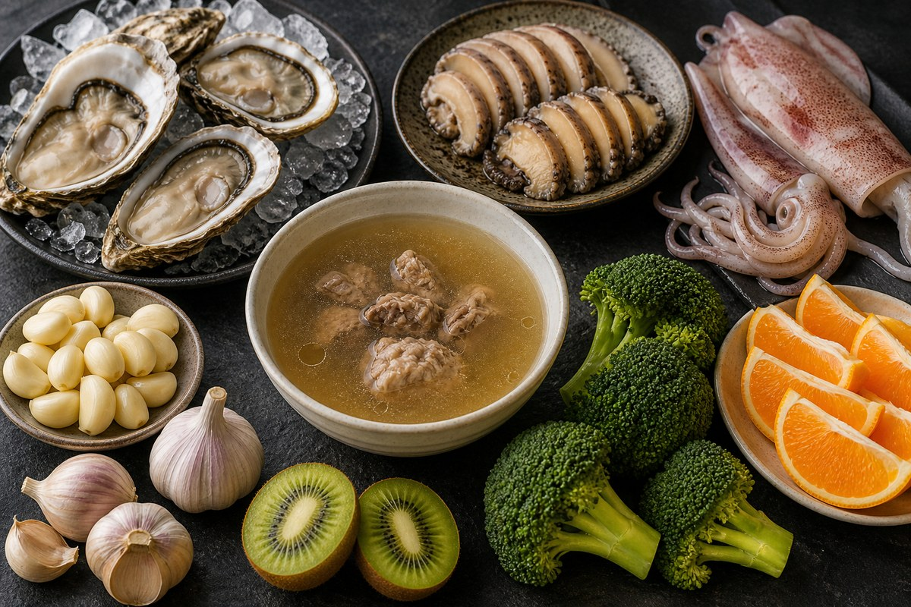

*▲ 피로 회복에 쓰이는 영양소는 세 갈래입니다. 아연·셀레늄(면역), 비타민C·엽산(세포 회복), 타우린·글리신(간 대사와 신경 안정)입니다.*

한 줄 결론 아연은 <strong>굴 100g에 16.6mg</strong>으로 압도적이고(성인 남성 권장량의 약 166%), 비타민C는 <strong>케일 93.4mg·키위 92.7mg·브로콜리 89.2mg</strong>이 앞섭니다. 간 대사와 피로 회복에는 <strong>오징어·전복의 타우린</strong>과 <strong>사골육수의 글리신</strong>이 쓰입니다.

피로는 한 가지 원인으로 오지 않습니다. 잠이 부족해서, 철분·비타민B12가 모자라서, 혹은 만성 염증과 감염이 이어져서 생깁니다. 그래서 "기력 회복에 좋은 음식" 목록은 대개 서로 다른 목적의 식품이 섞여 있습니다.

이 글은 목적을 세 갈래로 나눠 정리했습니다.

1. **면역(아연·셀레늄):** 굴·전복·소고기·마늘. 아연은 면역세포(T세포)의 성숙과 항체 생성에 관여합니다.
2. **세포 회복(비타민C·엽산·철분):** 케일·키위·브로콜리·오렌지. 비타민C는 콜라겐 합성과 항산화에, 엽산은 세포 분열에 필요합니다.
3. **간 대사·신경 안정(타우린·글리신):** 오징어·전복·사골육수. 타우린은 담즙산 합성과 삼투압 조절에, 글리신은 신경 억제성 아미노산으로 작용합니다.

수치는 USDA FoodData Central 기준 100g당이며, 조리법이 영양소 보존에 큰 영향을 줍니다.

---

## 1. 피로 회복·면역력 음식 순위는?

| 식재료 | 핵심 성분 (100g당) | 피로·면역 포인트 |
| :--- | :--- | :--- |
| **1위 굴** | 아연 16.6mg, B12 16µg, 타우린 520mg | 아연 권장량의 약 166%, 반드시 익혀 먹기 |
| **2위 전복** | 셀레늄 44.8µg, 단백질 17.1g, 타우린 | 셀레늄 일일 권장량 수준, 저지방 고단백 |
| **3위 소고기 등심** | 아연 3.55mg, 헴철 1.48mg, 단백질 20.3g | 철분 결핍성 피로에 직접 작용하는 헴철 |
| **4위 케일** | 비타민C 93.4mg, 비타민K 389.6µg, 철분 1.6mg | 비타민C 권장량의 93%, 항산화 색소 포함 |
| **5위 키위** | 비타민C 92.7mg, 식이섬유 3.0g | 비타민C 흡수가 빠른 생과, 액티니딘 소화 보조 |
| **6위 브로콜리** | 비타민C 89.2mg, 엽산 63µg, 설포라판 전구체 | 엽산은 세포 분열과 조혈에 필요 |
| **7위 오렌지** | 비타민C 53.2mg, 헤스페리딘 28.5mg | 감귤류 헤스페리딘은 모세혈관 보호 |
| **8위 마늘** | 알린 1,000~1,500mg, 셀레늄 14.2µg | 항균·항바이러스 작용, 익히면 알리신 생성 감소 |
| **9위 오징어** | 타우린 450mg, 단백질 15.6g, B12 1.3µg | 담즙 분비를 돕고 92kcal로 가볍습니다 |
| **10위 사골육수** | 글리신 0.45g, 콜라겐 펩타이드 2.0g | 17kcal로 수분·전해질 보충, 단백질량은 적음 |

## 2. 피로의 원인별로 어떤 영양소가 필요한가?

- **철분 결핍성 빈혈:** 피로·어지럼·손톱 변형이 나타납니다. 소고기 등심의 헴철(1.48mg)은 흡수율이 15~25%로, 식물성 비헴철(2~5%)보다 훨씬 높습니다. 비타민C를 함께 먹으면 흡수가 더 올라갑니다.
- **비타민B12 결핍:** 채식 위주 식단이나 위 절제 후에 생깁니다. 굴(16µg)·전복·오징어에 많습니다. B12는 신경 수초와 적혈구 생성에 관여합니다.
- **만성 염증·감염 후 회복:** 아연과 셀레늄이 필요합니다. 굴 100g이면 아연 16.6mg과 셀레늄 22µg을 함께 채웁니다.
- **수면 부족·스트레스:** 글리신(사골육수)이 체온을 낮추고 수면의 질을 높였다는 소규모 연구가 있으나, 근거 수준은 아직 제한적입니다.

## 3. 아연은 면역에 어떻게 작용하나?

- **T세포 성숙과 항체 생성에 필수입니다.** 아연이 부족하면 감염 빈도가 늘고 상처 회복이 늦어집니다. 임상에서는 아연 보충이 소아 설사와 폐렴 이환 기간을 줄였습니다.
- **하루 권장량은 성인 남성 10mg, 여성 8mg입니다.** 굴 100g(16.6mg) 한 번이면 하루치를 넘습니다. 상한 섭취량은 35mg이며, 장기간 초과하면 구리 결핍과 빈혈이 생길 수 있습니다.
- **보충제보다 음식이 안전합니다.** 아연 보충제는 고용량에서 메스꺼움과 미각 변화를 일으킵니다. 굴·소고기·마늘처럼 음식으로 채우면 다른 미네랄과 균형이 맞습니다.
- **식물성 식품의 아연은 흡수가 낮습니다.** 콩류·곡물의 피트산이 아연과 결합하기 때문입니다. 불리고 발효하면 피트산이 줄어 흡수율이 올라갑니다.

## 4. 사골육수는 정말 기력 회복에 좋은가?

- **영양 성분은 수분과 아미노산입니다.** 사골육수 100ml는 17kcal, 단백질 3.3g, 글리신 0.45g 수준입니다. 콜라겐 펩타이드가 포함되지만 단백질 총량은 적습니다.
- **근거는 제한적입니다.** "콜라겐이 관절을 재생한다"는 주장은 인체 연구에서 일관되지 않습니다. 다만 따뜻한 수분·전해질·글리신 보충이라는 점에서 식사 섭취가 적을 때 보조적 역할은 합니다.
- **나트륨을 확인하세요.** 시판 사골육수는 100ml당 나트륨이 300~600mg인 제품이 많습니다. 직접 끓이면 나트륨을 조절할 수 있습니다.
- **퓨린이 많습니다.** 통풍이 있거나 요산 수치가 높다면 사골·곰탕 국물 섭취를 줄이는 편이 좋습니다.

## 5. 영양소를 살리는 조리법은?

| 식재료 | 권장 조리법 | 주의 |
| :--- | :--- | :--- |
| 굴 | 85℃ 이상 가열(찜·국) | 생굴은 노로바이러스·비브리오 위험 |
| 채소(브로콜리·케일) | 데치기 1~3분 또는 찜 | 오래 삶으면 비타민C 손실 |
| 마늘 | 다져서 10분 뒤 사용 | 기름에 태우면 알리신 감소 |
| 키위·오렌지 | 생과로 | 주스는 섬유질 손실 |
| 소고기 | 중간 이하로 굽기 | 탄 부분은 피하기 |

## 6. 함께 읽으면 좋은 식재료 가이드

- **[굴](/posts/oyster-nutrition-benefits/)** — 68kcal, 아연 16.6mg과 타우린 520mg.
- **[전복](/posts/abalone-nutrition-benefits/)** — 105kcal, 셀레늄 44.8µg과 단백질 17.1g.
- **[소고기 등심](/posts/beef-sirloin-nutrition-benefits/)** — 아연 3.55mg과 헴철 1.48mg.
- **[케일](/posts/kale-nutrition-benefits/)** — 35kcal, 비타민C 93.4mg.
- **[키위](/posts/kiwi-nutrition-benefits/)** — 61kcal, 비타민C 92.7mg.
- **[브로콜리](/posts/broccoli-nutrition-benefits/)** — 34kcal, 비타민C 89.2mg과 엽산 63µg.
- **[오렌지](/posts/orange-nutrition-benefits/)** — 47kcal, 비타민C 53.2mg.
- **[마늘](/posts/garlic-nutrition-benefits/)** — 149kcal, 알린과 셀레늄.
- **[오징어](/posts/squid-nutrition-benefits/)** — 92kcal, 타우린 450mg.
- **[사골·도가니 육수](/posts/beef-bone-broth-nutrition-benefits/)** — 17kcal, 글리신 0.45g.

## 7. 자주 묻는 질문 (FAQ)

**Q1. 피로에 가장 좋은 음식 하나는 무엇인가요?**
원인에 따라 다릅니다. 면역과 아연이 목적이면 굴(아연 16.6mg), 빈혈성 피로면 소고기 등심(헴철 1.48mg), 항산화와 세포 회복이면 케일(비타민C 93.4mg)이 우선입니다.

**Q2. 아연은 얼마나 먹어야 하나요?**
성인 남성 하루 10mg, 여성 8mg이며 상한은 35mg입니다. 굴 100g 한 번으로 하루치를 넘기므로, 보충제를 함께 먹으면 과다 섭취가 되기 쉽습니다.

**Q3. 감기 기운이 있을 때 비타민C를 많이 먹으면 좋나요?**
일반 인구에서 감기 예방 효과는 크지 않다는 코크란 리뷰 결과가 있습니다. 다만 발병 후 섭취 기간이 짧아지는 경향은 일부 연구에서 보고됩니다. 하루 100mg 권장량을 채우는 수준이면 충분합니다.

