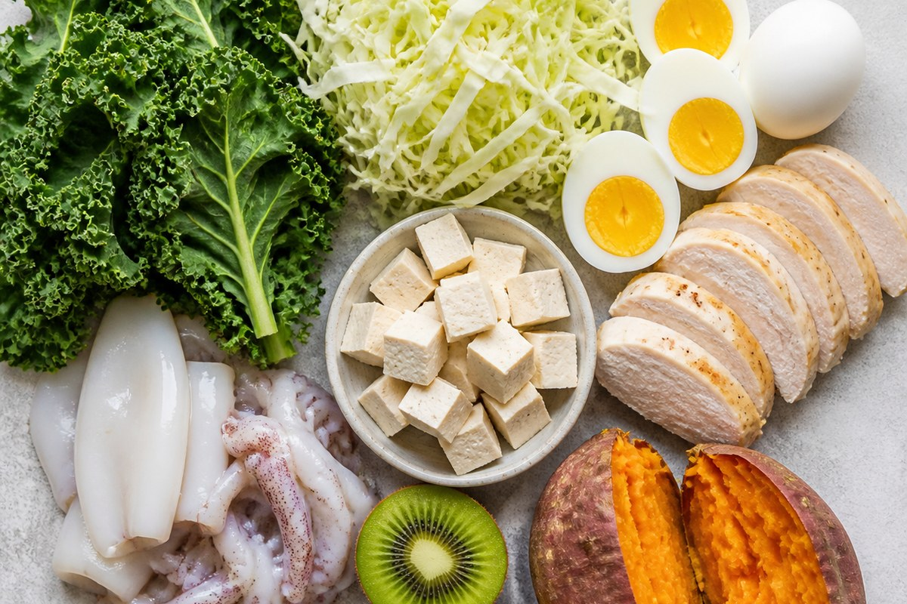

*▲ 포만감은 열량이 아니라 부피·수분·식이섬유·단백질에서 나옵니다. 100kcal에 가까운 양을 얼마나 많이 먹을 수 있는지가 다이어트의 실제 변수입니다.*

한 줄 결론 100g당 열량이 가장 낮은 것은 <strong>시금치 23kcal·양배추 25kcal</strong>이고, 같은 열량으로 가장 오래 배부른 것은 <strong>닭가슴살(110kcal에 단백질 23.1g)</strong>과 <strong>달걀</strong>입니다. 300kcal 한 끼는 닭가슴살 100g+양배추 200g+키위 1개로 채울 수 있습니다.

다이어트에서 실패하는 가장 흔한 이유는 배고픔입니다. 열량만 줄이면 2~3주 안에 식욕이 반등하고, 그 반등은 대개 야식과 단 음식으로 옵니다. 그래서 최근 영양 연구는 "얼마나 적게 먹는가"보다 "같은 열량으로 얼마나 오래 배부른가"를 봅니다.

포만감을 만드는 요소는 네 가지입니다. **부피와 수분**(위 벽을 늘리는 물리적 자극), **식이섬유**(위 배출 지연), **단백질**(포만 호르몬 반응), **천천히 소화되는 전분**(저항성 전분). 이 네 가지가 모두 높으면 열량이 낮아도 배고픔이 늦게 옵니다.

이 글은 블로그에서 다룬 식재료 중 열량이 낮은 10종을 100g당 칼로리 순으로 세우고, 각 식재료가 어떤 방식으로 포만감에 기여하는지 정리했습니다. 수치는 모두 USDA FoodData Central 기준 생것 또는 표기된 상태입니다.

---

## 1. 저칼로리 음식 순위는? (100g당 칼로리 TOP 10)

| 식재료 (100g당) | 칼로리 | 포만감을 만드는 성분 |
| :--- | :--- | :--- |
| **1위 시금치** | 23 kcal | 수분 약 91%, 식이섬유 2.2g, 엽산 |
| **2위 양배추** | 25 kcal | 수분 약 92%, 식이섬유 2.5g, 비타민U |
| **3위 브로콜리** | 34 kcal | 식이섬유 2.6g, 단백질 2.8g, 비타민C 89.2mg |
| **4위 케일** | 35 kcal | 식이섬유 4.1g(채소 중 최고 수준), 루테인 |
| **5위 키위** | 61 kcal | 식이섬유 3.0g, 수분 83%, 액티니딘 |
| **6위 두부** | 76 kcal | 단백질 8.1g, 칼슘 350mg, 이소플라본 |
| **7위 고구마** | 86 kcal | 식이섬유 3.0g, 저항성 전분, 베타카로틴 |
| **8위 오징어** | 92 kcal | 단백질 15.6g, 지방 1.4g, 타우린 |
| **9위 닭가슴살** | 110 kcal | 단백질 23.1g, 지방 1.5g 미만 |
| **10위 달걀** | 143 kcal | 단백질 12.6g, 지방 9.5g, 콜린 |

표의 열량은 100g 기준이며, 달걀은 전란(whole egg) 생것, 두부는 부침용, 고구마는 생것입니다. 조리 시 기름을 쓰면 열량이 크게 올라가므로 별도로 계산해야 합니다.

## 2. 포만감 지수(Satiety Index)가 말하는 것

호주 시드니대 연구팀이 흰 빵(100)을 기준으로 38종 식품의 포만감을 측정한 지수(Holt et al., 1995)에서, **삶은 감자는 323**, 생선 225, 오트밀 209, 사과 197, 소고기 176, 달걀 150, 렌틸콩 133으로 나타났습니다. 크루아상(47)과 케이크(65)는 같은 열량에서 가장 배고픈 식품이었습니다.

핵심은 세 가지입니다.

- **수분과 부피가 지배적입니다.** 삶은 감자가 1위인 이유는 100kcal당 무게가 크고 수분이 많기 때문입니다. 같은 원리로 양배추·시금치·수박은 열량 대비 부피가 큽니다.
- **단백질은 포만감을 오래 끌고 갑니다.** 닭가슴살·달걀·두부·오징어처럼 단백질 비중이 높은 식품은 식후 3~4시간 뒤의 허기를 줄입니다. 단백질은 식사 열량의 20~30%를 차지할 때 가장 효과적이라는 연구가 많습니다.
- **액체는 포만감이 약합니다.** 같은 열량의 주스와 생과일을 비교하면 생과일 쪽이 배부름이 오래갑니다. 씹는 과정과 섬유질 구조가 포만 신호를 만듭니다.

## 3. 다이어트에 유리한 조리법은?

- **굽지 말고 삶거나 찌세요.** 고구마는 굽면 GI가 80~90으로 오르고 수분이 빠져 100g당 열량도 높아집니다. 찌면 45~55를 유지하고 부피도 남습니다.
- **기름은 열량의 2배를 더합니다.** 조리유 1큰술(15g)은 약 120kcal로, 닭가슴살 100g(110kcal)보다 많습니다. 볶음 대신 데치기·찜·에어프라이어를 쓰고, 기름은 마지막에 소량만 두릅니다.
- **양배추·케일은 씹는 시간을 늘립니다.** 채 썰어 부피를 키우면 같은 양도 천천히 먹게 되고, 식사 시간이 20분을 넘기면 포만 신호가 도달합니다.
- **단백질은 한 끼 20~30g을 지키세요.** 채소만 먹는 식단은 2주는 버티지만 근손실과 식욕 반등이 옵니다. 닭가슴살·달걀·두부 중 하나는 매 끼니에 두는 것이 안전합니다.

## 4. 한 끼 300kcal은 이렇게 채웁니다

| 구성 | 열량 | 단백질 |
| :--- | :--- | :--- |
| 닭가슴살 100g + 양배추 200g + 키위 1개 | 110 + 50 + 48 = 208 kcal | 24 g |
| 두부 150g + 시금치 100g + 달걀 1개 | 114 + 23 + 72 = 209 kcal | 19 g |
| 오징어 100g + 브로콜리 150g + 고구마 100g | 92 + 51 + 86 = 229 kcal | 20 g |
| 케일 100g + 달걀 2개 + 양배추 150g | 35 + 143 + 38 = 216 kcal | 27 g |

위 조합은 밥 없이 반찬만으로 구성한 예시입니다. 실제 식단에서는 밥 반 공기(약 150kcal)를 더하면 한 끼 350~380kcal가 됩니다.

## 5. 저칼로리 식단의 함정은?

- **단백질 부족이 가장 큰 위험입니다.** 하루 1,200kcal 이하로 내려가면서 단백질이 50g 미만이면 근육 손실과 탈모·생리 불순이 나타날 수 있습니다. 체중 1kg당 1.0~1.2g을 최소선으로 잡으세요.
- **생채소 과다 섭취는 위장 장애를 부릅니다.** 브로콜리·양배추 같은 십자화과 채소를 하루 500g 이상 생으로 먹으면 복부 팽만과 가스가 심해집니다. 데치거나 쪄서 양을 조절하세요.
- **국물·소스의 나트륨을 보세요.** 저칼로리 샐러드도 드레싱 한 번에 200kcal가 붙습니다. 간장·식초·겨자 기반으로 바꾸면 열량의 3분의 1로 줄어듭니다.
- **단백질·지방을 0으로 만들지 마세요.** 지방은 호르몬과 지용성 비타민 흡수에 필요합니다. 하루 총열량의 20% 정도는 지방으로 남기는 것이 좋습니다.

## 6. 함께 읽으면 좋은 식재료 가이드

- **[시금치](/posts/spinach-nutrition-benefits/)** — 100g당 23kcal, 수분 91%로 부피 대비 열량이 가장 낮습니다.
- **[양배추](/posts/cabbage-nutrition-benefits/)** — 25kcal, 비타민U로 위 점막을 보호합니다.
- **[브로콜리](/posts/broccoli-nutrition-benefits/)** — 34kcal에 비타민C 89.2mg.
- **[케일](/posts/kale-nutrition-benefits/)** — 35kcal, 식이섬유 4.1g으로 채소 중 최고 수준입니다.
- **[키위](/posts/kiwi-nutrition-benefits/)** — 61kcal, 식이섬유 3.0g과 비타민C 92.7mg.
- **[두부](/posts/tofu-nutrition-benefits/)** — 76kcal에 단백질 8.1g, 칼슘 350mg.
- **[고구마](/posts/sweet-potato-nutrition-benefits/)** — 86kcal, 저항성 전분과 베타카로틴.
- **[오징어](/posts/squid-nutrition-benefits/)** — 92kcal에 단백질 15.6g, 지방 1.4g.
- **[닭가슴살](/posts/chicken-breast-nutrition-benefits/)** — 110kcal에 단백질 23.1g, 지방 1.5g 미만.
- **[달걀](/posts/egg-nutrition-benefits/)** — 143kcal에 단백질 12.6g, 포만감 지수 150.
- **[아스파라거스 (Asparagus)](/posts/asparagus-nutrition-benefits/):** 100g 20kcal·수분 93%로 이 순위표 최저 열량군에 속합니다.

## 7. 자주 묻는 질문 (FAQ)

**Q1. 칼로리가 가장 낮은 음식은 무엇인가요?**
시금치(23kcal)와 양배추(25kcal)가 가장 낮습니다. 다만 이것만 먹으면 단백질이 부족하므로, 닭가슴살·두부·달걀처럼 열량 대비 단백질이 높은 식품을 반드시 함께 드세요.

**Q2. 배고픔을 줄이려면 무엇을 먼저 먹어야 하나요?**
식사 시작에 채소(양배추·시금치·브로콜리)를 100~150g 먼저 먹고, 이어 단백질을 먹은 뒤 탄수화물을 먹으세요. 같은 열량이라도 포만감이 오래갑니다.

**Q3. 저녁에 고구마를 먹어도 되나요?**
됩니다. 고구마는 100g에 86kcal로 밥(100g 130kcal)보다 낮고 식이섬유가 많습니다. 다만 밤에 굽는 조리(군고구마)는 GI와 열량이 모두 올라가므로 찐 것을 100~150g 정도로 드세요.

